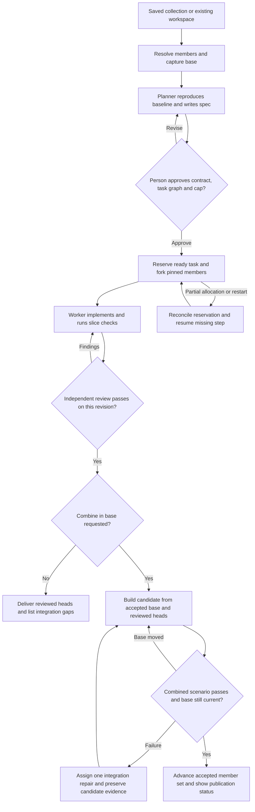

# Collection-centred Missions

**Status** Proposed for a single Runner. **Decision requested** Adopt reusable collection definitions and a revision-pinned Mission workflow. Pilot with human acceptance and opt-in integration into a Mission base. Existing manual Missions remain supported.

## Implementation status

The first increment provides file-backed collection definitions through `workspace export-definition` and `workspace realize`. A plan can request `workspace: pinned` and name an exact structured spec artifact revision. The approval sheet displays the captured member commits and acceptance criteria. Child execution starts on those commits and receives the approved criteria. The grant and parent permission ceilings still apply. [Collection commands](COLLECTIONS.md#reusing-a-collection-definition) · [Mission planning](docs/guides/missions.md#starting-workers-from-a-fixed-base)

Phase two reserves pinned workers before allocation, replays unfinished dispatch after session adoption, and binds a changes review to the approved contract digest and captured member heads. Human acceptance remains the final task gate. The definition library UI, Git ref retention for long-lived baselines, individual criterion verdicts and candidate promotion remain pending. Workspace startup and productivity measurements require the pilot.

## Product contract

A Collection answers “which repositories do I usually work on together?” A Workspace answers “which checkouts can I run and change right now?” A Mission answers “what outcome did we agree to, and which combination of changes demonstrates it?” The same collection can support concurrent missions. Editing a saved definition affects future starts. A running mission retains its member identities and revisions.

From a collection, choose **Start mission**, enter a goal, and open a planning conversation in the base. From an existing workspace, choose **Plan a mission here** and optionally save its membership as a collection. Show uncommitted changes before taking the baseline. Let the person commit relevant changes or explicitly start from committed HEAD. A worker cannot reproduce a dirty parent from a Git ref.

## Audit of main

Source reviewed at [0b67b709](https://github.com/AntoineToussaint/lazybox/tree/0b67b709ae743abf5b05c63f13e838aa87974882). This is a static audit. Each finding below identifies the implementation seam.

| Path on main | Finding | Design consequence |
|---|---|---|
| [Collection model](https://github.com/AntoineToussaint/lazybox/blob/0b67b709/COLLECTIONS.md) | The stored Collection is the UI Workspace. Two members may use the same registered repository. | Add a separate saved definition and persistent member keys. Preserve legacy RPC names and workspace IDs. |
| [Orchestrator planning](https://github.com/AntoineToussaint/lazybox/blob/0b67b709/services/runner/code/internal/runner/orchestrator_plan.go) | Proposal and human decision already materialize tasks with dependencies, paths, estimates and a cap. | Extend this approval with a contract revision and a baseline. Keep this plan authoritative for scheduling. |
| [Child allocation and dispatch](https://github.com/AntoineToussaint/lazybox/blob/0b67b709/services/runner/code/internal/runner/orchestrator.go) | childWorkspace iterates ready members, skips unready ones, and normally uses their branch names. Spawn opens the conversation before recording the attempt. Brief delivery can fail after the attempt exists. A child inherits the parent's plan workflow. | Validate required membership, pin commits, reconcile intermediate allocations, and select implementation mode explicitly for approved workers within the grant ceiling. |
| [Artifact store](https://github.com/AntoineToussaint/lazybox/blob/0b67b709/services/runner/code/internal/runner/artifacts/store.go) and [validator](https://github.com/AntoineToussaint/lazybox/blob/0b67b709/services/runner/code/internal/runner/artifacts/structured.go) | Versions carry a digest. Writes support an expected version. Structured specs have text criteria, permit empty arrays and reject unknown fields. | Reference an immutable version in the base workspace. Introduce stable criterion IDs through an additive schema version when needed. Never silently change spec.v1. |
| [Work events](https://github.com/AntoineToussaint/lazybox/blob/0b67b709/services/runner/code/internal/work/event.go) and [review tests](https://github.com/AntoineToussaint/lazybox/blob/0b67b709/services/runner/code/internal/work/review_test.go) | A Mission folds an ordered event log. Run evidence can carry repository HEADs at finish. Open review blockers already affect verification. | Extend the fold and the existing evidence model. An integration gate also needs contract identity and assurance the candidate stayed fixed during the run. |
| [Process resolution](https://github.com/AntoineToussaint/lazybox/blob/0b67b709/services/runner/code/internal/runner/orchestration.go), [Mission guide](https://github.com/AntoineToussaint/lazybox/blob/0b67b709/docs/guides/missions.md) | The Runner resolves candidate process files and handles ambiguity across repos. The guide documents solo-pair execution and limits on automatic review. | Pin the selected policy when approving. Implement only the pilot gates before promising general execution of process YAML. |

## Workflow and failure ownership

The planner should define an observable user outcome, a baseline reproduction, dependencies, writable members or paths, worker checks, and at least one combined scenario whenever integration is requested. Let one worker own coupled changes. Parallelize when each child has an independent check. A person can accept a deliverable with disclosed integration gaps. The board must reserve “integration verified” for the tested combination.

## Records and service operations

| Proposed record | Identity and contents | Owner |
|---|---|---|
| Collection definition | Stable ID, revision, display name and ordered member keys with repository identity, alias and default ref. | Runner collection manager |
| Baseline | Mission, generation, base workspace, definition revision if any, required member keys and resolved commit per member. Retain Git refs for the mission lifetime. | Runner and Mission log |
| Contract reference | Base workspace ID, artifact ID, version, digest. In the pilot a criterion is the pinned spec plus array index. Reordering or editing creates a new contract requiring explicit reapproval. | Artifact store owns bytes. Mission records approval. |
| Task attempt | Existing task and attempt IDs plus approved contract, criterion references, baseline generation, declared scope, operation ID, child workspace and brief delivery state. | Mission log |
| Review and integration | Reviewer identity, criterion, verdict, findings, candidate member heads, observed run IDs, contract reference and remaining gaps. | Mission evidence fold |

**Start** resolves every required member before declaring the base ready. If one fails, show the member and permit retry. **Approve** compares the displayed plan and contract revision with the proposal being decided. **Dispatch** requires approved dependencies, valid grant, capacity and budget. Persist the allocation intent before creating worktrees. Reuse its operation ID across allocation, conversation creation and brief delivery. Reconcile by recorded intent after restart. Stop dispatch on cancellation or exhausted budget. Preserve worktrees containing user work.

**Review** launches a fresh read-only conversation against the candidate and pinned criteria. Let it request approved test execution. The builder may provide a report.v1 describing changed behaviour, evidence and gaps. Reviewer observations and Runner evidence have separate provenance. A task-scoped reader may fetch the referenced base artifact version without gaining access to unrelated artifacts in that workspace. A new candidate head invalidates prior review for the changed input. Contract edits in the pilot require renewed review of all affected tasks; a later schema can track unchanged criteria individually.

**Integrate** serializes promotion per Mission. Prepare merges in disposable candidate worktrees, materialize the complete member set, run the combined scenario, and record the tested revisions. Reject a dirty or moving candidate. Advance the accepted manifest with a compare-and-swap on baseline generation. A conflict becomes a repair task. Its resolution creates a new candidate requiring review and checks. Upstream PR publication is separately authorized and tracked per repository. On partial publication, surface landed and pending revisions and resume forward from observed remote state. Keep an accepted manifest recoverable even when a remote merge fails.

## Example acceptance contract

For a change to Mission evidence across Runner and desktop, the planner records “after disconnect and reconnect, the panel displays the completed command exactly once with its original status.” Fix the shared response fixture first. One worker checks Runner replay, the other checks UI rendering. The integrator runs a command, disconnects before completion, reconnects to the real Runner and inspects the panel. A duplicate row fails the Mission scenario even if both child suites pass. Preserve the run and candidate set for the repair owner.

## Fast workspaces

Use the existing local repository and worktree machinery. Resolve common refs once per approved baseline. Materialize independent members with bounded concurrency. Start with all declared required members and measure before introducing partial realization. Record queue time, ref resolution, checkout, dependency preparation and first runnable check separately. Cache dependencies only through existing repository tooling and compatible lockfiles. Surface progress and per-member retries. Warm checkout latency alone cannot predict when a worker becomes productive.

## Extension options

| Delivery mechanism | Suitable responsibility | Constraint |
|---|---|---|
| Built-in Runner operations | Durable intents, grants, evidence provenance, cross-workspace access and baseline promotion | All callers need identical enforcement and replay behaviour. |
| Optional process preset | Role selection, concurrency, review strategy, approval and integration choices | Requires an executor for each advertised gate. Start with one supported Mission policy. |
| Sandboxed panel extension | Alternate planning or review UI | Add narrowly scoped bridge grants only as needed. A closed panel must never stop execution. [Extension model](https://github.com/AntoineToussaint/lazybox/blob/0b67b709/EXTENSIONS.md) |
| Compiled Go service plugin | Packaging additional RPC services and migrations | Existing interface and generated registry describe build-time integration. Defer a third-party scheduler interface until a second policy demonstrates the boundary. [Plugin interface](https://github.com/AntoineToussaint/lazybox/blob/0b67b709/services/runner/code/pkg/framework/plugin.go) |

## Research and limits of transfer

- Anthropic's long-running harness used an initializer, explicit feature requirements, incremental work and startup checks to overcome premature completion. Persist the contract and a reproducible next action for every resumable task. Their application-building experiment does not establish a universal optimal task size. [Long-running harnesses](https://www.anthropic.com/research/effective-harnesses-for-long-running-agents)
- Anthropic's generator/evaluator experiments motivate a fresh reviewer with an explicit rubric. Use executable checks for objective outcomes, and record human judgement for subjective decisions. [Evaluator experiments](https://www.anthropic.com/research/harness-design-long-running-apps)
- Symphony specifies bounded dispatch, isolated workspaces and reconciliation before dispatch. Adopt those scheduling properties while using Lazybox's existing durable Mission log and grants. Symphony is a design precedent rather than a performance comparison. [Symphony specification](https://github.com/openai/symphony/blob/main/SPEC.md)
- OpenAI's engineering account emphasizes making the running application and its diagnostics legible to agents. The child brief should include the actual startup action and where its evidence appears. SWE-agent supplies experimental evidence that the tool interface affects repository task performance. [Harness engineering](https://openai.com/index/harness-engineering/) · [SWE-agent](https://papers.nips.cc/paper/2024/hash/5a7c947568c1b1328ccc5230172e1e7c-Abstract-Conference.html)
- METR's early-2025 randomized trial measured a slowdown for experienced maintainers on their own tasks. Measure human review and repair time, and include changes too small to justify dispatch overhead. [METR study](https://arxiv.org/abs/2507.09089)

## Rollout and release checks

1. Ship saved definitions, explicit baseline capture and pinned artifact handoff behind an opt-in entry point. Existing workspaces can become definitions on demand. Old events replay with their historical trust semantics.
2. Reuse the approved-plan path for two child tasks. Add durable reservation, brief reconciliation and revision-bound review. Keep acceptance human-controlled.
3. Add opt-in candidate integration and combined checks. Keep remote publication explicit. Disabling the workflow stops new dispatch and preserves evidence and existing workspaces.

- [ ] Start two missions from one definition. Change its default ref between starts and confirm the first mission reproduces its original base.
- [ ] Exercise duplicate repository members, dirty bases, unavailable refs and partial realization. Each required member must be identifiable after retry.
- [ ] Interrupt after reservation, worktree creation, conversation creation and brief delivery. Replay the same operation concurrently. Observe one live attempt, one delivered brief and one budget reservation.
- [ ] Revise the spec or worker head after approval. The board must explain the stale verdict and identify the missing review.
- [ ] Inject a cross-component failure invisible to child suites. Verify the accepted generation stays fixed. Race two promotions and allow only the tested current generation to advance.
- [ ] Replay old Mission fixtures; verify grants, budget refusal, cancellation, and denied cross-workspace artifact reads.
- [ ] Compare against solo-pair on matched historical changes from pre-fix commits, same model, checks and budget. Record correctness, false acceptance, human minutes, cost per accepted outcome, elapsed time and cold/warm startup distributions. Investigate every false acceptance before widening rollout.

**Assumptions and open decisions.** Pilot on one Runner with locally registered Git repositories. One human approves the plan. Artifact access delegation, reservation recovery, candidate promotion and latency improvements are proposed work. The audit did not run end-to-end Missions, benchmark startup or exercise provider-specific plan-to-build transitions. Set a latency target from measured baselines and the interactive wait users tolerate. Pilot feedback should decide whether collection definitions eventually need team sharing and whether selective criterion reapproval warrants spec.v2.
