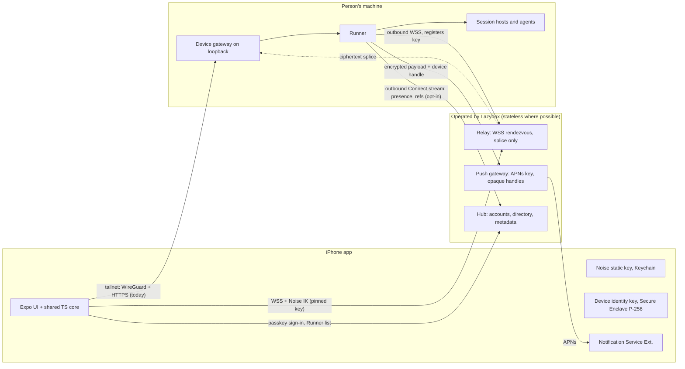
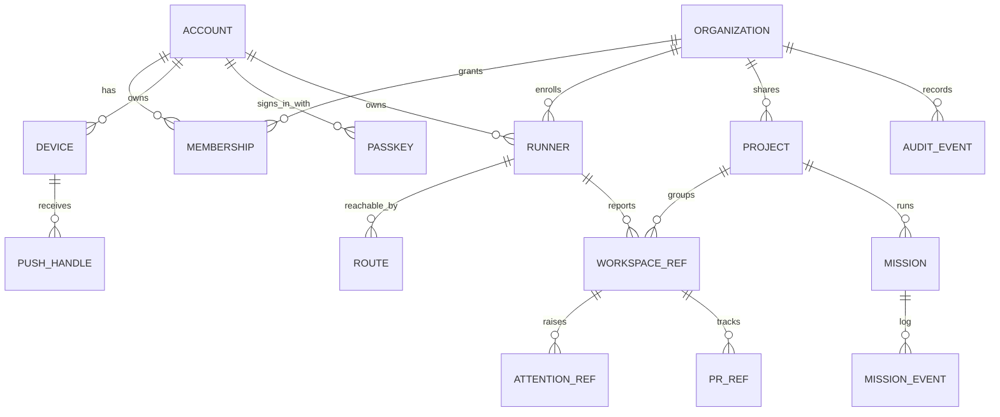

# Mobile client, cloud backend and the Hub

**Status: proposal, 2026-11-17.** Nothing here is built or decided. It
records where V2 stands on the phone, remote reach and a shared platform; what
comparable products do now; and a recommended direction with the decisions only
the user can make. It amends nothing by itself: [D16](DECISIONS.md#remote-control--2026-11-16)
(tailnet transport) and C17 (the shared Hub lives outside this repository)
remain in force until the user decides otherwise ([§6](#6-decisions-for-the-user)).

Read with [Remote](REMOTE.md) (the phone today), [Device experience](DEVICE_EXPERIENCE.md)
(the intended phone/iPad/desktop flows and Hub contract), [Several Runners](MULTI_RUNNER.md),
[Agents outlive the Runner](SESSION_HOSTS.md) and [Architecture](ARCHITECTURE.md).

## Short answers

| Question | Answer |
| --- | --- |
| Do we have the Hub here? | **No.** There is an empty `internal/hub` package, a contract stated as required semantics, and decision C17, which places it outside this repository. V1 has a client of a hosted platform (account claim, relay entitlement) and a working end-to-end-encrypted relay; the platform itself is not here. [§1.1](#11-do-we-have-the-hub-in-this-repository) |
| Native iPhone app or the PWA? | **A native Expo app, keeping the PWA.** iOS gives a web app no notification actions, no Live Activities, no Siri or Shortcuts, and no way to run an end-to-end-encrypted relay safely. Expo keeps the shared TypeScript core; Live Activities and widgets are now first-class in Expo. [§2](#2-iphone-client) |
| How does a phone reach a Runner without Tailscale? | **Through an end-to-end-encrypted relay that the Runner dials out to.** It is V1's design (Noise IK, key pinned by the QR code), carrying the same Connect RPCs to the same device gateway. A small push gateway holds the APNs key. Tailscale stays the zero-infrastructure default. [§3](#3-cloud-backend) |
| What is the Hub for, first? | **Identity and connectivity.** Accounts with passkeys, a directory of Runners, device introductions, push routing, and an inbox across Runners whose titles it cannot read. Shared work for teams comes later. The Runner stays the authority for execution and for admitting devices. [§4](#4-the-hub) |
| What can start today without you? | M0 (the phone's missing screens on the tailnet) and M1 (key abstraction, relay protocol and Go client against local fakes, a Linux Runner build). Everything after that needs an Apple account, hosting, a domain or a decision on C17. [§5](#5-phased-plan) |

## 1. Where we are

### 1.1 Do we have the Hub in this repository?

**No.** There is no Hub service, Hub protocol or Hub data store in this
repository, in V1 or V2. What exists:

| Kind | What | Where |
| --- | --- | --- |
| Code (V2) | An empty Go package whose comment describes the Hub's future responsibilities; "No handlers are implemented yet." | [`internal/hub/doc.go`](services/runner/code/internal/hub/doc.go) |
| Code (V2) | Runner-local stand-ins that are deliberately *not* a Hub: missions and their event log ("the event envelope is what Lazybox offers the Hub, not a second Hub"), tracked pull requests, pins, device pairing. | [`internal/work`](services/runner/code/internal/work/doc.go), [ORCHESTRATION.md](ORCHESTRATION.md), [GITHUB.md](GITHUB.md), [REMOTE.md](REMOTE.md) |
| Protocol | None for the Hub. `api.proto` is the Runner's service only (`lazybox.bench.v1.RunnerService`, ~190 RPCs). [INTERFACES.md](INTERFACES.md) proposes a Runner-initiated gRPC bidirectional stream to a Hub; it is not defined. | [`api.proto`](services/runner/proto/api.proto) |
| Docs | The Hub's role (shared work, identity, assignments, attention, artifacts), its ownership table, and a "minimum Hub–Runner–client contract" stated as required semantics, explicitly "not invented endpoint names". | [ARCHITECTURE.md](ARCHITECTURE.md), [DEVICE_EXPERIENCE.md](DEVICE_EXPERIENCE.md) ("Minimum Hub–Runner–client contract"), [IMPLEMENTATION_ROADMAP.md](IMPLEMENTATION_ROADMAP.md) |
| Decision | C17 (2026-11-03): build the shared Hub in an external platform, not here; local experiments must not become a competing Hub. P04–P09 of the implementation roadmap depend on that external Hub and are all *Planned*. | [DECISIONS.md](DECISIONS.md#current-scope-corrections--2026-11-03) |
| V1 | **Clients of a hosted platform**, not the platform: `lazybox account claim <code>` links a box to an organization on `platform.lazybox.ai` (organization, device id, plan, entitlement); the relay's entitlement gate asks the platform `POST /v1/relay/entitlements/check`. The claim parser accepts several response shapes, i.e. the platform's API was never pinned here. The platform's own source is not in this repository. | `crates/tui-boot/src/account_cli.rs`, `crates/entitlement`, `docs/byo-remote-runbook.md` |
| V1 | **A working end-to-end-encrypted relay**: a rendezvous broker the box dials out to (no inbound port), Ed25519 registration challenge, client brokered by box id, then a raw byte splice; Noise `IK_25519_ChaChaPoly_BLAKE2s` inside, the client pinning the box's key from the pairing QR. Tests, a scratch Docker image and a Fly/GCE runbook exist. | `crates/relay`, `crates/e2e-channel`, `crates/identity`, `docs/hosted-relay-runbook.md` |

So the honest summary: **the Hub is a plan with a well-argued contract and no
implementation anywhere we control**, while the two pieces of infrastructure a
mobile product needs first, a blind relay and a device identity, exist in V1
(relay) and V2 (device identity) and are reusable.

### 1.2 What the phone can do today

The phone is a web app the Runner serves through its loopback **device
gateway**, published on the owner's tailnet by `tailscale serve` (never Funnel).
It installs to the Home Screen. Details in [REMOTE.md](REMOTE.md).

| Area | Today |
| --- | --- |
| Reach | Phone and Mac on the same tailnet; `https://<machine>.<tailnet>.ts.net:8443`. The Mac must be awake: the Runner is on the laptop. |
| Pairing | One-time, five-minute QR offer (256-bit secret in the URL fragment); a non-extractable WebCrypto ECDSA P-256 key on the phone; 15-minute credentials from signed single-use challenges; grants `read` / `respond` / `start`; revoke ends access and open streams at the next request. |
| Authority | A pinned allowlist of device RPCs (tests enumerate the generated service). A phone can never merge, change permissions, touch settings, terminals, files or processes. Agents and phones cannot use each other's credentials. |
| Inbox | Every conversation across workspaces grouped by what it needs (needs input, failed, ready for review, working, done); pins shared with the computer. Rows act: Allow/Deny an approval (flagged commands confirm in a sheet), answer a question by chips, 4.5 s Undo, swipes, ⋯ sheet, pull to refresh, offline bar. |
| Conversation | Transcript (tail first via `ReadSessionTail`, live via `WatchEvents` from its cursor), pending request with answer UI, composer, interrupt, the conversation's commands with live read-only output. |
| Notifications | Web Push (RFC 8291 encrypted payload holding title, kind and link only; VAPID key per Runner); kinds, quiet hours, test push; tap opens the conversation. Needs iOS 16.4+ and the Home Screen app. No action buttons. |
| Voice | The web client's dictation where the browser has a recognizer; otherwise the keyboard's dictation. |
| Not built | Diff review screens (the RPCs are allowed), starting a conversation (the grant exists, the screen does not), files, PR merge, Live Activities, widgets, Shortcuts/Siri, Watch, anything off-tailnet. None of the remote push path is verified on a real iPhone yet. |

### 1.3 Remote model and several Runners

- **Runner is the authority over its machine.** All listeners bind loopback;
  the gateway refuses the owner's bearer; Tailscale is transport, not authority.
- **Agents outlive the Runner** ([SESSION_HOSTS.md](SESSION_HOSTS.md)): session
  hosts keep agents and commands alive across Runner restarts and upgrades.
  They do not survive the machine sleeping or rebooting, which is why "laptop
  closed" needs a Runner elsewhere.
- **Several Runners** ([MULTI_RUNNER.md](MULTI_RUNNER.md)): step 1 (CLI lists
  all Runners) and step 2 (one desktop window merges local Runners with
  `RunnerDirectory`/`RunnerScope`, a merged inbox and per-Runner pages) are
  shipped. Step 3, Runners on other machines through their device gateway, is
  designed and not built.
- **Always-on Runner:** none yet. The Runner does not compile for Linux
  ([IMPLEMENTATION_ROADMAP.md](IMPLEMENTATION_ROADMAP.md), P02), so there is
  no headless Runner to host on a server or VM.
- **Shared TypeScript core:** `packages/client-core` (`RunnerLink`, `device.ts`)
  has no DOM/React dependency, but `device.ts` depends on WebCrypto
  non-extractable keys and the transport is `@connectrpc/connect-web` over
  `fetch`. `apps/iphone` is a placeholder (`package.json` plus a README; no
  Expo installed). C11 selected Expo/React Native for iPhone; no experiment has
  validated it.

### 1.4 Gaps against the state of the art

Sources are listed at the end. The survey was made on 2026-11-17, and several
of these products change monthly.

| Capability | Lazybox now | Best in class (who) | Gap |
| --- | --- | --- | --- |
| Approve or deny a tool call | Yes: on the Inbox row or in the conversation; flagged commands confirm; Undo. | Claude Remote Control: requests stay open until answered, with a dedicated push setting for "actions required"; Codex is close. | Parity, but only on the tailnet. |
| Approve from the notification or Lock Screen | No. iOS Web Push supports no notification actions. | No major vendor documents it; small companion apps approve from a Live Activity. | Needs native. Also an opening: nobody major does it well. |
| Answer an agent's question | Yes: chips, several choices, typed answer. | Claude (AskUserQuestion stays open until answered). | Parity. |
| Live conversation | Yes: tail first, then live from the cursor; command output follows. | Claude (subagents included); Codex streams screenshots, terminal output and diffs. | Parity on the tailnet; screenshots and artifacts are not shown on the phone. |
| Start new work from the phone | The grant exists; the screen does not. | Claude, Cursor, Codex cloud. | Screen missing. |
| Review a diff | RPCs allowed; screens not built. | Cursor: full diffs and checks. | Screens missing. |
| PR status and merge | Desktop only. The phone can send CI failures or a review to the agent; merging is refused by design. | Cursor (squash, auto-merge, update branch, reviewers); GitHub Mobile. | PR list missing; merge needs a grant decision. |
| Push | Web Push with encrypted, minimal payloads, kinds and quiet hours. **Unverified on a real iPhone.** A tap opens a `*.ts.net` page, which fails if the VPN is off. | Claude: two push settings, and no push while the person is at the terminal. | Verify on a device; presence suppression; reachability on tap. |
| Live Activities and Dynamic Island | No. | Cursor (up to 8 agents); GitHub Mobile (several vendors' cloud agents). | Needs native. |
| Siri, Shortcuts, widgets, Watch | No. | Cursor: Siri starts voice. Nobody major ships widgets or a Watch app. | Needs native; an opening. |
| Voice | Browser dictation where available (not iOS Safari without Siri). | Cursor: dictation, realtime voice, Siri. | Native on-device SpeechAnalyzer (iOS 26). |
| Reach without a VPN | No. | Claude Remote Control and Codex: outbound host to a vendor relay. | Relay. |
| Relay privacy | Not applicable (WireGuard end to end). | Happy: an E2E-encrypted relay. Claude and Codex relays see plaintext; Claude stores transcripts. | Keep end-to-end encryption when adding the relay. It is a differentiator. |
| Work continues with the laptop closed | No: the Runner runs on the laptop, and there is no Linux build. | Cloud agents: Claude on the web, Codex cloud, Cursor, Devin, Copilot. | Linux Runner, then BYO cloud. |
| Self-hosted execution, hosted control | Not applicable. | Claude self-hosted environments; Cursor self-hosted machines; GitHub Actions runners (outbound long-poll). | Enrollment and directory (Hub MVP). |
| Several machines in one client | Desktop merges local Runners; remote Runners designed (step 3). | Claude Remote Control server mode (worktree per session); Codex (several hosts per phone). | Step 3; several Runners on the phone. |
| Team sharing, audit, admin | None. | Claude (session sharing as snapshots, org settings, trusted devices); Cursor Teams; Devin. | Hub. |
| Device security | Non-extractable key, 15-minute credentials, grants, revoke, pinned allowlist. | Claude Trusted Devices: biometric step-up after 18 hours, revocable per device. | Already strong; add biometric step-up in the native app. |

## 2. iPhone client

### 2.1 Recommendation: an Expo app, with the PWA kept

| Option | For | Against |
| --- | --- | --- |
| **PWA only** (today) | Built, tested and served by the Runner; no App Store; Android works too. | On iOS: no notification actions (MDN's compatibility data lists `actions` as unsupported), so no approving from a notification; no Live Activities, Siri, App Intents or widgets; no background refresh; push only from the Home Screen app; Declarative Web Push always shows a visible notification. And it cannot be the client of an E2E relay (§3.2). |
| **SwiftUI** | The best ActivityKit, App Intents and Watch integration, with the least glue. | Nothing shared with the web client. The complex client logic is in TypeScript and would diverge: transcript folding, attention rules (`attention.ts`), the row plan (`remote/row-plan.ts`), request and risk models, reconnect and cursors. Two implementations of "what needs the person" would drift apart. |
| **Expo / React Native** (C11) | Shares `protocol`, `client-core` and the attention and request models. `expo-widgets` has been stable since SDK 56, including Live Activities written in TSX that compile to SwiftUI. Expo DOM components (`'use dom'`) can host the existing React DOM transcript, diff and console while native screens take over. SDK 58 (2026-10-15, React Native 0.88) supports only the New Architecture. | Still needs native targets, through config plugins or local modules: the Notification Service Extension, App Intents (SDK 58 adds only App Intents identification), the Secure Enclave key, SpeechAnalyzer, and later the Watch. Connect server streaming on React Native is a known weak spot (spike S1). DOM components are webviews (spike S4). |
| A WKWebView wrapper around the PWA | Least work. | App Review 4.2 ("a repackaged website") risk; no gain over Expo, which can wrap the same DOM components better. |

**Recommendation: build the iPhone app with Expo (keeping C11). Keep the PWA
as the zero-install path and the Android answer. Write the small native parts
in Swift as Expo modules or targets.** The deciding reason is that "what needs
the person, and what can they safely do about it" is shared logic. It must
behave the same on the desktop, the PWA and the phone. Revisit SwiftUI only if
spikes S1 or S4 fail. In that case, keep TypeScript for the models (in
JavaScriptCore) and SwiftUI for the views, rather than porting the models.

### 2.2 MVP scope

| Feature | How | Reuses |
| --- | --- | --- |
| **Inbox** | Native list grouped as today (needs input, failed, review, working, done) across Runners, with swipes, ⋯ and pull to refresh. Badge = durable unresolved count sent by the Runner, never "+1 per push". | `attention.ts`, `row-plan.ts`, `request-model`, pins (moved into `client-core`, which has no DOM). |
| **Approve and answer** | In the app, as on the PWA. From a notification: an `APPROVAL` category with **Allow** and **Deny** actions (`.authenticationRequired`); `QUESTION` with up to three short options; and **Reply** with text input. A flagged or "default to no" request gets **Open** only, matching the existing confirmation rule. | `Apply` with answer/approval; the device allowlist, unchanged. |
| **Live conversation** | Tail first, then live from the cursor. Start with the existing transcript as a DOM component (S4), and move to a native list if measurements demand it. Images and artifacts open in a viewer. | `ReadSessionTail`, `WatchEvents`, `useTranscript` fold logic. |
| **Send now** | The composer queues while a turn runs, and **Send now** steers (stops the current step and sends), as on the desktop. | `Apply` steer/message. |
| **Voice** | Hold to talk in the composer using on-device SpeechAnalyzer (iOS 26), falling back to keyboard dictation. "Reply by voice" from a notification opens the composer listening. Reading replies aloud is a later addition. | [VOICE.md](VOICE.md) quiet limits and command words. |
| **PR status and merge** | Tracked PRs with checks (failing first), "Send failures to agent", "Import review". **Merge** only with a new opt-in `integrate` grant: exact head SHA precondition, required checks green, Face ID confirmation, and the Runner merging with its own GitHub credential. | `ListLinks`, `SendPullRequestFailures`, `ImportPullRequestReview`, `MergePullRequest` (owner-only today). |
| **Push** | APNs through the push gateway, with payloads encrypted to the device and decrypted in the Notification Service Extension. The Runner's notifier (kinds, quiet hours, bursts, collapse per conversation) is unchanged; only its delivery backend is new. Add: suppress a push while the person is active at the Mac. Claude does this; today the Runner does not know what a window shows. | `internal/remote/notify.go`. |
| **Live Activity** | One aggregate activity, "2 working · 1 needs you", plus an optional "Follow" for a single turn. Started locally while the app is open, so the title stays on the device; updates by push carry only a state code, counts and timestamps (§3.3). Priority 5 for progress and priority 10 only for "needs you", to stay within iOS's hourly budget. Ends with the turn. iOS caps activities at 8 hours active plus 4 on the Lock Screen. | Same notifier events. |
| **Shortcuts / Siri** | App Intents: *What needs me?* (requires unlock), *Reply to …*, *Open Inbox*. Spotlight entries for workspaces. | Same RPCs. |
| **Pairing and Runners** | Scan the QR code or paste a link; several Runners, as in the desktop's `RunnerDirectory`; per-Runner grants shown. Revoke from any device. | `/remote/v1/pair`, challenge and session, unchanged. |

**Not in the MVP:** Watch, widgets beyond the Live Activity, iPad-specific
compositions (the adaptive layout carries over), file editing, a terminal
([V2 is not a terminal emulator](TERMINALS.md)), and **an in-app preview of
the person's app**. Apple enforced guideline 2.5.2 against in-app previews of
generated apps in March 2026. Previews open in Safari.

### 2.3 Reusing the core, credentials and grants

- `packages/protocol` and `@bufbuild/protobuf` run on Hermes as they are.
  `client-core`'s `RunnerLink` already takes an injectable `fetch`. Add an
  injectable Connect `Transport`, so the same clients run over `expo/fetch`
  on the tailnet or over the relay multiplexer.
- `device.ts` gains a `KeyProvider` interface: WebCrypto (PWA, desktop) or the
  Secure Enclave (iOS). The algorithm is the same ECDSA P-256, so the Runner's
  pairing and challenge protocol does not change. One concrete difference:
  Apple's `SecKey` produces DER (X9.62) signatures, while WebCrypto produces
  raw `r‖s`. The native module must convert, or the Runner must accept both.
- Grants, the allowlist, 15-minute credentials and revoke stay as they are. The
  device record gains `platform`, the Noise public key and an opaque push handle.
  A new grant (`integrate`) is the only authority change proposed.
- Keys are created with `kSecAttrAccessibleAfterFirstUnlockThisDeviceOnly` so
  that notification actions can sign while the phone is locked. They are excluded
  from backups. A biometric step-up is required for `integrate` and after a long
  idle period (as Claude's Trusted Devices do).

### 2.4 Offline and poor networks

- **Read from cache, act live.** The last Inbox and the tails of recent
  conversations are kept in SQLite under iOS Data Protection and shown with
  "as of 14:02". Drafts persist. Approvals, answers and merges are **never
  queued**: they carry a request id or SHA that may be stale, so offline means
  a disabled button that says why ([DEVICE_EXPERIENCE.md](DEVICE_EXPERIENCE.md#offline-and-background-behavior)).
  A message can wait only through an explicit "Send when connected".
- **Streams only in the foreground.** iOS suspends background sockets. On
  return to the foreground, the app reads the tail from its cursor and resumes
  `WatchEvents`, which is the path the PWA already takes.
- **Route choice.** The app probes the tailnet origin (fast and direct) and
  falls back to the relay. It reconnects with backoff and jitter and shows one
  quiet bar for "Offline" or "Can't reach your Mac", as today.
- **Notification actions** get roughly 30 seconds of background time. The app
  tries each route; on failure it replaces the notification with "Couldn't
  reach your Mac. Open to retry", so the person never sees a false success.
- **Push is a wake-up, not the record** (as the device-experience doc already
  states). Pushes can be lost or duplicated and are collapsed per conversation.
  Opening the app always revalidates.

### 2.5 App Store constraints

- **2.5.2 (executable code):** the app runs no downloaded code. It controls code
  that runs on the person's own machine, the same pattern Claude, ChatGPT/Codex,
  Cursor, Termius, Blink and Prompt 3 ship. Apple's March 2026 actions against
  "vibe-coding" apps targeted generated apps running *inside* the app, so
  previews stay in Safari. Expo DOM components bundle our own code, which is
  allowed. Over-the-air updates must not add features.
- **4.2 / 4.2.3:** native features keep the app clear of "repackaged website".
  The app needs a Runner to be useful, so App Review needs a demo Runner, or a
  demo mode with recorded data.
- **4.2.7 (remote desktop clients)** applies to apps that mirror a computer's
  screen. Lazybox is a structured API client and should not stream the Mac's UI.
  This is an interpretation, not Apple's ruling.
- **5.1.1:** a privacy policy; in-app account deletion once Hub accounts exist;
  disclosure of what goes to third-party AI providers (the Runner does that,
  but App Review will ask).
- **4.8 (login services):** if Hub sign-in offers a third-party login such as
  GitHub, Apple requires an equivalent privacy-preserving option. Passkeys with
  our own accounts avoid the question. Check the current text before M4.
- **TestFlight:** up to 100 internal testers, and 10,000 external after Beta App
  Review. Builds expire after 90 days. The Apple Developer Program costs $99 a
  year.

## 3. Cloud backend

### 3.1 What the backend must and must not be

The Runner holds the person's source, their Claude/Codex sign-ins, a GitHub
token, environment secrets, and the ability to approve tool calls, which means
running code on their machine. Whatever carries phone traffic carries the
power to do that. Three rules follow, the first already a project rule:

1. **The Runner never listens beyond loopback/tailnet unless the person
   explicitly chooses it.** Any off-tailnet path is an *outbound* connection
   from the Runner, opted into per Runner in Settings → Devices.
2. **No operator we run can read or forge Runner traffic.** Our infrastructure
   routes ciphertext and holds public keys. A compromised relay or Hub must not
   be able to approve a command, read a transcript or mint a device.
3. **Authority stays on the Runner.** A Hub can *introduce* a device or person;
   only the Runner, or a device the Runner already trusts, can *admit* one.

The market shows why rule 2 is a real differentiator. Anthropic's Remote
Control and OpenAI's Codex remote both use the right shape, an outbound
connection from the host to a vendor relay, but the vendor reads the traffic:
Anthropic stores the session transcript on its servers, and OpenAI does not
document end-to-end encryption. Happy, an open-source client for Claude Code, is
the mainstream exception. It uses a relay that stores only encrypted blobs and
pairs devices by QR code.

### 3.2 Options

| Option | How | Operator sees | Phone needs | We run | Verdict |
| --- | --- | --- | --- | --- | --- |
| **A. Tailnet only** (today) | `tailscale serve` to the loopback gateway; WireGuard end to end; DERP relays only see ciphertext. | Nothing (Tailscale's coordination server distributes keys). | The Tailscale app, signed into the owner's tailnet, VPN on. | Nothing. | Keep as the default for people who have Tailscale. Not enough alone: it requires a VPN app on iOS, where only one VPN can be active at a time (it conflicts with a corporate VPN), and teams need tailnet sharing. |
| **B. E2E relay we operate** | Runner dials out (WSS 443) and registers its key; the phone dials the relay with the Runner's id; the relay splices; Noise IK inside, with the Runner's key pinned from the pairing QR. V1's design. | Runner id, IPs, timing and sizes. No content. | The native app (the page-serving problem below). | A stateless relay and a push gateway. | **Recommended** as the off-tailnet path. |
| **C. Generic tunnel** (Cloudflare Tunnel, ngrok, Dev Tunnels, Funnel) | Outbound agent; public HTTPS hostname. | Cloudflare, ngrok and Dev Tunnels terminate TLS and see plaintext; Funnel passes TLS through but makes the gateway public. | A browser. | A third-party account. | Reject as a product default. Each either reads traffic or publishes the Runner. Cloudflare's public hostnames also do not carry gRPC. |
| **D. P2P with relay fallback** (iroh 1.0, WebRTC) | Hole punching, falling back to a relay; QUIC or DTLS keyed to endpoint identities. | Nothing beyond what B leaks, and less traffic through us. | Native app; iroh has Swift and Kotlin bindings. | Relays (iroh can self-host). | Strong later option if relay bandwidth costs matter. iroh is Rust; the Go Runner would need FFI or a sidecar. Not first. |
| **E. Hosted Runners** | A Linux Runner in a microVM or VM we or the person provision. | Whoever hosts the VM can read its disk and memory. | Any client. | Compute, storage, credentials policy. | Later, as "a Runner that happens to be in the cloud". It reaches clients through B like any other Runner. Blocked today: the Runner does not build for Linux. |

**Why B needs the native app.** D16 already noted this. In a web page, the
server that delivers the page also delivers the code that does the encryption,
so a relay that served the page could serve code that leaks the keys. A signed
app from the App Store pins the Runner's key from the QR code in code the relay
cannot change. That makes off-tailnet reach the strongest single reason to ship
a native app.

### 3.3 Threat model additions

These extend [REMOTE.md's table](REMOTE.md#threat-model) for the relay, push
gateway and Hub:

| Adversary | Could try | What stops it |
| --- | --- | --- |
| The relay operator (us, or a compromise of it) | Read or alter traffic; impersonate the Runner. | Noise IK with the Runner's static key pinned from the QR code: a substituted key fails the handshake. Inside the tunnel, the existing device credential and allowlist still apply. |
| The relay | Correlate who uses which Runner, and when. | Not prevented. Minimise and document it: no account names on the relay, opaque Runner ids, no logs of sizes kept past rate limiting. |
| The push gateway / Apple | Read notifications. | Encrypt the alert to a per-device key and decrypt it in a Notification Service Extension. Apple and the gateway see a generic fallback ("Lazybox"), the time and the device token. **Live Activity pushes cannot be decrypted on the device** (to our knowledge ActivityKit offers no service extension; confirm in spike S3), so their payload carries only a state code and timestamps, never titles or text. |
| The Hub | Mint access to a Runner. | A Hub-signed introduction is not a credential. The Runner admits a new device only after confirmation from the Runner's own screen or an already-paired device (as Signal links devices). An explicit "trust my organization's Hub to admit members" mode is a team decision, recorded per Runner and off by default. |
| A stolen phone, unlocked | Approve commands. | Grants as today. Lock-screen actions require device unlock (`.authenticationRequired`). Flagged commands always open the app. Revoke works from any other device or the Hub. |
| A stolen phone, locked | Read notifications. | Notification previews follow iOS's "when unlocked" setting. Device keys are `ThisDeviceOnly` (not in backups); the identity key is in the Secure Enclave. |
| A hosted Runner's provider | Read code and credentials. | Not preventable by protocol. Say so plainly in setup; prefer the person's own cloud account (BYO) and short-lived, scoped credentials. Subscription sign-ins in hosted VMs need a terms check first ([§6](#6-decisions-for-the-user)). |

### 3.4 Recommended architecture

**Pairing** stays the D16 protocol, carried by a richer QR code:
`lazybox://pair#v=2&runner=<id>&rk=<Runner Noise public key>&relay=<url>&tn=<tailnet origin>&pair=<id>.<secret>&grants=…`.
The phone generates its Secure Enclave P-256 identity key (the same algorithm
the Runner already verifies, so `/remote/v1/pair` is unchanged) and an X25519
Noise static key. The Noise public key is added to the device record. Every
later connection, whether over the tailnet or the relay, reaches the **same**
gateway handler, allowlist and credential checks.

**Relay protocol** (proposal, "LBR/1"):

1. The Runner opens `wss://relay/v1/runner`, signs a challenge with its relay
   identity key, and keeps the control socket open, as V1's `RegisterBox` does.
   It reconnects with backoff; this is the only new outbound connection, and it
   exists only while the person has turned relay access on.
2. The phone opens `wss://relay/v1/connect?runner=<id>`. The relay tells the
   Runner, which opens a data socket for that session (V1's `BoxData`), and
   splices the two. Nothing is buffered beyond the socket.
3. Inside: Noise `IK_25519_ChaChaPoly_BLAKE2s` (V1 `e2e-channel`), with a
   prologue binding the protocol version and Runner id. The Runner accepts only
   Noise static keys of paired, unrevoked devices.
4. Inside Noise: a stream multiplexer (yamux framing). Each stream is one HTTP/1.1
   exchange. The Connect protocol supports unary calls and server streaming over
   HTTP/1.1, which are all a device uses. On the Runner, the multiplexer is a
   `net.Listener` served by the existing gateway `http.Handler`. On the phone,
   it is a custom Connect `Transport`. That also sidesteps React Native's
   `fetch`, which Connect's React Native support has historically limited to
   unary calls.
5. WebSockets over 443 rather than V1's raw TCP 9443: they cross mobile
   carriers, captive portals and corporate proxies. Most hosts can run them.

**Push.** Native push requires an APNs auth key that belongs to our Apple
developer team, so it cannot ship inside every Runner. A small push gateway
holds it:

- At registration, the device gives the gateway its APNs token and receives an
  opaque handle. The device passes the handle to its Runner through the tunnel.
- The Runner POSTs `{handle, ciphertext, collapse id, urgency}` signed with
  its key. The ciphertext is HPKE (RFC 9180) to the device's push key.
- The gateway sends an APNs alert with `mutable-content` and a generic
  fallback text. The Notification Service Extension decrypts it and sets the
  real title, kind and actions.
- The gateway rate-limits per Runner and per device, and keeps no payloads.
- The Runner's existing notifier (kinds, quiet hours, bursts, `Topic`/collapse)
  is reused. Only the delivery backend is new.
- Web Push stays as it is for the PWA.

**Hosted Runners later.** A hosted Runner is the same Runner binary on Linux,
enrolled like any other Runner (RFC 8628 device code: `lazybox runner enroll`
shows a code; the person approves on the phone), reached through the relay, and
listed by the Hub. Start with **bring-your-own cloud** (the person's VM or Fly
Machine, `contrib/box-lifecycle`-style stop on idle), then consider a
Lazybox-provisioned microVM (Fly Machines, E2B or Daytona-class) once demand
and the credentials question are settled. Session hosts keep agents alive
across Runner restarts there too. A VM stopped on idle is a reboot, which they
do not survive. Idle stop must therefore wait for running turns, as V1's
lifecycle timer did.

## 4. The Hub

### 4.1 What it is for

The Hub is the service that knows **who** (people, organizations, devices),
**where** (which Runners exist, whether they are reachable, by which route) and
**what is shared** (projects, cross-Runner attention, pull requests, missions a
team chose to share, audit). It answers questions no single Runner can:

- *Which of my Runners need me?* An inbox across Runners, including one whose
  laptop is asleep, shown honestly as unreachable.
- *Sign in on a new phone once* and see every Runner, without scanning a QR
  code per Runner. The Runner still admits the device (rule 3).
- *Team:* who is working on what, which PRs are in flight across Runners and
  people, a mission's shared state, who approved what.
- *Platform plumbing:* relay entitlement, push routing, billing, hosted Runner
  enrollment.

Existing practice converges on one shape: a hosted control plane, with
execution on an outbound-connected runner that registers with a token and
polls or streams. GitHub Actions self-hosted runners, Buildkite agents, Claude
Code's self-hosted environments and Cursor's self-hosted machines all work this
way. Lazybox differs in one respect: the Hub need not see transcripts.

### 4.2 Authority boundary

| Record or action | Authority | Notes |
| --- | --- | --- |
| Processes, worktrees, agents, commands, output, transcripts | **Runner** | Never moves to the Hub. A Hub restart changes nothing on a Runner. |
| Approving a tool call, answering, sending a message | **Runner**, via a device credential | The Hub can deliver the person to the Runner; it cannot act for them. |
| Device admission to a Runner | **Runner** (or a trusted device) | Hub introductions need confirmation. |
| Provider and GitHub credentials | **Runner** | The Hub never receives them ([ARCHITECTURE.md](ARCHITECTURE.md#human-identity-and-authorization) already says so). |
| Accounts, organizations, membership, roles | **Hub** | |
| Runner directory: identity key, owner, name, version, last seen, route | **Hub** | Reported by the Runner; the Runner's own key is authoritative for its identity. |
| Projects (repository sets and defaults), when shared | **Hub** | Local `projects/*.yaml` ([PROJECTS_AND_INTEGRATIONS.md](PROJECTS_AND_INTEGRATIONS.md)) stays the personal form; sharing publishes it. |
| Shared work: missions, decisions, assignments across Runners | **Hub, later** | The [mission event envelope](ORCHESTRATION.md#events-the-only-stored-state) is the export format. Until then missions are Runner-local, as today. |
| Audit of Hub actions; entitlements and billing | **Hub** | Runner-side actions stay in Runner journals; the Hub records what it was told and by whom. |

This keeps [ARCHITECTURE.md](ARCHITECTURE.md)'s rule ("the Hub owns intent; the
Runner owns observed execution facts") and adds an order: the Hub first owns
identity and connectivity, and owns shared work only once a team needs it.

### 4.3 Data model sketch

| Record | Holds | Never holds |
| --- | --- | --- |
| Account, Passkey, Membership, Organization | Identity, WebAuthn credential ids and public keys, role (maintainer, contributor). | Passwords (passkeys and OAuth only). |
| Device | Platform, public keys (identity, Noise, push), name, last seen. | Private keys. |
| Runner, Route | Runner public key, owner/org, name, version, capabilities, `tailnet`/`relay` routes, last seen. | The owner bearer, the Runner's state. |
| WorkspaceRef | `{runnerId, workspaceId}`, project, **encrypted** title. | Paths, branches unless shared. |
| AttentionRef | Kind (approval, question, failed, review), time, resolved, a reference. | The command, question text or transcript. |
| PR_REF | Provider, repository, number, head SHA, state, checks summary, linked workspace or mission. | Diff or review text (already on GitHub; fetch there). |
| Mission, MissionEvent | Only for projects shared with a team: the envelope as exported. | Transcripts, command output (referenced, not copied). |
| AuditEvent | Actor, action, target, time, origin (Hub action or Runner report). | Payload content. |

**What syncs, in tiers the person chooses per Runner:**

1. *Directory only* (default once signed in): Runner key, name, version,
   reachability. Enough for "my Runners" and push routing.
2. *Personal sync*: workspace refs and attention refs, with titles
   end-to-end encrypted to the account's devices. The Hub routes and counts; it
   cannot read them. This gives a cross-Runner inbox that works while a Runner
   is asleep (it shows the last known state, marked stale).
3. *Team sharing* (per project): project definitions, PR refs, mission events
   and shared artifacts in plaintext to the Hub, because team features
   (search, webhooks, permissions on records) need a server that can read them.
   This is the line other products draw implicitly. Lazybox draws it
   explicitly, per project.

**Never leaves the Runner:** source and worktrees, provider/GitHub/env
credentials, the owner bearer, transcripts and tool output, terminal I/O,
files, approval capability. Sharing a conversation, when built, means a
deliberate, read-only snapshot artifact (as Claude Code's session sharing is a
static snapshot), not live Hub access to the journal.

**Sync mechanism.** The Runner keeps an outbound Connect stream to the Hub.
Runner→Hub reports are idempotent events with a per-Runner cursor (the
ORCHESTRATION envelope's `idempotency` and `seq` fields already fit). Hub→Runner
messages are introductions, revocations and shared project changes. A
general-purpose sync engine is not needed for the MVP. Zero and Electric need
plaintext Postgres, which contradicts tier 2. Automerge can sync through a blind
relay and is worth revisiting if shared, offline-edited documents appear.

### 4.4 MVP versus later

| Hub MVP | Later |
| --- | --- |
| Account with passkeys (plus "Sign in with GitHub" for convenience; see App Store 4.8 in §2). | Organizations beyond one person; roles; SCIM/SSO. |
| Runner enrollment (device code), directory, presence, routes. | Hosted Runner provisioning and billing. |
| Device list; introduce a new device to my Runners (confirmed on a trusted device); revoke everywhere. | Org policy: "this Hub may admit members to these Runners". |
| Push routing and relay entitlement. | Usage metering per Runner/project. |
| Tier 2 cross-Runner inbox. | Tier 3 shared projects, PR tracking across people, missions across Runners, decision records, audit export. |
| Hub audit log of its own actions. | Federation of several Hubs (V2 806), only on demonstrated need. |

Where the Hub's code lives is the open question in [§6](#6-decisions-for-the-user).
C17 places the shared-work Hub in an external platform. Everything in the left
column is connectivity and identity specific to Lazybox (the relay, push, device
introductions), which a mobile app needs regardless of who builds shared work.

## 5. Phased plan

Each phase ends with something a person uses. "Agent" means an agent can
build and verify it in this repository with no account, money or external
decision. "Needs you" lists what blocks it.

| Phase | Delivers | Agent can build now | Needs you | Acceptance |
| --- | --- | --- | --- | --- |
| **M0 Finish the phone on the tailnet** | Diff review on the phone (RPCs already allowed); start a conversation (grant exists); PR list from `ListLinks` with checks; MULTI_RUNNER step 3 (a desktop paired to a remote Runner). | All of it. | A decision on a guarded `integrate` grant: merge from the phone is refused today by design. | Playwright at 320/390/430 px; the device allowlist test extended and still exhaustive; **a real iPhone on a real tailnet** completes approve → review diff → reply, and a push arrives with Lazybox closed (the unverified items in REMOTE.md). |
| **M1 Transport and identity groundwork** | A `KeyProvider` interface in `client-core` (WebCrypto today, Secure Enclave later); a Noise key on device records; LBR/1 spec; Go relay client and multiplexer in the Runner serving the gateway handler; a reference relay (port V1's broker to WSS) and a fake push gateway, both runnable in tests; the Runner building for Linux. | All of it, against local fakes. | Whether the relay server stays Rust (V1) or is rewritten in Go (one language for services). | A TS client in Node completes Noise IK through a local relay and runs `WatchEvents` with the same allowlist; a substituted Runner key fails; revoke closes the tunnel; `GOOS=linux` build and Runner tests pass on Linux CI. |
| **M2 Native app, tailnet, TestFlight** | Expo app: Inbox, conversation, approve/answer (notification actions included), Send now, voice, PR status, Live Activity for a running turn, three App Intents. Same Runner, same gateway. | Code, simulator builds, Maestro/Detox flows, the Swift widget/intent targets. | **Apple Developer Program** ($99/year), bundle id and team, App Store Connect access; push needs the gateway (M3) or, temporarily, Expo's push service. | On a real iPhone: pair by QR; approve from a lock-screen action after unlock; a Live Activity starts with a turn and ends with it; a Shortcut "What needs me?" answers; app killed → tap on push opens the request; a weak network (Network Link Conditioner, 3G) keeps the transcript usable. |
| **M3 Reach without Tailscale** | Hosted relay and push gateway; relay toggle in Settings → Devices; pairing QR v2. | Deploy scripts and runbook (V1 has one for Fly/GCE). | **Hosting provider, domain, APNs key, budget**; a privacy policy (App Store requires one). | Phone on cellular with no Tailscale approves a real request; relay and gateway logs contain no payloads (checked); relay restart reconnects within 10 s; App Store review passes. |
| **M4 Hub MVP** | Accounts with passkeys, Runner enrollment and directory, device introductions, tier 2 cross-Runner inbox, Hub audit log. | Contract (`lazybox.hub.v1` proto), a reference implementation, conformance tests. | **Where the Hub lives** (C17), database/hosting, the domain for the passkey relying party, terms and privacy policy. | A second phone signs in, is confirmed on the first, and sees both Runners; one Runner asleep shows stale, not gone; the Hub database contains no readable workspace titles; Hub down → tailnet and relay paths still work. |
| **M5 Teams and hosted Runners** | Organizations and roles; shared projects; PR tracking and missions across Runners (tier 3); share-a-conversation snapshots; BYO-cloud Runner, then optional managed Runners; billing. | Contract and Runner side. | Pricing, billing provider, a terms check on subscription credentials in cloud VMs, a sandbox vendor. | Two people on one shared project see each other's PRs and mission state; an action is attributed to a person in the audit log; a hosted Runner survives a Runner restart with agents alive and stops on idle only when no turn runs. |

Spikes to run first, each a day or two, each able to change this plan:

- **S1 Streaming on React Native.** Connect server streams through `expo/fetch`,
  and through the custom transport over WebSocket + Noise. If neither holds up
  for hours with backgrounding, the native shell does networking in Swift and
  hands events to JS.
- **S2 Secure Enclave key and the existing pairing.** A Secure Enclave P-256
  key signs `lazybox-device-pair-v1` and the Runner verifies it unchanged.
- **S3 Live Activity budget.** How many updates per hour iOS actually
  delivers for a turn, with and without the frequent-updates entitlement.
- **S4 Expo DOM components for the transcript.** Reuse the existing React DOM
  transcript inside the app and measure scrolling and keyboard behaviour on a
  long conversation against a native list.

## 6. Decisions for the user

| # | Decision | Options | Recommendation |
| --- | --- | --- | --- |
| 1 | iPhone client | Expo (C11); SwiftUI; PWA only. | **Expo, keeping the PWA**, after spikes S1 and S4. Fall back to TypeScript models with SwiftUI views if they fail. |
| 2 | Apple Developer Program | Individual (your name as seller) or organization (needs a D-U-N-S number; the company name is shown). | **Enroll now** (organization if a legal entity exists). TestFlight's external testing waits on Beta App Review, so start early. $99 a year. |
| 3 | Off-tailnet reach | Tailnet only; our E2E relay; a third-party tunnel; P2P (iroh). | **Our E2E relay (V1's design, over WSS), opt-in per Runner**, with the tailnet kept as the default. No third-party tunnel that terminates TLS or makes the Runner public. iroh later if relay bandwidth costs matter. |
| 4 | Hosting for the relay and push gateway | Fly.io (V1 runbook, long-lived WebSockets); Cloudflare (Workers and Durable Objects); a GCE VM. | **Fly.io** for the first deployment: V1 has a runbook, the smallest machine is about $0.0082 an hour (roughly $6 a month), and bandwidth is the cost to watch. Review after a month of real traffic. |
| 5 | Domain | `lazybox.ai` subdomains (V1 used `platform.` and a relay host); a new domain. | **`relay.`, `push.`, `hub.lazybox.ai`.** This is infrastructure, not the public docs site, which stays unpublished until the first release. The Hub domain becomes the passkey relying party, so choose it once. |
| 6 | Where the Hub lives (C17) | Keep C17: everything Hub-side in the external platform. Split: identity and connectivity (§4.4 MVP) built by Lazybox, shared work behind a contract the external platform can serve. Everything in Lazybox. | **Split.** The relay, push, device introductions and Runner directory are specific to Lazybox, and the phone needs them before any shared work exists. Keep shared-work authority (missions, decisions, assignments) behind `lazybox.hub.v1`, so C17 can still hold for that part. This amends C17 and is yours to make. |
| 7 | Merge from the phone | Never (today); an opt-in `integrate` grant. | **Opt-in `integrate`**: exact head SHA, checks green, Face ID, merged by the Runner with its own credential. |
| 8 | Push before the gateway exists | Wait for M3; Expo's push service with E2E payloads in the meantime. | **Build our gateway in M3.** Use Expo's push service with encrypted payloads only if M3 slips past the TestFlight build. |
| 9 | Hosted Runners | None; bring your own cloud; managed by Lazybox. | **BYO cloud first.** Managed Runners only after checking whether Claude/Codex subscription sign-ins may run in a VM we operate, and after pricing. |
| 10 | Pricing | Free during the preview; relay or Hub subscription; per seat. | **Free personal relay with rate limits during the preview.** Decide pricing before M5. Note that V1's relay was designed as the point of payment enforcement. |

## Sources

Retrieved 2026-11-17. Secondary sources are marked; where sources conflicted,
the text above follows the vendor's own documentation.

**Coding agents on phones**

- Claude Code: [Remote Control](https://code.claude.com/docs/en/remote-control) (outbound polling, transcript stored, Trusted Devices, push settings) · [mobile](https://code.claude.com/docs/en/mobile) · [on the web](https://code.claude.com/docs/en/claude-code-on-the-web) (cloud VMs, sharing, auto-fix) · [self-hosted environments](https://code.claude.com/docs/en/self-hosted-environments) (runner token, lease by polling)
- Codex: [remote connections](https://learn.chatgpt.com/docs/remote-connections) (QR pairing, relay, approvals) · [Work with Codex from anywhere](https://openai.com/index/work-with-codex-from-anywhere/) · [cloud environments](https://developers.openai.com/codex/cloud/environments) · [MacRumors, 2026-05-15](https://www.macrumors.com/2026/05/15/openai-brings-codex-chatgpt-mobile-app/) (secondary)
- Cursor: [iOS app](https://cursor.com/blog/ios-mobile-app) · [mobile docs](https://cursor.com/docs/cloud-agent/mobile) (Live Activities for 8 agents, Siri, merge) · [remote control of local agents](https://cursor.com/changelog/remote-control-local-agents) · [self-hosted machines](https://cursor.com/blog/self-hosted-machines)
- GitHub: [Live Activities for coding agents, 2026-02-26](https://github.blog/changelog/2026-02-26-github-mobile-track-coding-agent-progress-in-real-time-with-live-notifications) · [agent on mobile](https://docs.github.com/en/copilot/how-tos/use-copilot-agents/cloud-agent/use-cloud-agent-on-mobile) · [self-hosted runner communication](https://docs.github.com/en/enterprise-cloud@latest/actions/hosting-your-own-runners/managing-self-hosted-runners/communicating-with-self-hosted-runners)
- Others: [Devin snapshots](https://docs.devin.ai/product-guides/snapshots) · [Cognition on cloud agents](https://cognition.ai/blog/the-cost-of-building-cloud-agents) · [Amp on macOS and iOS](https://ampcode.com/docs/macos-and-ios) · [Conductor](https://conductor.build/) · [Replit Agent 4 on iPhone](https://www.iclarified.com/100875/replit-resolves-app-store-dispute-with-apple-releases-agent-4-for-iphone) (secondary) · [Warp agents](https://warp.dev/agents) · [Happy](https://github.com/slopus/happy) and [how it works](https://happy.engineering/docs/how-it-works) · [VibeTunnel](https://github.com/amantus-ai/vibetunnel) · [Buildkite agent tokens](https://buildkite.com/docs/agent/v3/tokens)

**iOS: web apps and native features**

- WebKit: [Web Push for web apps on iOS](https://webkit.org/blog/13878/web-push-for-web-apps-on-ios-and-ipados/) · [Declarative Web Push](https://webkit.org/blog/16535/meet-declarative-web-push/) · [iOS PWA notes, updated 2026-10-13](https://firt.dev/notes/pwa-ios/) · [MDN browser-compat-data](https://github.com/mdn/browser-compat-data) (`api/Notification.json`: no `actions` on iOS Safari)
- Apple: [ActivityKit push updates and budget](https://developer.apple.com/documentation/activitykit/starting-and-updating-live-activities-with-activitykit-push-notifications) · [Live Activities limits](https://developer.apple.com/documentation/activitykit/displaying-live-data-with-live-activities) · [SpeechAnalyzer, WWDC25](https://developer.apple.com/videos/play/wwdc2025/277/) · [passkeys, WWDC22](https://developer.apple.com/videos/play/wwdc2022/10092/) · [App Review Guidelines](https://developer.apple.com/app-store/review/guidelines/) · [TestFlight](https://developer.apple.com/testflight/) · [Developer Program](https://developer.apple.com/programs/whats-included/)
- 2.5.2 enforcement: [MacRumors](https://www.macrumors.com/2026/03/30/apple-pulls-vibe-coding-app/) · [9to5Mac](https://9to5mac.com/2026/03/30/apple-steps-up-crackdown-on-vibe-coding-apps/) (secondary)
- Expo: [SDK 58](https://expo.dev/changelog/sdk-58.md) · [SDK 55](https://expo.dev/changelog/sdk-55.md) · [widgets and Live Activities](https://docs.expo.dev/versions/latest/sdk/widgets/) · [Live Activities end to end](https://expo.dev/blog/live-activities-with-expo-end-to-end-client-and-backend) · [DOM components](https://docs.expo.dev/guides/dom-components/) · [pricing](https://expo.dev/pricing) · [Voltra](https://www.use-voltra.dev/)
- Connect on React Native: [connect-es#199](https://github.com/connectrpc/connect-es/issues/199) (streaming limited by React Native's fetch; old thread) · [examples-es React Native](https://github.com/connectrpc/examples-es/tree/main/react-native) · [Connect protocol](https://connectrpc.com/docs/protocol/) (server streaming over HTTP/1.1; bidirectional needs HTTP/2)

**Relays, tunnels and identity**

- Tailscale: [Funnel](https://tailscale.com/kb/1223/tailscale-funnel) · [tsnet](https://tailscale.com/kb/1244/tsnet/) · [security (DERP sees ciphertext)](https://tailscale.com/security)
- Cloudflare: [Tunnel](https://developers.cloudflare.com/cloudflare-one/networks/connectors/cloudflare-tunnel/) · [gRPC only through private networks](https://developers.cloudflare.com/cloudflare-one/networks/connectors/cloudflare-tunnel/use-cases/grpc/)
- ngrok: [free plan limits](https://ngrok.com/docs/pricing-limits/free-plan-limits) · [OAuth action](https://ngrok.com/docs/traffic-policy/actions/oauth)
- [Microsoft Dev Tunnels security](https://learn.microsoft.com/azure/developer/dev-tunnels/security) (TLS terminated at the service)
- [Zed collaboration server](https://zed.dev/docs/development/local-collaboration)
- [iroh 1.0](https://iroh.computer/blog/v1)
- Noise and E2E: [Noise](https://noiseprotocol.org/noise.html) · [WireGuard protocol](https://www.wireguard.com/protocol/) · [Signal sealed sender](https://signal.org/blog/sealed-sender/) · [MLS, RFC 9420](https://www.rfc-editor.org/rfc/rfc9420) · [Magic Wormhole](https://magic-wormhole.readthedocs.io/)
- HPKE: [RFC 9180](https://www.rfc-editor.org/rfc/rfc9180)
- OAuth: [DPoP, RFC 9449](https://www.rfc-editor.org/rfc/rfc9449) · [device authorization grant, RFC 8628](https://www.rfc-editor.org/rfc/rfc8628) · [OAuth 2.1 draft](https://datatracker.ietf.org/doc/draft-ietf-oauth-v2-1/)

**Sandboxes and sync**

- Sandbox providers: [E2B pricing](https://e2b.dev/pricing) · [Vercel Sandbox](https://vercel.com/docs/vercel-sandbox/pricing) · [Cloudflare Containers architecture](https://developers.cloudflare.com/containers/platform-details/architecture/) · [Fly.io sandbox pricing](https://fly.io/learn/ai-sandbox-pricing/) · [Morph Cloud](https://cloud.morph.so/docs/developers) · [Northflank sandbox pricing](https://northflank.com/blog/ai-sandbox-pricing) (vendor comparison)
- Sync engines: [Electric 1.0](https://electric-sql.com/blog/2025/03/17/electricsql-1.0-released) · [Zero 1.0](https://zero.rocicorp.dev/docs/release-notes/1.0) · [Automerge 3](https://automerge.org/blog/automerge-3/)

**In this repository:** [REMOTE.md](REMOTE.md), [DEVICE_EXPERIENCE.md](DEVICE_EXPERIENCE.md), [MULTI_RUNNER.md](MULTI_RUNNER.md), [SESSION_HOSTS.md](SESSION_HOSTS.md), [ARCHITECTURE.md](ARCHITECTURE.md), [DECISIONS.md](DECISIONS.md), [INTERFACES.md](INTERFACES.md), [ORCHESTRATION.md](ORCHESTRATION.md), [PROJECTS_AND_INTEGRATIONS.md](PROJECTS_AND_INTEGRATIONS.md); V1 `crates/relay`, `crates/e2e-channel`, `crates/identity`, `crates/entitlement`, `docs/hosted-relay-runbook.md`, `docs/byo-remote-runbook.md`.
