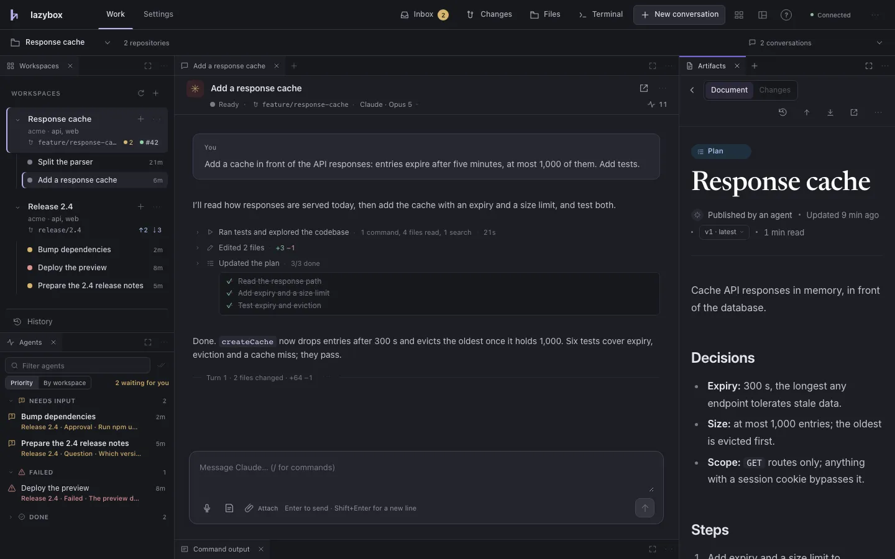
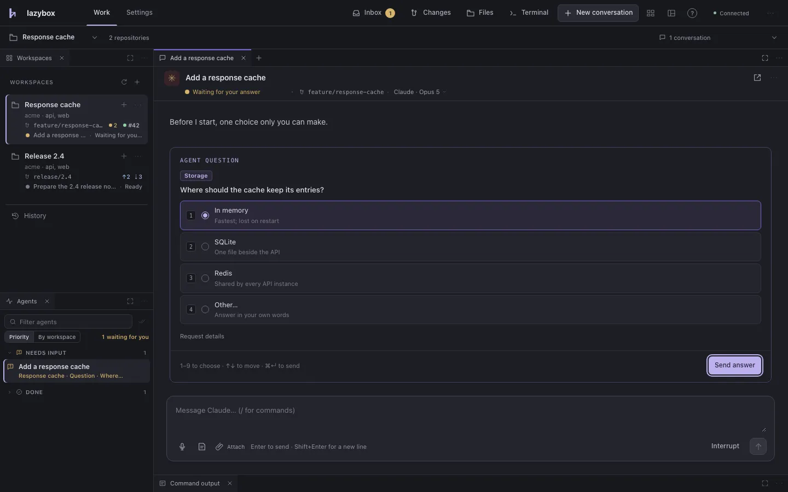
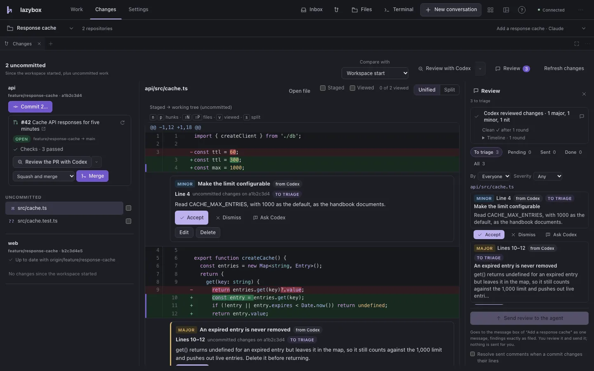

# Lazybox

**One window for all your coding agents, across all your workspaces — and the
place you check their work before it lands.** Run Claude Code and Codex side
by side, see what each one actually did, and keep them running when you close
the window or restart Lazybox.

> **Status: early preview, for a few testers.** Lazybox installs from this
> repository with one command. Expect rough edges, and please
> [tell us about them](#feedback). What to try first: the
> [testers' guide](docs/testers.md).

<picture>
  <source media="(prefers-color-scheme: light)" srcset="docs/images/hero-light.webp">
  
</picture>

## Requirements

- An **Apple Silicon Mac** with **macOS 13.5** or later.
- A **Claude Code** and/or **Codex** account. Lazybox brings Claude Code, which
  only needs you to sign in; Codex is installed and signed in as usual.
- To build: Xcode Command Line Tools, Go, Node.js and Rust. `make install`
  checks them and prints the command for anything missing.

## Install from source

```sh
git clone https://github.com/AntoineToussaint/lazybox.git
cd lazybox
make install
```

The first build takes 5 to 10 minutes and needs about 8 GB of free disk
space; no accounts, keys or secrets. `make install` builds the app, installs it in
`/Applications` (`PREFIX=~/Applications` for your account only), sets up its
background service (the **Runner**, where your agents run), puts the
`lazybox` command on your PATH and opens Lazybox. Then:

1. **Welcome.** Connect a subscription (your existing `claude` or `codex`
   sign-in already works) and start your first task.
2. **New task:** `⌘N`, type what you want, pick a repository, **Enter**.
3. **Check its work:** `]] d` opens Changes.

| Command | Does |
| --- | --- |
| `make update` | Pull the newest commit, rebuild and reinstall. Your conversations and settings stay; running agents keep running. |
| `make uninstall` | Remove the app, the Runner service and the `lazybox` link. Your data stays; `PURGE=1` deletes it too (it asks first). |
| `lazybox doctor` | Check the installation, with the fix for anything wrong. |

Prerequisites, options and where things are: [Install](docs/install.md#install-from-source).

## What you get

**Many agents, one window.** Workspaces of one or several repositories, each
in its own git worktrees, each with as many Claude or Codex conversations as
you like. The inbox (`]] i`) and `⌘J` take you to whichever needs you next.

**A chat at least as good as the agent's own terminal.** Questions as option
cards, approvals that show exactly what will run, *Send now* to steer a
working agent, sub-agents as live cards. [Work in the chat →](docs/guides/chat.md)

**Verify before you trust.** Review every change in a split diff, comment
inline, have another agent review it (Codex checks Claude's work, and the
other way round), undo any turn, then commit, push, open the pull request and
watch its checks — without leaving the app. [Review an agent's work →](docs/guides/review-agent-work.md)

 

**Agents outlive everything.** Close the window, restart the Runner, install a
new build: agents and the commands they started keep running, and Lazybox
picks them up where they were.

**And:** versioned plans and reports as [artifacts](docs/guides/artifacts.md) ·
[voice](docs/guides/voice.md), on-device · a `lazybox` [CLI](docs/reference/cli.md)
that does what the app does · [extensions](docs/guides/extensions.md), panels
of your own · [missions](docs/guides/missions.md) and
[agents that run agents](docs/guides/orchestrator.md) *(preview)* · your
[phone as a remote](docs/guides/phone.md) *(preview)*.

## Known limitations

- **Desktop app:** Apple Silicon Mac. The separate [Linux Runner](REMOTE_RUNNERS.md) supports remote execution.
- **Self-hosted.** The Runner and agents run on your Mac or on a Linux machine you manage.
- **The phone is a web page**, reached over [Tailscale](docs/guides/phone.md);
  there is no phone app.
- **Gemini CLI, Goose and other ACP agents are a Preview**
  ([guide](docs/guides/other-agents.md)); Claude Code and Codex are the agents
  Lazybox is tested with.
- **Builds from source update with `make update`**, not in the app, and are signed
  for your Mac only.
- More in the testers' guide: [what not to rely on yet](docs/testers.md#what-not-to-rely-on-yet).

## Documentation

**[The docs](docs/README.md)** — [getting started](docs/getting-started.md),
[the testers' guide](docs/testers.md), concepts, guides,
[keyboard shortcuts](docs/reference/keyboard-shortcuts.md),
[the CLI](docs/reference/cli.md), [troubleshooting](docs/troubleshooting.md)
and the [FAQ](docs/faq.md). See the [Codefly Runner module](deploy/module-lazybox/)
for Kubernetes deployment.

## Feedback

**Help → Send feedback…** in the app writes a report you read before it goes
anywhere, and can open a GitHub issue filled in with it. Or open an
[issue](https://github.com/AntoineToussaint/lazybox/issues) yourself;
[SUPPORT.md](SUPPORT.md) says what to include. Security problems go
privately, as [SECURITY.md](SECURITY.md) describes.

## Contributing

`make deps` and `make dev` for a hot-reloading Dev app; [CONTRIBUTING.md](CONTRIBUTING.md)
has the setup, the tests and the conventions, and [AGENTS.md](AGENTS.md)
the rules for coding agents.

## Preview terms

Lazybox is proprietary software: see [LICENSE](LICENSE). For this
preview, the owner permits you to build Lazybox from this repository, install
it on your own computer and use it to evaluate it, and to share feedback and
bug reports. Everything else the LICENSE reserves stays reserved: please do not
redistribute the code or your builds, or publish modified versions.
