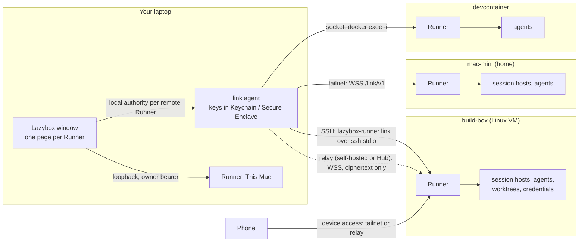
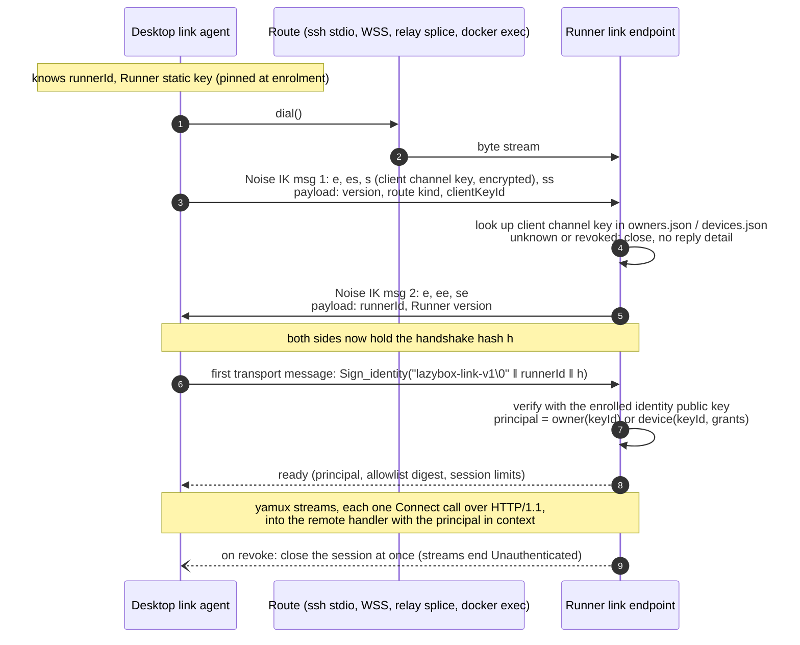
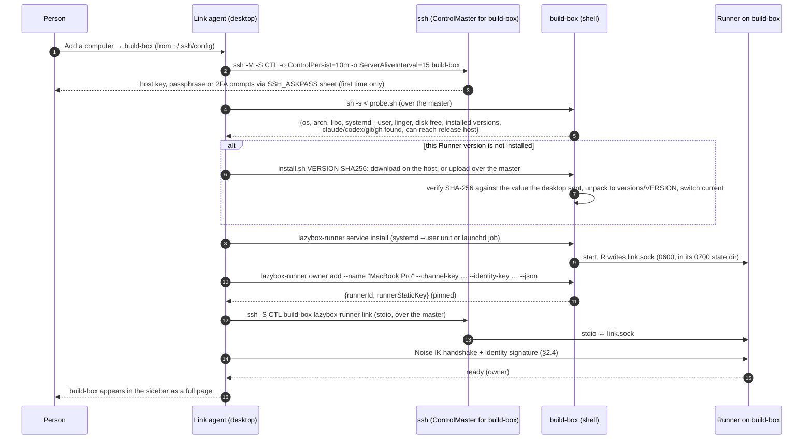

# Runners on other computers

**Status: proposal, 2026-11-17; P0 built.** The owner link over SSH (P0b,
[below](#p0b-the-owner-link-over-ssh-built)) and the Linux Runner (P0 steps
1–3, [§5.2](#52-the-linux-runner)) are built and verified on Ubuntu 24.04 and
in a container; the rest is a proposal, not built or decided.
It designs one generic way for Lazybox to work with a Runner on another computer:
a second Mac, a Linux VM, a cloud dev box (EC2, GCE, Hetzner, Fly), a
devcontainer, or a home server. The goal is the **full Lazybox experience on that
machine**: workspaces, chat, files, diffs and review, terminals, command
output, artifacts and PRs, not only "see and answer". It amends nothing by itself.
[MULTI_RUNNER.md step 3](MULTI_RUNNER.md#step-3-runners-on-other-machines-owner-level-built-over-ssh-device-level-designed)
(a remote Runner as a paired device), [D16](DECISIONS.md#remote-control--2026-11-16)
(tailnet transport) and C17 (the shared Hub lives elsewhere) stand until the
user decides otherwise ([§11](#11-decisions-for-the-user)).

Read with [Several Runners](MULTI_RUNNER.md), [Mobile, cloud and Hub](MOBILE_CLOUD_HUB.md)
(the relay, the Hub), [Remote control](REMOTE.md) (device keys, grants, the
gateway allowlist), [Agents outlive the Runner](SESSION_HOSTS.md),
[Resource ownership](RESOURCE_OWNERSHIP.md) and [Architecture](ARCHITECTURE.md).

## Short answers

| Question | Answer |
| --- | --- |
| Do we have a design for a generic remote connection? | **This document.** Before it, MULTI_RUNNER step 3 covered only *device* access, the phone's see-and-answer, over Tailscale. [MOBILE_CLOUD_HUB](MOBILE_CLOUD_HUB.md) designed the relay for phones. Neither gave a desktop owner access to another machine. |
| What is the model? | One window lists many Runners, each the only authority over its own machine. Each Runner is reached at one of two **access levels**: *owner* (your machine, full control, the same as local) or *device* (see and answer). The access level and the route are independent. [§2](#2-the-model) |
| How does owner access work without copying the owner bearer? | Each client (a desktop app, a CLI install, a phone) gets its **own key pair**, enrolled on the Runner once over a channel that already proves you control that machine, for example an SSH login. Every connection then runs a **Noise IK** handshake that pins the Runner's key, and the client signs the handshake. The bearer never leaves its machine. [§2.4](#24-keys-and-the-owner-handshake) |
| How does it connect? | Through one contract, `RunnerLink`, with interchangeable **routes**: SSH (bootstrap and tunnel, like VS Code Remote-SSH and Zed), the tailnet, the end-to-end-encrypted relay (self-hosted or the Hub's), and a local socket for containers. Every route ends in the same Runner handler with the same keys and allowlists. [§3](#3-runnerlink-one-contract-many-routes), [§4](#4-routes) |
| Where does the Hub fit? | **It is one more implementation of the same contract**, not a separate system. It provides a relay route, a machine directory and a provisioner for managed VMs. It never holds a private key, never mints a credential and never sees plaintext. [§3.3](#33-who-implements-what) |
| What blocks it today? | Nothing for P0: the owner link over SSH ([P0b](#p0b-the-owner-link-over-ssh-built)) and the Linux Runner are built. The Linux Runner: it compiles and its Go suite passes on Linux (CI too), it runs as a systemd user service, its session hosts leave its cgroup in scopes of their own so agents outlive `systemctl --user restart`, and the release ships it as checksummed tarballs. [§5.2](#52-the-linux-runner) |
| What first? | **P0: the Linux Runner plus an owner link over SSH to an existing host.** An agent can build and verify it against an OrbStack Linux machine on this Mac. Effort M: about 2–3 weeks, 7 PRs. [§10](#10-phased-plan) |

## P0b: the owner link over SSH (built)

Built 2026-11-17 on `feat/v2-runner-link`: items 4–6 of the [P0 plan](#10-phased-plan),
the owner link without the Linux Runner (items 1–3, another branch). The
person's guide is [docs/guides/remote-computers.md](docs/guides/remote-computers.md).

| Piece | Where | As designed, or how it differs |
| --- | --- | --- |
| Noise IK channel | `internal/link/noise.go`, `handshake.go` | `Noise_IK_25519_ChaChaPoly_BLAKE2s`, `[u16 BE len][msg]` framing as V1's `e2e-channel`, prologue `lazybox-link-v1`. The client signs `SHA-256("lazybox-link-v1\0" ‖ Runner static key ‖ h)` with its P-256 identity key (the pinned key stands for `runnerId`). |
| `link.Serve` | `internal/link/serve.go` | One entry point for every route. Admits only a channel key in `<state>/owners.json` whose identity signature verifies; rechecks the record every 250 ms, so a revoke ends live sessions within a second; 12 h session ceiling; `<state>/audit.jsonl` for sessions, refusals and owner changes. **Differs:** HTTP/2 inside the channel instead of yamux plus HTTP/1.1 per stream (`golang.org/x/net/http2`, already a dependency: multiplexing, per-stream flow control and pings for the RTT, no new library). The host-local list is `OpenRepositoryHome`; a request carrying its own `Authorization`, or a path outside the Runner's RPC service, is refused. |
| The endpoint on the host | `lazybox link serve --stdio` (`cmd/lazybox/remote.go`) | **Differs:** the endpoint is a `lazybox` subcommand that sshd runs as the person's login and that proxies to the loopback Runner with the owner bearer it reads from `endpoint.json` on the host, rather than a `link.sock` the Runner owns. Same properties (no port, the bearer never leaves the host, Noise with pinned keys in front of everything) with no change to the Runner process; a `link.sock` (for the tailnet and relay routes, where no login runs a command) is P1. Refused from an agent's, terminal's or hook's environment. |
| Owners | `internal/link/owners.go`; `lazybox link owners ls\|add\|revoke` on the host | `<state>/owners.json` (0600, flock-guarded, atomic). **Differs:** the verbs are `lazybox link owners …`, not `lazybox-runner owner …`. Pairing-link enrolment is P1. |
| Client keys | `internal/link/keys.go`, `FileKeys` | `~/.config/lazybox/keys/link-client.json` (0600 in a 0700 directory), behind a `KeyProvider`. **Not yet:** Keychain and Secure Enclave (decision 10). |
| SSH route | `internal/link/route.go` | System OpenSSH with the person's config, `BatchMode`, `ControlMaster` per host under `~/.config/lazybox/ssh/`, `ServerAliveInterval=15`. Host names are validated so one cannot be read as an option; remote words are quoted for sh, bash, zsh and fish alike. `SSH_ASKPASS` prompts are P1: a host that needs a prompt fails with *check that `ssh <host>` works in a terminal*. |
| Bootstrap | `internal/link/bootstrap.go`, `scripts/probe.sh`, `scripts/install.sh`; `lazybox remote add` | Probe (POSIX `sh -s`, one JSON line, changes nothing); upload of a runtime `.tar.gz` (this Mac's runtime when the host is the same OS and CPU, else `--bundle FILE`); the host checks the SHA-256 before unpacking into `versions/<v>`, switches `current`, keeps the previous version; `lazybox link up` starts the Runner (registered one, the launchd service for a full release on a Mac, else detached for the login); `owners add` over the same SSH login answers the Runner key, which is pinned. |
| Link agent | `internal/link/agent.go`; `lazybox link connect <name>` | Serves the remote Runner on `127.0.0.1:<port>` with a per-start token in `~/.config/lazybox/remotes/<name>/endpoint.json`, named by a locator in `runners/<name>.json` with a `remote` field, so `RunnerLink`, `RunnerScope` and `--runner NAME` work unchanged. Redials with backoff (250 ms doubling to 15 s), notices a wake by the wall clock and on `SIGUSR1`, measures the RTT by HTTP/2 ping, and writes `status.json` (connecting, connected, reconnecting, refused with *unknown-key* or *wrong-runner*). |
| Desktop | `apps/desktop/src-tauri/src/links.rs`, `runners.rs` | One `lazybox link connect` per added computer, started from the Runner listing and stopped when the app quits (agents on the computer keep running). `remote_hosts`, `remote_add` (steps as events), `remote_remove`. A listing carries `remote: {host, route, machine, state, rttMs, …}`. |
| UI | `AddComputerSheet.tsx`, `RunnersSettings.tsx`, `CollectionPanel.tsx`, `runner-directory.ts` | Settings → Runners → **Add a computer…** (filtered `~/.ssh/config` hosts or `user@host`, arrow keys and Return, one line per step with the exact error, closing does not cancel); the sidebar grouped by computer with the route, the RTT (on hover, or always above 300 ms) and *Reconnecting…* / *Access revoked*; a remote Runner is the full page; Reveal in Finder and the home checkout's Finder and editor actions are not offered on it; **Remove** forgets it and revokes the key there. |

**Verified** (`go test ./internal/link ./cmd/lazybox`, `cargo test` in
`apps/desktop/src-tauri`, `npm run test:remote-computers`):

- the handshake: a wrong pinned key, a key never enrolled, a revoked key and a
  copied channel key without its identity key are each refused before any
  request reaches the Runner; a revoke ends a live session within a second;
- the owner bearer never crosses the link (checked on the wire), is refused
  if a client sends it, and no file on the client holds it;
- streaming RPCs flow through both proxies as they are written;
- the agent's token, loopback Host check and reconnection;
- end to end through a **fake `ssh`** that runs each remote command with
  `/bin/sh` in a second home on this Mac (Remote Login was off, and the Linux
  Runner does not exist yet): `remote add` probes, uploads, verifies,
  installs, starts a real Runner, enrols and pins; `link connect` serves it;
  `lazybox --runner build-box ls` works through it; killing the host side of
  ssh reconnects in about 0.1 s; `owners revoke` on the host refuses within
  about 0.3 s; another Runner key behind the same name is refused as *wrong
  runner*; `remote rm` revokes the key on the host;
- the UI against fixture Runners (WebKit, dark and light);
- **by hand, over the real system OpenSSH to a Linux Runner** (2026-11-18): a
  throwaway OrbStack Ubuntu 24.04 arm64 machine, reached as
  `lazybox-test-link@orb` through `~/.ssh/config`, with this branch merged
  with `feat/v2-linux-runner` and cross-built for linux/arm64: `remote add`
  probed, uploaded and verified, started the Runner, enrolled and pinned in
  13 s; `lazybox --runner orbbox ls` worked through `link connect` (RTT 2 ms
  over a reused ControlMaster); killing ssh reconnected in under a second;
  `owners revoke` on the host refused within 0.3 s; a replaced Runner key
  was refused as *wrong runner*; `remote rm` revoked the key on the host.
  This run found that sshd's blocking stdio kept a revoked session alive
  until the client's next ping (~10 s); `link serve` now makes its stdio
  pollable, and the fake `ssh` of the Go test holds the command's stdio as
  sshd does, so the test fails without the fix.

**Not verified:** a real sleep and Wi-Fi change; host key and passphrase
prompts (BatchMode refuses them: there is no askpass yet); the desktop app
driving `lazybox link connect` (the Rust side is unit-tested; the Playwright
suite drives the web client); `launchctl` over SSH on a Mac host.

**With the Linux Runner** (`feat/v2-linux-runner`, 2026-11-18): `link up`
installs the release's service on any platform (`lazybox service install`): a
systemd user unit on Linux, the supervisor without systemd, launchd on a Mac;
it starts the Runner detached only when that fails, and says why. The
`start` step reports the manager and whether it starts at boot (lingering).
The release's Linux tarballs are bundles `remote add --bundle` takes as they
are. Verified by hand over the real system OpenSSH to an OrbStack Ubuntu
24.04 arm64 machine (`lazybox-test-linux@orb`), from a clean host: `remote add
--bundle lazybox-runner-0.1.0-pre.1-linux-arm64.tar.gz --sha256 …` installed,
started the Runner *as a systemd user service; starts at boot (lingering is
on)*, enrolled and connected in under 5 s; `lazybox --runner orbbox ls`
through `link connect`; a fake ACP agent opened through the link and left
mid-turn; `systemctl --user restart lazybox-runner` on the host (Runner PID
99077 → 99194): the agent (PID 99167, in `lazybox-host-….scope`) kept running,
was re-attached, its turn still busy, and `ls` through the same link showed it
*working*. Turning lingering off with no session open stopped the user
manager, and with it the Runner and the agent, as logging out does: the guide
and `lazybox doctor` say so.

## 1. Where we are

| Piece | State | Where |
| --- | --- | --- |
| Several Runners in one window | Shipped for Runners on this machine: `RunnerDirectory`, `RunnerScope`, merged inbox, a page per Runner. | [MULTI_RUNNER.md](MULTI_RUNNER.md) steps 1–2 |
| A remote Runner in the window | Designed as *device* access through the gateway, never the page. Not built. | MULTI_RUNNER step 3 |
| Device identity | Built: non-extractable P-256 key, one-time pairing offer, 15-minute credentials, grants, revoke, a pinned allowlist. | [REMOTE.md](REMOTE.md), `internal/devices`, `internal/transport/device_auth.go` |
| Listener rule | Built: `requireLoopbackListeners` (`services/runner/code/listen.go`) refuses any Runner listener that is not loopback. The device gateway is loopback too, and only `tailscale serve` publishes it. | `listen.go`, `internal/remote` |
| Owner authority | `endpoint.json` (0600) holds a random bearer that is regenerated at every Runner start. It is accepted only on the loopback owner listener (`transport.LocalAuthority`), and refused by the gateway. | `work.go`, `internal/transport/auth.go` |
| Agents outlive the Runner | Built on macOS and Linux: session hosts `setsid` out of the Runner's session, and on Linux each starts in a systemd scope of its own. launchd, a systemd user unit, or Lazybox's own supervisor (no systemd) keeps the Runner running. | [SESSION_HOSTS.md](SESSION_HOSTS.md#on-linux) |
| The E2E relay | Designed (LBR/1: WSS, Noise IK, yamux, Connect over HTTP/1.1). V1 has a working Rust relay and Noise channel (`crates/relay`, `crates/e2e-channel`). | [MOBILE_CLOUD_HUB.md §3.4](MOBILE_CLOUD_HUB.md#34-recommended-architecture) |
| Linux | Built (P0 steps 1–3): the Runner and CLI for x64 and arm64, `lazybox service install` as a systemd user unit (or the supervisor), `lazybox doctor`, the release tarballs, a Linux CI job. The Dev and Working launchers (`scripts/environments.mjs`, `scripts/runner-service.mjs`) stay macOS only. | [§5.2](#52-the-linux-runner), [install](docs/install.md#runner-on-a-linux-machine) |
| UI connection | The TypeScript `RunnerLink` (`packages/client-core/src/index.ts`) holds `{baseUrl, token}`, renews from a locator, and retries a refused bearer once. The desktop's HTTP goes through `tauri-plugin-http` with a capability per origin. | `client-core`, `apps/desktop/src-tauri/src/runners.rs` |

The [competitive audit](audits/2026-11-17-competitive/README.md) puts
"Linux Runner + BYO always-on Runner" fourth on its kill list (rows 11, 48, 49).
Every first-party competitor now has some form of "work continues with the laptop
closed".

## 2. The model

### 2.1 One window, many Runners, each the authority over its machine



- Every Runner keeps its own state, credentials, worktrees and agents. Nothing
  is proxied from one Runner through another
  ([MULTI_RUNNER: Not doing](MULTI_RUNNER.md#not-doing)), and Runners never
  connect to each other.
- The window already merges Runners (step 2). A remote Runner becomes one more
  entry in that directory. At owner level **it can be the page**, exactly as
  a local Runner is.
- What differs from a local Runner is only how the window reaches it and the
  credential it presents. That is the `RunnerLink` contract ([§3](#3-runnerlink-one-contract-many-routes)).

### 2.2 Two access levels

| | **Owner** | **Device** |
| --- | --- | --- |
| Meaning | Your own machine or VM. You control it as you control this Mac. | See and answer: today's phone, or a desktop you trust less (a shared machine, a colleague's Runner). |
| What it may call | Every RPC the local owner may call, minus a short **host-local** list (below). It can be the page: files, terminals, settings, processes, review, starting work. | The device allowlist, unchanged ([REMOTE.md](REMOTE.md#what-a-device-may-call)), by grant: `read`, `respond`, `start`. Never the page; the remote conversation surface of step 3. |
| How it is granted | Enrolling an **owner key** over a channel that proves control of the host account ([§2.5](#25-enrolment-how-a-key-first-becomes-trusted)). | Pairing as today: a one-time offer shown by an owner, with grants chosen by the owner. |
| Record on the Runner | `<state>/owners.json` (0600) | `<state>/devices.json` (0600), as today |
| Revoked by | Any owner client, the host's CLI (`lazybox-runner owner revoke`), or the Hub's "revoke everywhere". | The same, plus the existing Settings → Devices. |

The **host-local** list holds RPCs that act on the host's own screen or
desktop session. A remote owner either cannot use them or would get something
else from them:

- open a path in the host's Finder or editor (`homes.OpenCommand`);
- the CLI's window requests (`lazybox open` / `lazybox shot` target the
  windows of the host's own app);
- the macOS Speech and notification hooks of a host app.

On a remote Runner each of these gets a remote counterpart:

- *Open in editor* gives a remote URI for the editor you use:
  `vscode://vscode-remote/ssh-remote+<host><path>`, Cursor's equivalent, or
  `zed ssh://<host>/<path>`.
- *Open in terminal* starts `ssh -t <host> 'cd <worktree> && exec $SHELL'` in
  your own terminal app.

Both come from the route, not the Runner. A test walks the generated service
description to keep the list exhaustive, as the device allowlist test does.

A desktop's access level is chosen at enrolment and shown on the Runner's
header (*Owner* or *See and answer*). One Runner can have both: your laptop as
owner, a colleague's desktop as a device.

### 2.3 Why owner access cannot be "copy the owner bearer"

The bearer in `endpoint.json` is forbidden off its machine
([MULTI_RUNNER: Not doing](MULTI_RUNNER.md#not-doing)), for concrete reasons:

1. **It names no one.** Whoever holds it is the owner, from anywhere. The
   Runner cannot tell your laptop from a stolen copy, cannot attribute an
   action in an audit, and cannot revoke one holder without revoking all.
2. **It is a long-lived secret in transit.** Over a relay or a Hub it would
   be one TLS or Noise layer away from the operator. Rule 2 of
   [MOBILE_CLOUD_HUB §3.1](MOBILE_CLOUD_HUB.md#31-what-the-backend-must-and-must-not-be)
   says no operator we run can forge Runner traffic. A copied bearer would make
   that rule depend on how carefully the copy is handled.
3. **It rotates at every Runner start.** A copy needs a way back to the file
   after every restart. The only safe way back is an authenticated channel, and
   once that channel exists the bearer adds nothing.
4. **It keeps a clean boundary.** The bearer is accepted on one loopback
   listener and refused everywhere else. That keeps "who can reach the owner
   listener" equal to "who runs as this user on this machine", which is
   already out of scope ([RESOURCE_OWNERSHIP](RESOURCE_OWNERSHIP.md#agent-credentials)).

An SSH-only shortcut was considered and rejected as *the* model. In it, a
host-side proxy (`ssh host lazybox-runner proxy`) reads the bearer locally
and injects it, so the bearer never leaves the host. It is safe and has no new
credential. It works only over SSH, though: the tailnet, the relay and the Hub
would each need another mechanism. It names no desktop, so there is no
per-desktop revoke or audit, and a lost laptop means removing an SSH key in
`authorized_keys` on every host. We keep its good idea instead: **SSH is how
an owner key is introduced**, as `authorized_keys` is for SSH itself.

### 2.4 Keys and the owner handshake

**Keys.**

| Key | Where | What it does |
| --- | --- | --- |
| Runner static key (X25519) | `<state>/link-noise.key` (0600) on the host, made once, never replaced except by an explicit `owner reset-identity` | Noise IK responder key. `runnerId` is derived from its public half. The desktop pins it at enrolment, so a substituted Runner fails the handshake. |
| Client channel key (X25519), one per client install | Desktop: Keychain, `kSecAttrAccessibleAfterFirstUnlockThisDeviceOnly`. CLI on Linux: `~/.config/lazybox/keys/` (0600). Phone: Keychain (as MOBILE_CLOUD_HUB) | The Noise IK initiator static key. It is what the Runner looks up in `owners.json` / `devices.json`. |
| Client identity key (P-256), one per client install | Desktop: **Secure Enclave** where the app's signature allows it, otherwise a non-extractable Keychain key. Phone: Secure Enclave. Web: non-extractable WebCrypto (today's device key) | Signs the Noise handshake hash at every connection (channel binding), and signs enrolment and rotation statements. |

There are two client keys because the Secure Enclave does P-256 only, while
Noise (and V1's `e2e-channel`) uses X25519. The hardware-bound identity key
signs every session, so stealing the software channel key alone does not
open a session.

**Session.** Every owner or device connection over any route is the same
exchange:



- **Mutual authentication without a bearer.** The client proves its channel
  key through Noise and its identity key through the signature over `h`. The
  Runner proves its static key through Noise. A Runner that does not hold the
  pinned key cannot complete message 2.
- **Channel binding.** The signature covers `h`, which is unique to this
  handshake with this Runner. A compromised host that receives the signature
  cannot replay it to another Runner or into another session. That is why a
  compromised host gains nothing against your other machines.
- **No stored credential.** The session is the credential. It ends when the
  stream ends, when the key is revoked (the Runner closes live sessions as the
  gateway does today), or at a session ceiling (12 h by default), after which
  the client re-handshakes silently.
- **Phones keep their HTTPS path.** The PWA on the tailnet keeps today's
  device credential (`/remote/v1/challenge`, `/session`) because a web page
  cannot pin a key safely (D16). The native app and the desktop use the Noise
  session on every route.
- **Step-up (optional, per Runner).** The identity key can require user
  presence (Touch ID) for sensitive owner actions: enrolling another owner,
  changing an agent's permission mode to bypass, deleting a workspace. Off by
  default for ordinary sessions, because a prompt on every reconnect is noise.

### 2.5 Enrolment: how a key first becomes trusted

Enrolment adds `{keyId, channel public key, identity public key, name, access,
addedVia, addedAt}` to `owners.json` or `devices.json`. The desktop pins
`{runnerId, Runner static key}` over the **same** channel. Every path below is
one way to establish that two-way trust, and all of them end in the same record.

| Path | Proves | Used for |
| --- | --- | --- |
| **SSH** (P0) | You can log in as that user, with ssh's host key check (`known_hosts`, or Tailscale SSH's control-plane host keys). | The desktop runs `lazybox-runner owner add --name … --channel-key … --identity-key … --json` over the SSH session. The Runner returns `runnerId` and its static key on stdout. Recorded as `addedVia: ssh`. This is the `authorized_keys` model. |
| **Pairing offer** | You saw the offer on a trusted screen: an existing owner's Settings → Runners → *Add another computer*, or `lazybox-runner owner pair` printed on the host's console. | Headless hosts reached by tailnet or relay. As today's device offer: one use, 5 minutes, 256-bit secret in the fragment, plus `rk=<Runner static key>` so the client pins it from the link. `access=owner` offers need an owner to create them. |
| **Provision-time** | You created the machine (P2). | `cloud-init` / devcontainer `postCreateCommand` writes the desktop's public keys and the expected `runnerId` comes back over the provider's channel (for example its serial console or the first SSH login). For BYO cloud the desktop passes the keys itself, never through the Hub. |
| **Hub introduction** (P3) | The Hub says "this account's new desktop wants in". **Not enough alone.** | The Runner admits it only after an existing owner client confirms, as Signal links devices (MOBILE_CLOUD_HUB rule 3). Exception: on a VM **the Hub itself provisioned**, the Hub controls the disk anyway, so its introduction of the first owner is accepted. That exception is stated in the setup and is never extended to BYO machines. |

**Where the desktop learns the Runner's key matters.** The key is pinned only
from SSH, from a pairing link, from your own provisioning, or from a statement
signed by an owner key you already trust. A key that came only from the Hub's
directory is shown as *unverified*, with its fingerprint. Otherwise the Hub
could substitute keys, and the Noise layer would protect nothing against the Hub.

**Rotation.** A client rotates its channel key with a statement signed by its
identity key. The identity key itself is replaced by re-enrolling. The Runner's
static key is not rotated in normal operation. Resetting it un-pins it for every
client, which then need to re-enrol, and Lazybox says so.

**Audit.** The Runner appends `<state>/audit.jsonl` (0600, rotated) with:

- sessions opened and closed: key id, name, route, the peer address when the
  route knows one;
- owner and device keys added, rotated and revoked, and by whom;
- installs and upgrades;
- ports forwarded ([§6](#6-what-works-remotely));
- step-ups.

Settings → Runners → *build-box* → **Activity** shows it. The Hub keeps an
audit only of its own actions.

## 3. RunnerLink: one contract, many routes

### 3.1 Layers

```
UI (React)            RunnerLink (TS, client-core) — unchanged: {baseUrl, token}, renew, retry
                        │ HTTP to 127.0.0.1:<p> with a per-launch local token
Link agent            one per desktop app (and one inside each CLI invocation)
(desktop sidecar)       ├─ Session   Noise IK + identity signature, yamux, keepalive, resume
                        └─ Route     one byte stream to the Runner's link endpoint
Runner                link.Serve(stream, route) → Noise responder → principal → yamux
                        → remote handler (Connect) → owner-remote or device allowlist
```

- **The UI does not change.** For a remote Runner, `runner_list` returns a
  listing whose authority is the link agent's local endpoint: `{baseUrl:
  http://127.0.0.1:<p>, token: <random, per link-agent start>}`. The
  existing `RunnerLink`, `RunnerScope`, renew-on-refusal and cursors all work
  as they do for Dev and Working. The local token stops other OS users on the
  laptop from using the proxy. The link agent strips it and never forwards it.
- **The link agent** is the only new client-side component. The
  recommendation ([§11](#11-decisions-for-the-user), decision 4) is to write
  it in Go as `lazybox link serve`, which the desktop app starts as a sidecar.
  That gives one implementation for the app and the CLI, in the Runner's language,
  tested against the Runner's own `link.Serve` in one Go test process. Keys go
  through a `KeyProvider` (Keychain or Secure Enclave on macOS through cgo,
  files on Linux), the same abstraction MOBILE_CLOUD_HUB M1 proposes for the phone.
- **The session layer is LBR/1's inner protocol** (MOBILE_CLOUD_HUB §3.4,
  steps 3–4): Noise `IK_25519_ChaChaPoly_BLAKE2s`, a prologue binding the
  protocol version and `runnerId`, yamux, one Connect call per stream over
  HTTP/1.1. Every route carries it unchanged. The relay is "a route that
  happens to be a splice".

### 3.2 The contract

```go
// Client side (link agent). One Link per Runner the window shows.
type Route interface {
    Kind() string                                    // "ssh" | "tailnet" | "relay" | "socket" | "local"
    Dial(ctx context.Context) (io.ReadWriteCloser, error) // one byte stream to the Runner's link endpoint
    Describe() RouteInfo                             // label ("SSH build-box"), expected RTT class
}

type Directory interface {                           // which Runners exist and how to reach them
    List(ctx context.Context) ([]Entry, error)
    Watch(ctx context.Context) (<-chan Entry, error)
}
type Entry struct {
    RunnerID, Name, Machine string
    RunnerKey      []byte   // nil or Verified=false when the source cannot vouch for it
    Verified       bool
    Routes         []Route  // the link agent tries them in preference order
    Presence       Presence // reachable, asleep (last seen), unknown
    Access         Access   // owner | device(grants) | none (not enrolled yet)
}

type Provisioner interface {                         // makes a machine exist and a Runner run on it
    Plan(ctx context.Context, spec MachineSpec) (Plan, error)    // cost, region, disk: shown before anything happens
    Up(ctx context.Context, spec MachineSpec, progress func(Step)) (Entry, error)
    Stop(ctx context.Context, id string) error       // waits for running turns (§5.4)
    Destroy(ctx context.Context, id string) error
}

type Enroller interface {                            // how a client key first becomes trusted (§2.5)
    Enroll(ctx context.Context, e Entry, keys ClientKeys, access Access) (Pinned, error)
}
```

On the Runner side there is one entry point: `link.Serve(ctx, stream,
routeKind)`. The SSH stdio command, the WSS handler on the gateway, the
relay client and the socket command all call it. Behind it sit the same
`owners.json` / `devices.json`, the same allowlists and the same audit.

### 3.3 Who implements what

| Part | Desktop and CLI | Runner | Hub (paid) | Self-hosted, free |
| --- | --- | --- | --- | --- |
| Routes | `ssh`, `tailnet`, `socket`, `local`, and the client half of `relay` | `link.Serve`; the relay client (outbound WSS) | **Relay route**: rendezvous and splice | The same relay binary (V1's broker ported to WSS), run by you |
| Directories | `~/.config/lazybox/runners/*.json` (today), `~/.ssh/config` hosts, `tailscale status --json` peers, pairing links | Reports its presence and routes to whichever directories it is enrolled with | **Hub directory**: your Runners across devices, presence and "asleep since", routes | None needed: SSH config and the tailnet are directories |
| Provisioners | SSH bootstrap (install on an existing host), devcontainer, your cloud CLI (`aws`, `gcloud`, `hcloud`, `fly`) | Self-install and upgrade (`lazybox-runner self-update --sha256 …`) | **Managed VMs**: create, stop on idle, destroy, billing | Not applicable |
| Enrolment | Generates the keys; runs SSH and pairing enrolment; confirms Hub introductions | Admits keys into `owners.json` / `devices.json`; revokes; closes sessions | Carries introductions and revocations, signed by clients, which it cannot forge | Not applicable |
| Access control | Asks for owner or device access | **The only authority**: principal, allowlist, grants | None | None |
| Push | Desktop notifications from its own links | Notifier, encryption to each device | APNs gateway (opaque handles, encrypted payloads) | Web Push direct, as today |

**What never goes through the Hub**, in any form it can read: source,
worktrees, diffs, transcripts, tool and command output, terminal I/O, files,
artifacts, the owner bearer, any private key, provider sign-ins (Claude,
Codex), the GitHub token, environment secrets, and the ability to approve or
send. The Hub routes Noise ciphertext, and stores public keys plus the
metadata in [MOBILE_CLOUD_HUB §4.3](MOBILE_CLOUD_HUB.md#43-data-model-sketch)
(names, presence, encrypted titles at tier 2).

**Interchangeable in the UI.** A Runner is identified by `runnerId` and its
pinned key, never by a route. The window merges entries from every directory
by `runnerId`. *build-box* can be reachable over SSH at home and through the
Hub relay from a café. The link agent picks the first route that answers, in
order `local` > `socket` > `ssh` / `tailnet` (lower measured RTT first) >
`relay`. It falls back without the page noticing: the session is
re-established and streams resume from their cursors. The header shows the
route in use as a small label, and nothing else changes. Signing in to the
Hub adds a directory and a route. It does not create a second kind of Runner.

## 4. Routes

### 4.1 SSH: bootstrap and tunnel

Use the **system OpenSSH client** (`/usr/bin/ssh`), as VS Code Remote-SSH,
Zed, JetBrains Toolbox and Codex's remote hosts do. That way every setup a
person already has keeps working:

- `Include`, `ProxyJump`;
- `IdentityAgent` (1Password, Secretive);
- FIDO keys;
- Tailscale SSH;
- Teleport (`tsh proxy ssh`);
- Coder (`coder config-ssh`);
- Codespaces (`gh codespace ssh --config`);
- OrbStack (`ssh orb`), Lima (`~/.lima/*/ssh.config`).

An embedded SSH library would re-implement all of that, badly.



**Details.**

- **ControlMaster per host** (`ControlPath` in the app's private directory,
  `ControlPersist=10m`). The first connection may prompt; later dials reuse
  the master in milliseconds. Prompts go through `SSH_ASKPASS` with
  `SSH_ASKPASS_REQUIRE=force` (OpenSSH 8.4+), a small helper that shows a
  sheet in the app: the host key fingerprint to accept, a passphrase, or a
  second factor. VS Code does the same.
- **Probe first, change nothing.** `probe.sh` is POSIX `sh` and prints one
  JSON line. Installation starts only when the person confirms the plan. The
  plan names the disk needed and what will be installed where.
- **Install, pinned and checked.** Each desktop release carries a manifest of
  Runner bundles (`linux-x64`, `linux-arm64`, `darwin-arm64`) with their SHA-256
  values, inside the signed app. The host downloads the bundle from the release
  URL when it can, otherwise the desktop uploads it over the master (VS Code's
  `remote.SSH.localServerDownload`, Zed's `upload_binary_over_ssh`). Either way
  the host checks the SHA-256 the desktop sent **before** unpacking. The
  editors pin by version and do not document a checksum; we do both. Layout:
  `${XDG_DATA_HOME:-~/.local/share}/lazybox/runner/versions/<version>/`, a
  `current` symlink switched atomically, the previous version kept for
  rollback, older ones removed.
- **Versions.** The desktop and a remote Runner may differ within the protocol
  window. The link handshake carries both versions. Upgrading a remote Runner
  is the existing upgrade path: the old Runner detaches, the new one
  re-attaches every session host ([SESSION_HOSTS: Upgrades](SESSION_HOSTS.md#upgrades)),
  so agents keep running. Settings → Runners offers it, as *Move the Runner
  now* does today.
- **The tunnel is stdio, not a port.** `ssh -S <ctl> build-box lazybox-runner
  link` runs a small subcommand that connects to the Runner's
  `<state>/link.sock` and copies bytes, like Zed's `remote_server proxy`.
  No local port is opened by ssh, and no port is opened on the host. The unix
  socket's directory permissions (0700) mean another user on a shared host
  cannot connect, and even if they impersonated the socket, Noise with the
  pinned key would fail. The stdio command is also what the **socket route**
  runs through `docker exec`.
- **Port forwarding for Preview** is a separate yamux stream type inside the
  same session ([§6](#6-what-works-remotely)), not `ssh -L`, so it works the
  same over every route.

| Property | SSH |
| --- | --- |
| Who can reach the Runner | Anyone who can log in as that user over SSH, then completes Noise with an enrolled key. The Runner opens no port; sshd is the existing listener. |
| Encryption | SSH transport and Noise inside. The double encryption is ChaCha20 at link speeds, so it costs nothing measurable. |
| Latency | RTT to the host. Connect costs one SSH handshake the first time, then about zero with the master. Interactive traffic is limited by RTT alone. |
| Reconnection | After sleep or a network change, the master is dead (TCP). The link agent notices within 15–45 s through keepalives, or at once through macOS wake and path-change events. It redials (a new master, using the agent's keys silently with `BatchMode=yes`), re-handshakes and resumes streams from cursors. If the redial needs a prompt (a hardware key touch), the header says *Reconnect* and waits for a click. |
| Needs | An SSH login to the host; outbound HTTPS from the host or an upload; Linux with glibc ≥ 2.28 and systemd for the service (fallback below). |

### 4.2 Tailnet

Today `tailscale serve` publishes the device gateway on
`https://<machine>.<tailnet>.ts.net:8443`, and phones use HTTPS device
credentials. For owner access the gateway gains one path, **`/link/v1`**, a
WebSocket upgrade that carries the Noise session and hands it to
`link.Serve`. Nothing else changes: the same port and route, Funnel still
refused, and the bearer still refused.

- **Security:** WireGuard between the two machines, the `*.ts.net`
  certificate, then Noise with pinned keys inside. Tailscale is transport,
  never authority, as in D16. A tailnet peer still needs an enrolled key.
- **Latency:** direct WireGuard is the network RTT. Through DERP it adds a
  hop, and Tailscale shows which applies (`tailscale ping`).
- **Reconnection:** WireGuard roams across networks itself, so the WSS session
  often survives a Wi-Fi change. After sleep the link agent redials.
- **Needs:** Tailscale on both machines, the host's Runner with remote access
  turned on, and enrolment by SSH (Tailscale SSH counts) or by a pairing link.
- **Tailscale SSH** is simply the SSH route over the tailnet. Its `check` mode
  (re-authentication every `checkPeriod`) applies to the SSH route's master
  connection, which is a good fit for people who already use it.

### 4.3 Relay: self-hosted or the Hub

For a machine behind NAT, with no SSH reachable from outside and no
Tailscale (a home server, a corporate VM with outbound HTTPS only). This is
MOBILE_CLOUD_HUB's LBR/1, unchanged:

- The Runner dials out `wss://<relay>/v1/runner` and registers its key. The
  client dials `wss://<relay>/v1/connect?runner=<id>`, and the relay splices
  the two.
- The relay sees `runnerId`, IP addresses, timing and sizes. It sees no
  content and cannot complete the Noise handshake.
- **Self-hosted** is the same binary on any small VM (V1 has a Fly/GCE
  runbook). **The Hub's relay** is that binary operated for you, plus the
  directory, so you never paste a relay URL.
- **Latency:** RTT client→relay plus relay→Runner. Choose the relay region
  near the Runner, because most bytes flow from the Runner.
- **Reconnection:** both sides redial with backoff. A relay restart reconnects
  within 10 s (MOBILE_CLOUD_HUB M3 acceptance).
- **Needs:** outbound 443 from the host, relay access turned on for that
  Runner (opt-in), and enrolment by SSH, a pairing link or a confirmed Hub
  introduction.

### 4.4 Local socket: containers and devcontainers

- **`docker exec -i <container> lazybox-runner link`**, or `devcontainer exec`,
  which applies `remoteUser` and `remoteEnv`. Stdio carries the session
  exactly as SSH does. DevPod does the same: it injects an agent and talks to
  it over the provider's stdio.
- **A mounted socket:** the devcontainer bind-mounts a host directory to hold
  `link.sock`. The link agent connects to it directly, with no exec per
  connection. This only works when Docker runs on this machine (OrbStack or
  Docker Desktop).
- **Remote Docker** (a devcontainer on build-box) is the SSH route to
  build-box, then `docker exec` there: `Route` composes as
  `ssh build-box docker exec -i <ctr> lazybox-runner link`.
- **Security:** whoever can `docker exec` into the container is root in it.
  Noise still pins the Runner key, and enrolment is provision-time
  ([§2.5](#25-enrolment-how-a-key-first-becomes-trusted)).
- **Latency:** near zero locally. **Reconnection:** the container restarting
  is a Runner restart (session hosts survive it) or a reboot (they do not),
  handled as on any host.

### 4.5 How the routes compare, and with the state of the art

| | SSH | Tailnet | Relay (self or Hub) | Socket |
| --- | --- | --- | --- | --- |
| Works behind NAT without setup | If you already SSH there | Yes, with Tailscale | **Yes** | Local only |
| New listener on the host | None (sshd) | None (`tailscale serve`) | None (outbound) | None |
| Third party in the path | None | Tailscale's coordination server (keys); DERP sees ciphertext | The relay operator sees metadata only | None |
| Interactive latency | RTT | RTT (direct) or RTT plus DERP | RTT plus the relay hop | ~0 |
| Survives a network change | No (redial in seconds) | Often (WireGuard roams) | No (redial) | Not applicable |
| Enrolment | SSH itself | SSH or pairing link | Pairing link or confirmed Hub introduction | Provision-time |
| Cost to the person | None | None (Tailscale free plan) | Small VM, or the Hub plan | None |

| Product | Transport | Install | Survives disconnect | Credentials | What Lazybox takes |
| --- | --- | --- | --- | --- | --- |
| VS Code Remote-SSH | System OpenSSH, one shared connection | Script piped over SSH; the host downloads the server pinned to the client's commit, with a local-upload fallback; glibc ≥ 2.28 since 1.99 | Server kept for a grace period after a drop | The SSH login; extensions run on the host | Bootstrap shape, upload fallback, askpass, glibc floor |
| VS Code Remote Tunnels | Outbound to Microsoft dev tunnels (relay); SSH inside for end-to-end encryption | `code tunnel` installs the server; `service install` | Yes (service) | Same GitHub or Microsoft account on both ends | Dial-out with an end-to-end channel inside. Note that it ties identity to a vendor account, which we avoid. |
| Zed | System ssh with a ControlMaster, protobuf envelopes over stdio | `~/.zed_server/…-{version}`, exact version, downloaded on the host or uploaded | **Daemon plus `proxy --reconnect`** (reattach), unsaved buffers kept locally | The SSH login | Daemon and stdio proxy, the stdio tunnel, exact version pinning |
| JetBrains Gateway / Toolbox | Direct SSH, TLS 1.3 inside; no JetBrains relay | Backend IDE uploaded or registered; Gateway moving into Toolbox (2025) | Not documented | The SSH login | A thin client over a headless backend is the same split as window and Runner |
| Cursor | Remote-SSH (VS Code fork); Cloud Agents on Ubuntu VMs with `environment.json`, disk snapshots; self-hosted workers dial out over HTTPS | Snapshot builds | Cloud VMs: yes | Admin-connected Git provider; secrets as env; STS/OIDC | Workers dial out; environment as a file in the repo |
| Codex | App-server over SSH from `~/.ssh/config` aliases; `codex remote-control` relay for phones; cloud containers | **No auto-install**: Codex must be installed and logged in on the host | Host sleeps: access stops | `codex login --device-auth` on the host | Agent CLIs signed in on the host, by the person, with device code |
| Claude Code | Remote Control: outbound HTTPS polling through Anthropic, no inbound ports; `--cloud` VMs; self-hosted runners that poll with ~60 s leases | Not applicable | Resumes after sleep; server mode exits after ~10 min offline | claude.ai login; GitHub token kept outside the VM by a proxy | Leases and heartbeats; keeping GitHub credentials out where possible |
| herdr 0.9 | `herdr machine add` over SSH; servers own sessions; Herdr Cloud planned as an E2E relay | Not documented | Agents keep running; not restarted after reboot | The SSH login | The closest product shape: machines in one sidebar, grouped |
| Tailscale SSH | WireGuard; identity from node keys; ACL `accept` or `check` | Not applicable | SSH semantics | No user SSH keys; revoked in seconds by policy | Works as our SSH route unchanged |
| Coder | Agent dials coderd, Tailscale-derived tailnet, DERP fallback | `init_script` downloads the agent **from coderd** (version-matched) | Yes | Agent token or cloud instance identity | Provisioner shape (Terraform); version served by the control plane |
| DevPod | Provider stdio tunnel, injected agent serves SSH over it | Agent injected per workspace | While a session is open | git and ssh-agent forwarded only during a session | Providers as plugins; stdio injection. Upstream looks stalled; a community fork is active. |
| Codespaces | GitHub's service; `gh codespace ssh --config` emits OpenSSH config | devcontainer and prebuilds | Idle timeout 30 min by default | User, repo or org secrets | A devcontainer as the environment format; idle stop |
| Teleport | Agents hold a reverse tunnel to the proxy | Join token | Yes | 12 h user certificates; audit; session recording | Short-lived credentials and audit as product features |
| mosh / Eternal Terminal | SSH bootstrap, then UDP SSP (mosh) or TCP with replay (ET) | A server binary per session | **Yes**: roaming (mosh), byte replay (ET) | The SSH login | The reconnection model: sequence numbers and replay, which our cursors already are. Not the protocols, because ours is RPC, not a screen. |

## 5. Provisioning a machine

### 5.1 Bring your own first

The first supported machine is **any host you can `ssh` into**: a Linux VM,
a cloud box, a Mac mini, a Codespace, an OrbStack or Lima machine. Providers
that create machines come later (P2) and end in the same SSH or socket route.

### 5.2 The Linux Runner

**Built, 2026-11-17** (`feat/v2-linux-runner`), as designed below, with these
differences and findings:

- **Service managers:** `Manager` in `internal/installation` with launchd,
  systemd (`lazybox-runner.service`, `Restart=always`, `KillMode=process`,
  the journal) and a third, **supervisor**: `lazybox-runner supervise`,
  detached in its own session, for hosts without systemd. It names processes
  by PID and start time (`/proc`), so a reused PID is never signalled.
- **Scopes** as designed (`systemd-run --user --scope`), with a trial scope
  and a fallback to today's `setsid` hosts ([SESSION_HOSTS.md](SESSION_HOSTS.md#on-linux)).
- **Paths:** `${XDG_DATA_HOME:-~/.local/share}/lazybox` (state,
  configuration, worktrees); the documented install puts releases in
  `…/lazybox/runner/versions/<version>` with a `current` link.
- **Node's Linux builds need `libatomic1`** besides glibc 2.28 and libstdc++;
  a minimal Ubuntu image lacks it. `lazybox doctor` names the package.
- **Verified** on Ubuntu 24.04 arm64 (OrbStack, systemd 255) and in an
  Ubuntu 24.04 container without systemd: the Go suite; the installed
  tarball; `lazybox doctor`; service install, restart, stop, start, logs
  and uninstall; an agent mid-turn (the fake ACP agent), a managed command
  and a terminal kept across a service update and a restart. Not verified:
  x64 at run time (vet and build only), other distributions, a Runner
  started from a real SSH session's scope (OrbStack's sessions are not
  logind sessions), and GitHub's Linux runner starting scopes.

**Compile.** `CGO_ENABLED=0 GOOS=linux GOARCH=amd64 go vet ./...` in
`services/runner/code` fails on exactly two lines, checked 2026-11-17:

| File | Error | Fix |
| --- | --- | --- |
| `internal/processguard/guard.go:462` | `undefined: syscall.Getsid` (the `syscall` package has it only on darwin and BSDs) | `unix.Getsid` from `golang.org/x/sys/unix`, which has it on Linux too. |
| `internal/installation/layout.go:154` | `undefined: unix.MNT_RDONLY` | Build-tagged `readOnly`: `Statfs_t.Flags & ST_RDONLY` on Linux. |

With both patched in a scratch copy, `go vet ./...` passes for linux/amd64
and linux/arm64, test files included. Nothing was run on Linux.

**Run.** This is where the work is:

1. **A service manager behind an interface.** `internal/installation` is
   launchd only. Add `ServiceManager` with three implementations:
   - **launchd**: today's.
   - **systemd --user**: `~/.config/systemd/user/lazybox-runner.service`, with
     `Restart=always` and `--supervised`. **Linger** (`loginctl enable-linger
     $USER`) keeps it running after you log out and starts it at boot. Some
     distributions need `sudo` for linger, so the plan shows the exact command
     and the remote shell runs it.
   - **none**: containers, and WSL without systemd. `setsid` plus the Runner's
     own restart loop. It is not started at boot, and the UI says so.
2. **Session hosts must leave the Runner's cgroup.** On macOS, `setsid` is
   enough for a host to survive a launchd boot-out. Under systemd it is not.
   `systemctl --user restart` kills every process in the unit's cgroup
   (`KillMode=control-group`), whatever its session, which would break
   [agents outlive the Runner](SESSION_HOSTS.md).
   - **Fix:** start each session host in its own transient scope
     (`systemd-run --user --scope --unit=lazybox-host-<id> --collect …`, or
     the D-Bus `StartTransientUnit` call). The Runner unit also gets
     `KillMode=process` as a second line of defence.
   - **Test:** `systemctl --user restart lazybox-runner` with an agent
     mid-turn, a running command and an open terminal, in a Linux VM. All
     three must still be there afterwards.
3. **processguard on Linux** keeps its process-group semantics in P0. Linux
   offers stronger primitives for later: `PR_SET_CHILD_SUBREAPER` to catch
   escaped children, pidfds, and `cgroup.kill` on a per-execution scope.
   These are P03 items ([RESOURCE_OWNERSHIP](RESOURCE_OWNERSHIP.md#remaining-p03-work)),
   not blockers.
4. **Packaging.** Add `lazybox-runner-<version>-linux-{x64,arm64}.tar.gz`,
   the macOS bundle's `runtime/` tree minus the app:
   - `bin/lazybox`, `bin/lazybox-runner`: Go, static;
   - `node/`: the official Linux build of the pinned Node, checksum-checked as
     today;
   - `worker/`;
   - `web/`: the phone app the gateway serves;
   - `SHA256SUMS`.

   Node's official Linux builds need glibc ≥ 2.28, the same floor as VS Code
   since 1.99. That rules out Debian 9, CentOS 7 and Alpine (musl) for now. The
   build gets a `linux` target in `scripts/release/build.mjs`. `runner-service.mjs`
   and `environments.mjs` stay macOS-only, because they are the Dev and Working
   launchers for this Mac.
5. **Platform branches to review** (each has a `darwin` case today):
   - `adapters/codex/account.go`: Keychain on macOS, `~/.codex/auth.json` on
     Linux;
   - `homes.go`: `xdg-open`, which is host-local and not offered remotely;
   - `browser/availability.go`: Chromium on Linux, plus `playwright
     install-deps`, which needs `sudo`;
   - `agentshell/probe.go`;
   - `power/manifest.go`.
6. **CI.** A Linux job in `.github/workflows/ci.yml` runs the Go tests,
   including `internal/sessionhost`, `internal/processguard` and the reboot
   gate. The systemd restart test runs in a VM job, or in an OrbStack machine
   locally.

**A Mac as host** (a Mac mini) uses today's launchd service. Two caveats, both
unverified:

- Over SSH, `launchctl bootstrap gui/<uid>` needs a GUI login session. A
  headless Mac needs automatic login, or the job in the `user/<uid>` domain.
- Claude Code stores its sign-in in the login Keychain, which is locked in an
  SSH session until it is unlocked.

### 5.3 Agent CLIs, sign-ins and git on the host

- **Credentials never leave the host.** Signing in happens *on* the host, in
  the remote Runner's shell panel or your own `ssh` terminal, through each
  vendor's own flow:
  - Claude Code prints a URL and takes the pasted code.
  - Codex has `codex login --device-auth`.
  - API keys are entered in the remote Runner's Settings, sent once over the
    end-to-end session and stored 0600 on the host.

  Lazybox never reads, copies or carries a subscription token. This is what
  [CLAUDE_COMPLIANCE](CLAUDE_COMPLIANCE.md) R2 and R3 require: the sign-in
  completes through Anthropic's flow, in the unmodified binary, by the person.
- **Install on the host, by the person.** The remote Runner's Settings →
  Agents already offers **Install Claude Code** (Anthropic's installer in the
  shell panel), and Codex has its own installer. The Linux bundle does **not**
  include Claude Code. R4 makes preinstalling it in our product a
  Commercial Terms question, and on your own VM the installer is one click.
  The probe reports which CLIs are present, and the setup's last step lists
  what is missing, with the button for each.
- **Git credentials**, from most to least recommended for P0:

  | Option | Verdict |
  | --- | --- |
  | The Runner's GitHub token, entered in the remote Runner's Settings as today ([GITHUB.md](GITHUB.md)), a fine-grained token scoped to the repositories you work on there | **Default.** Same flow as local, and it stays on the host. |
  | `gh auth login` (device flow) on the host, with `gh auth setup-git` | Fine. The token is broad. |
  | A host SSH key added to GitHub (`gh ssh-key add`) | Fine for git. It does not cover the API that PR tracking uses. |
  | SSH agent forwarding (`ForwardAgent`) | **Off.** Root or any agent on the host can use your keys while you are connected, and agents keep working after you disconnect, when it is gone. It suits a person's shell, not agents. |
  | A GitHub App installation token minted per repository for one hour (P3, team) | The right answer for teams. Whoever holds the App key mints the tokens, which is a Hub decision ([§9](#9-the-hub-and-the-business)). |

- **Disk and worktrees** live on the host under its configured worktree root
  (`LAZYBOX_V2_WORKTREE_ROOT`, or the default). The probe shows free disk.
  Settings → Runners → *build-box* shows the worktrees' usage, as the Processes
  panel shows processes. Nothing is synced to the laptop. Files, diffs and
  output are read over RPC when shown.

### 5.4 Providers (P2), DevPod-style

A provider implements `Provisioner` and ends in an SSH or socket route plus
provision-time enrolment. Each one shows a **plan** before acting: machine
type, region, disk, the hourly cost from the provider's price list, and which
of your accounts is used.

| Provider | How | Notes |
| --- | --- | --- |
| **devcontainer** | `devcontainer up` (the reference CLI), then copy the Linux bundle in and `devcontainer exec … lazybox-runner link` | The repository's `.devcontainer/devcontainer.json` is the environment. Locally (OrbStack, Docker Desktop) or on an SSH host's Docker. |
| **Your cloud CLI** | `aws ec2 run-instances`, `gcloud compute instances create`, `hcloud server create`, `fly machine run`, using **your** CLI and account | cloud-init installs the bundle (SHA-256 pinned) and writes your public keys. The desktop never holds cloud credentials beyond what the CLI already has. |
| **Hub managed** (P3) | The Hub creates a VM in its account | The Hub can read that disk and introduces the first owner ([§2.5](#25-enrolment-how-a-key-first-becomes-trusted)). Setup says so plainly. |

**Stop on idle** waits until no turn runs and no command or terminal is live,
as V1's lifecycle timer did. A stopped VM is a reboot for its agents, which
are interrupted and resume natively ([SESSION_HOSTS: After a reboot](SESSION_HOSTS.md#after-a-reboot)),
so stopping one mid-turn would waste the turn. **Destroy** asks first and
lists the unpushed branches it would lose.

## 6. What works remotely

At owner level, a remote Runner is the page, so every surface works. The table
says how each one travels and what is specific to it.

| Surface | How | Remote-specific |
| --- | --- | --- |
| Chat, transcript, approvals | Same RPCs: `ReadSessionTail` tail first, then `WatchEvents` from its cursor | None. The transcript streams as events, not as files. |
| Files | Same file RPCs, paged | *Open in editor* gives a remote URI (VS Code, Cursor, Zed). *Download* replaces *Reveal in Finder*. |
| Diffs and review | `ListWorkspaceChanges`, `ReadWorkspaceDiff`, computed on the host | A large diff is read file by file as it scrolls into view, never as one response. Generated or lock files stay collapsed until opened. |
| Terminals | The same session-host PTY: `WatchTerminal` by byte offset, `WriteTerminal`, resize | Keystrokes cost one RTT, with no local echo: the shell stays a minimal escape hatch ([D: no terminal emulator](audits/2026-11-16/herdr-gui.md#decision-no-terminal-emulator)). *Open in your terminal* runs `ssh -t` in your own terminal app. A reconnect resumes from the byte offset, as ET does. |
| Command output | `WatchOutput` by sequence | `lazybox run` / `lazybox log` on the host publish to the host's Runner. From the laptop, `lazybox --runner build-box log` goes over the link. |
| Ports, Run and Preview | A **port stream** inside the session: the Runner opens TCP to its own loopback for ports in the workspace's port block (and ports you add explicitly). The link agent listens on `127.0.0.1:<the same port if free>` on the laptop. | Preview then loads `http://localhost:<port>`, so WebSockets, HMR and cookies work as if local. Only loopback targets on the host are allowed; every forward is audited. This removes the limit in [WORKSPACE_RUNTIME: Preview](WORKSPACE_RUNTIME.md#preview). |
| Agent browser | Chromium runs on the host, where the app under test runs. `WatchBrowser` screencast frames come over the link. | Frames flow only while the panel is visible (as today). Frame quality steps down when the link's measured throughput is low. |
| Artifacts | Same RPCs | None |
| PR tracking | The host Runner's GitHub token | None |
| Voice | The laptop's mic and on-device recognition; text is sent | Audio never leaves the laptop. |
| Notifications | The desktop computes attention for every link it holds, as for local Runners. Phones paired to *build-box* get its pushes directly. | With the laptop closed, the phone is how you hear from build-box. |
| Settings, Processes, Restart Runner | Owner RPCs | Updates offer *Move build-box's Runner to <version>*, with agents kept. |
| Windows (detached chat, console, workspace) | Today only the window's own Runner opens windows (MULTI_RUNNER step 2). | P1 lets a window belong to any Runner in the directory. |

**Bandwidth and latency.**

- Nothing is synced. Files stay on the host, so there is no initial sync and
  no conflict. The cost is a round trip for every file opened, which is
  acceptable at < 150 ms RTT and gets a spinner after 300 ms.
- Streams are already incremental: events, output chunks and terminal bytes
  carry cursors. Large responses are paged (`ReadSessionTail` pages, diffs per
  file).
- yamux gives each stream its own window, so a big diff download does not
  starve a terminal of its window. Head-of-line blocking at the TCP level
  remains on lossy links. QUIC (iroh, MOBILE_CLOUD_HUB option D) is the later
  fix if measurements show it matters.
- **Reconnection after sleep or a network change.** The link agent watches
  wake and path-change events and redials at once, without waiting for
  keepalives to fail. It re-handshakes and re-opens each stream from its
  cursor. The UI's `RunnerLink` sees `Unavailable` and retries as it does for
  a Runner restart. Agents never noticed the disconnect: they run on the host
  under session hosts.
- **Mutations across a drop.** As today, a request that may have run is not
  resent. P1 adds a client idempotency key to `Apply` and `OpenSession`, so
  the link agent can resend safely and the person never sees "did my message
  go?".

## 7. UX

Every surface is keyboard-first, closable, movable, quiet, and uses existing
icons and components.

**Add a computer…** (Settings → Runners, the sidebar's `+`, ⌘K *Add a
computer*). It opens one sheet with a filter field, focused, and one list with
three sources:

- **SSH hosts** from `~/.ssh/config`, `Include`d files included. Wildcard
  `Host` patterns are hidden.
- **Tailnet machines** from `tailscale status --json`, marked when they
  already serve Lazybox.
- **Paste a pairing link** (⌘V anywhere in the sheet).
- When signed in to the Hub (P3), **Your machines** from the Hub directory,
  and **Create a machine…** (P2) at the bottom.

Arrow keys move through the list; Return chooses. Choosing a host shows its
plan ([§4.1](#41-ssh-bootstrap-and-tunnel)): *Linux arm64 · systemd · 38 GB
free · Claude Code found · Codex missing*, with **Install Lazybox Runner
0.x.y** focused and the access level (*Owner* by default for SSH).

**Progress** happens in the same sheet, one line per step, each with a tick or
the exact error and its next step:

1. Connect
2. Check the host
3. Download (or upload) 0.x.y and verify
4. Install the service
5. Start
6. Add this Mac as owner
7. Connected

Closing the sheet does not cancel a step that is running; it continues in the
Runner's header. A failure keeps the log one click away (*Show details*).

**Sidebar.** Machines group Runners: *This Mac* (Dev, Working), *build-box*,
*mac-mini*. Each header shows:

- a glyph for the kind of machine (laptop, server, container, cloud);
- the name;
- the route label in muted text (*SSH*, *Tailnet*, *Relay*) and RTT in ms,
  shown only on hover or when above 300 ms;
- what waits there.

States are words, not colours alone: *Reconnecting…*, *Asleep since 14:02*
(from a directory's last-seen time), *Not reachable*, *Access revoked*. A
remote Runner that is unreachable leaves the Inbox, as local ones do.

**Laptop closed.** No banner. The facts are where you look:

- A remote Runner's header reads *3 agents working*, and its tooltip adds
  *they keep going when this Mac sleeps*.
- When you quit Lazybox or close the lid with agents running **on This Mac**,
  the quit confirmation (which exists) adds one line: *2 agents on This Mac
  pause while it sleeps*. If an owner remote Runner is connected, it offers
  **Run new tasks on build-box** as the default from then on.

**Run this task on build-box.** ⌘N's Runner row (step 2) lists remote Runners,
labelled by machine. A conversation started there gets its own workspace on
build-box, with the repository cloned or fetched there. Settings → Runners →
**Default for new tasks** picks the machine.

**Move a task to another machine** (P2) works at a turn boundary:

1. The desktop fetches a git bundle of the branch from the source Runner,
   with uncommitted work as a checkpoint commit, and pushes it to the
   destination Runner. The desktop carries the bundle. The Runners never
   connect to each other.
2. The conversation continues on the destination through the existing
   [checkpoint handoff](SUBSCRIPTIONS.md).
3. The original becomes read-only, marked *Moved to build-box*.

Native provider sessions do not move between machines.

**Settings → Runners → *build-box*** shows:

- its routes, in the order tried;
- **Owners** and **Devices** with their names, how each was added, last seen,
  and **Revoke**;
- its version and *Update*;
- **Activity** (the audit);
- disk;
- **Stop Runner**;
- **Remove from this Mac**, which forgets it and revokes this Mac's key on the host;
- **Uninstall from build-box**, which stops the service and removes the
  bundle, but keeps state unless you tick *also delete workspaces and conversations*.

**CLI.**

- `lazybox runners add ssh://build-box` runs the same bootstrap and enrols the
  CLI's own key.
- `lazybox --runner build-box …` works over the link.
- `lazybox runners owners build-box` and `lazybox runners revoke build-box
  <key>` manage keys.
- On the host, `lazybox-runner owner ls|add|pair|revoke` works with no
  desktop at all.

## 8. Security and threat model

**Assets:** each host's source, worktrees and transcripts; its provider
sign-ins, GitHub token and environment secrets; the ability to run code there
(approving, sending, terminals); every client's private keys; and the
directory of who owns which machine.

**Who can reach what.**

| From | Reaches | With |
| --- | --- | --- |
| Processes of the same user on the host | The owner listener (loopback) and `link.sock` | The bearer file, readable to them. Out of scope, as today. |
| Other users on a shared host | Nothing | `link.sock` sits in a 0700 directory. Loopback ports need the bearer or a Noise key. |
| The network | Nothing the Runner opens | `requireLoopbackListeners` is unchanged. `link.sock` is a unix socket. sshd, `tailscale serve` and the outbound relay are the only ways in, and each lands in Noise. |
| An enrolled owner client | Everything but the host-local list | Noise IK plus the identity signature, per session |
| A paired device | Its grants | As today |
| The relay or the Hub | Ciphertext and metadata | Nothing else |

**Keys and their storage.**

| Key | Stored | Leaves its device? |
| --- | --- | --- |
| Runner static (X25519) | Host, `<state>`, 0600 | Public half only |
| Desktop identity (P-256) | Secure Enclave (signed app) or a non-extractable Keychain key | Never; it only signs |
| Desktop channel (X25519) | Keychain, this device only, not in backups | Never |
| CLI keys on Linux | `~/.config/lazybox/keys/`, 0600 | Never |
| Owner bearer | Host `endpoint.json`, 0600 | **Never** |
| Agent sign-ins, GitHub token | Host only | Never. They are entered on the host or sent once over the end-to-end session. |

**Adversaries** (extending [REMOTE.md](REMOTE.md#threat-model) and
[MOBILE_CLOUD_HUB §3.3](MOBILE_CLOUD_HUB.md#33-threat-model-additions)):

| Adversary | Could try | What stops it, or what remains |
| --- | --- | --- |
| A **compromised desktop** (malware as you) | Use your owner keys against every enrolled host | **Not prevented while the malware runs.** The Secure Enclave stops the key being copied, not being used, the same as an SSH key on that laptop. Limits: the keys are per desktop, so revoking that one key (from the host over SSH, another owner client, or the Hub) cuts it everywhere; the audit names the key; optional step-up gates the most dangerous actions behind Touch ID. |
| A **stolen laptop**, locked | Use the keys | The Keychain items are this-device-only and available after first unlock. A locked FileVault disk protects them at rest. Revoke from another device. |
| A **compromised host** | Use your keys against other machines; attack the desktop | No keys to take: the desktop's identity signature is bound to this handshake (channel binding). There is no agent forwarding and no Runner-to-Runner connection. The desktop treats the host's content as untrusted: Preview runs in its isolated view, forwards bind to `127.0.0.1` on the laptop only, and nothing downloaded is opened automatically. The host can lie about its own state, which is its own data. |
| **Another user on a shared host** | Squat the link socket or the gateway port while the Runner is down | 0700 state directory; Noise fails without the Runner's static key. |
| A **relay or Hub operator** | Read traffic; impersonate the Runner; admit a device | Noise with keys pinned outside the Hub. Introductions need confirmation from an existing owner. The Hub's directory keys are marked *unverified* unless signed by a key you trust. Exception: VMs the Hub provisioned, where the Hub controls the disk (stated in setup). Metadata (which Runner, when, how much) is visible and minimised. |
| A **network attacker** on the SSH path | Man in the middle | ssh's host key check, then Noise with the pinned key: two independent checks. |
| **SSH misconfiguration** (a typo pointing at a different host) | Talk to the wrong machine | That machine cannot complete Noise for the pinned `runnerId`. Lazybox says *This is not build-box's Runner* and sends nothing. |
| A **tampered download** | Install a modified Runner | The SHA-256 is pinned in the signed desktop app and checked on the host before unpacking. A compromised release host still cannot serve a different binary. |
| **Agents on the host** | Use the owner's remote authority | Agent, terminal and hook credentials are refused by `link.Serve`. Link principals are refused by the owner listener. The same separation as today. |

**Revocation.**

- Each of these removes the key's record and closes its live sessions at once:
  - Settings → Runners → *Owners* → **Revoke**;
  - `lazybox-runner owner revoke <key>` on the host;
  - the Hub's **Revoke everywhere**, a signed revocation that every enrolled
    Runner applies.
- The Hub may push revocations without confirmation, because they only reduce
  authority.
- A desktop that is removed revokes its own key on the way out.

**The listening rule is kept.** No Runner listener goes beyond loopback, plus
one unix socket. SSH, `docker exec`, `tailscale serve` and the relay are
existing channels that end inside the host and then in Noise.

## 9. The Hub and the business

**The free path is the whole product for one person**:

- any SSH host or tailnet machine, owner access, every surface in §6;
- a self-hosted relay if you want reach without SSH or Tailscale;
- Web Push to the PWA.

Nothing in §2–§8 needs an account with us.

**What the Hub adds is convenience and infrastructure only we can run.**

- **The directory.** Your machines on every device without a pairing link
  per machine, *asleep since* for a stopped VM, and new devices confirmed once.
- **The operated relay.** Uptime, regions, no VM of your own to run.
- **Native push on iOS.** It needs an APNs key that belongs to our Apple
  team, so it cannot ship inside every Runner (MOBILE_CLOUD_HUB §3.4).
- **Managed always-on machines**, and later team machines with shared
  projects, PR tracking across people, an org-wide revoke, and GitHub App
  tokens.

**What stays honest.**

- The Hub is a `Directory`, a `Route` and a `Provisioner`, not a gate. The
  protocol it speaks (LBR/1 and the link session) is the one self-hosters
  use.
- A paid feature never moves authority off the Runner, and never needs the
  Hub to see content.
- A managed VM is the exception the person must understand: its operator can
  read its disk. Setup says this in one sentence, and BYO cloud stays available.
- **Subscriptions in VMs.** The person's own Claude or Codex sign-in on their
  own VM is the R3 case. Running Claude Code in VMs **we** operate is the R4
  case (Commercial Terms) and needs that check before any managed offer
  (MOBILE_CLOUD_HUB decision 9).

## 10. Phased plan

"Agent" means an agent can build and verify it in this repository without an
account, money or an external decision. Local Linux for testing:

- an **OrbStack** machine (installed on this Mac; full Ubuntu with systemd;
  `ssh <machine>@orb` through OrbStack's own SSH config);
- Docker for the no-systemd case.

SSH to `localhost` needs Remote Login turned on in System Settings, which is
yours to toggle. The OrbStack path avoids it.

| Phase | Delivers | Agent can build and verify | Needs you | Acceptance |
| --- | --- | --- | --- | --- |
| **P0: Linux Runner plus SSH owner link** | (1) Linux compile fixes, the `ServiceManager` (systemd user, none), transient scopes for session hosts, the Linux bundle, a Linux CI job. (2) `link.Serve`: Noise IK, the identity signature, yamux, the remote handler, `owners.json`, `owner add/ls/revoke`, the owner-remote allowlist, `link.sock`, `lazybox-runner link`. (3) `lazybox link serve`: SSH route (ControlMaster, askpass, probe, install with SHA-256, enrol), `KeyProvider` (Keychain, file), local authority. (4) Desktop: *Add a computer* (SSH hosts), progress, the remote Runner as a full page. | All of it, against an OrbStack Ubuntu machine and a Docker container. | Nothing to start. Real Claude or Codex sign-ins on the VM for the live check (yours). | `GOOS=linux` build and Go tests green on Linux CI. In a Linux VM, `systemctl --user restart lazybox-runner` keeps a mid-turn fixture agent, a running command and a terminal. From the desktop: add the OrbStack host from `~/.ssh/config`, install, open a workspace, run a fixture conversation, read a diff, type in a terminal. Killing `ssh` reconnects within 5 s with no lost or repeated events. `owner revoke` on the host ends the session within 1 s (*Access revoked*). A different Runner behind the same SSH alias is refused before any RPC. A test proves the link agent never reads `endpoint.json` and `link.Serve` refuses the bearer. The allowlist walk over the generated service passes. |
| **P1: polish and reconnection** | RTT and route labels; wake and path-change redial; idempotency keys on `Apply` and `OpenSession`; the port stream and Preview; *Open in editor* / *Open in terminal*; windows for any Runner; the tailnet route (`/link/v1` on the gateway); pairing-link enrolment; device-level desktop access (folds MULTI_RUNNER step 3 into the same link); remote Runner updates from Settings; the audit view; Linux Chromium for the agent browser; *Run this task on…*; the CLI over the link. | All of it. Network conditions are simulated with `tc netem` in the VM and by toggling the VM's network. | A real sleep and wake on a real laptop, and a café-style network change (yours). | Sleep the Mac 10 minutes mid-turn; on wake, the transcript continues with no duplicate and the agent finished meanwhile. Preview of a Vite app on the VM works with HMR. Pair a second desktop as a device by link; it can answer, not open files. 300 ms of added RTT keeps typing usable and the RTT shown. |
| **P2: devcontainers and cloud providers** | The `Provisioner` interface; devcontainer (local and on an SSH host); your-cloud-CLI providers (start with one, [§11](#11-decisions-for-the-user)); provision-time enrolment; stop on idle that waits for turns; destroy with an unpushed-branch check; *Move a task*. | devcontainer end to end locally; cloud providers against recorded CLI fixtures; the move flow between two OrbStack machines. | A cloud account, its costs, and the provider choice. | A devcontainer from a real repository becomes a Runner in under 2 minutes (warm image). A cloud VM is created from Lazybox, used, stopped on idle only after its turn ends, and destroyed, all with the plan and costs shown first. A task moves between machines with its uncommitted work. |
| **P3: relay and Hub** | LBR/1 relay (self-hostable), the relay route, the Hub directory, introductions confirmed on an owner client, revoke everywhere, managed VMs, APNs push gateway (per MOBILE_CLOUD_HUB M3–M5). | Relay and directory against local fakes; conformance tests that run the same link suite over every route. | Hosting, domain, APNs key, pricing, C17, Commercial Terms for managed Claude. | The same P0/P1 acceptance passes over the relay route. A Hub restart changes nothing for SSH or tailnet links. The relay's logs and the Hub's database hold no content (checked). An introduction is refused until an owner confirms it. |

**P0, recommended and sized.** About 2–3 weeks of agent work in 7 PRs, each
with its tests:

1. The Linux compile fixes, a Linux CI job, and `ServiceManager` with systemd. **Built.**
2. Transient scopes for session hosts, with the systemd restart test. **Built.**
3. The Linux bundle in `scripts/release`. **Built.**
4. `link.Serve`, `owners.json`, the allowlist, the CLI verbs.
5. `lazybox link serve` with the SSH route and `KeyProvider`.
6. Desktop *Add a computer* and progress.
7. Acceptance against OrbStack, recorded in RUNTIME_EVIDENCE.

Not verified until you do it: a real cloud VM, real sign-ins on it, and a
real laptop sleeping.

## 11. Decisions for the user

| # | Decision | Options | Recommendation |
| --- | --- | --- | --- |
| 1 | Access levels | Device only (MULTI_RUNNER step 3 as designed); owner and device | **Owner and device.** Step 3's device mode becomes the device level of the same link, built in P1, instead of a separate path. |
| 2 | Owner credential | Copy the bearer (no); an SSH-only proxy that injects it on the host; **per-client keys with Noise IK and a channel-bound signature** | **Per-client keys**, enrolled by SSH or a pairing link. One model across SSH, tailnet, relay and the Hub. |
| 3 | Noise on every route | Only on the relay; on every route | **Every route.** It costs nothing measurable. It protects against port squatting on shared hosts and a mistaken SSH alias, and it makes the Hub route identical to the free ones. |
| 4 | Where the client half lives | Rust in the Tauri host (reuse V1 `e2e-channel`), plus Go in the CLI; **Go only, `lazybox link serve` as the app's sidecar** | **Go only.** One implementation, tested against `link.Serve` in-process. The Rust crate stays a reference. Secure Enclave from Go needs cgo and the app's signature: spike it first. |
| 5 | SSH implementation | System OpenSSH; an embedded library | **System OpenSSH**, as VS Code, Zed, JetBrains Toolbox and Codex do. |
| 6 | Where hosts get the Runner | The host downloads from GitHub Releases; the desktop uploads | **The desktop uploads until public releases exist** (kill-list 1). Then the host downloads, with upload as the fallback, SHA-256 checked either way. |
| 7 | Linux support | Any Linux; glibc ≥ 2.28, x64 and arm64, systemd preferred | **glibc ≥ 2.28 (Ubuntu 20.04+, Debian 11+, RHEL 8+), x64 and arm64.** systemd for "starts at boot"; without it the Runner runs but does not start at boot. Alpine later, if asked. |
| 8 | Claude Code on hosts | Bundle it in the Linux tarball; the person installs it on the host | **The person installs it** with Anthropic's installer, one click in the remote shell panel (R4). |
| 9 | Git on hosts | The Runner's token (fine-grained); `gh auth login`; agent forwarding | **The Runner's token, fine-grained, entered for that host.** Agent forwarding off and not offered for agents. |
| 10 | Desktop key storage | Secure Enclave (needs a signed app); Keychain | **Secure Enclave when the app is Developer ID signed; Keychain for `make install` builds**, with the difference shown in Settings → Runners → *Owners*. |
| 11 | Step-up | None; Touch ID per session; Touch ID for sensitive actions | **Touch ID only for enrolling owners and for bypass permission modes on remote Runners**, opt-in per Runner for everything else. |
| 12 | The Hub's place | Separate system; **one more `Directory`, `Route` and `Provisioner`** | **One more implementation**, as the user asked. The relay protocol is open and self-hostable; the Hub sells operation, the directory, push and managed machines. |
| 13 | First cloud provider (P2) | AWS, GCP, Hetzner, Fly, DigitalOcean | **The one you already use.** If none, Hetzner Cloud for a personal always-on box: cheapest, with a simple CLI. AWS for teams. Your account and costs in any case. |
| 14 | Hub-provisioned first owner | Always confirm on an existing device; trust the Hub for VMs it created | **Trust the Hub only for VMs it created**, said in setup. Never for BYO machines. |

## 12. Addendum: the Hub link (2026-11-17)

**Status: design only on the Lazybox side.** A first Hub exists outside this
repository, as C17 requires, in its own local repository `lazybox-hub`
(unpublished). It is a Codefly workspace that composes the SaaS starter and
adds a `hub` module. Its `HUB.md` holds the design, and its `lazybox.hub.v1`
protos are the contract. Built and tested there:

- enrolment tokens;
- Runner enrolment with proof of possession;
- signed heartbeats and derived presence;
- the person's Runner listing;
- device introductions that only the Runner's signed report can mark admitted.

It stores public keys only.

**How it fits §3.** The Hub is one more `Directory` and `Enroller`, later a
relay `Route`:

- `ListRunners` feeds a `Directory`. Entries merge by `runnerId`, and the Hub's
  copy of the link key is shown as **unverified** (§2.5).
- `IntroduceDevice` carries a new client's public keys to the Runner, which
  admits them only after an owner confirms them on the Runner or on a trusted
  device, as rule 3 of MOBILE_CLOUD_HUB requires.

**Runner changes needed** (none built):

1. **A Hub identity key.**
   - `<state>/hub-identity.key`: Ed25519, 0600, made at the first enrolment.
   - It is separate from the link key, which is X25519 and cannot sign.
   - Every Runner call to the Hub is a statement signed with it: a serialized
     `RunnerStatement`, signed over `"lazybox-hub-statement-v1\0"` and the
     bytes.
   - The statement carries an `issued_at` the Hub requires to be fresh and
     increasing.
2. **`lazybox hub enrol <token> [--hub <url>]`.**
   - The person creates the one-time token in the Hub after signing in.
   - The Runner signs an `Enrollment` with both public keys, `runnerId`, name,
     machine, platform and version, and calls `RunnerService/Enroll`.
   - It stores `{hub, runner_id, interval}` in `<state>/hub.json` (0600).
   - `lazybox hub status` and `lazybox hub leave` complete the set.
3. **The heartbeat.**
   - While enrolled, the Runner calls `RunnerService/Heartbeat` every 30 s
     (the Hub's `heartbeat_interval_seconds`), with jitter and backoff.
   - It reports its version and routes: the tailnet origin when serving, the
     relay when on.
   - The Hub shows *asleep since* after 90 s without one.
   - A `PermissionDenied` answer means the person removed the Runner. The
     Runner stops and says so in Settings.
   - The connection is outbound HTTPS only. No listener is opened, and the
     listening rule (§8) is unchanged.
4. **The `hub` entry in `RunnerLink`.**
   - The link agent adds the Hub as a directory when the desktop is signed in.
   - It calls the Hub's person face through the host's gateway, with the
     person's own session; the Runner's credentials are never used.
5. **Introductions.**
   - When a heartbeat answers `pending_introductions > 0`, the Runner calls
     `PendingIntroductions`.
   - It shows each one in Settings → Devices and on trusted devices, with the
     device fingerprint and the grants asked for.
   - After an owner confirms, it writes `devices.json` (or `owners.json`) with
     the grants the owner chose. Only then does it sign `RecordAdmission`.

Paused by the user's priority on 2026-11-17: remote access and the iPhone
first, the Hub after.

## Sources

Retrieved 2026-11-17. Where vendor docs and third parties differ, the text
follows the vendor. Items marked unverified in the table above were not
confirmed in primary documentation.

- VS Code: [Remote development FAQ](https://code.visualstudio.com/docs/remote/faq) (server install, glibc floor) · [Remote Tunnels](https://code.visualstudio.com/docs/remote/tunnels) · [Remote-SSH troubleshooting](https://github.com/microsoft/vscode-remote-release/wiki/Remote-SSH-Troubleshooting) (`localServerDownload`, `useLocalServer`, `useExecServer`)
- Zed: [Remote development](https://zed.dev/docs/remote-development) (ssh, `~/.zed_server`, `upload_binary_over_ssh`, reconnect); `crates/remote_server/src/server.rs` in Zed's repository (daemon and `proxy --reconnect`; read from source)
- JetBrains: [Remote development FAQ](https://www.jetbrains.com/help/idea/2026.1/faq-about-remote-development.html) · [Gateway to Toolbox migration](https://www.jetbrains.com/help/toolbox-app/jetbrains-gateway-migrations-guide.html) · [Code With Me on-premises](https://jetbrains.com/help/cwm/on-premises-server-setup.html)
- Cursor: [Cloud agents](https://cursor.com/docs/cloud-agent) · [setup and environment.json](https://cursor.com/docs/cloud-agent/setup) · [self-hosted pool](https://cursor.com/docs/cloud-agent/self-hosted-pool)
- Codex: [cloud environments](https://learn.chatgpt.com/docs/environments/cloud-environment) · [agent internet access](https://developers.openai.com/codex/cloud/agent-internet) · [remote connections](https://learn.chatgpt.com/docs/remote-connections) (SSH hosts, app-server, remote control)
- Claude Code: [Remote Control](https://code.claude.com/docs/en/remote-control) · [on the web, `--cloud`, teleport](https://code.claude.com/docs/en/claude-code-on-the-web) · [self-hosted environments](https://code.claude.com/docs/en/self-hosted-environments) · [legal and compliance](https://code.claude.com/docs/en/legal-and-compliance) (see [CLAUDE_COMPLIANCE.md](CLAUDE_COMPLIANCE.md))
- herdr: [Connecting the machines (0.9)](https://herdr.dev/blog/connecting-the-machines/) · [remote docs](https://herdr.dev/docs/remote)
- Tailscale: [Tailscale SSH](https://tailscale.com/kb/1193/tailscale-ssh) · [serve](https://tailscale.com/kb/1312/serve)
- Coder: [networking](https://coder.com/docs/admin/networking) · [`coder_agent` resource](https://github.com/coder/terraform-provider-coder/blob/main/docs/resources/agent.md)
- DevPod: [how it works](https://devpod.sh/docs/how-it-works/overview); upstream activity checked on GitHub (last release 2025-06; community fork active)
- GitHub Codespaces: [`gh codespace ssh`](https://cli.github.com/manual/gh_codespace_ssh) · [dev containers](https://docs.github.com/en/codespaces/setting-up-your-project-for-codespaces/adding-a-dev-container-configuration/introduction-to-dev-containers) · [timeout](https://docs.github.com/en/codespaces/setting-your-user-preferences/setting-your-timeout-period-for-github-codespaces)
- Teleport: [agents](https://goteleport.com/docs/reference/architecture/agents/) · [session recording](https://goteleport.com/docs/reference/architecture/session-recording/) · [`tsh`](https://goteleport.com/docs/connect-your-client/tsh/)
- mosh: [mosh.org](https://mosh.org/) · Eternal Terminal: [how it works](https://eternalterminal.dev/howitworks/)
- devcontainer CLI: [reference](https://code.visualstudio.com/docs/devcontainers/devcontainer-cli) · Lima: [SSH](https://lima-vm.io/docs/usage/ssh/) · OrbStack: [machines over SSH](https://docs.orbstack.dev/machines/ssh)
- Noise: [specification](https://noiseprotocol.org/noise.html) (IK pattern, handshake hash for channel binding) · systemd: [`systemd.kill`](https://www.freedesktop.org/software/systemd/man/latest/systemd.kill.html) (`KillMode`) · [`systemd-run`](https://www.freedesktop.org/software/systemd/man/latest/systemd-run.html) (`--scope`) · [`loginctl`](https://www.freedesktop.org/software/systemd/man/latest/loginctl.html) (linger)

**In this repository:** [MULTI_RUNNER.md](MULTI_RUNNER.md), [MOBILE_CLOUD_HUB.md](MOBILE_CLOUD_HUB.md), [REMOTE.md](REMOTE.md), [DEVICE_EXPERIENCE.md](DEVICE_EXPERIENCE.md), [SESSION_HOSTS.md](SESSION_HOSTS.md), [RESOURCE_OWNERSHIP.md](RESOURCE_OWNERSHIP.md), [EXECUTION.md](EXECUTION.md), [ARCHITECTURE.md](ARCHITECTURE.md), [RELEASING.md](RELEASING.md), [CLAUDE_COMPLIANCE.md](CLAUDE_COMPLIANCE.md), [the competitive audit](audits/2026-11-17-competitive/README.md); code: `services/runner/code/listen.go`, `work.go`, `internal/transport/auth.go`, `internal/transport/device_auth.go`, `internal/processguard/guard.go`, `internal/installation/`, `packages/client-core/src/index.ts`, `apps/desktop/src-tauri/src/runners.rs`.

## Kubernetes owner link

For a Runner already deployed in Kubernetes, enroll the desktop's local
Lazybox installation using the operator's kubeconfig and kubectl:

```sh
lazybox remote add-kubernetes --name pilot --context CONTEXT --namespace NAMESPACE --workload statefulset/RUNNER --container RUNNER
```

Use the names from the rendered workload. Lazybox first probes the container
(its platform, and that its image includes a Lazybox that serves links; it
never installs into a pod, which would lose it), then enrolls. It stores the explicit context,
namespace, workload and container alongside the pinned Runner key. It resolves
the workload's pod on each connection. The desktop discovers the saved Runner
through the normal Runner directory. For a CLI-only connection, use
`lazybox link connect pilot`. Remove access using `lazybox remote rm pilot`.

Run the service with one replica and persist its entire XDG data, configuration
and state directories. The foreground Runner writes its owner endpoint to the
standard state path. Keep the Runner listeners on loopback. The operator's
Kubernetes role needs to resolve the workload and pod and open a pod exec
stream. Keep this role restricted to the Runner's operators. Each session
still uses the existing authenticated owner handshake.

A disconnected client can reconnect to the same running shell. Pod replacement
ends the shell. Verify that a replacement pod can read the same owner identity,
worktrees and transcripts from the volume.
