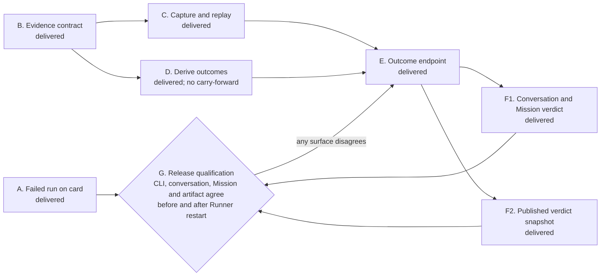

# Delivery outcomes implementation roadmap

November 23, 2026. Release objective: a person opening an ordinary conversation, Mission, CLI result or published report can identify the requested deliverable, its current verdict, the blocking criterion and the evidence behind it. The [source audit](delivery-outcomes.md) records current behavior. Ownership below identifies code areas; individual assignees and dates are open.

| Milestone and owner | Starts after | Deliverable | Definition of done |
|---|---|---|---|
| A. Preserve failed command history — Mission surfaces | Independent | Keep the most recent failed run on the collapsed card and acceptance inbox alongside the latest run. | Existing model regression passes; visually verify both commands on the card and inbox and open the failed run from the card. Local implementation and 10 passing model tests recorded; live UI check pending. |
| B. Define the evidence contract — Runner work and artifact schema | Now | Stable criterion ID, required flag, contract version/digest, candidate identity, attempt ID, evidence source, observation outcome and command reference. Specify separate fields for process exit, assertion result, prerequisite failure and human decision. | Versioned fixtures cover a conversation without a Mission, an approved Mission contract, a candidate change and a legacy text-only spec. Round-trip preserves identities. Legacy criteria show unverified until explicitly bound. |
| C. Capture and replay observations — Runner commands, reviews and persistence | B | Record a declared check against its criterion. Reuse managed command IDs and review executions. Store observations for ordinary conversations and link Mission attempts when present. | Restart after command completion but before acknowledgement; replay yields one observation. Concurrent attempts stay distinct. Missing exit, piped input and absent assertion evidence cannot satisfy a criterion. Capture failure remains visible and retryable. |
| D. Derive delivery outcomes — Runner work model | B; can develop alongside C using B fixtures | One deterministic reducer for required criteria, blocker reasons, evidence freshness, resolved failures and human acceptance. | Generator exit 1 plus SQL exit 0 yields blocked, SQL passed and API checks unrun. A successful rerun of the generator clears only that blocker. Candidate changes invalidate affected proof. Passing all required checks on the current candidate yields success. Acceptance or waiver preserves the recorded technical outcome. |
| E. Expose the projection — Runner transport and CLI | B for schema; C and D for working endpoint | Serve the same projected outcome by conversation and by Mission task; expose machine-readable output and authorized evidence links. | The same attempt has equivalent criterion IDs, states and evidence references through both lookups after restart. An unauthorized caller cannot retrieve private command output. |
| F1. Present completion — conversation and Mission clients | E contract for development; E endpoint for acceptance | Show delivery verdict, unresolved criteria and resolved failure history in the conversation completion summary, Mission card and acceptance inbox. | With no Mission, the conversation still shows the blocker. With a Mission, both surfaces agree. Selecting a command opens its evidence. Human acceptance leaves the technical gap visible. |
| F2. Publish the outcome — artifact store and reader | Same as F1; parallel with F1 | Export an immutable versioned verdict snapshot with candidate, criterion states and scoped evidence references. | Publish while blocked, repair, publish again. The original version still shows blocked; the later version shows the new result. Expired output has an explicit unavailable state. |
| G. Release qualification — scenarios and desktop | C–F complete; fixture preparation starts now | Run the catalog failure, partial repair and final success sequence with and without a Mission. | CLI, conversation, Mission and artifact agree for each candidate before and after Runner restart. Retain test output, candidate revisions and UI evidence. |

## Decision rules settled in B

The versioned fixtures in [`delivery/testdata/v1`](../../services/runner/code/internal/delivery/testdata/v1) pin these rules. A change to them is a new fixture version.

| Recorded facts on one criterion | Criterion state |
|---|---|
| Assertion failed | failed |
| Prerequisite failed, so the check could not run | blocked |
| Assertion passed with exit 0, or from a review | passed |
| Prerequisite passed (`--needs` exited 0) | clears blocked to unverified; changes nothing else |
| No assertion and no prerequisite (a bare exit 0, a stopped run) | unrun becomes unverified; changes nothing else |
| Nothing recorded | unrun |
| A human decision on the outcome | recorded beside the verdict; never changes a criterion |

The verdict is the worst required criterion: failed, then blocked, then incomplete (unrun or unverified), otherwise passed. No required criteria, an unbound spec.v1 contract, or an observation scope that does not match the contract digest yields unverified. Each criterion takes its latest decisive observation (an assertion or a failed prerequisite) in the same contract, candidate and attempt, so an unrelated pass, a met prerequisite or a stopped rerun never resolves an earlier failure, and proof on one candidate or attempt never counts for another. A candidate names each repository's commit and its uncommitted tree. `delivery.Observation.Validate` refuses contradictions such as a passing assertion with a failing exit, a failed prerequisite with exit 0, an assertion from a prerequisite, a decision from an agent, or a person's decision on a single criterion.

## Sequence and release boundary

Finish A's visual check while starting B and the scenario fixture. After B, C and D can proceed independently. E joins those two paths. F1 and F2 can then ship together or independently against the same endpoint. G is the full release gate. The Mind catalog and hosted Hub rollout have their own roadmap; the recorded catalog sequence is sufficient as a Lazybox test fixture.

## Status: delivered

[#76](https://github.com/AntoineToussaint/lazybox/pull/76), [#80](https://github.com/AntoineToussaint/lazybox/pull/80), [#87](https://github.com/AntoineToussaint/lazybox/pull/87), [#90](https://github.com/AntoineToussaint/lazybox/pull/90) and the outcome change deliver B through G. The user guide is [Missions: checking and reading delivery criteria](../../docs/guides/missions.md#checking-delivery-criteria).

| Milestone | Delivered | Left open |
|---|---|---|
| A | The collapsed card and inbox keep the newest unresolved failed run beside the latest run; it clears when a later run with the same title passes. The delivery verdict now carries criterion-bound evidence beside it. | A look at the card in a real desktop session (the Playwright suite covers it on the fixture). |
| B | `spec.v2` criteria with IDs and required flags; `delivery-observation.v1` with contract digest, candidate (each repository's commit and uncommitted tree), attempt, subject, source, reference, and separate exit, assertion, prerequisite and decision; versioned fixtures for the four cases. | — |
| C | `lazybox run --check` / `--needs` resolve their criterion at registration and record against the files fingerprinted then; a run whose files change records nothing. Contract-bound reviewers record per-criterion verdicts (`lazybox delivery review`). The journal keeps one observation per run across retries and restarts; failed writes are visible and retried. | — |
| D | `delivery.Assess` and `delivery.Project`: decisive observations only, failed > blocked > incomplete > passed, the person's decision beside the verdict. | Proof never carries forward: any change to the files makes a new candidate that needs its checks again (see the decision below). |
| E | `GetDeliveryOutcome` by conversation or by Mission task serves one projection: the current files first, then each candidate checked, with every observation and whether its command output is still kept. `lazybox delivery status [--json]`. Agents read only their own conversation's outcome; command output stays behind `ReadCommand`. | — |
| F1 | The verdict on the Mission card (one line, every criterion when expanded), in the acceptance inbox, and under the conversation's messages; runs open their output; acceptance shows beside an unchanged verdict. | — |
| F2 | `lazybox delivery publish [--id]` keeps the outcome as a `delivery-outcome.v1` report; each version keeps its verdict; the reader renders it with output availability as published. | Re-checking output availability when an old snapshot is read later. |
| G | `TestDeliveryQualificationWithoutMission` (RPCs, restart, authorization, snapshots), `TestMissionOutcomeIsTheSameByConversationAndTask` (both lookups, acceptance, restart), the pinned-plan review flow, and the Missions and artifact-reader UI suites with screenshots. | A run on a real desktop with a live agent. |

> **Decision** Proof is per candidate: a commit or an edit makes new files whose checks run again. Deciding which criteria a change cannot affect would need a dependency map per criterion; until one exists, re-running is the honest answer.

> **Decision** Mission cards still match a resolved *run* failure by title; the delivery verdict beside them is criterion-bound and does not depend on titles.
