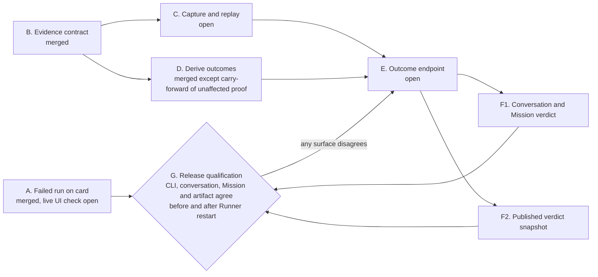

# Delivery outcomes implementation roadmap

November 23, 2026. Release objective: a person opening an ordinary conversation, Mission, CLI result or published report can identify the requested deliverable, its current verdict, the blocking criterion and the evidence behind it. The [source audit](delivery-outcomes.md) records current behavior. Ownership below identifies code areas; individual assignees and dates are open.

| Milestone and owner | Starts after | Deliverable | Definition of done |
|---|---|---|---|
| A. Preserve failed command history — Mission surfaces | Independent | Keep the most recent failed run on the collapsed card and acceptance inbox alongside the latest run. | Existing model regression passes; visually verify both commands on the card and inbox and open the failed run from the card. Local implementation and 10 passing model tests recorded; live UI check pending. |
| B. Define the evidence contract — Runner work and artifact schema | Now | Stable criterion ID, required flag, contract version/digest, candidate identity, attempt ID, evidence source, observation outcome and command reference. Specify separate fields for process exit, assertion result, prerequisite failure and human decision. | Versioned fixtures cover a conversation without a Mission, an approved Mission contract, a candidate change and a legacy text-only spec. Round-trip preserves identities. Legacy criteria show unverified until explicitly bound. |
| C. Capture and replay observations — Runner commands, reviews and persistence | B | Record a declared check against its criterion. Reuse managed command IDs and review executions. Store observations for ordinary conversations and link Mission attempts when present. | Restart after command completion but before acknowledgement; replay yields one observation. Concurrent attempts stay distinct. Missing exit, piped input and absent assertion evidence cannot satisfy a criterion. Capture failure remains visible and retryable. |
| D. Derive delivery outcomes — Runner work model | B; can develop alongside C using B fixtures | One deterministic reducer for required criteria, blocker reasons, evidence freshness, resolved failures and human acceptance. | Generator exit 1 plus SQL exit 0 yields blocked, SQL passed and API checks unrun. A successful rerun of the generator clears only that blocker. Candidate changes invalidate affected proof. Passing all required checks on the current candidate yields success. Acceptance or waiver preserves the recorded technical outcome. |
| E. Expose the projection — Runner transport and CLI | B for schema; C and D for working endpoint | Serve the same projected outcome by conversation and by Mission task; expose machine-readable output and authorized evidence links. | The same attempt has equivalent criterion IDs, states and evidence references through both lookups after restart. An unauthorized caller cannot retrieve private command output. |
| F1. Present completion — conversation and Mission clients | E contract for development; E endpoint for acceptance | Show delivery verdict, unresolved criteria and resolved failure history in the conversation completion summary, Mission card and acceptance inbox. | With no Mission, the conversation still shows the blocker. With a Mission, both surfaces agree. Selecting a command opens its evidence. Human acceptance leaves the technical gap visible. |
| F2. Publish the outcome — artifact store and reader | Same as F1; parallel with F1 | Export an immutable versioned verdict snapshot with candidate, criterion states and scoped evidence references. | Publish while blocked, repair, publish again. The original version still shows blocked; the later version shows the new result. Expired output has an explicit unavailable state. |
| G. Release qualification — scenarios and desktop | C–F complete; fixture preparation starts now | Run the catalog failure, partial repair and final success sequence with and without a Mission. | CLI, conversation, Mission and artifact agree for each candidate before and after Runner restart. Retain test output, candidate revisions and UI evidence. |

## Decision rules settled in B

The versioned fixtures in [`delivery/testdata/v1`](../../services/runner/code/internal/delivery/testdata/v1) pin these rules. A change to them is a new fixture version.

| Recorded facts on one criterion | Criterion state |
|---|---|
| Assertion failed | failed |
| Prerequisite failed, so the check could not run | blocked |
| Assertion passed with exit 0, or from a review | passed |
| Exit 0 with no assertion, a piped run with no exit, or nothing recorded | unverified or unrun |
| A human decision | recorded beside the verdict; never changes a criterion |

The verdict is the worst required criterion: failed, then blocked, then incomplete (unrun or unverified), otherwise passed. No required criteria, an unbound spec.v1 contract, or an observation scope that does not match the contract digest yields unverified. Each criterion takes its latest observation in the same contract, candidate and attempt, so an unrelated pass never resolves an earlier failure, and proof on one candidate or attempt never counts for another. `delivery.Observation.Validate` refuses contradictions such as a passing assertion with a failing exit, an assertion from a check that could not run, or a decision from an agent.

## Sequence and release boundary

Finish A's visual check while starting B and the scenario fixture. After B, C and D can proceed independently. E joins those two paths. F1 and F2 can then ship together or independently against the same endpoint. G is the full release gate. The Mind catalog and hosted Hub rollout have their own roadmap; the recorded catalog sequence is sufficient as a Lazybox test fixture.

## November 23 checkpoint: merged

[#76](https://github.com/AntoineToussaint/lazybox/pull/76) landed A's card change and the first slices of B and D. The evidence-contract change completes B and the reducer rules of D.

| Milestone | Merged | Still open |
|---|---|---|
| A | The collapsed card and inbox keep the newest unresolved failed run beside the latest run. A failure clears once a later run of the same command (matched by title) passes. | Live visual check on the card and inbox. A stable command identity instead of the title. |
| B | `spec.v2` with stable criterion IDs and required flags ([`delivery/contract.go`](../../services/runner/code/internal/delivery/contract.go)). `lazybox artifact template delivery-spec` starts one. Publishing recognizes the schema, and each version records the schema it declares. The artifact reader lists criteria by ID and level. Pinned Mission plans keep the bindings and name them in the approval sheet and the worker and reviewer briefs. The `delivery-observation.v1` contract ([`delivery/outcome.go`](../../services/runner/code/internal/delivery/outcome.go)): contract artifact, version and digest; candidate ID derived from each repository's commit; attempt; conversation, and Mission and task when present; source, reference and idempotency ID; separate exit, assertion, prerequisite and decision fields. One `ContractFromSpec` pins spec.v1 and spec.v2 revisions for plans and assessment. Versioned fixtures cover a conversation without a Mission, an approved Mission contract, a candidate change and a legacy text-only spec, with round trips that preserve every identity. | Nothing for B. C records these observations from managed commands and reviews. |
| D | [`delivery.Assess`](../../services/runner/code/internal/delivery/outcome.go) folds valid observations for one contract digest, candidate and attempt under the rules above. A human acceptance, waiver or rejection is reported beside the verdict and leaves the technical result in place. A new candidate starts with no proof. | Carrying proof forward to a new candidate for criteria its change cannot affect. |
| C, E, F1, F2, G | Nothing yet. | Live command attribution, durable observation capture, the outcome endpoint and the user-facing delivery verdict. |

> **Decision** Mission cards match a resolved failure by run title until C supplies a criterion-bound observation. Two different commands with the same title would clear each other.

> **Note** Verified with `make check` and CI on #76. The new card behaviour has not been looked at in the running app.
