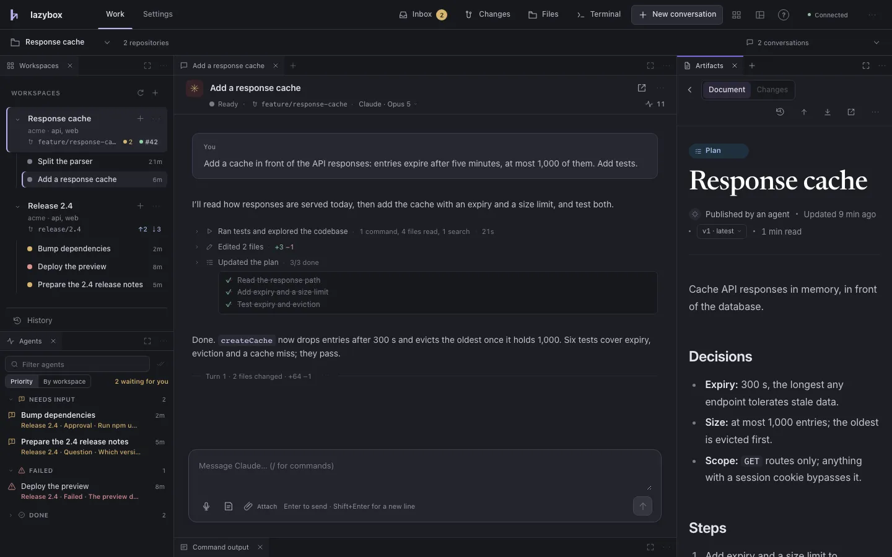
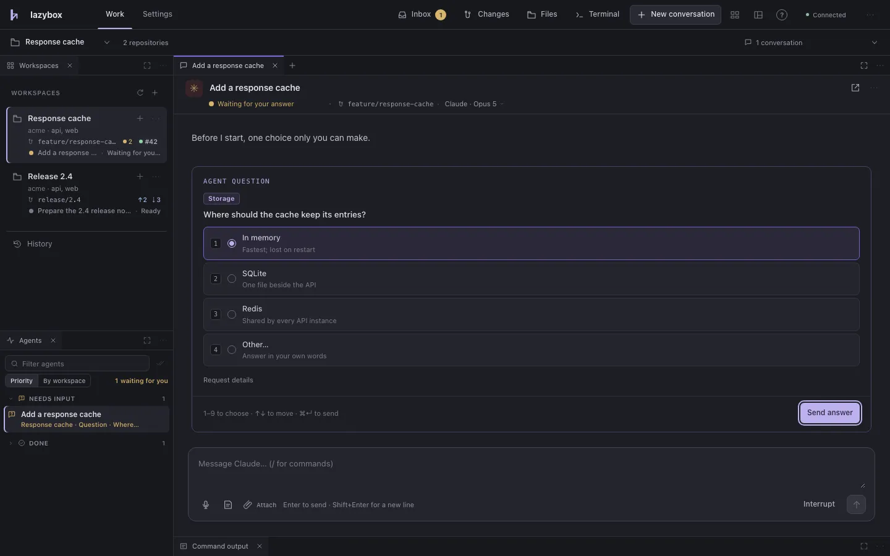
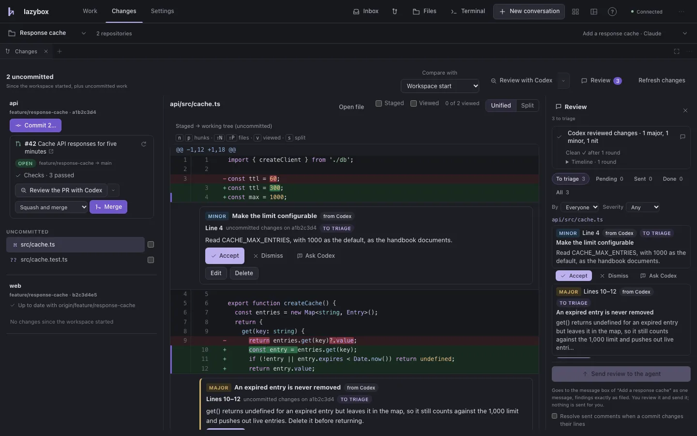
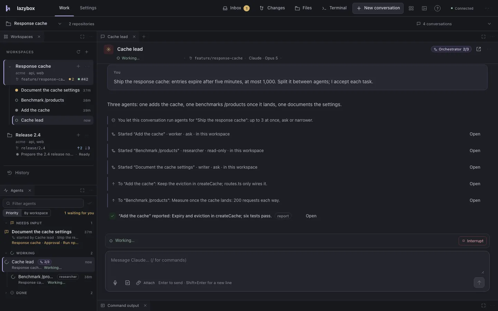
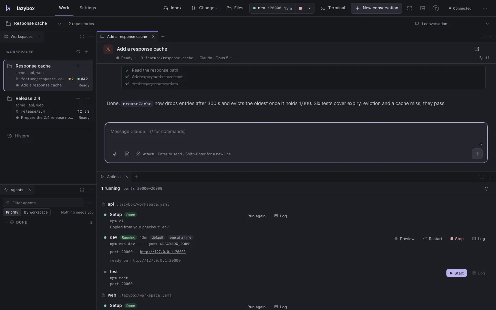

<div class="lb-install">

```sh
brew install --cask AntoineToussaint/lazybox/lazybox-v2
```

A Mac app for Apple Silicon. Or download the disk image from the [releases](https://github.com/AntoineToussaint/lazybox/releases); see [Install](/install).

</div>

<div class="lb-hero-shot">



</div>

<div class="lb-grid">
<div class="lb-card">

### Many agents, one window

Workspaces of one or several repositories, each in its own git worktrees, each with as many Claude or Codex conversations as you like. `⌘J` takes you to whichever needs you next. [Concepts →](/concepts)

</div>
<div class="lb-card">

### A chat built for agents

Questions as option cards, approvals that show exactly what will run, tool calls folded into readable lines, sub-agents as live cards. [Work in the chat →](/guides/chat)

</div>
<div class="lb-card">

### Verify before you trust

A split diff, inline comments, a second agent's review, undo any turn, then commit, push, open the pull request and merge. [Review an agent's work →](/guides/review-agent-work)

</div>
<div class="lb-card">

### Agents outlive everything

Close the window, restart the Runner, install a new build: agents and the commands they started keep running, and Lazybox picks them up where they were. [Install →](/install)

</div>
<div class="lb-card">

### Run your app per workspace

A committed `.lazybox/workspace.yaml` gives every workspace its setup, its dev server on its own ports, and a preview beside the chat. [Run your app →](/guides/run-your-app)

</div>
<div class="lb-card">

### Yours to shape

Light, dark and your own themes, voice, a `lazybox` CLI, your own actions and hooks, and sandboxed panels of your own. [Automate →](/guides/automate)

</div>
</div>

<div class="lb-pair">





</div>

<div class="lb-pair">





</div>
