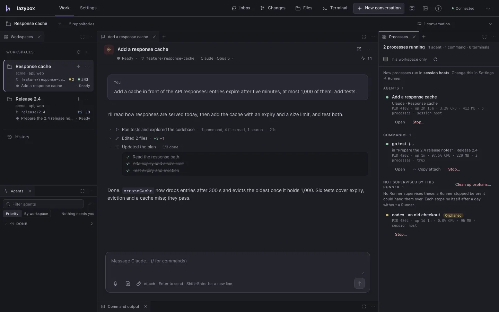
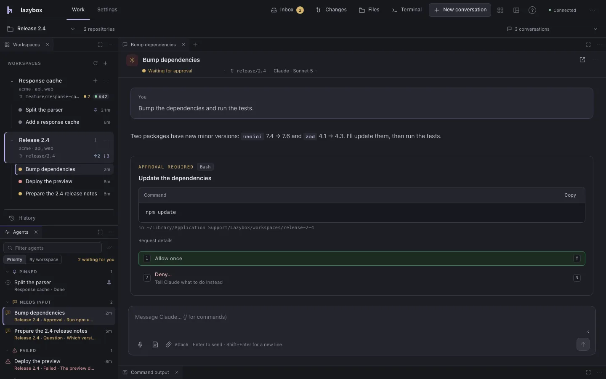
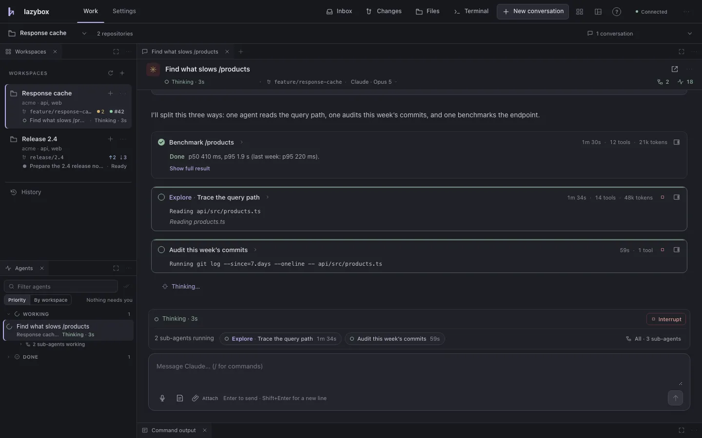

# Concepts

Seven ideas explain all of Lazybox. Each section ends with where to go next.

```
 Lazybox window(s) · phone · lazybox CLI          ← clients: show and ask
                    │
                 Runner                            ← owns the work, on your machine
   ┌────────────────┼──────────────────────────┐
 Workspace        Workspace                 Subscriptions
 (worktrees of     ├─ Conversation ── agent ── sub-agents
  your repos)      ├─ Conversation ── agent
                   ├─ Artifacts (plans, reports)
                   └─ Commands, actions, terminals
 Missions: goals split into tasks, each worked in a conversation, with evidence
```

## Runner

The **Runner** is the program that does the work: it starts agents, runs their
commands, keeps every transcript, creates worktrees and talks to GitHub. The
window, your phone and the `lazybox` CLI are all clients of it.

That split is why **agents outlive everything else**. Close the window, reload
it, restart the Runner, install a new build: each agent and each command runs
in its own small host process, and the next Runner re-attaches to it with its
turn, pending questions, queued messages and output intact.

- The Runner's status is in the workspace header; click it for Settings →
  Runner, where **Restart Runner** restarts it without stopping any agent.
- Settings → Agents & workspaces holds the defaults every new agent gets: its
  permission, workspace naming, and the shared context every agent is given.
- **Processes** (the **Panels** menu in the header → Processes) lists everything it
  hosts — agents, commands, terminals — with CPU, memory, uptime, and Stop.



## Workspaces

A **workspace** is a named place to work: one or several repositories, each a
git worktree on its own branch, plus all the conversations about that work.
Several repositories in one workspace is normal — a change across an API and its
web client is one workspace.

- Every conversation in a workspace shares its files and branches. Need
  separate branches? Use separate workspaces.
- An **empty workspace** (no repository) is for planning or scratch files.
- A workspace can carry its repositories' [setup scripts, dev servers and port
  blocks](guides/run-your-app.md).
- Deleting a workspace stops what runs in it, runs its archive scripts, and
  removes its worktrees. Your original checkouts are never touched.

## Conversations

A **conversation** is one agent session — Claude or Codex — in a workspace, with
its own transcript, account, model and permission. It is durable: an ended
conversation is *Saved*, and the next message you send resumes it with the same
settings.

- **Permission** is chosen per conversation (Ask for approval, Read only, YOLO)
  and can be changed while it runs.
- **States** you will see everywhere — sidebar, inbox, phone, CLI: *needs
  input*, *failed*, *working*, *ready for review*, *done*.
- **The inbox** (`]] i`, or **Inbox** in the header) is the **Agents** list
  under Workspaces: every conversation across workspaces, the ones that need
  you first, always on screen. `⌘J` jumps to the next one. Pins are kept by
  the Runner, so your phone shows them too.

  
- Each turn is **checkpointed**: you can see what a turn changed and revert it.

See [Work in the chat](guides/chat.md).

## Sub-agents

When an agent delegates (Claude's Task tool, Codex sub-threads), each
**sub-agent** is a card in the conversation, where it was started: its task,
live state, the step it is on, elapsed time and tokens, and its result when it
ends. Open a card to follow it in its own panel; stop one without stopping the
rest. Chips beside the message box show what runs right now.



## Missions

A **mission** is a goal bigger than one conversation, split into **tasks**.
Each task is assigned to a conversation, and Lazybox records what actually
happened — commands that ran with their exit status, commits, pull requests and
their checks — as **evidence**. A task's *trust* is derived from that evidence
(claimed → observed → verified → accepted), never from the agent's say-so; you
accept or send back work at its gate. **Preview** — see
[Missions and evidence](guides/missions.md).

You can let one conversation be a mission's **orchestrator**: it starts agents
for the mission's tasks, messages and waits on them, within limits you set
(how many at once, their permission, their subscriptions, a budget). It never
approves, answers for you or accepts work; its agents ask you. See
[Let an agent run agents](guides/orchestrator.md).

## Artifacts

An **artifact** is a versioned document of a workspace — a plan, a report, a
spec — with its own page. Track it from an agent's message, from a Markdown file
(Lazybox follows the file as it changes), or let the agent publish one with
`lazybox artifact put`. Compare versions, export, and hand it back to an agent.
See [Artifacts](guides/artifacts.md).

## Subscriptions

A **subscription** is an account an agent runs on: your existing `claude` or
`codex` sign-in, an Anthropic API key for Claude, or named accounts you add in
Settings → Subscriptions (each signed in once, kept isolated). Lazybox shows
each account's usage windows and reset times. When a conversation hits an
account's limit you can **switch it to another subscription** of the same
provider and carry on in the same conversation; switching by itself is the
*Subscription rotation* extension's. See [Subscriptions and limits](guides/subscriptions.md).

## Commands and the console

When an agent runs a command through Lazybox, two views exist: **you** get every
byte in the **Command output** console; **the agent** gets a compact view —
the outcome, failures kept, noise dropped — plus the path of the full output.
Your own terminal can feed the same console with `cmd | lazybox log`. Lazybox is
not a terminal emulator: keep using your terminal (see the [FAQ](faq.md#is-lazybox-a-terminal)).
