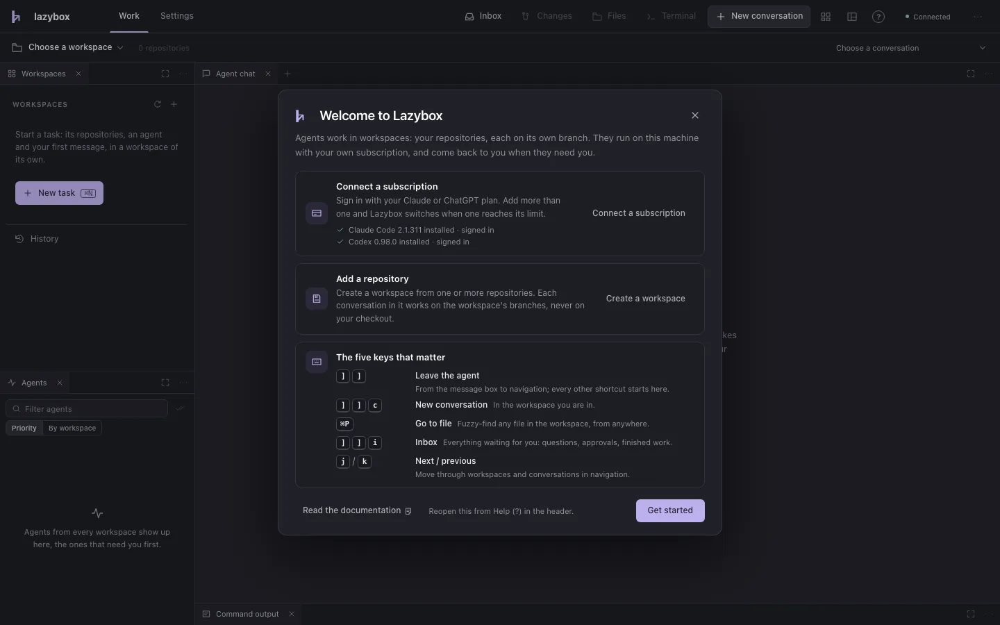
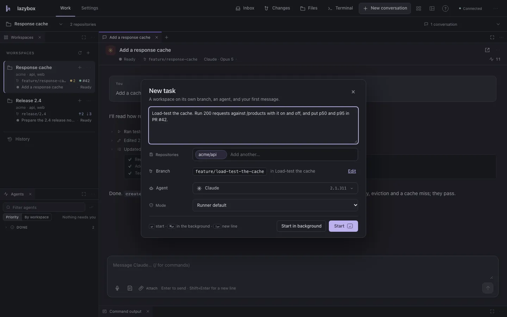
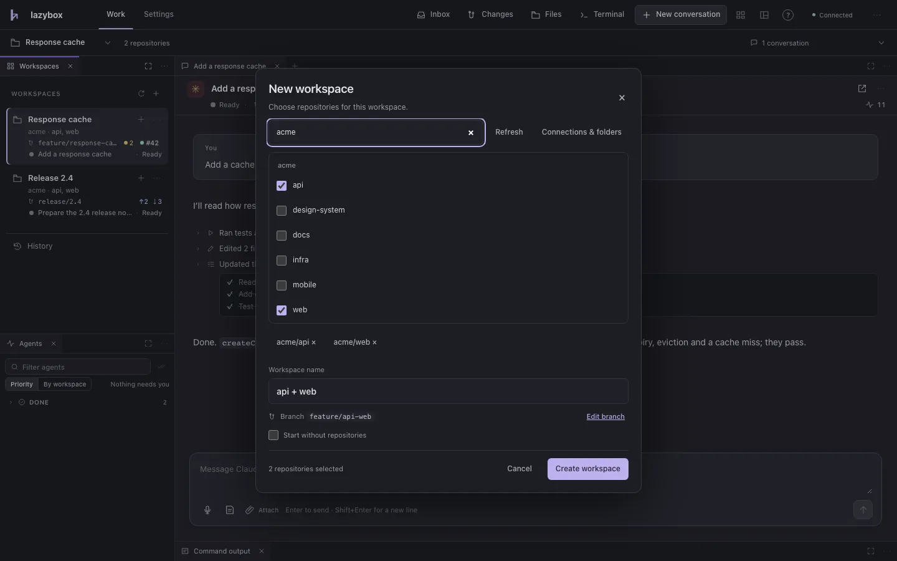
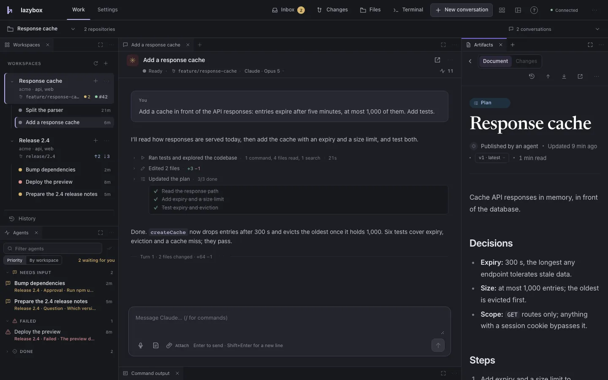
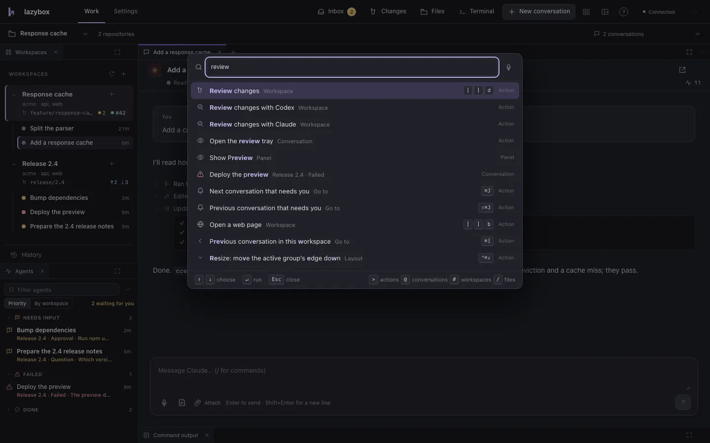

# Getting started

Ten minutes from a clone to an agent working in its own workspace.

- [Install](#install)
- [Build from source](#build-from-source)
- [First launch](#first-launch)
- [Your first workspace](#your-first-workspace)
- [Your first agent](#your-first-agent)
- [The keys that matter](#the-keys-that-matter)
- [Use the CLI from your terminal](#use-the-cli-from-your-terminal)
- [Next steps](#next-steps)

## Install

Lazybox is a Mac app for Apple Silicon (macOS 13.5 or later). During the
preview you build and install it from a clone, with one command:

```sh
git clone https://github.com/AntoineToussaint/lazybox.git
cd lazybox
make install
```

It checks what the build needs (Xcode Command Line Tools, Go, Node.js, Rust)
and prints the command for anything missing, builds Lazybox (5 to 10
minutes the first time), installs it in `/Applications`, sets up its
background service, the **Runner**, puts the `lazybox` command on your PATH,
and opens the app. Lazybox brings its own Runner, Claude worker, Node and
Claude Code, which only needs you to sign in; you need `git`, and Codex if you
use it. `make update` gets a newer version, `make uninstall`
removes it. Everything else — the prerequisites, where things are,
uninstalling — is in [Install](install.md#install-from-source).

Once releases are published on the
[releases page](https://github.com/AntoineToussaint/lazybox/releases), you can
install the disk image instead; from the first stable release, Homebrew too,
and updates arrive in the app
([Install a published release](install.md#install-a-published-release)). To
work on Lazybox itself, see [Build from source](#build-from-source) below.

## Build from source

This is for working **on** Lazybox: Dev and Working run straight from your
checkout, each with its own Runner and data. To use Lazybox, `make install`
(above) is all you need. On **macOS** (the desktop app has only been built
and tested there).

**You need**

| Tool | Version | Why |
| --- | --- | --- |
| Git | any recent | worktrees for every workspace |
| Go | 1.27 or newer | the Runner and the `lazybox` CLI |
| Node.js / npm | 24+ / 11+ | the app's interface and the Claude worker |
| Rust | 1.90 or newer | the native desktop app (Tauri) |
| [Codefly](https://github.com/codefly-dev) CLI | current | builds and supervises the Runner |
| Claude Code and/or Codex | installed | the agents themselves; sign in once, or add accounts later in Settings |
| Tailscale | optional | only to [pair your phone](guides/phone.md) |

**Build and launch**

```sh
git clone https://github.com/AntoineToussaint/lazybox.git
cd lazybox
make deps                                # npm dependencies, once

# Freeze a build you will use day to day ("Working"):
make stage                               # builds, runs the release checks, prints a release id
make promote RELEASE=<that id>
make working                             # opens Lazybox; keep this terminal open
```

`stage` runs the full release check suite, so the first one takes a while.
To try Lazybox straight from your checkout instead, run `make dev`: it
opens **Lazybox Dev**, a separate app with its own Runner and data, which
reloads as the source changes.

Check **Settings → About & updates → Versions** for the build time of the running desktop app.

Keep the launcher's terminal open. Closing the window leaves the Runner — and
your agents — running; `Ctrl+C` in the launcher stops the Runner. Agents keep
running even then, and the next Runner picks them up again.

> **Working and Dev are separate.** Each has its own workspaces, conversations
> and GitHub connection, so experimenting in Dev never disturbs your real work.
> See [the internal notes](../ENVIRONMENTS.md) for where each keeps its data.

## First launch

The welcome checks your Runner and agent readiness, shows where to connect
accounts, and takes you to an existing workspace or a new task. Preview
**Focused**, **Standard**, or **Power user** to choose how much detail the app
shows. Preview agent personalities against the same example prompt and pick
the default for new tasks and conversations. Both choices can be changed
later. Optional steps can be skipped and reopened from Help.


**The installed app sets up its Runner first.** The first time it opens, a
small *Welcome to Lazybox* window explains the Runner, the background service
your agents run in (it starts when you log in, so agents keep working when the
window is closed), and offers to add the `lazybox` command to your terminal.
Choose **Set up Lazybox**; when it says the Runner is running, choose **Open
Lazybox**. If another `lazybox` comes first on your PATH, the window says
what it is and how to fix it; for an older Lazybox installed by Homebrew, it
offers to remove it (`brew uninstall lazybox`, shown before it runs). More in
[Install → First run](install.md#first-run). `make install` has already
done this, and Dev and Working skip this window too (their launcher runs the
Runner), so they open straight to the welcome below.



On a fresh install Lazybox greets you once with the three things it needs:

1. **Connect your agents.** **Add an API key** opens Settings → Agents &
   workspaces → Claude, where an Anthropic API key is the way Anthropic
   documents for apps like Lazybox; your own `claude` sign-in also works.
   **Sign in to Codex** opens Settings → Subscriptions; your existing `codex`
   sign-in already works as *Local CLI sign-in* (see [Subscriptions and limits](guides/subscriptions.md)).
2. **Start a task.** Opens **New task**: repositories, an agent and what to
   do, in one sheet (next section).
3. **Five keys** — shown with *your* bindings. They are also
   [below](#the-keys-that-matter).

You can reopen the welcome any time from **Help (?) → Welcome and getting
started**. After an update, a quiet card in the corner lists **What's new**.

## The fastest start: New task (`⌘N`)



`⌘N` (File → New Task…, **New task** in the header, or where the window is
empty) opens one
sheet: type what the agent should do, pick the repositories (recent ones
first; type to search), check the branch it suggests from your message (Edit
to change it or the workspace's name), the agent and how it works (Ask for
approval, Plan first, Read only, YOLO). **Enter** creates the workspace on its
branch and the conversation, and sends your message; **⌘Enter** does it in
the background so you can start the next one. The sheet remembers your last
repositories, agent and mode; Escape keeps an unsent message for next time.
Choose **Start without a repository** at the top of the repository list to create an empty workspace. Paste a GitHub issue's
link into the message, or choose **From an issue…**, to
[start from an issue](guides/start-from-an-issue.md). The steps below do the
same one at a time.

### Start from another branch

Each repository in the sheet shows where its new branch starts: **from
main ▾**, origin's default branch. When your work lives on another branch
(say a new version developed on `feat/v2` while `main` is the released one),
click the chip or press **⌥B** (`Alt+B`): a searchable list of origin's
branches opens, its default first, then the ones you chose lately, the most
active, then all of them. Type to filter (or a branch name it does not show
yet), `↑`/`↓` and `↵` to choose, `Esc` to close. Lazybox fetches that branch
first, so the workspace starts from it as it is on origin now.

Each new workspace selects the repository's default branch again. Earlier
choices remain in *Recent* for when you want to select them. Offline, Lazybox
uses the last known commit of the selected branch and says so. **Add
repositories…** and **New workspace** have the same chips. From the command
line, use `lazybox new <name> --repo R --start-from feat/v2`.

## Your first workspace

A **workspace** is a named place to work: one or several repositories, each
checked out as its own git worktree, plus every conversation about that work.



1. Press `]] w` (or **New workspace** in the sidebar).
2. To start empty, select **Start without a repository** at the top, enter a name, and choose **Create workspace**. Otherwise, **find your repositories**. The picker searches everything Lazybox knows:
   - **A folder of checkouts:** *Connections & folders → choose a folder*.
     Lazybox scans it once and remembers what it found. No GitHub needed.
   - **GitHub:** *Connections & folders → Connect with a personal token*. The
     form links to GitHub with the right scope (`repo`) already set; the output
     of `gh auth token` works too. Nothing is cloned until you create a workspace.
3. **Select** one or more repositories, accept or edit the name, and
   **Create workspace**. Progress streams while the Runner clones (once) and
   creates the worktrees. Double-clicking a repository creates the workspace at
   once.

Your original checkouts are never changed. Add more repositories later with
the workspace's **Add repositories…** action.

If a repository has a committed [`.lazybox/workspace.yaml`](reference/configuration.md#lazyboxworkspaceyaml-setup-and-actions),
Lazybox asks you to **review its scripts** before running its setup — see
[Run your app](guides/run-your-app.md).

## Your first agent



1. Press `⌘⇧N` or `]] c` (or the **+** beside the workspace name).
2. Choose the **agent** (Claude or Codex), the **account**, and the
   **permissions**:
   - **Ask for approval** — the agent asks before running commands or editing.
     The best place to start.
   - **Read only** — it can look, not change.
   - **YOLO** — full access, no prompts. Use it in workspaces you can throw away.

   *Model & context* holds the rest: a specific model, a *Plan* workflow,
   extra instructions, and a **Gateway** (such as **Metered · track workspace
   cost**) when the Runner has one besides the direct connection.
3. **Start**, then type what you want and press `Enter` (`Shift+Enter` for a
   new line). Drop files or paste a screenshot to attach them.

While it works, the bottom of the conversation shows one live line: the step
in words, the command it runs, and **Interrupt**. When it needs you — a question
or an approval — the conversation says so, the inbox counts it, and you get a
notification if Lazybox is in the background.

Close the window whenever you like: **the agent keeps running**, on the Runner.
Reopen Lazybox and it is exactly where it was.

Next: [work in the chat](guides/chat.md) and [review what it did](guides/review-agent-work.md).

## The keys that matter

| Key | What it does |
| --- | --- |
| `⌘K` | **Command palette.** Every action, conversation, workspace, file, setting and panel, by name. Start here when you don't know a key. |
| `⌘J` | **Next conversation that needs you**, across all workspaces (`⇧⌘J` goes back). |
| `⌘1` … `⌘9` | Jump to the Nth workspace in the sidebar. |
| `]]` | **The leader.** From the message box, leaves typing and opens a menu of every next key: `]] c` new conversation, `]] d` changes, `]] f` go to file, `]] i` inbox, `]] s` snippets… |
| `?` | **All shortcuts**, with your current keys, filterable (`⌘/` works while typing). |



Prefer a tmux-style `Ctrl+b` prefix or plain arrows? Settings → Shortcuts has
both presets, and every key can be changed. The full list is in
[Keyboard shortcuts](reference/keyboard-shortcuts.md).

## Use the CLI from your terminal

Everything you do in the window is scriptable with the `lazybox` command. The
installed app (and `make install`) already put it on your `PATH`; open a
new terminal:

```sh
lazybox doctor                           # is everything set up, and the fix if not
lazybox ls                               # workspaces, conversations, live state
lazybox inbox                            # what needs you
```

If you also have an older Lazybox installed, mind which `lazybox` comes first
on your `PATH` (`brew uninstall lazybox` removes one Homebrew installed).
Agents always get this one. Working on Lazybox itself? Build the CLI from your
checkout with `make build-go` (it writes `bin/lazybox`); it finds the
running Working or Dev Runner by itself. See [the CLI reference](reference/cli.md).

## Next steps

- [Concepts](concepts.md) — the model in one page.
- [Review an agent's work](guides/review-agent-work.md) — Changes, comments,
  checkpoints, pull requests.
- [Run your app](guides/run-your-app.md) — a dev server per workspace, previewed
  beside the chat.
