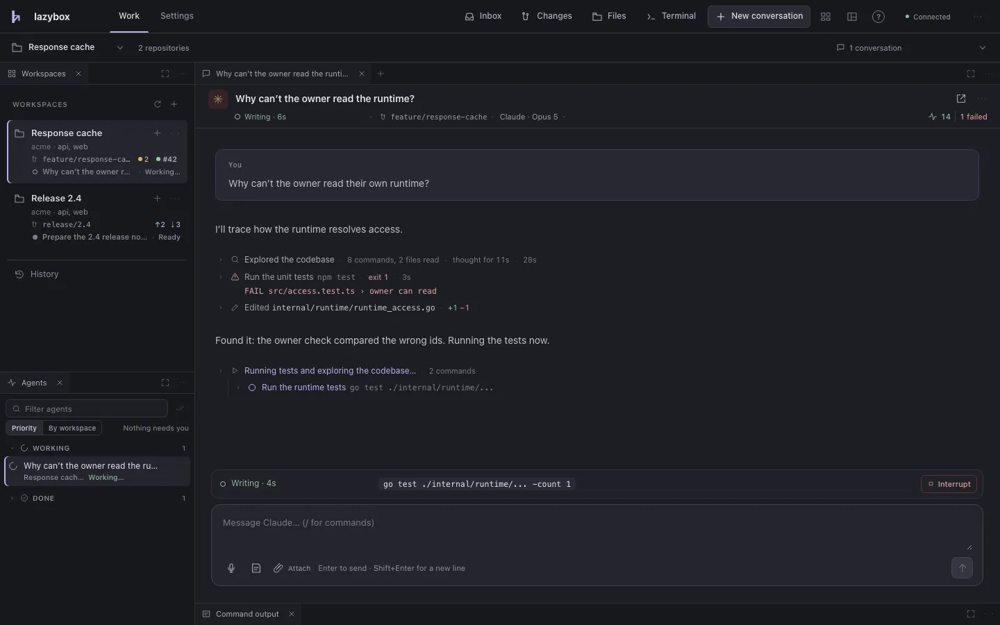

# Activity detail

An agent can run dozens of commands between two sentences. **Activity detail**
decides how much of that a conversation shows. Nothing is ever lost: every call
stays in the conversation's history and in **Activity** (chat header).

| Mode | What you see |
| --- | --- |
| **Smart** (default) | The calls between two pieces of the agent's prose fold into **one line** named after what they did — *Explored the codebase · 8 commands, 2 files read · 28s* — that expands in place. Inside, commands read as the agent described them, or in a short form (`npm run test:client`), never as a raw script. |
| **Quiet** | The agent's prose, its questions and approvals, and its edits. A whole turn's calls are one line — *Worked for 2m 10s · 15 steps · 1 failed* — expandable. |
| **Verbose** | Every call on its own line, with the full command. |

In every mode, **failures, edits, the live plan, questions, approvals and
sub-agent cards always stand on their own**, and while the agent works, the step
running now shows under its summary.

## Change it

- **For every conversation:** Settings → Chat, with a live preview.
- **For one conversation:** its ⋯ menu or a right-click on its header, or the
  command palette (*Activity detail: Quiet / Smart / Verbose / Use the default*).
- **Cycle quickly:** `]] v` switches the conversation you last clicked through
  the three modes, with a short note saying which one you are in.
- **For one answer:** use the response detail selector on its prompt. The choice survives reopening or reloading the conversation. Choose **Session** to follow the conversation setting again.
