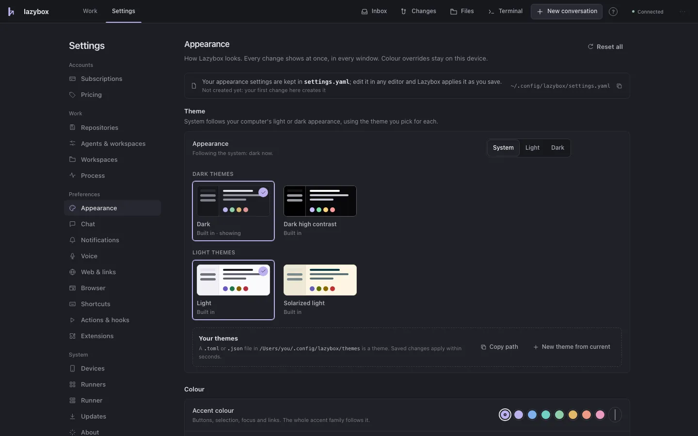
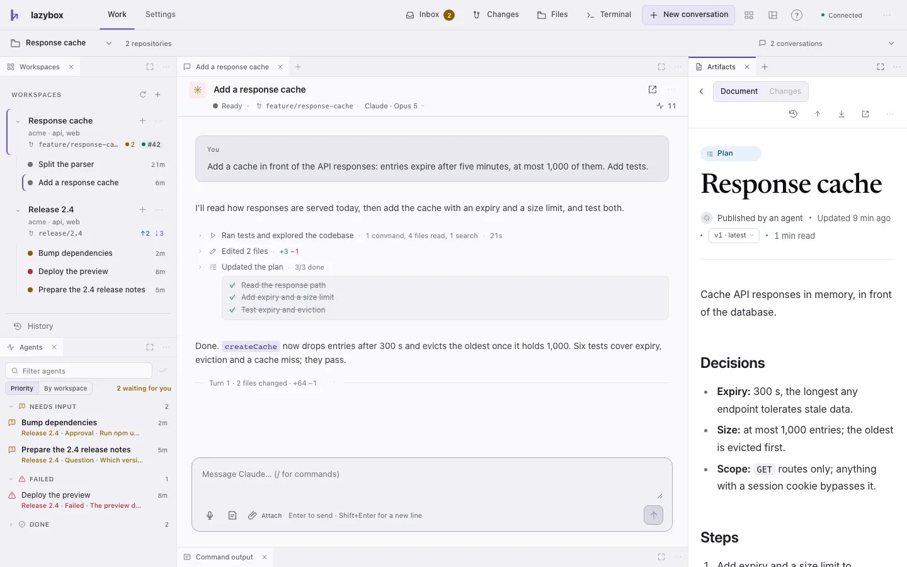

# Appearance and notifications

Light, dark or following your system; built-in and your own themes; an accent
colour, fonts, text sizes, density and zoom. Every change shows at once, in
every window, and is kept on this device.



## Light, dark, or your system

**Settings → Appearance → Appearance:** *System* follows your computer's light
or dark mode; *Light* and *Dark* fix it. Pick the theme used for each mode:
**Dark**, **Dark high contrast**, **Light**, **Solarized light**, or one of
yours. The command palette's *Switch between light and dark* flips it in one go.



## Everything you can adjust

| Setting | Where | What it does |
| --- | --- | --- |
| Accent colour | Appearance | Buttons, selection, focus and links all follow it. |
| Minimum contrast | Appearance | Off, 3:1, **4.5:1** (default, WCAG AA) or 7:1. Text too faint for its background is nudged just enough to reach it; surfaces never change. |
| Colour overrides | Appearance | Any colour token, on top of every theme. **Token reference** lists them all. |
| Interface font and size | Appearance | Any installed font, 11–16 px; every text size scales with it. |
| Code font, size, ligatures | Appearance | The editor, code blocks, diffs, command output and the terminal. |
| Density | Appearance | Compact, comfortable or relaxed rows; also sets chat spacing. |
| Motion | Appearance | *System*, or *Reduce* to turn off animations and smooth scrolling. |
| Zoom | `⌘=` `⌘−` `⌘0` (View menu) | The desktop app, every window, 50–200 %, kept across launches. In a browser, use its own zoom. |
| Chat text | Chat | Size, line spacing, paragraph spacing, and a line-width cap for wide windows, with a live sample. |
| How much of the agent's work the chat shows | Chat | Smart, Quiet or Verbose — see [Activity detail](activity-detail.md). |
| Diffs side by side or unified | `s` in Changes | Remembered for every window. |
| Word wrap in the editor | `⌥Z` | Prose wraps by default, code does not. |
| What a link click does | Web & links | Open in your browser (default) or in a Web panel; the search engine. |
| Keys | Shortcuts | Presets (Vim `]]`, `Ctrl+b`, arrows), every binding, Vim editing. |

Panel arrangement is in [Layouts and docking](layouts.md).

## Your own themes

A theme is a small `.toml` or `.json` file in the Runner's themes folder.
Settings → Appearance → *Your themes* shows the folder with **Copy path**, and
**New theme from current** writes a starting file with the colours you see now.
Edit it in any editor and save: it reloads within seconds, in every window.

```toml
name = "Midnight"
appearance = "dark"        # or "light"
extends = "dark"           # optional: a built-in theme to start from

[tokens]                   # a few base colours; the rest are derived
bg = "#05060a"
surface = "#0b0d14"
"surface-raised" = "#121522"
line = "#252a3a"
text = "#e8ecf5"
"text-muted" = "#8b93a7"
accent = "#5eb1ff"

[typography]               # optional; your own settings win
density = "compact"
chatLineHeight = 1.4
```

Colours are `#rgb`, `#rrggbb`, `#rrggbbaa`, `rgb()` or `hsl()`. A mistake keeps
the last good version on screen, and Settings says what is wrong and where,
suggesting the token you probably meant. More in the
[configuration reference](../reference/configuration.md#themes).

## Notifications and sounds

Settings → Notifications:

- **Notify me when** a conversation *needs input* (a question or an approval),
  *failed*, or is *ready for review* (finished its turn). While Lazybox is in
  front you get a toast in the window instead of a system notification, with
  `⌘J` to jump to it.
- **Dock badge** with the Inbox count: conversations, pull requests and tasks
  waiting for you.
- **Sounds:** a short sound when something needs you (on by default) and when
  an agent is done (off by default). Each one is Lazybox's soft chime, a macOS
  system sound (Glass, Ping… — in the desktop app) or a short file of your own
  (WAV, AIFF, MP3…, up to 512 KB), played when you choose it and with ▶. One
  **Volume** for all, and **Only when Lazybox is in the background** keeps
  them quiet while you are looking at it. These choices belong to this
  computer, so they are kept by this browser or app, not on the Runner.
- **Send a test notification** to check your system allows them. It says
  whether the system took it; a refusal, of the test or of a real
  notification, shows here with the reason until one goes through.

In the desktop app, macOS asks once, the first time Lazybox starts, whether
it may notify you. Settings → Notifications shows what macOS decided. If you
said no, allow it in **System Settings → Notifications → Lazybox**; Settings
reads the new answer when you come back.
