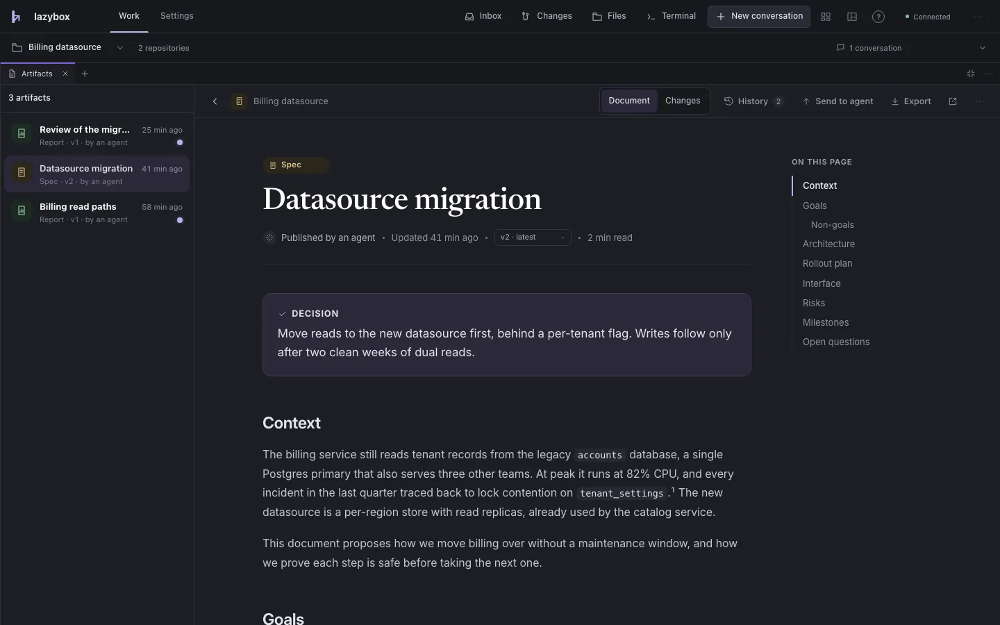

# Artifacts

Agents write plans, reviews and specs — in a chat message, or in a file such as
`docs/PLAN.md`. Track one as an **artifact** and it becomes a versioned page of
the workspace: compare versions, export it, and hand it back to an agent.
The Runner verifies each revision against its saved SHA-256 digest when you open it. If a file is damaged, that revision reports an error. Other intact revisions remain readable.



## Track something

| From | How |
| --- | --- |
| **An agent's message** | Hover the message and click **Track**, or right-click → **Track as artifact…**. The title and kind (plan, report, spec, notes) are suggested, with a preview. When the message links a Markdown file, the dialog offers **Track `docs/PLAN.md`** (stays in sync with the file) first, chosen already for a short message that mostly names it. Later messages of the same conversation offer **Update "Title" from this message…**, which shows the diff before saving. |
| **A Markdown file** | In Files, right-click the file (or the editor tab, or the file's link in a message) → **Track as artifact**. Lazybox follows the file: each settled change becomes a new version, and the page says *Synced with `api/docs/PLAN.md`*. **Stop syncing with file** keeps every version. |
| **The agent itself** | Agents publish with `lazybox artifact put plan.json --title "Migration plan" --kind plan`; their briefing tells them to. |

## One artifact per topic

Agents revise as they go, and three overlapping documents are worse than one.
An agent keeps one artifact per topic: it publishes a new version of the same
artifact, or merges overlapping ones into one with
`lazybox artifact put STATUS.md --title "Status" --supersedes ID1,ID2,ID3`,
which **retires** the old ones. It can also retire one alone with
`lazybox artifact retire ID --superseded-by ID`.

Retiring is safe and reversible:

- A retired artifact keeps every version. Nothing is deleted; only you
  delete (⋯ → **Delete…**).
- An agent can retire only artifacts agents published. Yours, one you edited,
  and files you track stay put unless you retire them.
- The conversation says what happened: **Merged 3 artifacts into “Status”**,
  with **Undo** to bring them all back.
- The Artifacts panel hides retired artifacts. **Show retired (N)** under
  the list shows them.
- A retired artifact's page says **Retired: superseded by Status**: click the
  title to open the replacement, or **Restore** to bring it back.
- You can **Retire** or **Restore** any artifact yourself from its ⋯ menu,
  or by right-clicking its row.

## Read and compare

Open **Source → Edit source** to edit the latest Markdown, JSON or HTML directly. **Save version** (⌘S or Ctrl+S) publishes a revision. The editor keeps the draft in this window while you switch tabs or review a newer version. If someone publishes first, your draft stays attached to its original version. Copy your changes before discarding it and editing the latest source. Edit a tracked file in its workspace to publish a revision.

An artifact lives in its workspace, and you reach it from wherever you are:

| From | How |
| --- | --- |
| **The conversation** | When the agent publishes or updates one, a card shows under its steps: the title, "Plan · v3", **Open**, and **Compare with v2** for an update. A message you tracked gets the same card. |
| **The chat header** | **3 artifacts** counts what this conversation made (or the workspace's, when it made none). Click it for the Artifacts panel showing just those; the pill's **×** shows the whole workspace. It is not there when there are none. |
| **⌘K** | Lists the artifacts of every workspace, with the workspace's name. Type `*` to search only artifacts. One from another workspace switches there and opens it. |
| **The Artifacts panel** | `]] a`, or the **Panels** menu in the header → Artifacts. **All workspaces** at the top lists every workspace's artifacts, grouped by workspace. |

The list shows each artifact's kind, latest version, who made it and when. On the
page:

- **Document** — the rendered Markdown; Mermaid blocks render as diagrams.
- **Changes** — the diff between the shown version and any earlier one.
- **History** — every version with its origin (*you*, *the agent*, *file
  changed on disk*) and time.

The page follows new versions by itself. Rename by double-clicking the title.

## Use it

- **Agent companion** opens a chat beside the artifact, or below it in a narrow panel. The draft includes the displayed version and any selected excerpt. You choose when to send. The companion opens the artifact’s source conversation when available. You can choose another conversation in the artifact’s workspace or start a new one. This also works when browsing **All workspaces**. A retained artifact from a deleted workspace offers **Copy artifact reference**.
- **Review update** compares a new revision with the version you started discussing and keeps the companion beside the diff. **Read latest** returns to the updated document.
- **Open in its own window** moves reading and discussion to a second screen. Use the same button again to bring that window forward.
- In a chat you moved to its own window, an artifact opens **beside the chat,
  in that window**. Drag its edge to resize it; × or Esc closes it, and **Open
  in main window** shows it in the workspace.
- **Export:** Copy as Markdown, Download .md, Download .html for a standalone
  copy of the selected version with offline styling and an outline for longer documents,
  Print or save as PDF, **Save to
  repository…** (written but never committed — review it in Changes), or
  **Create GitHub issue…** in a workspace repository. The desktop app opens
  the system Save dialog for Markdown, HTML, and JSON exports.

Workspace deletion keeps artifacts and their version history by default. Find them under **Artifacts → All workspaces**. Select **Permanently delete workspace artifacts and all their versions** to remove them when the undo period ends. Deleting a conversation keeps its artifacts.

## Preview an HTML artifact

Publish a self-contained page with
`lazybox artifact put preview.html --title "Deploy walkthrough" --format html`.
Update it with `lazybox artifact put preview.html --id ID`. The format is fixed
at creation and independent of the kind. Select a version to preview or
download its original HTML. **Changes** shows a source diff.

The preview supports inline styles, embedded raster images, and native HTML
controls such as expandable details. It runs in a sandbox with scripts and
external resources blocked. Repository file tracking uses Markdown.

For artifacts managed
directly in Lazybox, select an older revision and choose **Republish vN** to
make that content current while preserving the intervening history.

Select text in the Markdown reader or HTML source before opening **Agent companion**. The draft includes the excerpt and a command to read the exact
revision you had open.

## Publish a TODO list

New CLI records created with an explicit kind default to its validated JSON schema. To import an existing document, specify `--format markdown` or `--format html`. Updates preserve the original format.

The task list shows how many items are complete. On the current version, use the remaining-tasks action to prepare a chat draft or copy a brief referencing that revision. You can review the draft before sending.

Publish a JSON file with `lazybox artifact put tasks.json --title "Release tasks" --kind todo-list`.
Each entry has a unique stable ID, text, and a status of `todo` or `done`. Array order is display order.

```json
{"schema":"todo-list.v1","items":[{"id":"verify","text":"Verify on phone","status":"todo"}]}
```

Checking an item saves a revision. Earlier revisions can be viewed and exported as Markdown checklists.

## Read a typed document

Open **Document** on a JSON spec to read the problem, requirements, and acceptance criteria. A plan presents its steps in execution order and groups its completion checks. A roadmap groups milestones by phase and shows each milestone’s owner, status, dependencies, definition of done and recorded evidence. Select a dependency to jump to its milestone. A checklist records each check or uncheck as a revision.

## Build a structured artifact

Run `lazybox artifact template plan > plan.json`, edit the example, then run
`lazybox artifact put plan.json --kind plan --format json --title "Release plan"`.
Publishing a version 1 template also infers its kind and JSON format when both flags are omitted. The template command accepts every artifact kind. Publish revisions with the same ID.
The reader renders sections and ordered content, compares revisions and exports Markdown.

| Kind | Fields in version 1 |
| --- | --- |
| Plan | Goal, steps, completion checks |
| Spec | Problem, requirements, acceptance criteria |
| Report | Scope, findings, evidence, verification gaps |
| Notes | Topic, entries |
| Other | Summary, sections |
| TODO list | Ordered items with stable ID, text and status |
