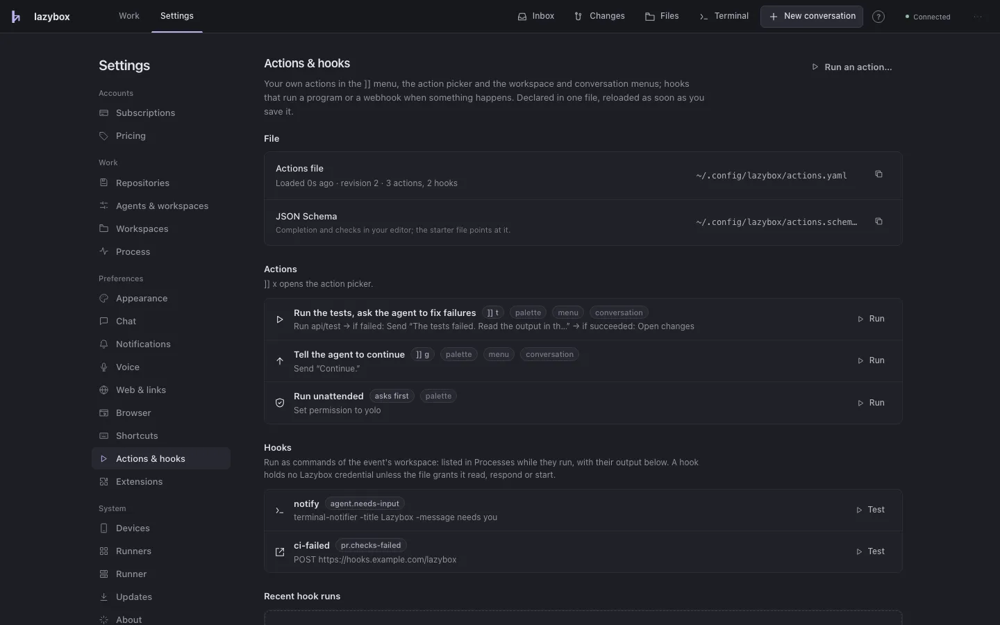

# Automate with the CLI, actions and hooks

Lazybox gives power users three things, all declarative and scoped — no plugin
code runs inside the app (panels of your own run beside it, sandboxed:
[Extensions](extensions.md)):

1. **The `lazybox` CLI** does what you do in the window, from any terminal or script.
2. **Actions:** your own named steps, in the palette and the `]]` menu.
3. **Hooks:** a program, shell line or webhook that runs when something happens.

## Script it

```sh
lazybox inbox                                         # what needs you, in order
lazybox send "Alpha/fix the tests" "Run the suite again"
lazybox wait "fix the tests" --until idle --timeout 20m && lazybox debug "fix the tests"
lazybox watch "fix the tests" --json | jq -c 'select(.type=="turn_ended")'
lazybox open api/README.md:3                          # show it in the window in front
```

Every command takes `--json` and exits with a documented code. The full list is
in the [CLI reference](../reference/cli.md).

## Actions: your own commands



Create the file from **Settings → Actions & hooks → Create actions.yaml** or
`lazybox actions init`. It lives at `~/.config/lazybox/actions.yaml`, and
Lazybox rereads it every second — save and it is live.

```yaml
version: 1
actions:
  - id: test-then-fix
    title: Run the tests, ask the agent to fix failures
    key: t                       # ]] t
    where: [palette, menu, conversation]
    steps:
      - run: test                # a workspace action (see Run your app)
      - when: failed
        send: The tests failed. Read the output in the console and fix them.
      - when: succeeded
        open: changes
```

An action shows up in the **command palette**, the **`]]` menu** on its key,
**`]] x` → Run an action…**, the right-click menu of a workspace or
conversation (*Your actions*), and Settings with a **Run** button. While it runs,
a small progress card (bottom right) offers **Cancel**; a failure stays until
you close it, naming the step and the reason.

Steps can **send** a message or a snippet (to this, a new or a named
conversation, optionally waiting for the turn to end), **open** a panel, a URL
or a file, **run** a workspace action, run a **command**, set the
**permission**, or **wait** for *idle* or *needs-input*. `when: succeeded` /
`when: failed` branch on the step before. Actions run with your own rules: a
read-only conversation still refuses commands, and unapproved workspace scripts
still don't run.

A mistake affects only its entry: it is left out and reported with its line
(Settings, or `lazybox actions validate`); a save that is not valid YAML at all
keeps the last good version.

## Hooks: run something when an agent needs you

```yaml
hooks:
  - id: notify
    on: agent.needs-input
    run: [terminal-notifier, -title, Lazybox, -message, needs you]
  - id: slack-on-failure
    on: [turn.failed, pr.checks-failed]
    filter: { repository: "acme/*" }
    webhook: { url: "https://hooks.slack.com/services/…" }
```

| Events | `agent.needs-input`, `turn.done`, `turn.failed`, `mission.accepted`, and a tracked pull request's: `pr.opened`, `pr.checks-failed`, `pr.checks-passed`, `pr.changes-requested`, `pr.approved`, `pr.merged`, `pr.closed`, `pr.conflicts` (each once, when it happens) |
| --- | --- |
| What runs | `run:` a program and its arguments (no shell), `shell:` a line for `/bin/sh -c`, or `webhook:` a POST of the event as JSON |
| What it gets | The event as JSON in `$LAZYBOX_EVENT_FILE`, and `LAZYBOX_EVENT_*` variables (workspace, conversation, title, PR URL…). Quote them: `"$LAZYBOX_EVENT_TITLE"`. |
| Where it runs | In the event's workspace, as a command listed in Processes; its output is kept, and Settings shows the last 100 runs. |
| Limits | Each event runs each matching hook once; at most 10 runs a minute and 4 at once. |

**Test** a hook from Settings or with `lazybox hooks test notify`.

A hook holds **no Lazybox credential** unless you grant one with `grants:
[read]`, `[respond]` or `[start]` — then it gets exactly what a paired phone with
those permissions could do, only while it runs.

Every field is in the [configuration reference](../reference/configuration.md#actionsyaml-your-actions-and-hooks).
