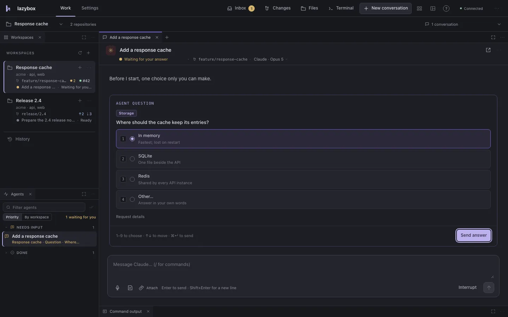
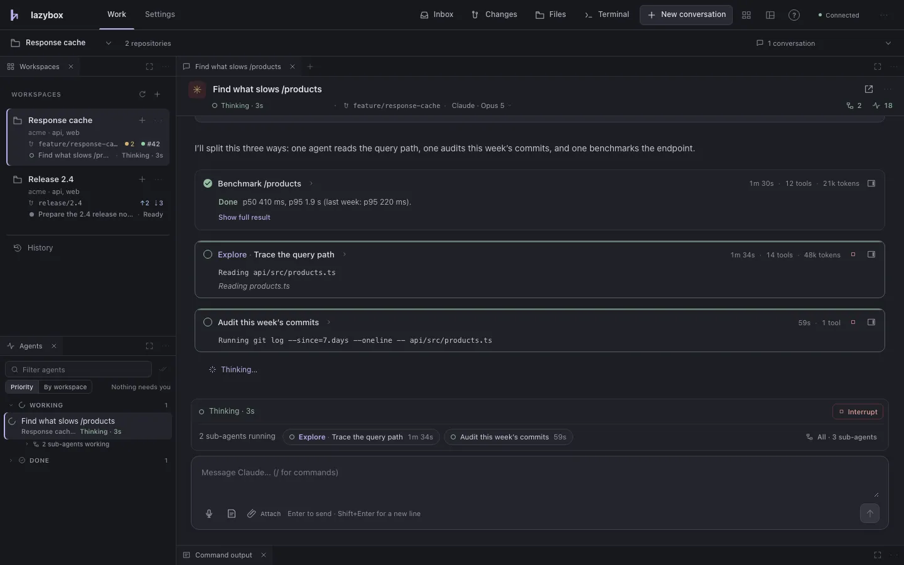

# Work in the chat

The chat replaces the agent's own terminal interface, so everything you would
do there — answer, approve, steer, stop — is here, plus a clearer view of what
it did.

- [Send, steer and stop](#send-steer-and-stop)
- [Hand off to another conversation](#hand-off-to-another-conversation)
- [Have another agent review the work](#have-another-agent-review-the-work)
- [Answer questions and approvals](#answer-questions-and-approvals)
- [Follow what it does](#follow-what-it-does)
- [Sub-agents and background commands](#sub-agents-and-background-commands)
- [What it costs](#what-it-costs)
- [Reuse your prompts and snippets](#reuse-your-prompts-and-snippets)
- [Peek without leaving the page](#peek-without-leaving-the-page)

## Send, steer and stop

- By default, `Enter` sends and `Shift+Enter` starts a new line. To send with
  `Shift+Enter`, assign it to **Send message** in **Settings → Shortcuts**. A message sent
  while the agent works is **queued** and delivered when the turn ends. Queued messages wait
  above the message box (*Queued — Claude is busy (Running a command · 5m)*),
  each with **Send now**, which stops the agent's current step and sends yours
  next in one click (its tooltip names the step it stops), and, for
  Claude and Codex, **Steer**, which hands it to the running turn without
  stopping it: the agent reads it after the step it is on, as when you type
  into its own terminal mid-turn. **Send to sub-agent** asks the running agent to
  delegate that queued message and continue its current task. It appears for
  your messages when the agent supports both steering and sub-agents. An agent that cannot take a message
  mid-turn (an ACP agent, or a Claude agent an older Lazybox started) has no
  Steer, and the strip says so. After Send
  now the conversation shows one quiet line, *Stopped to send your message*,
  and your message goes as soon as the step stops, the other queued messages
  in order after it.
  **Edit**, in the message's row of buttons right before Send now, pauses
  delivery before the editor opens below the message. The message keeps its place
  and attachments, even if the current turn ends. **Save** releases the
  revised message. **Cancel edit** releases the original. If you reload the
  tab while editing, choose **Resume edit** to continue.

  A queued message is in one place at a time: above the message box while it
  waits, then in the conversation where the agent got it, starting its own
  turn after the one it waited for (and after *Stopped to send your
  message*), or, steered, inside the running turn, marked *You · steered*.
- **Send now from the keyboard:** `⌘↵` (`Ctrl+Enter` on Windows and Linux).
  While the agent works, `↵` queues your message and `⌘↵` sends it now,
  stopping the current step. Pressed `↵` and saw it queued? `⌘↵` with an
  empty box sends the oldest queued message now. While the agent is idle,
  `⌘↵` is an ordinary send (also while you dictate). It always stops and
  sends, also for an agent that steers: Steer stays a button. Change the key in Settings →
  Shortcuts.
- **Dictate** instead of typing: hold `Right ⌥` (or `⌥Space`) and speak, or click the
  microphone in the message box — see [Voice](voice.md).
- **Attach** files with the paperclip, by dropping them on the chat, or by
  pasting a screenshot. Up to four files, 20 MiB per message. Each file is a
  box above the message: an image as its thumbnail, a PDF with its page
  count, any other file by name and size. Hover a box (or Tab to it) to
  preview it; click it, or press Enter, to open it. Delete or Backspace
  removes the focused box, ⌥← and ⌥→ (or a drag) reorder them, and × removes
  one too. On a phone, tap a box to open it. A file over a limit stays out as
  a red box that says why (*Too large: 25 MiB of 20*); dismiss it with × or
  Delete.
- **Paste a big chunk of text** — more than 800 characters, or more than 12
  lines — and it becomes a box instead of filling the message: *Pasted text ·
  142 lines*, its first line as the title (*Pasted Python* when it is clearly
  code). Hover it to scroll through it; click it to read or edit it. ⌘Z right
  after the paste, or the box's ⋯ → **Insert inline**, puts the text in the
  message instead. A pasted box counts as one of the four files, and it is
  kept with your draft if the window reloads. Large pasted boxes use the local
  attachment store and can still be edited after reloading.
- Attached files, including screenshots, are saved with the draft on this device.
  The composer remembers their names immediately. Binary files and large pasted
  boxes finish saving in the background. Closing or reloading the window before
  that write finishes can leave a name without its contents. The composer lists
  each missing file so you can reattach or remove it before sending.

- **Every agent gets your attachments**, Claude, Codex and ACP agents alike,
  after your text and in the order of the boxes: an image as an image (when
  the agent sees images), text (a pasted box, a source file, up to 256 KiB)
  as its text, and anything else (a PDF, an archive, longer text) as a file
  the agent opens itself. The sent message shows the same boxes; hover one
  to see how the agent got it.
- **Interrupt** (in the live bar at the bottom) stops the running turn and asks the provider to stop its active sub-agents, including nested ones. Lazybox reports any child it could not stop. An
  interrupt is never treated as an error: send your next message and the agent
  carries on.
- **Permission** can change mid-conversation from the session menu (⋯):
  Ask for approval, Read only or YOLO.
- **Model** too: the session menu and `/model` list the provider's models by
  name, the id after it, with the current one marked — Claude's current models
  and whatever else Claude Code lists, or the models Codex lists for your
  subscription — and the model name in the chat header opens the same picker.
  Choosing the current model does nothing. The switch is live and applies from
  the next turn: during a turn, that turn finishes on its model. An agent that an
  older Lazybox started cannot switch live: one card asks to restart it, and the
  conversation continues (**Restart now**, or **Restart after this turn**).
- **End session** stops the agent but keeps the conversation; sending a new
  message resumes it. **Delete conversation…** removes it.

The composer shows the model picker before the first message and shows the
context percentage when the provider reports it. **Dictate** sits beside
**Send**. Double-click a tool row or live command output to expand or collapse it.

Agent replies show a timestamp on hover or keyboard focus. On touch, tap the
timestamp to see the exact date and time. Date dividers stay visible, and
**Settings → Chat → Always show timestamps** keeps reply times in view.
Command history shows when each run started. Select a run to inspect its exact
time in the output toolbar.

## Hand off to another conversation

The workspace sidebar and chat tabs show an agent icon next to each conversation.
Hover over the sidebar icon for the agent name.

Right-click a message or a selection in a workspace chat and choose **Send to
conversation…**. Choose another conversation in the same workspace and add an
optional note. **Add to draft** opens that conversation and appends the quote,
note, and source link to any existing draft. Review the draft and send it when
ready. The source link in the sent message returns to the quoted message.

If the destination is in its own window, put it back in the workspace first.
[Artifacts](artifacts.md) keep longer-lived context in a versioned document associated with
its workspace.

## Have another agent review the work

**Review** in the conversation's header starts a second agent on the
workspace's changes — committed, uncommitted and untracked, the same review as
**Changes → Review with Codex** — without leaving the chat. So do `/review` in
the message box and `] ] ⇧R` (⌘K *Review this workspace's changes*).

- **Who reviews:** by default the other agent — Codex reviews Claude's work,
  Claude reviews Codex's. The button's tooltip names it (*Review with Codex*).
  Its chevron picks another agent or subscription for this run;
  **Settings → Agents & workspaces → Default reviewer** sets the default:
  the other agent, the same agent in a fresh conversation, or always one agent
  (on a model you choose). When the other agent is not installed or signed in,
  a fresh conversation of the author's agent reviews, and the review says so.
- **A focus:** `/review the retry loop in handler.go` adds what to look at to
  the brief; `/review claude races` names the reviewer too.
- **Watch it:** the review opens as a tab beside the conversation, in the
  same group, without taking you away from your message box. Its tab is
  *Review · Codex*, with a live dot while it works, then *3 findings* (or
  *done*). The conversation shows the review's card, and its findings land in
  the [Review tray](review-agent-work.md#let-another-agent-review-it). The
  review card’s **Open conversation** button brings its tab to the front.
- In a slim panel the button folds into the conversation's ⋯ menu.

## Slash commands

Type `/` at the start of the message box for a menu of what you can run, in
three groups. It filters as you type; `↑`/`↓` choose, `Tab` completes, `Enter`
runs and `Esc` closes it and leaves your text. It works in Vim insert mode too. When several names start with the same letters,
the menu highlights the one you use most. For example, typing `/rev` can select
`/review` ahead of the `/rev` snippet.

- **Lazybox** commands do the real thing and send nothing: `/model <name>`,
  `/permissions ask|read-only|yolo`, `/subscription`, `/compact` (the agent
  summarizes its context; the conversation shows "Compacted context: 156k → 61k
  tokens"), `/clear` (a new conversation in this workspace; this one is kept),
  `/cost` and `/context` (the usage popover), `/review [codex|claude] [focus…]`
  (another agent reviews the workspace's changes; `/review tray` opens the tray),
  `/artifact` (track the agent's last message), `/mission`, `/run` (the last
  command block), `/stop`, `/detail quiet|smart|verbose`, `/rename <title>` and
  `/help`. A command that takes a choice lists it (models, modes) with the
  current one marked. The unfiltered `/model` list puts the current model first
  and the provider default next when available, then sorts the rest by name and version number. Each model appears once. Use `/effort` to choose a supported reasoning level for the current model, or type both in one command, such as `/model luna high`. An unavailable suggestion says why and lets Tab move
  focus away. Enter returns to the normal send flow, which asks before sending
  an unsupported command as text. They are in the command
  palette (`⌘K`) as well, where they leave your draft alone; there `/review`
  is *Open the review tray*. The model name in the chat header and under the
  message box opens the same `/model` choices (`Tab` to it, `Enter`). A
  switch that restarts the agent asks in a card that has the keyboard:
  `Enter` restarts (or restarts after this turn), `Esc` cancels, and the
  message box has the keyboard back. If the provider rejects the model but
  the agent is still running, choose another model before retrying your message.
  Lazybox resolves known model names such as `Fable 5.2` to their provider IDs.
  For a model outside the built-in list, use the full ID from your provider.
- **The agent's own** commands — Claude's built-ins and your project's or your
  own `.claude/commands` — with their descriptions and argument hints. Choosing
  one completes `/name ` for its arguments; `Enter` sends it as the prompt and
  the agent runs it. (Codex's app-server does not list custom prompts.) Where
  Lazybox's command of the same name does nothing for the agent — `/compact`
  for an ACP agent — the agent's own is listed instead.
- **Snippets** by name: choosing one inserts it; those the last one sent chains
  to (`next:`) come first.

A switch of model or permissions, or a compaction, leaves one quiet line in the
conversation rather than a message. Codex compacts its context on its own; its
line says so, with the size before (*Context compacted automatically from 156k
tokens*: Codex does not report the size after). A message that merely starts with a slash
(`/usr/local/bin is missing`) is sent as written; an unknown `/word` asks
"Not a command — send as text?" first, and `Enter` again sends it.

## Answer questions and approvals



When the agent needs you, the conversation shows a card, the inbox counts it,
and it moves to the top of the **Agents** list under Workspaces. Right-click
any conversation, in any list, for Open beside, Peek, Rename, Pin, Mark as
read, Stop, Archive and Delete.

**Questions** show their options as cards: click, or press `1`–`9`; `↑` `↓`,
`Space` and `Enter` work too. *Other…* lets you answer in your own words.
Several questions are answered together and sent with `⌘↵`.

**Approvals** show exactly what will run: the command (highlighted) and its
folder, or the diff of a file edit, with risk hints such as a recursive
delete, a download piped to a shell, network access, or a path outside the
workspace. Then:

| Answer | Key | What happens |
| --- | --- | --- |
| **Allow once** | `y` | Runs this call only. |
| **Always allow …** | `a` | Allows this kind of call for this conversation or this workspace, at a scope the provider supports. |
| **Deny** | `n` | Optionally tell the agent what to do instead; it receives your reason. |

When Codex asks for **more access** than its sandbox gives (the network, a
folder to read or write), the card names exactly what: **Allow once** grants
it for this turn, **Always allow** for the rest of the conversation, and
nothing beyond what it asked.

When the agent marks a request as one to refuse unless you are sure (Claude's
*default to no*), no single key allows it: its allow rows have no key and show
none, and only `n` (deny) works. Allow it with a click, or `↓` to the row and
`Enter`.

Keys work while the chat has focus, never while you are typing. A card that
appears takes the focus itself, not one of its buttons, so a `Space` or
`Enter` meant for the conversation (to page down, say) never answers it. With
two conversations side by side, a key pressed on the page answers the one you
last clicked or typed in, never both.

What you always allow for a Claude conversation stays with the conversation:
Claude does not ask again after its agent restarts, after Lazybox restarts, or
when you resume the conversation later. The session menu (⋯) lists them under
**Always allowed**; × removes one, and Claude asks again for it from its next
request. What you allow for the whole workspace is saved in the workspace's
`.claude/settings.local.json` instead, where Claude itself keeps it.

With **Ask for approval**, a Claude conversation asks before every command it
runs: Bash, Monitor and PowerShell commands and Lazybox's own command tool,
even one a saved rule or Claude's read-only judgement would let through.
For a command, **Always allow** offers that exact command, or the commands
starting with its first words (never for PowerShell), but never every
request of the tool. An older "every Monitor request" Claude no longer
honours leaves **Always allowed**. If Claude reports that it did not apply
Lazybox's own approval settings, a conversation in Ask stops and says what did
not load rather than run commands without asking; resume it once that is
fixed. When Claude rejected only your own settings files (or the conversation
is not in Ask), its warning shows in the conversation, naming the file, and
the agent goes on.

## Follow what it does

- **The header** names the conversation and says how it is going. The title
  is a few words the agent gives it when its first turn ends (turn this off in
  Settings → Agents & workspaces → *Name conversations after their first
  turn*), and until then a cut of your first message that never stops inside a
  word. **Double-click** the title (or press `F2` on it, or ⋯ → **Rename…**) to
  name it yourself: your name always wins and is what the sidebar, the Agents
  list, the inbox, tabs, peek and the palette show. A click shows the first
  message whole. The line under it has the status, the branch, the agent and
  model (click to switch), the subscription when you have more than one, then
  the numbers — prompts, background work, context and cost, tool calls — with
  their words in the tooltips. In a narrow panel what does not fit moves, whole,
  into **⋯**.
- **Tool calls are one line each** — *Read src/a.ts*, *Ran npm test*, *Edited
  3 files +12 −4* — expandable in place to the command, its output, or the diff.
  How much you see is your choice: [Activity detail](activity-detail.md).
- **Edits** show their first changed lines without a click.
- **The plan** (Claude's to-do list, Codex's plan) is a live checklist in the
  conversation; older plans fold to one line.
- **Thinking** is one quiet line: *Thinking…*, then *Thought for 4s*.
- **The live bar** at the bottom of a running conversation says what is
  happening now, in words, with the command and the folder it runs in, the last
  lines of its output, and the right stop button (**Stop command** for a
  command Lazybox runs, otherwise **Interrupt**). A server or watcher the agent
  started with `lazybox run` in the foreground (it listens on a port, looks
  like a server, or has been quiet for 20 seconds) offers **Move to
  background**: the agent's turn goes on and the command keeps running, in
  Command output and Processes. Agents' `lazybox run` does this by itself after
  20 seconds. For the agent's own shell step that may never end, the bar
  suggests interrupting and asking it to use `lazybox run`.
- **What Lazybox tells the agent** is an event, never a message from you: one
  line with an icon — *Added authority to this workspace* `feature/revenge`
  (its path on hover and behind the copy button), *Codex review · 3 findings
  sent*, *Codex asked Claude: …*, *Task assigned · …* — that opens to exactly
  the text the agent received. Events that follow each other read as one
  block. Lazybox's messages are not among the prompts `↑` recalls or `⌥↑`
  jumps to.
- **What Lazybox gained since the conversation started.** A conversation
  lives for days; when Lazybox learns something new for agents meanwhile (a
  new command, a changed rule) or you change Settings → Agents, the composer
  shows *Instructions updated*, and your next message that starts a turn
  carries only what changed, never mid-turn. It shows as one quiet line before
  your message, *Lazybox told Claude about new features*, that opens to
  exactly what the agent received. Each change is told once.
- **Runner restarts** that interrupted nothing leave only a small mark (its
  count and last time on hover), one until you next send a message. A restart
  that left something uncertain — a message it could not confirm, a command
  whose outcome is unknown — is one quiet line saying what to do.
- **Each finished turn** ends with a quiet marker: *Turn 2 · 3 files changed*,
  with **Show changes in this turn** and **Revert to before this turn…** in its
  menu. See [checkpoints](review-agent-work.md#undo-a-turn-checkpoints).
- **Activity** in the chat header opens the full, searchable history of every
  tool call, with Running and Failed filters.
- **Command output** (`]] o`) is the console of the commands the agent ran —
  every byte, while the agent itself received a compact view. It stays on the
  run you read: a new run takes it over only when that run keeps going, the
  one shown has finished, and you have not used the console for 30 seconds.
  Newer runs are offered in its header (**2 newer · npm test ↵ Show**); turn
  off **Follow new runs** in its ⋯ menu to keep it from ever switching by itself.

Links in the agent's answer work: a `path:line` opens the file in the Editor
(`⌥`-click opens a quick look instead), and `⌥`-click on a web link opens it in
a [Web panel](run-your-app.md#browse-beside-your-work-the-web-panel). HTML
quick look has **Open in Lazybox** and **Open in browser**. Both render a
static preview with embedded styles and images.

## Run the commands it gives you

A shell block in the agent's answer (`bash`, `sh`, `zsh`, `console`…) has
**Run** beside **Copy**:

- **Run** runs it in a shell of the workspace's Terminal panel, in the
  conversation's folder: the shell already open there if it is idle at its
  prompt, otherwise a new one, once the shell is ready. It is a real
  terminal, so a login can ask for a password or open a browser sign-in, and
  its sign-in link is clickable. A script of several lines, or a command with
  something to fill in (`<your-project>`), is typed at the prompt instead:
  read it, edit it, and press Return. **Paste in terminal (don't run)**, in
  the ▾ menu, does that for any command. Nothing goes to the agent. When the
  command ends, the block says
  *Finished · exit 0* and offers **Tell Claude it's done**, which sends
  *Done: `make seed` finished (exit 0).* so the agent can go on.
- The **▾** next to Run (or the block's right-click menu) also runs it in a
  repository's [home checkout](home-checkouts.md) or your home folder, opens
  **your own terminal app** at the folder with the command copied, or copies
  it. Last, marked *no terminal*: **Ask Claude to run it** (the block goes as
  its own message, queued behind a running turn; the block then says *Sent to
  Claude · ran ✓* or *failed ✗*) and **Run as command output…** (the exact
  script, editable, and the folder; `Enter` runs it in
  [Command output](#follow-what-it-does), *✓ exit 0* or *✗ exit 2* on the
  block, and after a failure **Ask Claude to fix** adds the script and the end
  of its output to your message; a placeholder such as `<your-token>` must be
  filled in first).
- **A command that needs a terminal** (a login, `auth`, a sign-in,
  `--no-launch-browser`) is marked *needs a terminal*: it is only opened in
  the Terminal panel or your own terminal, or copied. An agent's commands have
  no terminal, so it is never sent to the agent or run as command output.
- **A server or watcher** (`npm run dev`, `docker compose up`, `--watch`…)
  runs in the Terminal panel like anything else (Ctrl+C stops it). Asking
  Claude starts it in the background and tells you when it is ready; Run as
  command output starts it in the background too, with *Running · port 3000*,
  **Open preview** and **Stop**, or the workspace action that runs the same
  command, on the workspace's own port.

Focus a block (`Tab`) and press `Enter` to open it in the terminal, `⌥Enter`
to run it as command output. `]] r` opens the latest block of the conversation
in the terminal. Commands an agent writes inline, such as `make lint`, offer
the same in their right-click menu. In a read-only or Plan conversation, your
own runs still work — they run as you — and the command-output card says so
first.

## Sub-agents and background commands



A sub-agent is a card where its parent started it: its task, live state, the
step it is on (*Reading platform/bin/devbox*), elapsed time, tool count and
tokens; once it ends, its outcome and the result it handed back. Open a card to
follow its own messages and tool calls in a panel docked beside the chat, or
floating. **■ Stop** on a running sub-agent's card, its chip or its row in
Background work (or `Delete` / `⌫` there) stops that one sub-agent (Claude or Codex);
the main agent continues. It reads *Stopping…* until the provider reports the end,
then *Stopped by you*. A skill Claude runs in a sub-agent of its own (a forked
`/code-review`) has no stop of its own: interrupt the turn to end it. A
sub-agent the turn waited on cannot outlive the turn: if its end was never
reported, its card says *Ended without a report*, its clock stopped at its
last step. A step Claude did not run because you interrupted reads
*Stopped*, and one you declined *Denied*; Claude's own words are in its
details.

Beside the message box, one chip per running sub-agent or background command
takes you to it; **All**, and the background-work button in the chat header,
list active sub-agents and background commands. Starting, running and
waiting sub-agents count as active. Finished sub-agents remain in the
conversation. Older finished commands fold behind **Show earlier**.
**Clear finished** hides finished commands from the list for this
conversation, with an option to undo. A failure you looked at stays
dismissed. A conversation keeps its latest 256 sub-agents and commands: past that, the oldest finished
ones leave, and the list says so. A background command (Claude's
`run_in_background`) is not a sub-agent: it reads as what the agent said it
does (*Generate the protobuf code*), whole, with what runs beneath it, and
opens a panel with its script and the output the agent last read.

## Continue in Claude Code or Codex

When you need something of the provider's own CLI that Lazybox does not map
(`/mcp`, a plugin, its own plan mode), **Continue in Claude Code…** (or
**Continue in Codex…**) in the conversation's ⋯ menu and its right-click menu
copies its resume command, in its folder — `cd <folder> && claude --resume
<id>` or `codex resume <id>` — to paste in your terminal. Let the agent finish
its turn here first. A conversation on a subscription Lazybox keeps apart from
your own CLI sign-in says so instead: its history is in that subscription's
private folder.

## Claude Code and Codex capabilities

Both native adapters support attachments, approvals, resuming, subagents,
and switching models and permissions where the running provider supports it.
Codex offers structured questions in Plan mode. Claude Code also offers them
in Execute mode. Stopping an individual subagent is available when the
Claude worker advertises it. The chat uses the session's capabilities to
decide which controls to offer.

## What it costs

The left of the message box's controls shows who answers, the agent and model
(*Claude · Opus 5.5*), and how full its context is: a small meter and a
percentage, amber from 60% and red from 85%, the same reading as the chat
header's. If the agent reports the number of tokens used before it reports
the window capacity, both show the token count. Click the agent
to switch model. Click either meter, or type `/cost`, for the usage popover:
the context window once the agent has reported usage (`/context` opens it
before that) and the conversation's **token cost**: input, cache read, cache write and output,
each with its tokens and what it cost, then the total and how much of the
input the prompt cache served. The cost is an API-equivalent estimate, not a
bill. Usage without a price says which model and why — a model with no price
yet (add one in Settings → Pricing), a provider that reports only a running
total for the session (Codex without the metered gateway), a fee Lazybox does
not price — and how many tokens that leaves out.

Select text in a workspace shell beside your chat and click **Send to agent** to append the selection to the conversation draft. You can add a question before sending it.

## Reuse your prompts and snippets

- **Recall:** `↑` in an empty message box brings back what you sent, newest
  first — this conversation's, then every other's — like a shell; `↓` walks back.
- **Jump to a prompt:** the marker rail and `⌥↑` / `⌥↓` move between your own
  messages in a long conversation.
- **Snippets** (`]] s`, or the snippet icon in the message box): a searchable
  picker over Lazybox's snippet catalog with a preview of the exact text.
  `Enter` sends it, `Shift+Enter` inserts it into your draft. Recent and
  favourite snippets come first. Sending the **review** or **deepreview** snippet on
  its own starts a structured code review with its instructions. Open **Review**
  on the resulting chat card, select the findings you want, and choose the
  current conversation or **Fix in new conversation**. Both prepare a draft
  containing the selected findings for you to send.
- **Review, PR and CI:** Select the **review-pr-ci** snippet (or type `/review-pr-ci`, select it, and send). Your configured default reviewer inspects the changes. When its report is ready, the Runner gives the original conversation the report and instructions to fix confirmed findings, update the branch’s PR or create one, and monitor checks on its latest commit. The author investigates failed checks, pushes repairs, and reports green CI or a specific blocker. A clean review also proceeds to the PR. The workflow leaves the PR open.
- **Your own leader keys:** Settings → Shortcuts can add `]]` menu entries that
  send or insert a snippet with one key.

## Peek without leaving the page

`⌥`-click a row — a conversation, an inbox item, a process, a command, a file —
or focus it and press `Space`, and it opens live in an overlay over the page:
a conversation's latest messages with a message box, a command's output, a
file's content. `←` / `→` step through the neighbouring rows, `⌘↵` opens it for
real, `Space` or `Esc` closes it.

## Conversation templates and behavior profiles

In a workspace tab bar, open **+ → Conversation templates** to start **Code
review** or **Security review** beside the workspace conversation. Both open a
fresh read-only Claude or Codex reviewer and capture a Git snapshot of the workspace changes
before sending the brief. The snapshot includes committed and untracked files
and uses the working-tree version where it differs from the staging area.
Security review asks for defensive inspection of
trust boundaries, authorization, data exposure, input handling and secrets.
Review findings stay in the Review tray. The finished review card links to a
versioned findings report with the captured revisions, coverage and structured
findings. If the reviewer omits its coverage line, the card reports the missing
result and the tray keeps the findings already filed.

In the Review tray, accept the findings you want to address, then choose
**Address selected findings in a new conversation**. Lazybox opens a sibling
with a draft that references the findings artifact and the selected IDs.
Review and send the draft. **Review again** on the template's card captures
the updated workspace for another read-only pass.

Choose a behavior profile when starting a coding conversation. Lazybox
remembers the launch choice when you change models or switch between
supported harnesses. The session menu shows the selected profile.

- **Balanced** starts clear, reversible work after inspecting the workspace
  and asks about decisions that materially change the outcome.
- **Hands-on** makes reversible decisions and carries requested steps through
  verification, including recovery from routine failures.
- **Check in first** starts Claude or Codex with read-only access. The agent
  inspects the workspace and proposes a plan. Approve the plan when the
  harness presents it. If the conversation is still read-only afterward,
  change permissions from the session menu.

Runner administrators can set `defaults.behaviorProfile` to `balanced-v2`,
`hands-on-v2`, or `check-in-first-v1`. Existing conversations keep the
guidance they started with. Profiles guide the model's judgment and tool
permissions enforce the read-only start.

To compare live model behavior, run `make test-personality`. The same fixtures
measure first-turn answers, whether the agent asks for input, elapsed time,
and whether the read-only workspace changed. Set
`LAZYBOX_V2_REAL_CODEX_MODEL=gpt-6-astra` to test Astra explicitly or
`LAZYBOX_V2_REAL_CLAUDE_MODEL` to select a Claude model. The test uses live
subscriptions and temporary Runner state.

### Review recent work

Open **Send feedback → Review recent work** from a workspace conversation. The
Runner examines retained human prompts across that workspace's conversations.
Repeated requests become editable proposals in Artifacts. Repeated repository
conventions suggest AGENTS.md additions. Repeated corrections immediately after
a snippet can suggest a revision. Use **Give feedback on this snippet** in the picker or select a snippet in Feedback to give explicit feedback
after a single use. Retire a proposal to dismiss it. Edit a proposal in Artifacts, then use **Send to agent** to apply the reviewed
change to its destination. A revision identifies the snippet version it used.

To run the same review hourly with the clients closed, enable **Review this workspace hourly**
in the same dialog. The review runs
locally on startup and hourly, uses the retained prompt log, and recognizes
repeated wording across two or more conversations.

A Runner can load declarative snippet packs through its `snippetPacks` array
of absolute YAML file paths. Each pack contains a list, for example:

```yaml
- key: release-check
  category: Release
  description: Review release readiness
  body: Check the release diff and summarize outstanding verification.
```

Pack keys must be unique across the combined catalog. Each entry shows its
pack filename as its origin.

### Agent and command permissions

Use the shield beside the model picker to change the conversation’s permissions.
**Full access** applies to the agent’s own tools and ordinary Lazybox-managed
commands. Interactive terminal handoffs and changes to Lazybox settings still
need your review. **CLI settings** inherits the agent’s native settings while
Lazybox’s command approvals stay in effect. Hover over the shield to see the
agent’s last report. The existing `/permissions yolo` shortcut selects Full
access.

In the sub-agent panel, the timer shows elapsed run time. After a minute without a reported event, **Last update** shows how long it has been since Lazybox heard from that sub-agent. Hover over it for the timestamp.
