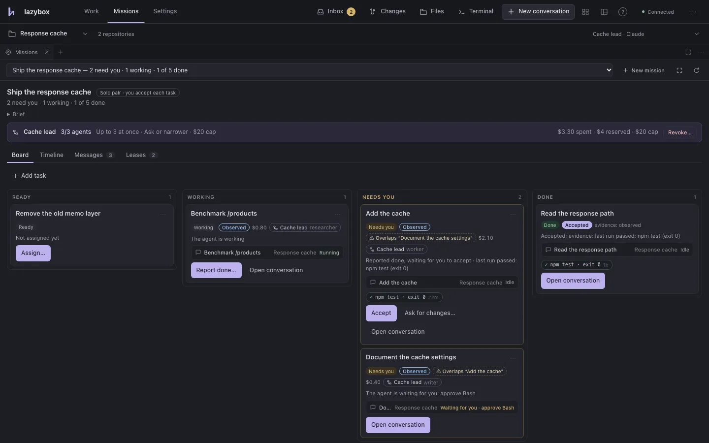

# Missions and evidence

> **Preview.** Missions work end to end for one person, but several pieces are
> still to come — see [What is not there yet](#what-is-not-there-yet).

An agent saying "done" is a claim. A **mission** turns a goal into **tasks**,
gives each task to a conversation, and records what actually happened — so you
can tell *claimed* from *verified* at a glance, across many agents.



## Create a mission

1. Open the **Missions** panel: the **Panels** menu in the header → Missions, or
   find *Missions* in the command palette (`⌘K`).
2. Create a mission with a title and a brief, then add its tasks. Tasks can
   depend on each other.
3. **Assign** a task: pick a workspace and start a new conversation there (or
   hand it to one you already have), optionally sending the task's brief as the
   first message.

The board has four columns — **Ready**, **Working**, **Needs you**, **Done** —
and each card shows the task's status, its trust, its evidence, the
conversation working on it and whether that agent is alive.

## Evidence is recorded for you

While a conversation works on a task, Lazybox attaches evidence to the task
without anyone asking:

- every **`lazybox run`** (or `lazybox log`) that finishes, with its exit
  status, the full output and what the agent saw;
- **commits** made through the PR loop;
- **pull requests** and their **checks**, re-read about once a minute while the
  board is open.

Click a run to open its output in the console; click a pull request to open it
on GitHub.

## Trust, derived — never declared

| Trust | Means |
| --- | --- |
| **claimed** | Reported done, with no passing evidence. A failing last run is flagged. |
| **observed** | The last real `lazybox run` exited 0, or the agent is running. |
| **verified** | Checks passed on a pull request whose head is the newest Lazybox has seen. A later commit makes it *stale*. |
| **accepted** | You passed the task's gate. |

## Accept or send back

When the work looks finished, **Report done…** on the task's card records what
was done. An agent an [orchestrator](orchestrator.md) started reports its own
task with `lazybox agents report`; any other conversation's task is reported
from its card. A reported task waits at its **gate** for you. The inbox lists
*Awaiting acceptance* first, and counts it in its badge: **Accept**, or **Ask for
changes** with a note. From a terminal:

```sh
lazybox missions                       # missions and their tasks
lazybox missions show <mission>
lazybox missions accept <mission> <task>
lazybox missions reject <mission> <task> --note "the migration is missing"
```

A [hook](automate.md#hooks-run-something-when-an-agent-needs-you) on
`mission.accepted` can react when you accept a task.

## What is not there yet

- **Only an agent an orchestrator started reports its own task**
  (`lazybox agents report`). A conversation you assigned yourself does not:
  you use **Report done…** on its card.
- **No automatic reviewer**: verdicts and findings from a second agent are
  designed but not built.
- **The process file is not applied yet.** Every mission uses the built-in
  process: one agent per task, and you accept each task (the board says so
  under the mission's title; its id is `solo-pair`). You can already write and
  check a
  [`.lazybox/process.yaml`](../reference/configuration.md#lazyboxprocessyaml-how-missions-run)
  with `lazybox process validate`.
- **Assigning from the board does not create a workspace**: you pick one. An
  orchestrator can give an agent a workspace of its own
  (`lazybox agents spawn --workspace new`).

### Starting workers from a fixed base

In a Mission plan, set a task's `workspace` to `pinned` to start it in separate worktrees at the base workspace's committed revisions when the plan was proposed. All pinned tasks in that plan share the same member list and commits. Commit or set aside pending changes before proposing. Approve the plan and spawn each task by ID. A pinned task refuses a workspace override. If a dependency changes a shared interface, propose a new plan from the updated base before dispatching work that needs that interface.

To pin a structured acceptance contract, add `contract: {artifact: ARTIFACT_ID, version: 1}` to the plan YAML. The Runner reads that exact spec.v1 from the planner's workspace. The approval sheet shows its criteria and the captured member commits. Each child spawned from the approved task receives the accepted criteria in its brief, even when the artifact has since been revised. This grants no additional artifact browsing permission.
