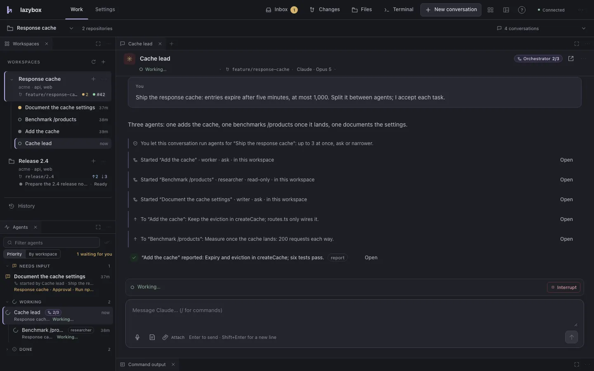
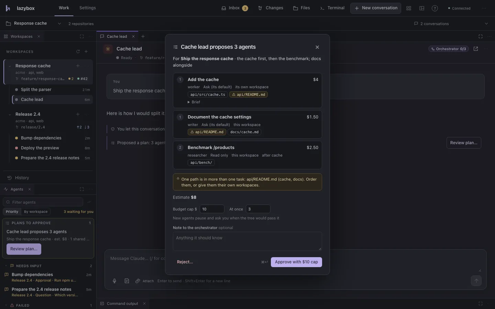
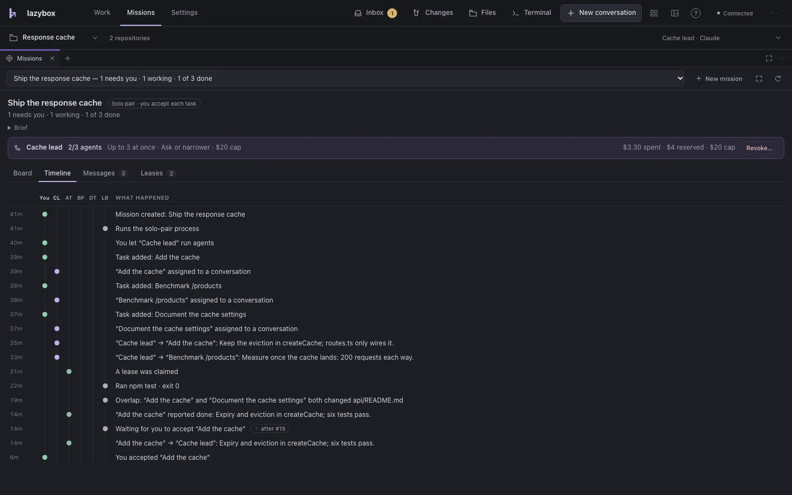

# Let an agent run agents

An **orchestrator** is a conversation you let start and drive other agents
for one [mission](missions.md). It splits the work, starts an agent per task,
messages them, waits for them and stops them. You keep every decision that
matters: their approvals and questions come to you, and only you accept
their work.



You don't need an orchestrator to have an agent start one other
conversation. Ask it in the chat (next section).

## Ask an agent to start another conversation

Tell an agent in its chat, for example *"Start a new conversation in this
workspace to review every module"*. It writes the brief and asks you. The
request appears in the chat as a card, like an approval:

> **Claude wants to start a conversation: Review all modules**
> the brief's first lines (or the artifact that holds it, with **Open**) ·
> **Workspace:** this one, shared with 2 running conversations · **Agent:**
> Claude · Opus 5.5

| Choice | Key | What it does |
| --- | --- | --- |
| **Start in this workspace** or **Start in a new workspace** | `1` `Y` | Starts it where the agent asked, which the button names, and opens it. |
| **Start in a new workspace** | `W` | When the agent asked for this workspace: starts it with its own branches, created from this workspace's, so it doesn't edit the same files as the agents already running here. |
| **Start in this workspace** | `H` | When the agent asked for a new workspace: starts it here instead, without creating one. |
| **Edit…** | `E` | Change the title, brief, agent, model or workspace first. `⌘↵` starts it; `Esc` goes back. |
| **Deny…** | `N` | Tells the agent why. It won't start the conversation another way. |

The arrow keys move between the choices. **Let this conversation start
agents (orchestrator grant)…** opens the grant sheet (below) if you'd
rather let it start agents without asking each time.

The request also shows in the Inbox as **New conversation**, and on a paired
phone, which can **Start** or **Deny** it as asked (changes stay on the
computer). From a terminal, `lazybox approve <conversation>` starts it and
`lazybox deny <conversation>` declines it. Nothing approves a request for
you. A conversation can have at most three requests waiting at once, and a
request expires after a day.

The conversation it starts is a **peer**, not a sub-agent. It has its own
tab and its own row in the Agents list, runs at the asking conversation's
permission, and answers to you. Its first message is the brief, plus a line
saying which conversation asked for it and why. The asking conversation
shows one line, **Started “Review all modules”**, with **Open**, or
**You declined starting “…”**.

For the agent, this is one command (every agent is told about it in its
briefing):

```text
lazybox conversation new --title "Review all modules" --brief "What to do, done when, boundaries"
                         [--brief - | --brief-artifact ID] [--workspace same|new [--start-from B]]
                         [--provider claude|codex|…] [--profile ID] [--model M] [--reason "why"]
                         [--timeout 90s] [--no-wait]
```

For example, if you ask the agent to start a separate TODO conversation in
this workspace, it can run:

```sh
lazybox conversation new --title TODO --brief "Maintain the Workspace TODO artifact." --no-wait
```

Choose **Start in this workspace** on the request card to open the conversation. This is the
agent command for creating a conversation. `lazybox do conversation.new`
opens the owner's New conversation dialog.

With `--workspace new`, the new workspace's branches start from this one's;
`--start-from B` starts them from origin's branch `B` instead, fetched first
(the request says so).

`--brief -` reads the brief from stdin (at most 8 KB). For a longer brief,
publish it as an artifact (`lazybox artifact put … --kind spec`) and pass
`--brief-artifact ID`. The new conversation's first message names that
artifact, so the brief stays versioned. A new workspace gets its own copy
of the artifact. The command waits for your answer and exits with one of
these codes:

| Exit code | Meaning |
| --- | --- |
| `0` | Started. It prints the new conversation's id. |
| `4` | You declined. It prints your reason. |
| `5` | No answer yet. The request stays open, and your answer reaches the conversation later. |

`lazybox agents spawn` requires a live grant. The Runner returns
`grant_required` (exit 4) and creates nothing when authorization is missing.
Select **Authorize this coordinator** in the requesting conversation, review
its mission and limits, then retry the spawn with the same `--key`.
Use `lazybox agents ls` to inspect the grant and its managed children.

## Give a conversation the right

In the conversation, type `/orchestrate` (or ⌘K → **Let this conversation run
agents…**). From the Missions board, **Let a conversation run agents…** does
opens the sheet for that mission. Choose a conversation explicitly. Each option shows the workspace it runs in. Opening the sheet from a conversation instead fixes the conversation and asks you to choose or create its mission.

The sheet asks:

| Field | What it means |
| --- | --- |
| **Mission** | The mission its agents work on. Each agent it starts is a task on that mission's board. Name a new one in the last row. |
| **Permission** | The most an agent it starts may get: Read only, Ask or YOLO. It can never be more than the conversation's own permission. |
| **Subscriptions** | The accounts its agents may run on. By default, the conversation's own. |
| **At once** | How many of its agents may run at the same time (default 3). An agent counts until you accept its task or it is stopped. |
| **Budget** | What the whole tree may spend, or no cap. |
| **Approve its plan first** | On by default: it starts no agent until you approve its plan (below). |

**Let it run agents** gives the right. The conversation's header shows an
**Orchestrator 0/3** badge, and the conversation hears what it may do with
your next message.

## Approve its plan

With **Approve its plan first** on, the orchestrator first proposes how it
would split the mission: each task with who does it, at what permission, in
which workspace, the paths it would change, the order, and an estimate.
The plan waits for you in its conversation (**Review plan…** on the line
*Proposed a plan*), at the top of the Agents list under **Plans to approve**
(the Inbox button counts it and focuses its Review), and on the Missions
board.



The sheet lists the tasks in the order they can start (tasks at the same
step run side by side). A path two tasks would both change is flagged: they
would edit the same files, so order them or give them their own
workspaces. Set the **Budget cap** (it starts at the estimate and a quarter)
and how many agents may run **At once**, add a note if you like, and
**Approve** (⌘↵). Approving creates the plan's tasks on the board; the
orchestrator is told and starts them, in order, and nothing else.
**Reject…** tells it why.

## Budget

The Runner counts priced usage observed for the orchestrator while its grant is in force. A new grant starts at zero even when the conversation has a long history. A task counts usage observed while its conversation is assigned, up to the end of the attempt, closure of the task or cancellation of the mission. The grant counts those agents only while the grant is in force. If you assign one existing conversation to multiple tasks at once, each task shows the usage observed during its assignment. Those overlapping task figures cannot be added to produce a total.

Before starting an agent under a cap, the Runner reads current usage. If that reading fails, the spawn can be retried when usage is available. ACP reports supply a running total. Lazybox records the change at each observation and retains the last known total from older versions.

Each agent the orchestrator starts reserves its plan estimate against the
cap. When what the tree spent (the orchestrator and every agent it started)
plus what its running agents reserved would pass the cap, the next agent is
not started: the board says **New agents paused** with what was spent and
reserved, and **Raise budget** lets it go on. At 80% the board's budget line
turns amber. Each task on the board shows what it cost against its
estimate (*$2.10 / $4*). Costs are API-equivalent prices from Lazybox's
usage records, not an invoice; agents already running are not stopped at
the cap, only new ones.

## The missions board

⌘K → **Open the missions board** opens the board for the connected Runner. Use **Back to workspace** to return. Under the mission, four tabs (←/→
moves between them):

- **Board**: the columns, the orchestrator with its agents, budget and
  plan, and each task's cost and who started it.
- **Timeline**: everything that happened, oldest first, one lane per actor
  (you, the orchestrator, each agent, Lazybox). Narrow windows and timelines with more than eight participants show the actor’s name above each event. Select a conversation name to open it. When its session is unavailable, the timeline keeps the actor’s name as plain text. *after #12* on an event jumps
  to the one it reacts to.
- **Messages**: what the orchestrator and each agent said to each other,
  one thread per pair.
- **Leases**: the paths agents leased, and where their changes met.



## Overlaps and leases

After every turn, Lazybox compares what each of the mission's agents
changed. When two changed the same file, or one changed a path another
leased exclusively, both cards say **Overlaps “…”**, the Leases tab lists
it, and the orchestrator is told so it can sequence them, merge or hand
off. Nothing is blocked mid-edit. An agent leases paths with
`lazybox lease claim search/lexer/ --exclusive`; another task's claim there
is refused while it holds (two hours by default).

## Work sized to your review

When as many tasks wait for your review as the grant allows (3 by default),
the orchestrator's new agents are held and the board says so. Accept or send
back work and it carries on.

## What it can and cannot do

| It can | It never can |
| --- | --- |
| Start an agent for a task (`lazybox agents spawn`) | Approve a request, or answer a question for you |
| Message, wait on and stop **the agents it started** | Reach any conversation it did not start |
| Give an agent its own workspace (new branches from its own) | Give an agent more permission, other subscriptions or more agents than you allowed |
| Read what its agents reported | Pass a gate or accept a task |
| Propose a plan (`lazybox mission plan`) | Approve its own plan, or raise its budget |

Every agent it starts asks **you** for approvals, labelled with where it came
from. A message from an agent never counts as your consent.

## Follow the tree

- **The badge** (click it): the mission, what its agents may get, each agent
  with its state (Working, Needs you, Reported, Accepted), and **Revoke
  grant…**.
- **The transcript** shows one quiet line per agent started, message sent or
  agent stopped, each with **Open**. A message from another agent is an event
  line with its sender — *Index the corpus: Found the tokenizer…* marked
  *your agent*, or *Task from “Search lead”: Index the corpus* — that opens to
  exactly what was sent, with **Open** to go to the sender. It never reads as
  you.
- **An agent it started** shows its orchestrator in its header; click it to
  go back up.
- **The Agents list** (under Workspaces) nests an orchestrator's agents under
  it, each with its role, and the orchestrator shows how many run (*2/3*).
  An agent listed apart from it, such as one that waits for your approval,
  says *started by Search lead · Ship search*. Its approvals are yours,
  never the orchestrator's.
- **The Missions board** shows the orchestrator above the columns, and on
  each card who started it and as what (*worker*, *researcher*…).

## Take it back

Click the badge → **Revoke grant…** → **Revoke**, or **Revoke…** on the
Missions board. The conversation can no longer start or drive agents. The
agents it started keep running until you stop them; their reports still
reach you. Deleting the conversation revokes its grant too.

## For the agent: `lazybox agents`

The orchestrator (and its agents) use these from their own conversations:

```text
lazybox conversation new --title "…" --brief "…"   # starts an agent of the mission at once, under the grant
lazybox agents spawn --title "Index the corpus" --brief "Objective… Done when…" [--workspace new]
                     [--permission read-only|ask|yolo] [--profile ID] [--role worker]
lazybox agents ls                      # its agents and their state
lazybox agents send <agent> "…"         # at most 4 KB, six a minute to one agent
lazybox agents wait [agent…] --until settled|idle|needs-input|reported|closed [--any]
lazybox agents watch                   # follow them live
lazybox agents stop <agent> [--end]
lazybox agents send parent "…"          # from an agent it started
lazybox agents report "what I did and how I checked it"
lazybox lease claim <path> [--exclusive] [--ttl 2h] · release · ls
lazybox mission plan -                  # YAML: summary; tasks with key, title, brief, role,
                                        # permission, workspace, paths, estimate_usd, after
```

From your own terminal: `lazybox mission approve <mission> --cap 20 [--wip 3]`,
`lazybox mission reject <mission> --note "…"` and
`lazybox mission budget <mission> --cap 40`.

A report asks you to accept the task on the board, and tells the
orchestrator. `wait` and `watch` keep going across a Runner restart: the
agents, the grant and who started whom outlive it.
