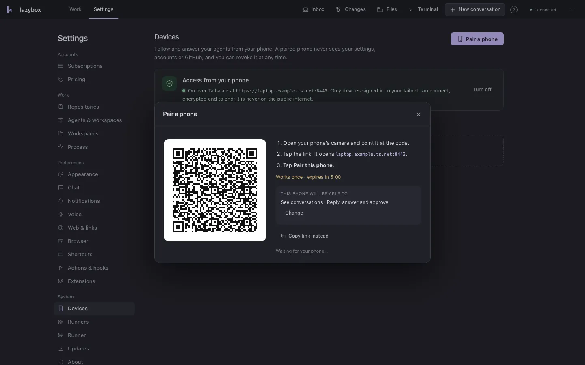
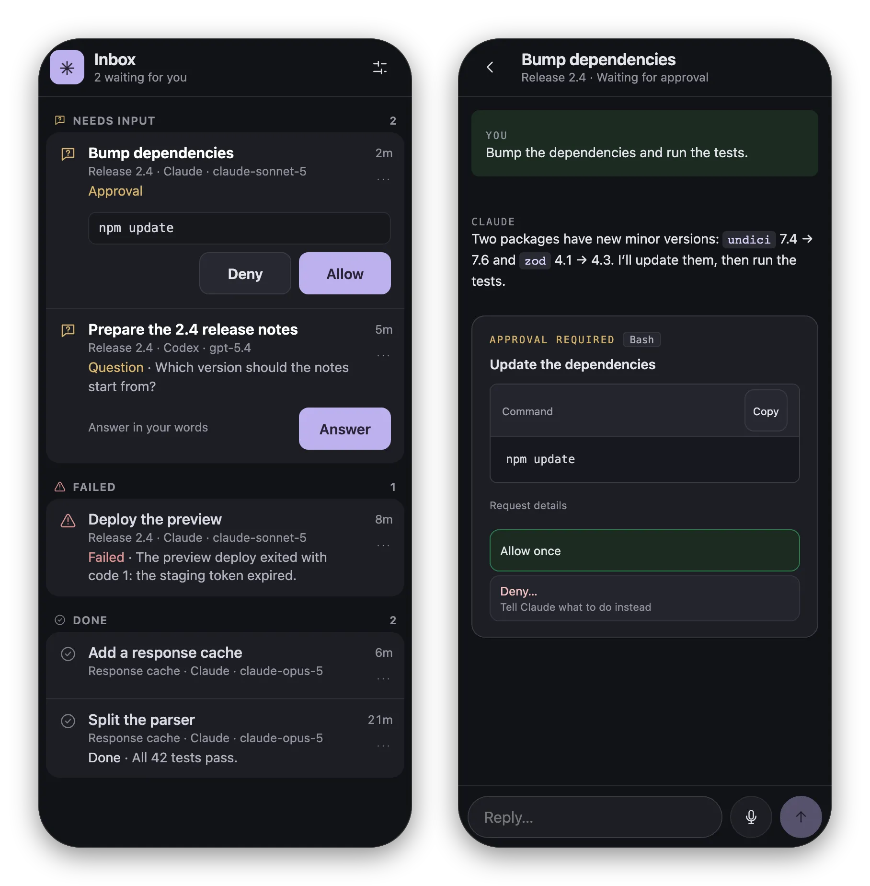

# Pair your phone

> **Preview.** Your phone can follow and answer your agents from anywhere on
> your Tailscale network, and be notified when one needs you. There is no
> native app yet; the phone uses a web page you can add to its Home Screen.

## iPhone app (in progress)

A native iPhone app is being built beside this web page. It pairs the same
way, from the same code, and shows the same Inbox, conversations, approvals,
answers and Send now. It is not on the App Store or TestFlight yet; developers
can build it from source onto their own iPhone (`apps/mobile/README.md`).
In the native app, tap the microphone next to the message field to dictate.
Tap it again to finish, then review the draft and send or queue it.
Until it ships, the web page below is the way to use Lazybox on a phone.

## What you need

- [Tailscale](https://tailscale.com) on the Mac running Lazybox and on your
  phone, signed in to the same tailnet, with **HTTPS certificates** turned on
  for the tailnet.
- Funnel **off** for the port Lazybox uses (Lazybox refuses to serve through
  Funnel: your Runner is never reachable from the public internet).

## Pair

1. **Settings → Devices → Access from your phone → Turn on.** Lazybox serves its
   phone gateway on your tailnet over HTTPS. If something is missing — Tailscale
   not installed or signed in, certificates off, the port taken, Funnel on — the
   card says exactly what.
2. **Pair a phone.** A QR code appears with what the phone will be allowed to do
   (*See conversations · Reply, answer and approve*); **Change** removes
   replying. The code works **once, for five minutes**; closing the dialog
   withdraws it.
3. **On the phone**, scan the code with the camera. Check what it will be able
   to do, name it, and **Pair this phone**. Both screens then show the same key
   fingerprint — check they match.

## Use it

The phone opens on an **inbox** of every conversation across workspaces,
grouped by what it needs: *needs input*, *failed*, *ready for review*,
*working*, *done*. Open one to read the transcript, **Allow** or **Deny** an
approval, answer a question, send a message, or **Interrupt** a running turn.
The tab's title carries the number of conversations waiting for you.

### Answer without opening the conversation

- An **approval** shows the command and anything worth a second look
  (*Deletes files recursively*, *Uses the network*…) with **Deny** and
  **Allow**. A flagged command asks *Allow this?* first; so does the same
  request in the conversation.
- A **question** with a few short options shows them as chips: tap one, or
  for a *choose any* question tap several and **Send**. **Other…** and
  questions that need typing open the conversation.
- After you answer, **Undo** stays on screen for a few seconds before the
  answer goes. Leaving the page sends it at once.
- A file edit or a settings change shows **Review**: read it in the
  conversation before allowing it.

### Swipe

- **Right**: allow an approval; on any other row, pin it. Pinned
  conversations stay together under *needs input*.
- **Left**: **Read**, **Pin** and, while an agent works, **Stop** (it asks
  first). A long swipe left marks the row read.
- **Long press** or **⋯** shows every action. **Undo** follows a pin or a
  mark read.
- **Pull down** at the top to refresh now. When the phone is offline or
  cannot reach your computer, a bar says so, with **Retry now**.

Pins are shared with your computer: a conversation pinned on one is pinned on
the other. A phone that may only see conversations shows the computer's pins
but cannot change them. Read marks are each device's own.

### Follow a command

Commands an agent runs are listed under the conversation's title, running
ones first. Tap one to follow its output live, with search and text size.
The phone reads output; it cannot stop or rerun a command.

To **dictate** a reply, tap the microphone next to Send, speak, and tap it again;
the words appear as you speak, and you tap Send when ready (saying "send" /
« envoie » at the end stops listening; the phone never sends for you). It uses
the phone browser's speech recognition; where the browser has none, the button is hidden
and the keyboard's own microphone dictates instead. See [Voice](voice.md).

## Notifications

Your phone can tell you when an agent asks a question, waits for an approval,
or fails — even with Lazybox closed. Your computer sends them over your
tailnet's HTTPS address through your phone's push service (Apple's or
Google's). A notification holds only the conversation's title and what
happened, encrypted for your phone: never code, commands or messages.

**What you need**

- **iPhone or iPad:** iOS or iPadOS **16.4 or later**, and Lazybox **on the
  Home Screen**: in Safari, **Share → Add to Home Screen**, then open Lazybox
  from the Home Screen. Safari tabs cannot receive notifications; the phone
  shows these steps when needed.
- **Android:** Chrome. Nothing to install.
- The phone paired and reachable over Tailscale, as above. Notifications reach
  the phone through Apple or Google even when Tailscale is off on it; opening
  one needs Tailscale.

**Turn them on**

1. In the Inbox, tap **Turn on notifications** (or **Settings** → **Turn on
   notifications**), and allow when the phone asks.
2. Choose what to be told about: **Needs input** and **Failed** are on,
   **Ready for review** is off — the same as Settings → Notifications on your
   computer. Each phone chooses its own.
3. **Pause at night** sets quiet hours (22:00–07:00 by default, in the phone's
   time zone). Nothing is sent then; the Inbox still has everything.
4. **Send a test** to check. Settings → Devices on your computer shows which
   phones have notifications on, and can send one a test too.

Tap a notification to open its conversation, ready to answer. Answered on the
computer meanwhile? The notification leaves the phone the next time Lazybox
opens there.

If notifications stop: open Lazybox on the phone once (it renews its
subscription), check the phone's own settings (**Settings → Notifications →
Lazybox** on an iPhone), and **Send a test**.

## Revoke

Settings → Devices lists each paired phone with its permissions, fingerprint,
pairing date, when it was last seen and whether its notifications are on.
**Revoke** signs it out at its next request and stops its notifications.

## What a phone can never do

Change settings, subscriptions or GitHub, open terminals, run commands, edit
files, delete anything, restart the Runner, manage devices — or change an
agent's permission mode, even with every grant. A phone's access token lasts 15
minutes and its key cannot be copied out of the phone's browser.

Not yet: access from outside your tailnet, reviewing diffs on the phone, and
starting a conversation from the phone.
