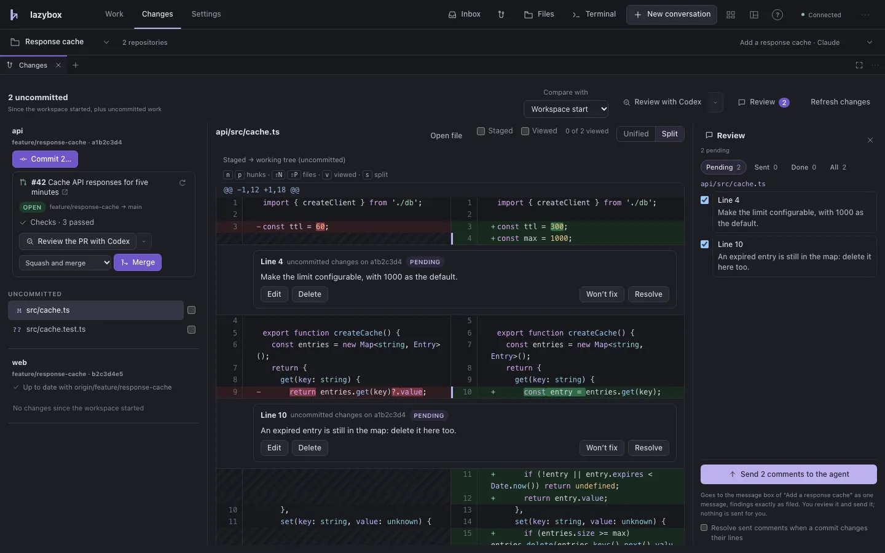
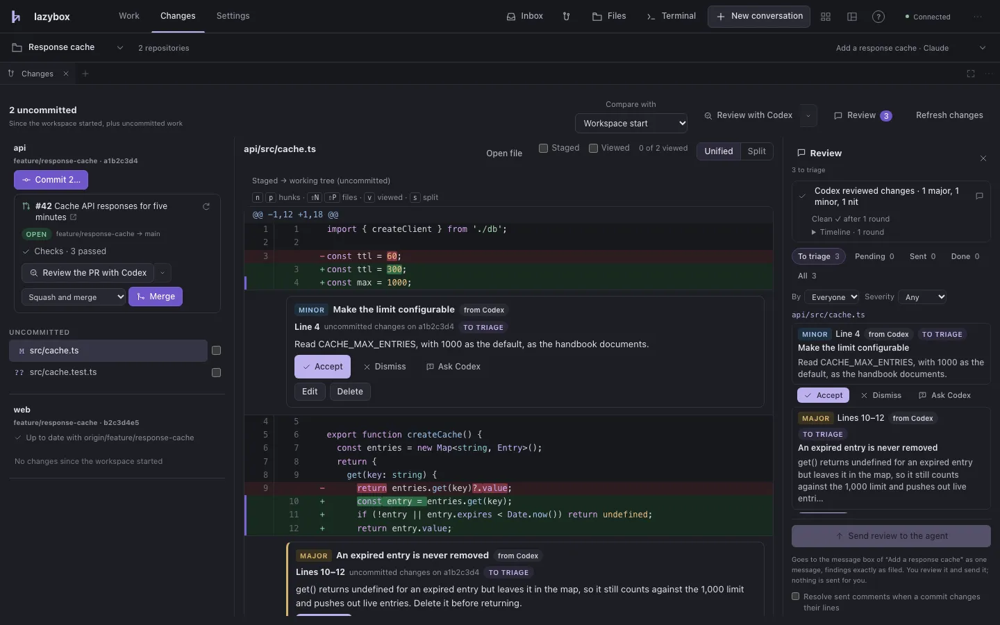
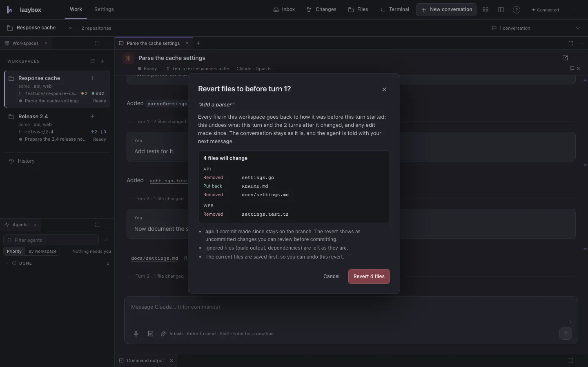
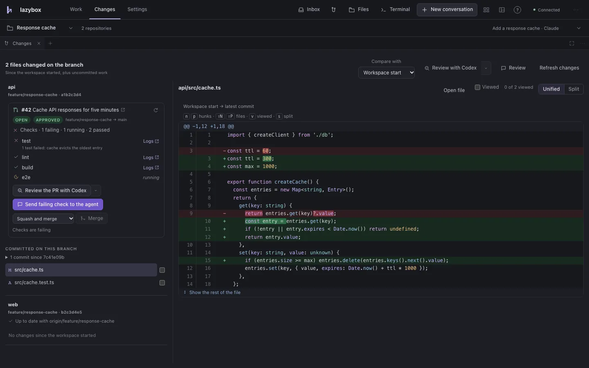

# Review an agent's work

When an agent says it is done, Lazybox gives you five tools to check: the
**Changes** page, **review comments** it can act on, **another agent's
review**, **checkpoints** to undo a turn, and the **PR loop** to land it.

- [Read the changes](#read-the-changes)
- [Comment, and send the comments to the agent](#comment-and-send-the-comments-to-the-agent)
- [Let another agent review it](#let-another-agent-review-it)
- [Undo a turn: checkpoints](#undo-a-turn-checkpoints)
- [Commit, push, open and merge a pull request](#commit-push-open-and-merge-a-pull-request)

## Read the changes

Press `]] d` (or **Review changes** in the workspace header). Changes shows every
repository of the workspace, each on its own, with its changed files and their
diffs. No GitHub connection is needed for any of it.



- **Compare with** picks what you see: uncommitted changes, staged changes, the
  branch since the workspace started, against the default branch or any other
  branch — or **one agent turn** (before → after).
- **Unified or split** (`s`): side by side, with the words that changed marked
  inside each line. Long unchanged runs fold; click a fold to read the lines.
  A pane narrower than 700px shows unified.
- **Viewed** boxes per file (`v` ticks one and moves to the next). A file whose
  diff changes again is unticked for you.
- **Move fast:** `n` / `p` next and previous hunk, `Shift+N` / `Shift+P` next
  and previous file.

## Comment, and send the comments to the agent

Every diff takes inline comments, like a pull request review — but the reviewer
receiving them is your agent.

1. **Comment:** hover a line and click **+**; drag down the **+** column, or
   Shift-click a second line, for a range. Removed lines take comments too.
   Comments are Markdown; `⌘↵` saves.
2. **Collect:** **Review** in the Changes header opens the tray with every
   comment of the workspace, by file, filtered *Pending*, *Sent*, *Done* or *All*.
   In a narrow Changes panel the tray and the file list share the left column:
   switch with the **Files** and **Review** tabs above it.
3. **Send:** **Send N comments to the agent** sends **one message** to the chosen
   conversation with each comment with `repo/path:line`, the quoted
   lines and whether they are still current. Untick any you want to keep back.
   The comments are marked *Sent* after delivery.
   In the transcript, open the review comment thumbnail to read or copy the full message.
4. **Close the loop:** Resolve, Won't fix, Edit, Delete or Reopen from each
   thread. Optionally, *Resolve sent comments when a commit changes their lines*.

Comments follow the code: one whose lines moved re-anchors (*moved*); one whose
lines are gone is *outdated*, with the original lines still quoted. They are
kept by the Runner, so every window sees them and they survive restarts.

> Not yet: publishing comments to GitHub as a PR review, replies inside a
> thread, comments from the Editor.

## Let another agent review it

**Review** in the conversation's header — or **Review with Codex** in the
Changes header — starts a second agent on the work, **read-only**. By default
it is the other agent than the one that did the work: Codex reviews Claude's
work, Claude reviews Codex's. It is a conversation of its own in the
workspace, briefed with the goal, the plan, the diff and the test runs; you
can talk to it like any other.

- **From the chat:** the header's **Review** (its tooltip names the reviewer),
  `/review` in the message box, or `] ] ⇧R` (⌘K *Review this workspace's
  changes*) review the workspace's changes — committed, uncommitted and
  untracked, as Changes does — without opening Changes. `/review <focus>`
  tells the reviewer what to look at first. The chevron beside the button
  picks another reviewer for one run.
- **It opens as a tab** beside the conversation it reviews, in the same panel
  group, and you stay in your message box. The tab reads *Review · Codex*,
  with a live dot while it works, then *3 findings* (or *done*). Its row in
  the sidebar brings the tab to the front.



- **Its findings land in the Review tray**, *To triage*, each with its
  severity (blocker, major, minor, nit), a title and the lines it is about —
  and as a card on those lines in the diff. Filter by severity or author.
- **Triage:** **Accept** makes a finding a pending comment; **Dismiss** asks
  why and keeps the reason; **Ask Codex** opens the reviewer's conversation
  with a follow-up about that finding.
- **Send** them with your own comments, as above: the author receives each
  finding exactly as filed.
- The author's conversation shows the review while it runs, then what it
  found, with **Open review**. When it ends with findings you have not sent,
  **Send N findings to Claude** sends them directly to the author and preserves your draft.
- **The reviewer closes when its work is handed on.** A reviewer stays out
  of the sidebar; open it from its review card or the review tray, and its
  questions reach the Inbox. Once its review is over and every finding is
  sent or dismissed, sending ends and archives it. Untick **Close the reviewer after sending** in the review tray
  to keep it.
- **Clean ✓** means nothing at major or above is open (a minor or a nit may
  be, and it says so). The loop works on blockers, so it can end with majors
  open: the card then says *No blockers · 2 major open*.
- **Cancel review** on the card (or `Esc` on it, the reviewer's ⋯ menu, ⌘K
  *Cancel review*, or `lazybox review cancel` in your terminal) stops a review
  under way: the reviewer stops now, its session ends and no further round
  starts. Its conversation and the findings it filed stay. It asks first only
  when there are findings. The card then reads *Review cancelled · 2 findings
  kept*, with **Review again**. Stopping, ending or deleting the reviewer's
  conversation yourself stops the review the same way: *Review stopped*.

Other ways in: a turn's ⋯ menu (**Review this turn with Codex**), the pull
request card (**Review the PR with Codex**) and ⌘K.

**Settings → Agents & workspaces → Review by another agent** sets the
**Default reviewer** — *The other agent (recommended)*, *The same agent, in a
fresh conversation*, or always one agent or subscription (an ACP agent too),
with the model it runs on — whether findings go back to the author between
rounds, and can review every turn that changes files. When the default
reviewer is not installed or signed in, a fresh conversation of the author's
agent reviews, and the review's card says so in a quiet line.

### Verify behavior with another agent

In the workspace's **New tab** menu, choose **Behavior verification**. This
starts an independent reviewer and an automatic repair loop, bounded by the
configured review round limit. The reviewer derives acceptance criteria from
the goal and registers independent executable checks.

The reviewer runs a check with the managed-command tool's **verify** action,
or through the CLI available to every agent backend.

```sh
lazybox review verify --name "restart recovery" --member api \
  --expected "existing tasks survive a failed poll and restart" \
  --regression "retain this scenario in the provider recovery suite" \
  -- go test ./provider -run TestPollRecovery
```

The Runner creates independent Git checkouts of the captured base and candidate,
including captured uncommitted changes, and executes the same command in each.
Commands run with a private home and temporary directory, without the reviewer's
credentials or host network access. They can read system toolchains and their
checkout, and write only inside that checkout. macOS uses sandbox-exec; Linux
requires bubblewrap and enabled unprivileged namespaces. On Ubuntu 24.04,
AppArmor also needs its distribution-provided `bwrap-userns-restrict` profile
(from `apparmor-profiles`) loaded by the administrator. CI installs and loads
that profile before testing; it does not disable the system-wide restriction.
See [Ubuntu's AppArmor guidance](https://discourse.ubuntu.com/t/understanding-apparmor-user-namespace-restriction/58007)
for the profile's purpose and deployment considerations. An unavailable sandbox
refuses execution; it never falls back to unrestricted host commands. Dependencies
must already be in the captured tree or available from the system toolchain;
network installation and user-home caches are unavailable. Each execution is
capped at fifteen minutes by its session host, including while the Runner is
restarting or preparing other reviews. Managed output survives Runner restarts.

The recipe is frozen once registered. Repeating it returns the same round's
command IDs; if preparation was interrupted before a side launched, retry starts
that missing side without repeating an existing execution. Changing its assertion or command requires a new criterion. The
**Acceptance checks** section in the Review tray shows each round's revisions,
exit results, state, and buttons to open base and candidate output. The report
artifact retains the reviewer account and Runner-recorded results, with one
version per completed round.

The reviewer files actionable failures as blockers. Lazybox sends them and the
recorded reproduction recipes to the author, asking it to repair the behavior
and retain confirmed reproductions in the existing regression suite. When the
author changes files, Lazybox captures a new candidate and reruns the frozen
checks. The reviewer inspects the output and resolves or reopens findings.
Regression proposals remain attached to the checks for the reviewer to follow up.

A successful verification requires isolated executions bound to the exact current
member, base and candidate commits, plus resolved
blockers. Zero checks, incomplete snapshots, interrupted execution and missing
results produce **Acceptance verification incomplete · needs you**, including in
mission evidence and conversation badges. Legacy or mismatched completed receipts
are invalidated and their mission evidence and report corrected; the original
report remains in artifact history. Start a new review to replace those receipts. Repeated
blockers, a repair turn without changes, and the round limit also escalate.
The report identifies ambiguous intent and remaining coverage gaps for the
person to decide. Passing commands establish only the assertions they execute.

Pause holds later rounds, Resume continues a pending recheck, and Cancel ends
running verification commands and the review. Each checkout is removed once
its command finishes (its exit status and output stay with the command), or at
once when the command cannot start; any left are removed when the review
conversation's checkpoints are deleted.

## Undo a turn: checkpoints

Before every agent turn, and again after it, Lazybox saves a checkpoint of every
repository in the workspace — committed, uncommitted and untracked files —
without touching your branch, index or stash.



- Each finished turn ends with a quiet marker: *Turn 3 · 4 files changed ·
  +40 −12*. Its menu (⋯) holds the actions below.
- **Show changes in this turn** opens Changes on exactly that turn.
- **Revert to before this turn…** previews which files will be restored,
  removed or put back, and what stays (commits made since stay on the branch).
  Then it saves your current state first, and restores.
- **Undo revert** (in the confirmation toast and on the turn's marker) puts
  everything back. The conversation is kept, and the agent is told with your
  next message that files were reverted.

Revert waits while any agent in the workspace is mid-turn. Ignored files,
files over 32 MiB, and repositories added after the turn are not part of a
checkpoint. Each conversation keeps its latest 100 turns.

## Commit, push, open and merge a pull request

Above each repository's files, Changes shows **the one next step**, in bold:
**Commit N…**, then **Push** (or **Publish branch**), then **Create PR…**, then
the pull request's card. Nothing happens without your click.



| Step | What you get |
| --- | --- |
| **Commit…** | The changed files, all ticked (untick to leave some out), and a message drafted from the conversation. **Ask the agent to write it** asks the agent that did the work for a message. **Commit & push** does both; when the commit is made but the push fails, the dialog says so and offers **Push again**. |
| **Push** | Pushes the branch under its own name. Never forced; a diverged remote branch is refused and explained. |
| **Create PR…** | Title and description prefilled from the commits, the default branch as base, a draft option. Unpushed commits are pushed first. |
| **The card** | State, review decision, and every check, failing first, each with its **Logs**. Refreshes on its own while checks run. |
| **Send failing checks to the agent** | Puts the failing checks, their results and log links in the conversation's message box. You decide when to send. |
| **Merge** | Squash, merge commit or rebase — offered only when GitHub says the PR is green and mergeable; otherwise the card says why. Merges only the head you see. |

Commit and push work with any git remote. Pull requests need a GitHub
connection: Settings → Repositories → *Connections & folders* → **Connect with
a personal token** (a classic token with `repo` scope covers everything; `gh auth
token` works too).

## Pull requests your agents open

Lazybox tracks every pull request a workspace delivers, whoever opened it and
on whatever branch, and keeps it fresh while you do something else:

- the one you open with **Create PR…**;
- one opened from any branch a workspace repository has been on, found on the
  next check (about a minute);
- one an agent opens with `gh pr create`, `hub pull-request` or `glab mr
  create`: Lazybox reads the URL it prints. Other pull request or issue links
  in an agent's output are listed as **Mentioned**, never tracked;
- one an agent links itself with `lazybox link URL` (agents are told to,
  when they open one some other way);
- one an agent opened before you updated Lazybox, or while its Runner was
  restarting: on start, Lazybox reads the recent end of each workspace
  conversation once for what `gh pr create` printed.

If Lazybox cannot read one (a private repository the GitHub connection cannot
see answers 404), the Pull requests panel says so in one line, naming the
repository.

**Where you see them.**

| Where | What |
| --- | --- |
| The header | A pill per open pull request of the workspace, most urgent first, each with its checks dot. One waiting on a required review says **review required**, its dot green once checks pass. The branch's own opens the PR loop in Changes, and its ↗ opens it on GitHub; another opens it on GitHub. |
| The sidebar | One badge per workspace: its most urgent pull request (checks failed, then changes requested, then ready to merge), and `+N` for the rest. |
| **Pull requests** (⌘K *Show pull requests*, or the panels menu) | Every tracked pull request: **Needs you**, **Waiting on others**, **Merged this week**, and **Mentioned** folded below. |
| ⌘K | Type `!` to search pull requests; those that need you are listed first when the palette opens. |
| The Inbox | A row for each one that needs you, with the next step ready. |
| The conversation | One quiet line when its pull request changes: checks failed, approved, merged. |
| Your phone | The same Inbox rows, and a notification under your existing settings (failures, ready for review). |

**One click to the agent.** Nothing is sent for you; each is your click:

- **Send the failures to Claude** (or Codex): Lazybox reads the failing GitHub
  Actions jobs' logs, keeps the failing step's output through the same filter
  as `lazybox run` (failures kept, progress dropped), saves each full log to a
  file the agent is pointed at, and sends it to the conversation that opened
  the pull request, with a **PR checks** chip. Checks from another CI are
  named with their link. If the agent is mid-turn, the message waits for its
  turn to end. A token that cannot read Actions logs gets a note saying to add
  **Actions: read** (fine-grained token: Repository permissions → Actions).
- **Address the review**: GitHub's review comments land in the Review tray on
  their lines (each once, marked as GitHub's, replies included), with the
  reviewers' summaries, and go to the agent with a **PR review** chip. Only
  the repository's owners, members and collaborators are sent; others'
  comments are counted in a note and stay on GitHub. What GitHub wrote
  reaches the agent quoted as data, never as instructions.
  When there is nothing eligible to send, the Inbox shows a status and
  keeps **Open review** available to read the feedback on GitHub.
- **Merge**: the same merge as the PR loop, after a confirmation, only the
  head you saw.

In the Pull requests panel: `j`/`k` move, `↵` opens the workspace at the
conversation that delivered it, `s` sends the failures, `r` addresses the
review, `m` merges (each asks first), `o` opens it on GitHub. The Inbox's
**Dismiss** hides a row until something new happens to it (a new push, a new
review). The Inbox and Pull requests panel share action progress in this browser.
After a successful send, the button disappears and the Inbox receipt closes
after ten seconds. Returning or reloading keeps the original deadline.
A failed send shows the error and lets you retry. Another CI run with a
different failing check URL can appear even on the same commit.

Open pull requests are checked about every minute while Lazybox has your
focus and every five minutes otherwise; merged or closed ones once a day for
a week. Unchanged pull requests cost nothing against GitHub's rate limit; if
the limit is reached, checking pauses and the panel says until when.
Outside an explicitly started workflow, sending failures from the PR panel takes your click. The **review-pr-ci** snippet asks the original author to watch and repair CI for the PR it prepares.

Codex can list workspace actions and read or wait for managed command output
without a per-call approval. Starting or cancelling commands retains its approval.


Repair delivery uses the repair operation's checkpoint start as its time boundary,
including after a delivery retry. Provider acknowledgement can arrive later without
making the repair look older than its findings. A repair that completes before
delivery bookkeeping is saved is reconciled once the sent state is recorded.

A completed repair is consumed at most once: its checkpoint sequence, not just its second-resolution timestamp, prevents a duplicate callback from advancing another round.

For a Mission-bound verification loop, each repair must be committed before rechecking. The next round captures that committed candidate and updates the evidence revision; dirty candidates or changed workspace membership stop the recheck. The approved contract and attempt stay pinned.
