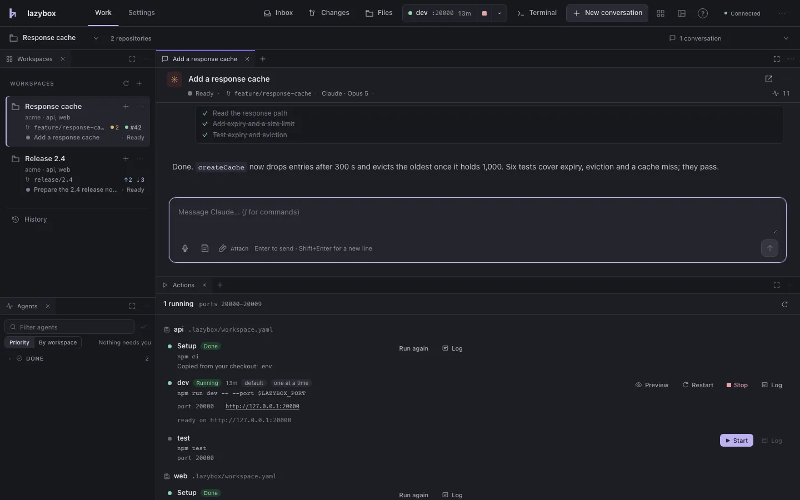
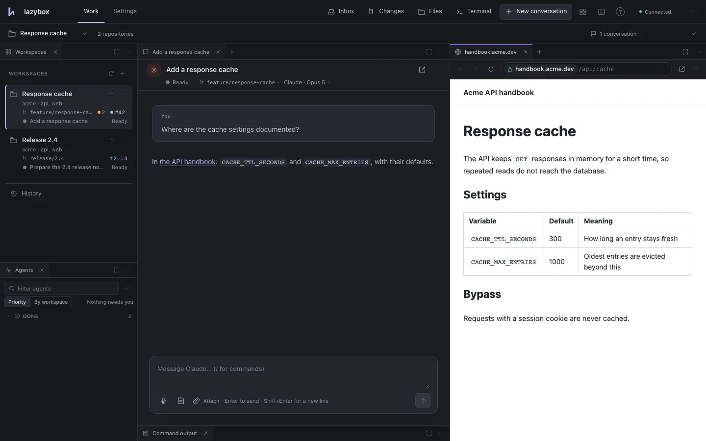
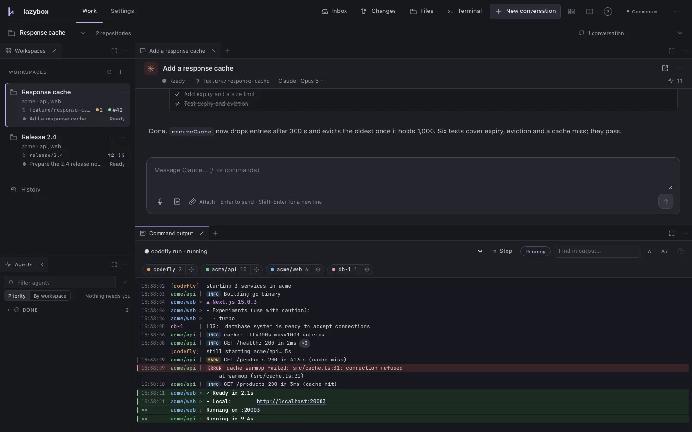

# Run your app

Every workspace can run its own copy of your app — its own dev server, on its
own ports — and show it beside the chat. Two workspaces of the same app run side
by side without fighting over port 3000.

- [Describe your app once: `.lazybox/workspace.yaml`](#describe-your-app-once-lazyboxworkspaceyaml)
- [Approve the scripts](#approve-the-scripts)
- [Run, Actions and Preview](#run-actions-and-preview)
- [Ports](#ports)
- [Browse beside your work: the Web panel](#browse-beside-your-work-the-web-panel)
- [Send your terminal's output to Lazybox](#send-your-terminals-output-to-lazybox)

## Describe your app once: `.lazybox/workspace.yaml`

Commit this file to a repository, and every new workspace of it knows what to
copy, what to install and what to run:

```yaml
# yaml-language-server: $schema=<path to workspace.schema.json>
setup: |                        # once per new workspace, after files are copied
  npm ci
files:                          # copied from your checkout, never overwriting
  - .env
actions:
  web:
    run: npm run dev -- --port $LAZYBOX_PORT
    url: http://localhost:$LAZYBOX_PORT
    default: true               # what Run starts
  test: npm test                # a plain string is just the command
archive:                        # before the workspace is deleted
  run: docker compose down -v
```

Every field, limit and variable is in the
[configuration reference](../reference/configuration.md#lazyboxworkspaceyaml-setup-and-actions).
Don't want to commit it? Settings → Workspaces takes the same YAML per
repository, just for you.

## Approve the scripts

A committed script runs code on your machine as you, so **nothing from the file
runs until you approve it** — not setup, not an action, not its environment
variables. When a repository's scripts are new or changed, **Review scripts**
appears: the file, with what changed since you last approved it marked, and
**Approve and run setup**, **Approve** or **Not now**. An approval covers that
exact version; any change asks again. Agents cannot approve scripts.

## Run, Actions and Preview



- **Run** in the workspace header starts the default action. Its menu (▾) lists
  every action with its state and port; a running one shows a live dot, how long
  it has run, and **Stop**. While setup runs, the button says so — click it for
  the log.
- **Actions** (from Run's menu, or the **Panels** menu in the header) lists each
  repository's setup and actions: state, port, address, the last output line,
  **Start / Restart / Stop**, **Log**, and **Preview**.
- **Preview** shows what an action serves inside the page, with an address bar,
  back and forward, reload, zoom and **Open in browser**.
- **Stop** asks the whole process tree to quit, then forces it after 5 seconds.
- Actions keep running when you close the window or restart the Runner.
- An action marked `concurrent: false` runs in one workspace at a time: starting
  it stops the same action elsewhere, and the menu tells you where it was running.
- Agents can list and start actions too (their briefing tells them to use the
  workspace's dev server rather than start their own), under the conversation's
  permission. They cannot approve scripts or stop actions.

### A server an agent starts: Preview :port

No action defined? When an agent (or you) starts a dev server with
`lazybox run`, Lazybox sees the port it listens on: the live bar above the
message box and the command's console show **Preview :5173**, which opens
the page in a Web panel (your browser when the window has none). The agent's
own browser may open that port too, so it can check the app it runs. For a
one-click **Run** and a Preview that survive the conversation, define the
action once in `.lazybox/workspace.yaml` (above):

```yaml
actions:
  web:
    run: npm run dev -- --port $LAZYBOX_PORT
    url: http://localhost:$LAZYBOX_PORT
    default: true
```

> **Preview** (the feature) only reaches apps on the machine running the
> window. With a Runner on another machine, open the address there or forward
> the port.

## Ports

Each workspace gets a block of **10 consecutive ports** (from 20000–29999 by
default; Settings → Workspaces changes the range), kept for the life of the
workspace. Scripts see them as `$LAZYBOX_PORT_0` … `$LAZYBOX_PORT_9`; an action's
own port is `$LAZYBOX_PORT` (port 0 unless it sets `port:`). If another program
already holds an action's port, Lazybox refuses to start it and tells you which
port, with the `lsof` command to find the culprit.

## Browse beside your work: the Web panel



A **Web panel** is a small browser docked like any panel: address bar (an
address or words to search), back and forward, reload, zoom, copy address, and
open in your browser. Its origin is always shown in bold, with a padlock for
https.

- **Open one:** `]] b`, or **⌥-click** any web link in Lazybox — in a chat
  message, an artifact, a pull request, a check. A right-click on a link offers
  *Open in Lazybox*, *Open in a new Lazybox panel*, *Open in your browser* and
  *Copy link*.
- A plain click still opens your browser. Prefer the opposite? Settings → Web &
  links swaps them, and picks the search engine.
- An empty Web panel lists the workspace's running previews, one click each.
- **Detach browser panel** in the panel header opens the page in its own window. The Agent browser has the same button. If its window fails to open, the panel stays in the workspace and an alert shows the reason reported by the host.

## Read output as a log

The **Command output** console reads what a run prints — one service or
several (Codefly, docker compose, pnpm and turbo workspaces) — as a log:



- **Columns:** the time, the service in its own colour, then the message;
  a stack frame stays under the line it belongs to.
- **Levels** the program wrote (`WARN`, `ERROR`, `npm ERR!`, `--- FAIL`…) are
  badges, and an error row is tinted. **Milestones** (*Running on :8080*,
  *ready in*, Vite's *Local:*) are highlighted.
- **Chips**, one per service with its line count: click one to hide or show
  its lines; its target (or ⌥-click) shows only it.
- **Links:** an address or a local port opens in the Web panel (⌘-click: your
  browser); `file.ts:31` opens in the editor.
- **Hide noise** shows each kind of warning once and folds progress lines
  that only count up; it is remembered for that command. The same line
  repeated folds to one row with ×N.
- Nothing is lost: **Copy** and the full-output file are the output as written.

## Send your terminal's output to Lazybox

Lazybox is not a terminal — keep yours. From a Lazybox workspace terminal
(**Terminal** in the workspace header, a minimal shell on the Runner), pipe any
command into the workspace's console:

```sh
go test ./... 2>&1 | lazybox log --title "go test ./..."
lazybox run -- cargo test                 # also records the exit status
make lint 2>&1 | lazybox log --to "fix the parser"
```

The run appears in the **Command output** console of every conversation in the
workspace. **Send to agent** in the console adds the run's compact view — the
outcome, the failures, the path of the full output — to your message; `--to`
does the same for a named conversation. The agent never gets the full output
dumped into its context.

**Open in Terminal** (on a workspace, a conversation or a Files row, or from
the command palette) opens your own terminal at that folder: Ghostty, iTerm,
WezTerm, Warp, Terminal, or a command of your own, chosen in Settings → Agents
& workspaces → *Your terminal* (Automatic picks the first one installed). It
starts with `LAZYBOX_RUNNER` naming this app's Runner, so `lazybox run` and
`lazybox log` there reach the right Runner even when several are registered.
In a browser, it copies the `cd` to paste instead.

**From your own terminal** (iTerm, Ghostty…) `lazybox log` and `lazybox run`
find the Runner by themselves (the installed app's, or Working's), and publish
to the workspace your current directory is in — its folder or one of its
worktrees:

```sh
cd ~/Library/Application\ Support/Lazybox/workspaces/alpha/api   # a workspace's worktree
go test ./... 2>&1 | lazybox log --title "go test ./..."
lazybox run --collection "Alpha feature" -- make lint             # or name the workspace
```

`--collection` takes a workspace's id or its name; `--endpoint FILE` still picks
a Runner explicitly.
