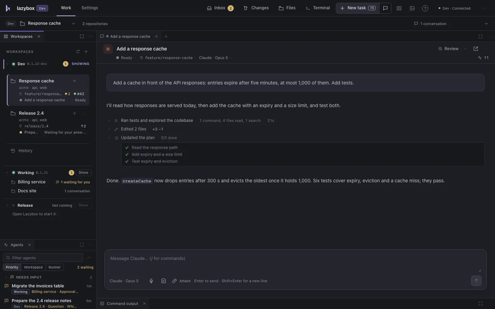

# Several Runners in one window

> **Preview.** One window can show every Runner on your Mac — Dev and Working,
> the installed app's, a standalone Runner, another checkout — and the Runners
> of your other computers, added over SSH (see
> [Runners on your other computers](remote-computers.md)).

A *Runner* is the service that runs your agents. Each has its own workspaces,
conversations and settings, and nothing is shared between two of them.

**A window shows its own Runner.** The brand at the top left says which
Lazybox it is when it is not the installed app: *Dev* or *Working*. Another
Runner on this Mac shows only once you choose to show it; the first time one
is found running, a hint says so once (*Lazybox Working is also running on
this Mac. Show it here?*). A computer you added, and a Runner you added by its
file, show without asking. Once a window shows more than one Runner, it shows
them side by side, and the page shows one of them at a time.

## Where the other Runners come from

- **The launchers' Runners.** Dev, Working and the installed app each register
  where they run in `~/.config/lazybox/runners/`, which `lazybox runners`
  lists. The window finds them by itself, running or not, and lists them in
  **Settings → Runners**; turn on **Show in this window** to see one here.
- **Runners you add.** **Settings → Runners → Add a Runner on this computer**
  takes the file a Runner is found through: a locator from
  `~/.config/lazybox/runners/`, or the `endpoint.json` a Runner writes in its
  state directory (another checkout, a standalone Runner). Lazybox accepts it
  only for a Runner on this machine (loopback) whose file only you can read.
  **Forget** removes one you added.

## What you see

- **Workspaces** has one section per Runner. Its header gives the name, the
  channel, the version, whether it is connected, and how many conversations
  wait for you there. The Runner the page shows lists its workspaces in full
  and says *Showing*; another Runner's are one line each with what waits there.
  Choose one (or **Show** on the header) and the page shows that Runner, with
  its own saved layout. Click a header to fold it.
- **Agents and the Inbox** list the conversations of every Runner together,
  most urgent first, each with a badge naming its Runner. **Runner** in the
  Agents panel groups them by Runner instead. Pin, mark read, rename, peek
  (Space), stop and delete act on the conversation's own Runner. Opening a
  conversation of another Runner shows that Runner's page, on it.
- **The header** says which Runner the page shows: *Working · Connected*.
- **Notifications** come from every Runner shown; the text names the Runner
  (*Working · Docs site*) and a click opens the conversation on its Runner.
  The dock badge counts them all.
- **⌘K** finds conversations and workspaces on every Runner, and **Show
  Working** switches the page. **⌘J** (next that needs you) moves across
  Runners.
- **⌘N** starts the task on the Runner the page shows; the **Runner** row of
  the sheet picks another (←/→), with that Runner's repositories and agents.

## When a Runner goes away

A Runner that stops answering says *Not reachable* on its header, its
conversations leave the Inbox (nothing it last said is offered as if you could
still act on it), and the Agents panel says so once. Nothing is shown as an
error, and it all comes back when the Runner answers again. Its agents keep
running meanwhile. If the page was showing a Runner that stopped, it goes back
to the window's own Runner.

A registered Runner that is not running says *Not running* and how to start it.

## Settings → Runners

Every Runner with its health, version and the file it was found through:

- **Show** switches the page to it.
- **Make primary**: the window opens on this Runner when it is running.
- **Show in this window**: on for the window's own Runner (always), a
  computer or a Runner you added; off until you turn it on for another
  launcher's Runner on this Mac (Dev, Working, the installed app). A Runner
  that is not shown is not contacted at all.

Each Runner keeps its own settings: **Settings → Runner**, Subscriptions,
Repositories and the rest are those of the Runner the page shows.

## Good to know

- Each Runner is reached with its own credentials, read by the app from that
  Runner's private file; nothing of one Runner is ever sent to another.
- Chats, consoles and workspaces open in windows of their own only for the
  window's own Runner. `lazybox open` and `lazybox shot` drive the window while
  it shows its own Runner.
- In a browser tab the page shows its one Runner; the desktop app finds the
  others.
