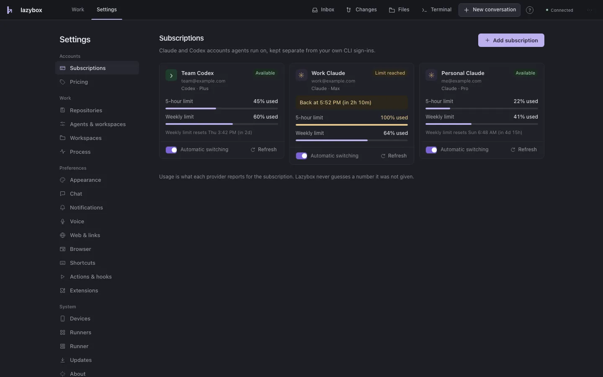

# Subscriptions and limits

Lazybox runs Claude and Codex on your own accounts. Use one, or several (a
personal and a work account, say), and choose which one each conversation
runs on. When one hits its limit, you can continue the same conversation on
another.

## Claude: an API key, or your own Claude Code sign-in

Anthropic asks apps built on its Agent SDK, which Lazybox is, to use an
**Anthropic API key**, and does not allow them to offer a claude.ai sign-in
without its approval. So for Claude:

- **Use an Anthropic API key** (recommended). Settings → Agents & workspaces
  → **Claude** → paste a key from the [Claude Console](https://platform.claude.com/)
  and **Save key**. New Claude conversations run on it, billed to your Console
  account. Lazybox keeps it on this computer, in the Runner's private folder,
  and only ever shows its last four characters. **Forget key** removes it.
- **Amazon Bedrock, Google Cloud Vertex AI or Microsoft Foundry.** Set the
  provider's variables (for example `CLAUDE_CODE_USE_BEDROCK=1` and your AWS
  credentials) in the Runner's environment; the Claude section says which one
  is in effect.
- **Your own Claude Code sign-in.** Without a key, Claude agents run on what
  you signed in to Claude Code with yourself (`claude`, then `/login`). Lazybox
  never shows a sign-in for it. Anthropic has not confirmed that apps built on
  its Agent SDK may use it, and the Claude section says so.

**Claude sign-in in Lazybox** (same section) is off on a new install. While it
is off, Settings → Subscriptions offers no Claude sign-in, and Claude
subscriptions saved there do not start (their card says *Not used*). Turning it
on brings both back, at your own risk with your own accounts;
[what Anthropic's terms say](../../CLAUDE_COMPLIANCE.md).

If you already had Claude subscriptions saved in Lazybox, it stays **on** for
you, so they keep working, and Lazybox says so once. An account you imported
from a token earlier is marked *Imported token; not recommended*: it still
works, and **Remove** forgets it and deletes the token. Lazybox no longer
imports new ones.

Lazybox runs Anthropic's Claude Code program, unmodified. If it is not on this
computer, **Install Claude Code** in the Claude section types Anthropic's
installer (`curl -fsSL https://claude.ai/install.sh | bash`) into a shell panel
of your workspace, where you watch it run.

## Your accounts

- **Local CLI sign-in**: the account your `claude` or `codex` command already
  uses. It works with no setup.
- **Named subscriptions**: Settings → Subscriptions → **Add subscription**:
  choose Codex (or Claude, when Claude sign-in in Lazybox is on), name it
  ("Work Codex"), and choose **Continue in your browser**. The provider's
  sign-in page opens; finish there and Lazybox continues by itself (**Open
  again** if you closed the page, **Cancel** to stop). Each account is stored
  separately from your CLI login and from each other, and is kept for next
  time. Browser sign-in needs the browser on the same computer as the Runner.

### Signing in to Codex with a code

For Codex, **Use a code instead (for another device)** shows a one-time code
to enter at ChatGPT on any device, such as your phone. Some ChatGPT accounts
do not allow codes: Lazybox then says that device-code sign-in is off for the
account (in a Business or Enterprise workspace, an admin turns it on) and
offers **Sign in with the browser instead**, which always works. When
ChatGPT's own page says so first ("Enable device code sign-in for Codex…"),
choose **Sign in with the browser instead** under the code in Lazybox.

Codex listens on your Mac for the browser to say you are signed in, so only
one Codex browser sign-in can wait at a time: starting one ends a `codex
login` still waiting in a terminal. If Codex cannot listen because other
sign-ins hold its ports, Lazybox says another Codex sign-in is in progress:
finish or close it and try again, or use a code instead.

Each card shows the plan, the usage windows the provider reports (for example
the five-hour and weekly windows) and when they reset. **Refresh** asks the
provider again without starting any work. A limited account reads *Back at
6:00 PM*.

## When a conversation hits a limit

The conversation stops on its account and one card offers the choices:

- **Switch to** the best other account of the same provider (or pick one): it
  stays the same conversation, and the interrupted request picks up where it
  stopped;
- **Wait for reset**: it resumes by itself at the reset time while the window
  is open.

Messages you send while a conversation waits are kept and delivered once it can
continue. You can also switch at any time from the session menu (⋯) →
**Switch subscription…**.

### Switching by itself: the Subscription rotation extension

Lazybox does not move a conversation to another account by itself. If you want
it to, add the **Subscription rotation** extension: Settings → Extensions →
Examples → **Add**, read what it asks for, and **Allow and turn on**. From then
on, a conversation that reaches a limit moves to another signed-in account of
the same provider with one quiet line in the chat (*Switched to Work Codex ·
Personal resets at 6:00 PM*), and the limit card, the session menu and new
conversations offer **Switch automatically**. Turning the extension off stops
it at the next limit, for running conversations too.

The extension asks for Codex and Claude. For Claude, its sheet says plainly
that Anthropic's terms may not allow moving between Claude subscriptions to
keep working past a usage limit; remove `switch:claude` from its
`extension.yaml` to keep it to Codex. How it works:
[Extensions → account policies](extensions.md#account-policies).

If automatic switching was on for you before it moved, it stays on: Lazybox
added and allowed Subscription rotation for you, with your settings, and says
so once, with a button to Settings → Extensions.

## Control it

| To… | Do this |
| --- | --- |
| Run Claude on an API key | Settings → Agents & workspaces → Claude → **Use an Anthropic API key**. |
| Switch a conversation now | The limit card's **Switch to …**, or ⋯ → **Switch subscription…**. |
| Switch automatically at a limit | Add and allow **Subscription rotation** in Settings → Extensions. |
| Keep one conversation on its account (with rotation on) | Untick **Switch subscriptions automatically** when you start it (CLI: `--no-rotate`). |
| Never switch onto an account (with rotation on) | Turn off **Automatic switching** on its card in Settings → Subscriptions. |
| Track cost per workspace | Choose **Metered · track workspace cost** as the Gateway under *Model & context* when starting a conversation (it shows when the Runner has the metered gateway); the Usage & cost panel and the chat's usage line then count it. Settings → Pricing holds the rates. |

More in [Troubleshooting → limits](../troubleshooting.md#an-account-hit-its-limit).
