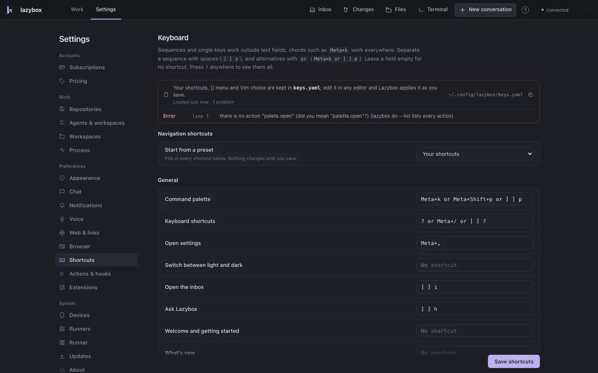

# Configuration files

Lazybox reads YAML files and your theme files. Two are committed to your
repositories and reviewed like code; the rest are yours.

| File | Lives in | Who edits it | What it does |
| --- | --- | --- | --- |
| [`.lazybox/workspace.yaml`](#lazyboxworkspaceyaml-setup-and-actions) | each repository | the team, by PR | setup, dev servers and archive scripts for every new workspace |
| [`.lazybox/process.yaml`](#lazyboxprocessyaml-how-missions-run) | each repository | the team, by PR | how missions run: roles, gates, budgets (**Preview**) |
| [`actions.yaml`](#actionsyaml-your-actions-and-hooks) | `~/.config/lazybox/` | you | your own actions and hooks |
| [`keys.yaml`](#keysyaml-your-shortcuts) | `~/.config/lazybox/` | you, or Settings → Shortcuts | your keyboard shortcuts, `]]` menu and Vim editing |
| [`settings.yaml`](#settingsyaml-settings-you-may-keep-in-a-file) | `~/.config/lazybox/` | you, or Settings → Notifications, Appearance and Chat | notifications and sounds; appearance (theme, accent, fonts, chat text, density, motion, zoom) |
| [`extensions/<id>/extension.yaml`](extensions.md) | `~/.config/lazybox/extensions/` | you, or `lazybox extension new` | a sandboxed panel extension: its panels, the grants it asks for, its network hosts |
| [`layouts/*.yaml`](#layoutsyaml-your-layouts) | `~/.config/lazybox/layouts/` | you, or the Layout menu | your whole-window layouts |
| [Theme files](#themes) (`*.toml`, `*.json`) | `<Runner state>/themes/` | you | your own colour themes |

Other settings (appearance, accounts, the Runner's own) live in the app (Settings).

**Editor completion.** Each YAML file has a JSON Schema. Point your editor at it with
a first line such as `# yaml-language-server: $schema=<path or URL>` (the YAML
extension of VS Code and most editors understand it).

## `.lazybox/workspace.yaml`: setup and actions

Schema: [`workspace.schema.json`](../../services/runner/code/internal/runner/workspaceruntime/workspace.schema.json).
Guide: [Run your app](../guides/run-your-app.md).

```yaml
version: 1                      # optional
setup: |                        # once per new worktree, after files are copied
  npm ci
archive:                        # before the workspace is deleted
  run: docker compose down -v
  timeout: 60                   # seconds; 120 by default
files:                          # copied from your checkout, never overwriting
  - .env
  - config/*.local.json
env:                            # for every script and action of this repository
  API_URL: http://localhost:$LAZYBOX_PORT_1
actions:
  web:
    run: npm run dev -- --port $LAZYBOX_PORT
    url: http://localhost:$LAZYBOX_PORT
    default: true               # what Run starts
    concurrent: false           # one workspace at a time
  api:
    run: go run ./cmd/api
    port: 1                     # this action's $LAZYBOX_PORT is the block's port 1
    cwd: services/api
    env: { LOG_LEVEL: debug }
  test: npm test                # a string is just `run`
```

| Key | Meaning |
| --- | --- |
| `setup` | Shell run once in each new worktree, after `files` are copied. |
| `archive` | Shell (or `{run, timeout}`) run before the workspace is deleted. A failure does not keep the workspace. |
| `files` | Paths or globs copied from your original checkout into the worktree, never overwriting. |
| `env` | Variables for every script and action of this repository. `$LAZYBOX_*` is expanded. |
| `actions.<name>` | A command string, or `run`, `url`, `port` (0–9 in the block), `cwd`, `env`, `default`, `concurrent`. |

**Variables** every script and action gets:

| Variable | Value |
| --- | --- |
| `LAZYBOX_PORT` | The action's port (`LAZYBOX_PORT_<port>`, port 0 by default) |
| `LAZYBOX_PORT_0` … `LAZYBOX_PORT_9` | The workspace's block of 10 ports |
| `LAZYBOX_WORKSPACE_ID`, `LAZYBOX_WORKSPACE_NAME`, `LAZYBOX_WORKSPACE_ROOT` | The workspace |
| `LAZYBOX_REPOSITORY`, `LAZYBOX_WORKTREE` | This repository's name and worktree folder |
| `LAZYBOX_ROOT_PATH` | The checkout the worktree was made from |

**Rules.** Scripts run in your login shell, in the worktree (or `cwd`). Decoding
is strict: an unknown or misspelt key is refused with its line, and nothing from
that file runs. Names are lowercase `[a-z0-9._-]`; `cwd` and `files` stay inside
the repository; `url` must point at this machine; `LAZYBOX_*` cannot be
overridden. Limits: 64 KiB, 32 actions, 64 files and 64 variables. **Nothing
runs until you approve the file's exact version** in Lazybox. In a workspace of
several repositories, each reads its own file and actions are named
`<repository>/<name>`.

**Just for you:** Settings → Workspaces takes the same YAML per repository
(no approval needed — you wrote it), plus the port range, the default action and
*skip setup*.

## `.lazybox/process.yaml`: how missions run

> **Preview.** You can write and check this file today, but missions do not read
> it yet: every mission runs the built-in *solo pair* process. See
> [Missions](../guides/missions.md).

Schema: [`process.v1.json`](../../services/runner/code/internal/process/schema/process.v1.json)
(also printed by `lazybox process schema`). Built-in presets:
[`solo-pair`](../../services/runner/code/internal/process/presets/solo-pair.yaml),
[`reviewed-team`](../../services/runner/code/internal/process/presets/reviewed-team.yaml),
[`factory`](../../services/runner/code/internal/process/presets/factory.yaml).

A repository's file starts from a preset and changes only what it sets:

```yaml
version: 1
extends: solo-pair
budgets:
  task: {usd: 5, retries: 2}
roles:
  worker:
    provider: codex
```

Check it from the repository, no Runner needed:

```sh
lazybox process validate              # schema and semantic checks, with line numbers
lazybox process show                  # the effective process, presets and your file combined
lazybox process explain task.reported # what fires on an event, in order
lazybox process events                # the events a process may name
```

A repository file can never raise autonomy, budgets, permissions or providers
above your own ceiling (set in Settings → Process). The full model — phases,
gates, roles, rules, conditions in CEL — is in the
[orchestration design](../../ORCHESTRATION.md#4-the-process-file).

## `actions.yaml`: your actions and hooks

Location: `~/.config/lazybox/actions.yaml` (`$XDG_CONFIG_HOME/lazybox/actions.yaml`
when set); `lazybox actions path` prints it. Create it with **Settings → Actions
& hooks → Create actions.yaml** or `lazybox actions init`, which also writes
`actions.schema.json` beside it and points the file at it. Schema in the source:
[`actions.schema.json`](../../services/runner/code/internal/power/actions.schema.json).
Guide: [Automate](../guides/automate.md).

```yaml
version: 1
actions:
  - id: test-then-fix
    title: Run the tests, ask the agent to fix failures
    key: t                                  # ]] t
    where: [palette, menu, conversation]
    steps:
      - run: test                           # a workspace action
      - when: failed
        send: The tests failed. Read the output in the console and fix them.
      - when: succeeded
        open: changes
  - id: review
    title: Ask for a review in a new conversation
    confirm: true
    steps:
      - send: {snippet: deepreview, to: new, wait: true}
      - open: changes
hooks:
  - id: notify
    on: agent.needs-input
    run: [terminal-notifier, -title, Lazybox, -message, needs you]
  - id: slack-on-failure
    on: [turn.failed, pr.checks-failed]
    filter: {repository: "acme/*"}
    webhook: {url: "https://hooks.slack.com/services/T000/B000/XXXX"}
  - id: log-done
    on: turn.done
    shell: 'echo "$LAZYBOX_EVENT_TITLE finished" >> ~/lazybox-done.log'
    timeout: 30s
```

### Actions

| Field | Meaning |
| --- | --- |
| `id` | Lowercase letters, digits, dashes; unique. |
| `title`, `description`, `icon` | What menus show (`title` defaults from the id). |
| `key` | One key after the `]]` leader (`t`, `7`, `Shift+t`). A key already taken is ignored and reported in Settings. |
| `where` | Any of `palette`, `menu` (the `]]` menu), `conversation` (its menu), `workspace` (its row's menu). Default `[palette, menu]`. |
| `confirm` | Ask before running. |
| `steps` | 1–20 steps, run in order. |

| Step | Forms | Succeeds when |
| --- | --- | --- |
| `send` | `send: text` · `send: {text \| snippet, to: current \| new \| <conversation>, wait: true}` | the message is accepted; with `wait`, the turn ends without failure |
| `open` | `open: changes` (a panel) · `open: https://…` · `open: {file: api/README.md, line: 3}` | always |
| `run` | `run: <workspace action>` | the action exits 0 (its script approval still applies) |
| `command` | `command: npm test` | the command exits 0 (refused in read-only conversations) |
| `permission` | `permission: ask \| read-only \| yolo` | the conversation accepts the change |
| `wait` | `wait: idle \| needs-input` · `wait: {until, timeout}` | the state is reached in time |
| `do` | `do: layout.maximize` · `do: {action: settings.open, argument: keyboard}` — any action of the app (`lazybox do --list`) | the window can run it now |

Every step may also have `name:`, `timeout:` and `when: always | succeeded |
failed`. A `when:` step reacts to the last step before it that has no `when:`.

### Hooks

| Field | Meaning |
| --- | --- |
| `id`, `description` | As for actions. |
| `on` | One or more of `conversation.archived`, `workspace.archived`, `agent.needs-input`, `turn.done`, `turn.failed`, `pr.opened`, `pr.checks-failed`, `pr.checks-passed`, `pr.changes-requested`, `pr.approved`, `pr.merged`, `pr.closed`, `pr.conflicts`, `mission.accepted`. A `pr.*` event is a [tracked pull request](../guides/review-agent-work.md#pull-requests-your-agents-open)'s transition, sent once. |
| `filter` | `workspace`, `conversation` (name or title), `repository` (`owner/name`); `*` and `?` wildcards, case-insensitive; all set filters must match. |
| `run` / `shell` / `webhook` | Exactly one: a program and its arguments (no shell); a line for `/bin/sh -c`; or a URL / `{url, headers}` that receives the event as a JSON `POST`. |
| `grants` | `read`, `respond`, `start` — a Lazybox credential for the hook's own `lazybox` calls, live only while it runs. None by default. With `respond`, a hook may also `lazybox do` the actions marked *safe* (they only show, focus or arrange). |
| `timeout` | Default `1m`, at most `10m`. |
| `enabled` | Default `true`. |

Limits: 256 KiB, 100 actions, 50 hooks. Lazybox rereads the file every second.
An entry with a mistake is left out and reported with its line; a save that is
not YAML at all keeps the last version that loaded. Check a file with
`lazybox actions validate [FILE]` (exit 2 on errors).

## Themes

A theme is a `.toml` or `.json` file in the Runner's themes folder,
`<Runner state>/themes` (`themeDirectory` in the Runner configuration moves it).
Settings → Appearance shows the folder (**Copy path**) and **New theme from
current** writes a starting file. Saved changes apply within seconds, in every
window. Guide: [Appearance](../guides/appearance.md#your-own-themes).

```toml
name = "Midnight"
appearance = "dark"        # "dark" or "light": which mode lists it
extends = "dark"           # optional: a built-in theme to start from

[tokens]                   # a few base colours; the rest are derived
bg = "#05060a"
surface = "#0b0d14"
"surface-raised" = "#121522"
line = "#252a3a"
text = "#e8ecf5"
"text-muted" = "#8b93a7"
accent = "#5eb1ff"

[typography]               # optional suggestions; the person's settings win
density = "compact"
chatLineHeight = 1.4
```

| Key | Meaning |
| --- | --- |
| `name` | What Settings shows. |
| `appearance` | `dark` or `light`. |
| `extends` | Optional built-in theme ID to start from, such as `dracula`, `one-dark-pro`, `tokyo-night`, `catppuccin-mocha`, `catppuccin-latte`, `github-dark-default` or `github-light-default`. |
| `[tokens]` | Colour tokens by name. Set the base ones (marked in Settings → Appearance → **Token reference**, which lists every token with its meaning and current value); the others derive from them. |
| `[typography]` | Optional suggestions such as `density` and `chatLineHeight`. |

Colours are `#rgb`, `#rrggbb`, `#rrggbbaa`, `rgb()` or `hsl()` — nothing else,
so a theme cannot inject CSS. There is no JSON Schema for theme files yet:
Settings checks a saved file and lists each problem, with a suggestion for a
misspelt token, and keeps the last good version on screen.

## Your config files: keys, settings, layouts

Beside `actions.yaml`, in the same folder (`lazybox config path`), Lazybox
keeps the rest of what you set as plain YAML files. They are yours: edit them
in any editor, keep them in a dotfiles repository, hand them to an agent.

- **Hot reload.** Lazybox rereads them every second; the open window applies a
  change within two seconds, with no reload.
- **Both ways.** Settings writes the same files, changing only the values that
  changed and **keeping your comments**. A change the file would refuse (a key
  already taken) is not written; Settings says why.
- **Mistakes are local and located.** A problem is shown with its line — a
  toast, then a banner in Settings (and in Settings → Actions & hooks → *Config
  files*). A binding or entry with an error is left out, the rest applies; a
  save that is not YAML at all keeps the last version that loaded.

  
- **Schemas.** Each file starts with a `# yaml-language-server: $schema=`
  line, and Lazybox writes `keys.schema.json`, `settings.schema.json` and
  `layout.schema.json` beside them (built from the app's own action registry,
  so your editor completes every action id and panel).
- **What the file leaves out is the default.** Remove a line to go back to the
  default; remove the file to reset everything it held.
- **Never secrets.** Credentials, subscriptions, devices and the Runner's own
  settings stay in the app; none of these files holds one.
- **From a terminal:** `lazybox config path | edit FILE | validate | get FILE
  [KEY] | set FILE KEY VALUE | export | import` ([CLI](cli.md)). `edit` opens
  `$VISUAL`/`$EDITOR` and checks the file when you close it; `validate` prints
  `file:line` problems and exits 2 on an error.

Shortcuts and notification settings you set before these files existed are
moved into them the first time Lazybox runs with this version, once; so are
the layouts you saved.

### `keys.yaml`: your shortcuts

```yaml
# yaml-language-server: $schema=./keys.schema.json
version: 1
preset: vim                  # vim (]] and h j k l), tmux (Ctrl+b) or arrows
keys:
  global:                    # global (anywhere), navigation (the sidebar), agent (the message box)
    palette.open: Mod+k      # Mod is ⌘ on a Mac, Ctrl elsewhere
    layout.cycle: [Mod+Shift+l, "] ] L"]
    files.find: []           # no shortcut
leader-menu:                 # your own entries under the ]] leader
  - {key: f, label: Fix the tests, snippet: fixtests, mode: send}
vim: {message-box: true, file-editor: false}
```

| Field | Meaning |
| --- | --- |
| `preset` | The keys of every action the file leaves out: `vim` (default), `tmux`, `arrows`. |
| `keys.<section>.<action>` | An action's keys: one binding, `"a or b"`, or a list; `[]` for none. Action ids and their default keys: `lazybox do --list`. An action under the wrong section still applies, with a warning. |
| `leader-menu` | Up to 36 `{key, label, snippet, mode: send \| insert}`; a key the built-in `]]` menu uses is refused. |
| `vim` | `message-box`, `file-editor`: Vim editing where you type. |

A key is a character or a name (`Enter`, `Escape`, `Tab`, `Space`,
`ArrowDown`, `F5`…) with `Mod+`, `Ctrl+`, `Meta+`, `Alt+`, `Shift+`; a
sequence is up to four keys separated by spaces (`"] ] i"`). Lazybox checks a
binding as the app does: an unknown action or key name, a held key that is not
a chord, and a key another action can fire from the same place are reported by
line and left out (that action keeps its preset key). The reset chord
(`⌃⌥⇧Esc`) cannot be rebound. Settings → Shortcuts writes the file; ⌘⇧L is
`layout.cycle`.

### `settings.yaml`: settings you may keep in a file

```yaml
# yaml-language-server: $schema=./settings.schema.json
version: 1
notifications:
  needs-input: true          # an agent asks a question or waits for an approval
  failed: true
  review: false              # an agent finished its turn
  dock-badge: true
  sound-needs-you: true
  reminders: true
  sound-done: false
appearance:                  # Settings → Appearance and Settings → Chat (chat text)
  mode: system               # system, light or dark
  dark-theme: dark           # dark, dark-high-contrast, or user:<file> for one of your themes
  light-theme: light         # light, solarized-light, or user:<file>
  accent: "#7fb0f0"          # #rgb, #rrggbb, #rrggbbaa, rgb() or hsl(); quote it
  min-contrast: 4.5          # 0 (off), 3, 4.5 or 7; any value 0–21
  motion: system             # system, reduce or full
  density: comfortable       # compact, comfortable or relaxed
  interface-font: Inter      # a font list; "" for the system font
  interface-font-size: 13    # 11–16 px
  code-font: JetBrains Mono  # "" for the system monospace
  code-font-size: 12         # 10–20 px
  ligatures: false
  chat-font-size: 14         # 11–22 px
  chat-line-height: 1.5      # 1.1–2.2
  chat-paragraph-gap: 8      # 0–32 px
  chat-line-width: 0         # characters per line, centred; 0 for the full width
  zoom: 1                    # the desktop app, every window: 0.5–2
```

Settings → Notifications writes `notifications`; Settings → Appearance and
Settings → Chat write `appearance`, a value at a time, keeping your comments (a
value set back to its default is removed). What the section leaves out is the
default; a typography value you leave out follows the theme's suggestion, then
the density's. A value with a mistake is reported by line in Settings →
Appearance (and a toast) and left out; the rest applies. Quote a colour: YAML
reads an unquoted `#` as a comment, which leaves the theme's accent.

Not in the file, by design: colour overrides (any token, Settings → Appearance)
and the copies of your user themes the windows draw from stay on the device.
`zoom` is the desktop app's: the View menu and `⌘=` `⌘−` `⌘0` write it, and a
save applies it in every window; a browser has its own zoom, which Lazybox
neither reads nor sets, so a browser tab leaves the file's `zoom` alone.

### `layouts/*.yaml`: your layouts

One whole-window layout per file. The Layout menu lists them after the presets
(*Yours*), the palette has *Layout: …* for each, and **⌘⇧L** cycles through the
presets and then yours. A file dropped into the folder appears within two
seconds; one with a mistake is listed in the Layout menu with its first problem
and is not offered.

```yaml
# yaml-language-server: $schema=../layout.schema.json
name: Review wide
description: Changes and the file side by side
layout:
  split: row                 # row: side by side; column: stacked
  sizes: [20, 40, 40]        # shares, normalized; equal when left out
  children:
    - split: column
      children:
        - panels: [collections]
        - panels: [agents]
    - panels: [changes]
    - panels: [editor, chat] # one group, two tabs
      minimized: false
```

Panels: `collections` (Workspaces), `agents`, `chat`, `console` (command
output), `terminal`, `assistant` (Ask Lazybox), `changes`, `usage`, `sessions`,
`missions`, `processes`, `actions`, `preview`, `web`, `browser`, `files`,
`editor`, `artifacts`. **Save current layout as…** writes a file;
rename and delete (with Undo) change it. **Copy current layout as YAML** puts
the file's text on the clipboard; paste it into ⌘K (or **Import a layout…**)
on another machine to import it: it is checked first (problems by line, nothing
written) and applied.

