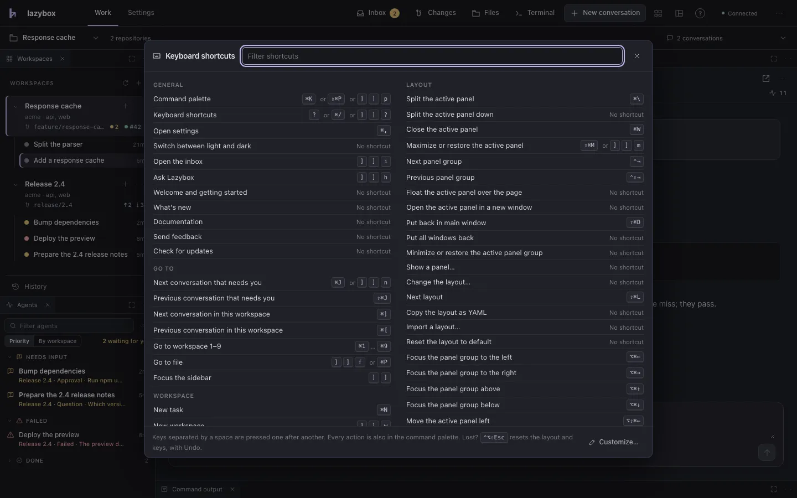

# Keyboard shortcuts

<!-- GENERATED FILE — do not edit by hand.
     Regenerate with: npm run docs:shortcuts (from the repository root)
     Source: packages/surfaces/src/actions.ts, rendered by scripts/docs-shortcuts.ts. -->

Every command in Lazybox is declared once, in the action registry. The keys
below are its **defaults**; the in-app overlay (`?`) always shows *your* keys.

- **Change a key:** Settings → Shortcuts. Pick a preset — **Vim** (`]]` and
  `h j k l`, the default), **Ctrl+b** (a tmux-style prefix with arrows) or
  **Arrows** — then edit any binding. The Ctrl+b preset replaces every `]]`
  below with `Ctrl+b`.
- **Or edit the file.** Your keys are
  [`keys.yaml`](configuration.md#keysyaml-your-shortcuts) beside your actions
  file: Settings writes it (keeping your comments), and a save in your editor
  applies within two seconds. `lazybox do --list` prints every action id.
- **Forgot a key?** `⌘K` opens the command palette: every action is there by
  name, with its key beside it. An action with no key (—) runs from the palette.
- **`]]` is the leader.** From the message box, `]]` leaves typing and shows a
  menu of every next key; a single `]` is still text. Settings → Shortcuts can
  add your own entries to that menu (one key sends or inserts a snippet), and
  [your actions](configuration.md#actionsyaml-your-actions-and-hooks) can take a
  key there too.
- On Windows and Linux, read `Ctrl` for `⌘` (the tables give both).
- **Lost?** `⌃⌥⇧Esc` (Ctrl+Alt+Shift+Esc) puts back the default layout *and*
  the default keys in one step, with **Undo** in the corner. It is the one
  shortcut you cannot change, so it always works.

## General

Work from anywhere in the window, including while a dialog is open for the palette and the shortcuts overlay.

| Action | macOS | Windows / Linux |
| --- | --- | --- |
| Command palette | `⌘K` or `⇧⌘P` or `]] p` | `Ctrl+K` or `Ctrl+Shift+P` or `]] p` |
| Keyboard shortcuts | `?` or `⌘/` or `]] ?` | `?` or `Ctrl+/` or `]] ?` |
| Open settings | `⌘,` | `Ctrl+,` |
| Switch between light and dark | — | — |
| Open the inbox | `]] i` | `]] i` |
| Training Wheels | — | — |
| Ask Lazybox | `]] h` | `]] h` |
| Welcome and getting started | — | — |
| What's new | — | — |
| Documentation | — | — |
| Send feedback | — | — |
| Check for updates | — | — |

## Go to

Move between conversations and workspaces. Chords with ⌘ (Ctrl) work even while you type in the message box.

| Action | macOS | Windows / Linux |
| --- | --- | --- |
| Next conversation that needs you | `⌘J` or `]] n` | `Ctrl+J` or `]] n` |
| Previous conversation that needs you | `⇧⌘J` | `Ctrl+Shift+J` |
| Next conversation in this workspace | `⌘]` | `Ctrl+]` |
| Previous conversation in this workspace | `⌘[` | `Ctrl+[` |
| Go to workspace 1…9 | `⌘1` … `⌘9` | `Ctrl+1` … `Ctrl+9` |
| Go to file | `]] f` or `⌘P` | `]] f` or `Ctrl+P` |
| Focus the sidebar | `]]` | `]]` |
| Show missions | — | — |
| Open the missions board | — | — |

## Workspace

Open the parts of the workspace in front.

| Action | macOS | Windows / Linux |
| --- | --- | --- |
| New task | `⌘N` | `Ctrl+N` |
| Start from an issue… | — | — |
| New workspace | `]] w` | `]] w` |
| New conversation | `⇧⌘N` or `]] c` | `Ctrl+Shift+N` or `]] c` |
| Review changes | `]] d` | `]] d` |
| Review this workspace’s changes | `]] ⇧r` | `]] Shift+r` |
| Review changes with Codex | — | — |
| Review changes with Claude | — | — |
| Cancel review | — | — |
| Browse files | `]] e` | `]] e` |
| Open a terminal | — | — |
| Open in Terminal | — | — |
| Show artifacts | `]] a` | `]] a` |
| Open a web page | `]] b` | `]] b` |
| Show or hide command output | `]] o` | `]] o` |
| Open this workspace in a new window | — | — |
| Customize this page | — | — |
| Layout configuration | — | — |
| Show pull requests | — | — |

## Layout

Act on the active panel group: the one you last clicked or focused, ringed while you use these keys. With the arrows, `⌥⌘` moves the focus to the neighbouring group; `⌥⇧⌘` moves the active panel into it, or swaps the two when the panel is alone in its group (with no group that way, a tab splits out to that side); `⌃⌘` moves the group's edge that way, 5 % a press and faster held down (at the sidebar, its one width changes). `⌃1`–`⌃8` bring a tab of the group to the front and `⌃9` the last one; `⌘1`–`⌘9` stay *Go to workspace*. The **+** after a group's tabs (or `⌘T`) starts a conversation there or opens any panel there. While a panel is maximized, moving the focus, `⌘J`, `⌘]` and opening a conversation keep it maximized and show the new one. Two exceptions keep code-editor habits: in the file editor `⌥⌘←` / `⌥⌘→` (with `⇧`, to move) are its own tabs, and in code `⌥⌘↑` / `⌥⌘↓` add a cursor. On Windows and Linux, where Ctrl stands for both ⌘ and ⌃, the keys differ: see the right-hand column.

| Action | macOS | Windows / Linux |
| --- | --- | --- |
| Split the active panel | `⌘\` | `Ctrl+\` |
| Split the active panel down | — | — |
| Close the active panel | `⌘W` | `Ctrl+W` |
| Maximize or restore the active panel | `⇧⌘M` or `]] m` | `Ctrl+Shift+M` or `]] m` |
| Next tab or panel group | `⌃⇥` | `Ctrl+⇥` |
| Previous tab or panel group | `⌃⇧⇥` | `Ctrl+Shift+⇥` |
| Reopen the last closed conversation tab | `⇧⌘T` | `Ctrl+Shift+T` |
| Float the active panel over the page | — | — |
| Open the active panel in a new window | — | — |
| Put back in main window | `⇧⌘D` | `Ctrl+Shift+D` |
| Put all windows back | — | — |
| Minimize or restore the active panel group | — | — |
| Show a panel… | — | — |
| Change the layout… | — | — |
| Next layout | `⇧⌘L` | `Ctrl+Shift+L` |
| Copy the layout as YAML | — | — |
| Arrange desktop windows | — | — |
| Import a layout… | — | — |
| Reset the layout to default | — | — |
| Focus the panel group to the left | `⌥⌘←` | `Ctrl+Alt+←` |
| Focus the panel group to the right | `⌥⌘→` | `Ctrl+Alt+→` |
| Focus the panel group above | `⌥⌘↑` | `Ctrl+Alt+↑` |
| Focus the panel group below | `⌥⌘↓` | `Ctrl+Alt+↓` |
| Move the active panel left | `⌥⇧⌘←` | `Ctrl+Alt+Shift+←` |
| Move the active panel right | `⌥⇧⌘→` | `Ctrl+Alt+Shift+→` |
| Move the active panel up | `⌥⇧⌘↑` | `Ctrl+Alt+Shift+↑` |
| Move the active panel down | `⌥⇧⌘↓` | `Ctrl+Alt+Shift+↓` |
| Resize: move the active group’s edge left | `⌃⌘←` | `Alt+Shift+←` |
| Resize: move the active group’s edge right | `⌃⌘→` | `Alt+Shift+→` |
| Resize: move the active group’s edge up | `⌃⌘↑` | `Alt+Shift+↑` |
| Resize: move the active group’s edge down | `⌃⌘↓` | `Alt+Shift+↓` |
| New tab in the active group… | `⌘T` | `Ctrl+T` |
| Reset the layout and shortcuts | `⌃⌥⇧Esc` (cannot be changed) | `Ctrl+Alt+Shift+Esc` (cannot be changed) |
| Go to tab 1…9 | `⌃1` … `⌃9` | `Alt+1` … `Alt+9` |

## Conversation

Act on the conversation you last clicked or focused.

| Action | macOS | Windows / Linux |
| --- | --- | --- |
| Open snippets | `]] s` | `]] s` |
| Focus the message box | — | — |
| Cycle activity detail | `]] v` | `]] v` |
| Activity detail: Quiet | — | — |
| Activity detail: Smart | — | — |
| Activity detail: Verbose | — | — |
| Activity detail: Use the default | — | — |
| Run the last command block in the terminal | `]] r` | `]] r` |
| Run the last command block as command output… | — | — |
| Slash commands | — | — |
| Switch model… | — | — |
| Change permissions… | — | — |
| Switch subscription… | — | — |
| Give the agent the browser | — | — |
| Let this conversation run agents… | — | — |
| Compact the context | — | — |
| Start over in a new conversation | — | — |
| Show context and token cost | — | — |
| Open the review tray | — | — |
| Track the last reply as an artifact… | — | — |
| Interrupt the agent | — | — |
| Rename the conversation… | — | — |

## Voice

Hold the key and speak; release to finish (a quick tap keeps listening until you press it again). `Right ⌥` is the Option key on the right, alone: hold it to talk, tap it twice to keep listening, tap it once to stop; with any other key it stays an ordinary ⌥. While dictating, `⌘↵` sends once the last words are in. See [Voice](../guides/voice.md).

| Action | macOS | Windows / Linux |
| --- | --- | --- |
| Dictate | `Right ⌥` or `⌥Space` | `Right Alt` or `Alt+Space` |
| Say a command | `⌥⇧Space` | `Alt+Shift+Space` |
| Read latest reply | — | — |
| Repeat last announcement | — | — |
| Open that announcement | — | — |
| Stop reading aloud | — | — |

## Sidebar

After `]]` puts the keyboard in the sidebar. The *Arrows* preset uses the arrow keys instead.

| Action | macOS | Windows / Linux |
| --- | --- | --- |
| Next entry | `j` | `j` |
| Previous entry | `k` | `k` |
| Workspace / left pane | `h` | `h` |
| Open entry / agent | `l` | `l` |

## Message box

While you type a message. While the agent works, `↵` queues your message and `⌘↵` stops the agent's current step and sends it now; with an empty box, `⌘↵` sends the oldest queued message now. While the agent is idle, `⌘↵` sends like `↵`, also while you dictate.

| Action | macOS | Windows / Linux |
| --- | --- | --- |
| Send message | `↵` | `↵` |
| Send now | `⌘↵` | `Ctrl+↵` |

## Keys inside a panel

These work while the panel or card has focus, never while you type in a text field.

| Where | Keys |
| --- | --- |
| Message box | `Enter` sends · `Shift+Enter` new line · `↑` in an empty box recalls your sent messages, `↓` walks back · `⌥↑` / `⌥↓` jump between your prompts in the conversation |
| Approval card | `y` allow once · `a` always allow (at the first scope offered) · `n` deny, with an optional reason · `1`–`9` pick a row · `↑` `↓` move between rows · a *default to no* request: only `n` (allowing takes a click, or `↓` and `Enter`) |
| Question card | `1`–`9`, `↑` `↓`, `Space` and `Enter` pick options · `⌘↵` sends the answers |
| Sub-agent card, chip or Background work row | `Delete` or `⌫` stops a running sub-agent or background command (the main agent continues) · `Space` opens a card in a floating panel · `Esc` closes its steps |
| Changes | `n` / `p` next / previous hunk · `Shift+N` / `Shift+P` next / previous file · `v` marks the file viewed and moves on · `s` switches unified / split |
| Review comment | `⌘↵` saves · `Esc` cancels · `Tab` to a line's **+** then `Enter` starts a comment (`Shift+Enter` extends the range) |
| Agent review card | `Esc` cancels the review under way (it asks first when the reviewer has filed findings; they are kept) |
| Inbox | `j` / `k` move · `Enter` opens · `m` marks seen |
| Any row you can peek | `⌥`-click or `Space` peeks it · in the peek `←` / `→` step through rows, `⌘↵` opens it, `Space` or `Esc` closes |
| Sidebar workspace row | `F2` renames · `⌥↓` opens its card · `⌥⇧↑` / `⌥⇧↓` move it up or down (or drag it; `Esc` puts it back) |
| File editor | `⌥Z` toggles word wrap · with Vim editing on: `:w`, `:q`, `:wq` |
| Desktop window | `⌘=` / `⌘-` / `⌘0` zoom in, out, reset |
