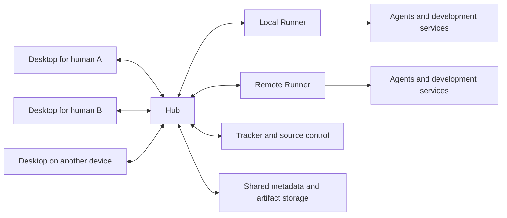
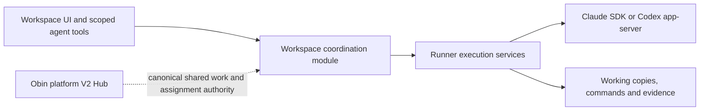

# Lazybox V2 architecture proposal

**Status, 2026-11-09:** [Device experience](DEVICE_EXPERIENCE.md) defines the
current phone/iPad/desktop direction and proposed portable contract. The
[audit](audits/2026-11-09/README.md) records actual implementation and blockers.
The topology below is a target architecture, not a claim
about the local implementation. The shared Hub is owned by Obin platform V2.
The current delivery sequence and required changes are recorded in the
[implementation plan](IMPLEMENTATION_ROADMAP.md) and [roadmap](ROADMAP.md).
The November 3 critical review is historical context.

V2 separates shared coordination, execution, and desktop interaction into Desktop, Hub, and Runner. These boundaries apply in a local installation and across a network. Exact implementation choices remain tracked in [Decisions](DECISIONS.md).

The [selected stack](STACK.md) uses Go services, a shared React/TypeScript desktop/web application layer, Tauri native hosting, and an Expo/React Native iPhone interface. [Interfaces](INTERFACES.md) defines the proposed generic Go adapter and RPC boundaries. The [first deliverable](FIRST_DELIVERABLE.md) validates real agent communication and command consoles before the native Desktop proof.

## Component topology

One Hub is authoritative for a collaboration space in the MVP. Several projects may live within it. Each execution is assigned to one registered Runner. Federation between independent Hubs is a later capability.

## Ownership

| Component | Owns | Receives from other components |
| --- | --- | --- |
| Desktop | Personal view model, independent windows, layout, navigation, drafts, annotations in progress, local presentation and interaction. | Shared state and changes from the Hub; authorized preview and execution streams. |
| Hub (Obin solution) | Durable agent identities/roles, model and budget policy, shared work, dependencies, assignments, decisions, accepted execution facts, durable history, artifact metadata, dispatch/recovery and integration policy; composed with host identity, Robin and Runtime. | Authenticated human and scoped agent commands; Runner observations, results, capacity, and availability. |
| Runner | Repository preparation, worktrees, processes, agent adapters, local execution journal, resource reservations, development services, logs, and artifact production. | Authorized assignments with stable execution identities, inputs, scoped capabilities, and cancellation requests. |

The Hub owns intent; the Runner owns observed execution facts. The Desktop presents both and supports rich local interaction without acquiring authority over shared truth.

Reuse Obin Runtime for durable work/interaction/recovery mechanics and Robin for
agent/conversation mechanics; qualify native Claude/Codex execution integration
before assuming those seams exist. Codefly owns service generation, endpoint
resolution and native service supervision. Runner attempt ownership and cleanup
remain explicit requirements; restarting its service is not agent recovery.

A coordinator agent is a participant using the Hub's work operations. It is distinct from the Hub service. Several coordinator agents can exist with different scopes.

## Core identities and records

| Record | Meaning | Required properties |
| --- | --- | --- |
| Collaboration space | A shared membership and authority boundary. | Stable identity; one authoritative Hub in the MVP. |
| Project | Related objectives, repositories, and shared context. | Repository links are references; project identity survives changes in execution location. |
| Work item | An objective or bounded part of an objective. | Stable identity, acceptance criteria, parent, dependencies, accountable participant, revision, and result references. |
| Participant | A named human or agent. | Individual identity, membership, authorship, capabilities, and permitted operations. |
| Agent profile | A configured agent capability and role. | Separate from a particular process or attempt; records adapter and requested model configuration. |
| Execution | One attempt to perform assigned work. | Stable attempt identity, Runner, assignment epoch, observed state, input and source revisions, and output references. |
| Collection | A Runner-local, named set of worktrees spanning one or more repositories. | Stable identity, root, named members, pinned provisioning revisions, work association, and exclusive execution ownership; survives sessions and windows. |
| Command | A registered shell command or captured output producer within an attempt. | Stable identity, capture mode, output ranges, lifecycle facts where observable, and links to its work and initiating tool call. |
| Artifact | An accessible piece of evidence or output. | Stable identity, media type, producer, work and revision context, storage location, and availability. |
| Decision | A question or choice with an attributable resolution. | Affected work, participants, status, answer, and supersession history. |
| Review finding | Feedback bound to evidence. | Artifact or code anchor, reviewed revision, disposition, and verification evidence. |
| View reference | A personal surface over shared records. | Participant, device layout, surface kind, selected records, and navigation state. |

V1's generic human identity and workspace-bound agent and artifact references require review before reuse. A worktree path, terminal identifier, or tracker number cannot serve as a portable identity for all of these records.

[Collections](COLLECTIONS.md) are implemented as an initial Runner-only slice. An
execution attaches to the Collection root and sees all members. Several members
may come from the same repository on different branches. The Hub's project and
work identities remain separate from this physical execution environment.

## State and completion

Work lifecycle and execution observation are separate. A work item can await a decision while its agent process is healthy. An execution can finish while the result still awaits review.

The initial work lifecycle should cover planned, ready, active, awaiting input, held, ready for review, accepted, failed, and canceled. The exact transitions, review requirements, and reopening behavior are decided in [D03](DECISIONS.md#d03-work-and-execution-state-machines).

Execution observations include provisioning, starting, running, awaiting input, exited, and unknown. Loss of a heartbeat changes confidence and reachability; it does not prove a process has exited or work has failed.

Agent completion produces a result proposal with evidence. Acceptance is a separate attributable operation. Source control integration has its own status, including failures and uncertain provider outcomes.

## Shared state and concurrent changes

The MVP uses a durable transactional store owned by the Hub. Each accepted mutation records its actor, command identity, affected record revision, and an event in the same transaction. This supports reliable subscriptions and auditability without requiring that the entire database be reconstructed by replaying events.

Commands carry an idempotency key and, where conflicting edits matter, an expected record revision. Repeating a command returns its recorded result. A stale edit returns the current revision and an actionable conflict; it cannot silently overwrite another participant's decision or assignment.

Per-record serialization covers dependency edits and ownership changes. Graph changes validate cycles and references atomically. A single accountable owner can have several contributors and reviewers.

An external side effect such as starting an agent or requesting a merge has a durable intent and outcome. Network uncertainty is represented explicitly. Retrying the Hub command cannot by itself guarantee that a third-party operation executes exactly once.

## Contracts and subscriptions

Expose product operations such as create work, add dependency, assign, answer decision, submit evidence, request review, accept result, and request integration. Desktop, agent tools, and automation call the same owners.

Subscriptions begin from a consistent snapshot and continue with scoped, ordered deltas and a resumable cursor. Define the sequence boundary between snapshot and deltas so updates cannot disappear during subscription setup. An expired cursor triggers a fresh snapshot and a visible resynchronization state.

Bound queues and subscription scopes. Slow clients can recover shared state without making a Runner or another client wait. High-volume process output, preview traffic, and binary artifacts travel in separate streams from shared-state control messages.

Negotiate protocol versions and capabilities before work begins. Different client and Runner versions must produce an explicit compatibility result. Field additions should not require simultaneous upgrades when the negotiated contract permits them.

The proposed transport is Protobuf/ConnectRPC: browser clients use unary operations plus server streams, while Go Runners can initiate a bidirectional gRPC control stream to the Hub. Keep bulk output separate from bounded control traffic. [D04](DECISIONS.md#d04-protocol-and-durable-change-delivery) and [Interfaces](INTERFACES.md) track validation, schema generation, and recovery requirements.

## Runner assignment and recovery

The Hub assigns an execution identifier, Runner, assignment epoch, input revisions, and capacity reservation. The Runner durably records acceptance before acknowledging it and deduplicates repeated start requests by that identity.

A connection loss must not cause the Hub to start a second writer elsewhere. Expired authority prevents new privileged side effects; it is not evidence that an old process stopped editing a local worktree. Reassignment requires reconciliation or explicit fencing of the old execution and its integration authority.

On reconnect, the Runner reports its identity, accepted assignments, journal position, running processes, completed attempts, and pending artifacts. The Hub reconciles those facts before dispatching replacements. Old assignment epochs cannot submit authoritative completion or integration actions.

Healthy remote execution continues when a Desktop closes. During a Hub connection outage, already accepted bounded local work may continue under the agreed execution policy, with observations and results journaled locally. New assignments, shared decisions, and integration wait for Hub authority. There is no automatic live migration of an agent process in the MVP.

Runner shutdown, process failure, machine reboot, Hub restart, and Desktop exit are distinct events with separate recovery behavior. State reconstruction never pretends that a dead process survived a machine reboot.

## Resource and environment management

Runners advertise agent availability, supported tools, execution environments, and capacity. Begin with explicit Runner selection and a queue; reserve capacity atomically to prevent simultaneous assignments from overcommitting a host.

Repository and worktree locations come from configured resolution. Development services bind available ports and publish discovered endpoints. Runner-local paths are opaque to other devices.

Worktree isolation protects file ownership but does not isolate ports, databases, credentials, or other services. The reference application must have explicit per-execution environment configuration. The MVP supports trusted team code and visible host execution authority; stronger sandbox providers are a later expansion, with the initial boundary stated in setup.

## Agent collaboration

The proposed primary runtime is structured bidirectional headless execution, with a real protocol for messages, questions, approvals, and interruption. [Agent sessions and live command consoles](EXECUTION.md) defines the required interactions and the first admission experiment. Shell consoles remain first-class execution views, including the log-pipe workflow; screen-based state inference is outside the primary agent contract.

Agent adapters normalize structured progress, tool activity, questions, approvals, usage where available, and turn completion. Preserve relevant raw provider evidence without making it the shared work model. Process exit and turn completion have separate meanings.

A generic Go engine owns queuing, execution identity, attribution, receipts, persistence, and independent subscribers. Claude and Codex adapters translate the provider protocols through the same small session contract. Provider-required SDK workers are implementation details of those adapters; the Hub and Desktop do not parse provider-specific messages.

Agents discover their assignment and relevant project context through bounded Hub queries. Findings, questions, decisions, contracts, and results reference stable records and artifacts. An agent can request another assignment within its authority, and the Hub records the requester and recipient.

Notifications announce relevant changes and carry a record reference. Delivery has a durable acknowledgement and visible pending or failed state. A terminal paste does not establish completion of a work item or acceptance of a decision.

Start with Claude Code and Codex as the proposed adapter pair. Each adapter must prove the required interactions before admission; CLI support alone is insufficient. MCP and CLI entry points are adapters over the same application operations.

## Human identity and authorization

Authenticate each human device and each Runner. A device belongs to a human; an agent credential identifies its execution and permitted scope. Shared-project setup needs enrollment, membership, revocation, and attributable activity in the MVP.

Use a small initial role set: maintainer and contributor. Maintainers manage membership and integration authority; contributors can work, discuss, and review within the project. Agent permissions are bounded by assignment and the authorizing participant. The authenticated channel supplies authorship; request bodies cannot impersonate another participant.

Credential resolution remains with the component and principal that owns the operation. Runner credentials are scoped to its configured execution account; provider writes carry the responsible participant. Reusing V1's credential chain requires checking this new context. The Hub does not receive every secret merely because it has a global view.

## Artifacts and live application previews

Artifact metadata lives in the Hub. Durable review evidence is uploaded to Hub-accessible storage before it is advertised as available to the team. Transfer is resumable and verified; pending and failed transfers remain visible. The MVP may use Hub-local blob storage behind its API.

Artifacts resolve through authorized references. Another device must never need a producer's filesystem path. The stored artifact includes its source revision, producer, and work context, so later changes can mark findings stale without deleting the evidence.

A live preview is a service on a Runner, with explicit endpoint discovery, access control, and a routed connection through the V2 connection model. It is reachable from another authorized computer. A preview can be offline while its saved screenshot remains available.

Prove cookies, assets, WebSockets, navigation, capture, and application input against the reference application early. Define origin separation between the application preview and privileged desktop controls. Avoid exposing arbitrary Runner services as a side effect of registering a preview.

## Smart Desktop and independent windows

The Desktop maintains shared-state subscriptions and derives useful local views, selection, search, and attention summaries. Rich local interaction stays responsive during rendering and network delays. Shared mutations still pass through Hub authority.

The shared TypeScript application core supplies protocol access and record updates. React surfaces render those views in desktop and web; Expo/React Native supplies mobile layouts while sharing appropriate core logic. Tauri-specific APIs live behind a small native host interface.

| State | Owner |
| --- | --- |
| Work, messages, decisions, executions, artifacts | Hub under shared project authority |
| Personal working sets, drafts, read position | Individual user |
| Selection, navigation, focus, scroll, geometry | Particular surface and device |

Each surface refers to existing records and executions. Detaching, copying, or restoring a surface changes presentation rather than starting work. Each native window has its own React root and independent interaction state. Dockview is the layout candidate inside windows; native detachment and restoration need a separate host integration.

Each window owns navigation, focus, selected records, and surface layout. Shared records update everywhere; changing a tab or selecting work changes only the initiating window unless a deliberate linking mode is active.

Save personal surface references to the Hub for continuation from another computer. Keep device-specific geometry separately and adapt restoration to available displays. A laptop should restore useful surfaces without attempting to place windows on a missing monitor.

Closing a window or the Desktop does not shut down the Hub or Runner. Local setup launches services with an independent lifecycle. A disconnected Desktop can inspect cached material and retain unsent drafts; shared mutations require reconnection in the MVP.

## Deployment and storage boundaries

| Deployment | Desktop | Hub | Runners |
| --- | --- | --- | --- |
| Local | Developer computer | Background service on the same computer | Local background service |
| Remote | Developer computer | Reachable durable host | One or more remote hosts, optionally a local Runner |
| Team | Several computers and humans | One shared reachable host | Several trusted hosts with explicit enrollment |

The proposed first platform scope is macOS Desktop with macOS and Linux services. The remote reference deployment uses a Linux Hub and Linux Runner. These are planning defaults, not shipped platform claims.

V2 state has an explicit configuration namespace and migrations. Resolve all locations through V2 configuration and path APIs; never infer them from V1's versioned directory names. Backups cover shared metadata, durable artifacts, configuration, and enrollment material. Runner journals and unuploaded outputs need separate retention and recovery treatment.

## Architecture validation

The architecture must pass the [MVP scenarios](MVP.md#acceptance-scenarios), including concurrent human edits, Desktop handoff, Hub restart, Runner partition, duplicate start delivery, artifact continuity, and preview access from another machine. Audit evidence and measured limitations are required before a V1 component is admitted.

## Critical coordination review — 2026-11-03

### Verdict and scope

Keep the native agent adapters, Runner execution engine, repository preparation,
conversation history, command journal, metering and shared React surfaces.
The gap is a coherent coordination and delivery domain between user intent and
agent execution. Replacing the working harnesses with another agent framework
would not supply that domain automatically.

This review compares checked-in-path source under `v2/` (currently untracked in
Git), the planning documents, and the isolated workflow experiment. It is not a
security audit or a claim that all existing runtime evidence was rerun. No Hub
code, live workspace state or provider credentials were changed by this review.

### What the code establishes, and what it does not

| Finding | Source evidence | Consequence |
| --- | --- | --- |
| Workspace attachment permits several owners of the same working copies. | `collections.Manager.Acquire` in `services/runner/code/internal/runner/collections/collections.go` appends active execution IDs; `Bench.open` gives each the collection root. | Several conversations are supported; safe parallel implementation is not established. Task ownership in a board cannot fence filesystem writes. |
| Runtime operations are better developed than work operations. | `engine.Engine.Apply` validates native requests and deduplicates operation IDs; sessionstore retains attempts and conversation identity. Main `api.proto` has session/command/workspace APIs but no work graph, shared decision or result-acceptance API. | Reuse this runtime. Do not treat its turn/session state as task state. |
| Planning advice and coordination are different products. | `Bench.OpenAssistant` creates a restricted assistant; main `toolWithEnv` exposes only `lazybox_command`. | A prompt mentioning orchestration cannot create durable assignments, shared decisions or notifications. |
| Accounts, models and capabilities are only partially separated. | `accounts.Options` has model, permission, workflow and rotation pool; `agent.Capabilities` describes runtime controls. No role policy, reasoning-effort contract or work-level budget is present. | Supporting Claude and Codex is not yet measured multi-model orchestration. Provider differences must remain explicit. |
| Existing handoff machinery is useful but not shared coordination. | `checkpoints.Checkpoint` includes objectives, criteria and source evidence; rotation closes the old native process before checkpoint handoff. | Build bounded context packets on these concepts. Cross-provider continuation is not exact restoration of private reasoning or approvals. |
| Review is currently local Git inspection. | Workspace file/diff RPCs and ChangesPanel inspect local files and staged/unstaged changes. | There is no revision-bound result, integration receipt or cross-repository completion proof. This leaves the user's “PR opened, never merged” failure unresolved. |
| Metering already has durable scope and source distinctions. | `runner/telemetry` persists execution/conversation/workspace usage and labels token cost as API-equivalent. | Extend attribution to task, role and attempt; do not replace it or call it the subscription invoice. |
| Documentation contains incompatible snapshots. | Architecture's Collection record says exclusive ownership; code permits multiple owners. PRODUCT still describes a separate repo library/Collection flow; newer WORKSPACES describes the unified picker. DECISIONS/MVP still place a Hub here. Runtime evidence mixes older limits with later progress. | Add dated current dispositions and preserve older observations as history. Passing a past experiment is not a current release claim. |

### Critique of the new workflow experiment

Its useful pieces are the explicit entry point, common provider tool definitions,
dependency validation, separate proposal/review states, idempotent launch keys,
and tests using fake adapters plus native protocol fixtures. Those are reusable
experiments, not a reason to admit the entire implementation.

The experiment still has material weaknesses:

- It launches workers in the shared workspace root. Different task IDs do not
  prevent overlapping edits, branch changes or service/test-data collisions.
- A result is an evidence string. “Accept completion” has no immutable source
  revision, artifact availability, verified test receipt or integration target.
- One mutable JSON board with revision checks is reasonable for a private scratch
  list, but lacks atomic command receipts and durable change/notification events.
  Its launch reservation and history writes require recovery across stores.
- The Bench owns workflow policy and holds one global launch mutex across provider
  startup. That couples unrelated workspaces and mixes domain decisions with
  adapter lifecycle. Recovery is associated using a context-string marker rather
  than a typed assignment reference in the execution record.
- There is no durable coordinator inbox, decision propagation, cancellation model,
  assignment epoch, bounded scheduling policy or structured model/role budget.
  The coordinator does not reliably wake when a worker blocks or submits a result.
- Mandatory human acceptance of every small task is only one policy. Hardcoding it
  would recreate supervision overhead. Keep integration and configurable risk
  boundaries explicit; routine transitions can later be automated by policy once
  their evidence contracts are proven.
- Scripted board tests do not establish live planning quality, sensible task
  decomposition or useful multi-model speedups. Protocol tests establish tool
  wiring, not orchestration quality.

Therefore retain the experiment separately and revise its backend contract before
promoting it to Dev. A board alone does not satisfy the requested workflow.

### Proposed small domain and ownership boundaries

A **workspace** remains the user's stable screen and context: repositories,
objective, conversations, work and results. Physical checkouts are resources
allocated underneath it. Users should not need to create another visible
workspace merely because an independent task needs an isolated working copy.

A **task** describes an outcome and acceptance criteria. An **assignment** binds a
version of that task, source/decision inputs and authority to a role. An **attempt**
is one execution under that assignment. A **result** references source revisions
and evidence. **Integration** records whether the accepted result reached its
intended target. Conversations are inspection/control surfaces over this work.

Implement a narrow Go module with commands and projections, rather than more
workflow branches inside Bench. Use the existing SQLite technology for local
transactional records, command receipts and a durable event/outbox table; full
event sourcing is not required. Keep execution launch/cancel and result inspection
behind interfaces. Reconcile durable launch intent with typed execution identity.
An unknown start/merge outcome is a state to reconcile, not an invitation to retry.

The local module owns a personal workspace execution plan. It is not a second
canonical tracker or a distributed Hub. Obin's Hub will own cross-workspace work,
identity, deduplication, shared decisions and assignment authority. Each shared
record needs one authoritative owner; do not build bidirectional status copying
between two independent sources of truth. The exact Hub API remains unverified.

Start with one writable execution per mutable checkout. Allow independent
read-only analysis/review. This is an execution admission rule, not an instruction
asking agents to remember a lock. If the runtime cannot constrain nested child
writers, do not claim the rule covers them. Parallel writers require isolated
working copies and an explicit integration protocol. Avoid per-file locks as the
first mechanism: edits, generated files, Git state and tests cross file boundaries.

For a multi-repository result, retain a vector of repository identities and commit
IDs, plus any dirty-tree snapshot identity needed for review. Acceptance binds to
that evidence and plan/decision revision. Any later edit makes affected review
stale. Integration has a separate outcome per repository; there is no fictional
atomic merge across Git repositories. Surface partially integrated work and
revalidate compatibility before continuing.

### Roles, models and communication

Begin with a coordinator, one implementer and an independent reviewer. Roles are
responsibilities; they need not all be permanent agents or separate processes.
Use parallel reviewers/researchers only when they have independent inputs and
useful outputs. A stronger model is a reasonable coordinator candidate, not proof
that it is the best routing policy. Evaluate role/model configurations on the
same representative tasks, including a strong single-agent baseline.

A role profile should resolve provider, requested model, supported effort,
account pool, allowed operations, context limits, concurrency and time/token/cost
budgets. Store requested and observed values. Unsupported settings must be
reported, not silently translated into something that looks equivalent.
Subscription rotation, model changes, provider changes and task reassignment
are distinct operations with different continuation guarantees.

Use typed records for findings, decisions, result submissions and handoffs.
Give each assignment a bounded packet containing its objective, criteria, source
vector, accepted contracts, relevant decisions, artifact references and unresolved
questions. Fetch current data through tools; a startup prompt is an introduction,
not a synchronized database. Record context/tool schema versions. Refresh at safe
turn boundaries and visibly invalidate affected assignments when decisions change.

Use an inbox/outbox with event IDs, recipient and acknowledgement for meaningful
coordination events. A sender's text saying “I told the other agent” is not a
receipt. Coalesce notifications and wake the coordinator for blockers, changed
contracts and results, not every token or tool call. Track provider-native children
as part of their owning attempt unless Lazybox explicitly assigns independent work;
do not let two schedulers unknowingly own the same task.

### What current research supports—and does not

- [Anthropic's multi-agent research system](https://www.anthropic.com/research/multi-agent-research-system)
  reports benefits for parallel research, substantial token overhead, and limits
  for tightly dependent coding work. This argues for measured parallelism, not a
  default swarm. Its research benchmark does not establish our coding throughput.
- [Cursor's coding-agent experiments](https://cursor.com/blog/scaling-agents)
  describe problems with peer coordination and locks, then benefits from distinct
  planner/worker responsibilities. They also removed an integrator agent that
  became a bottleneck. Borrow explicit responsibilities; do not copy a permanent
  hierarchy or equate generated code volume with accepted product quality.
- [Anthropic's March 2026 harness work](https://www.anthropic.com/research/harness-design-long-running-apps)
  uses planning, generation and evaluation, structured handoffs and testable
  contracts. It also removes scaffolding when stronger models make it unnecessary.
  Our role system should allow that simplification, rather than require a fixed
  number of agents or decomposition depth.
- [MAST](https://arxiv.org/abs/2503.13657) identifies system-design,
  inter-agent alignment and verification failures across its studied frameworks.
  It motivates failure-oriented evaluation, not a universal failure percentage
  or a promise that adding a reviewer eliminates errors.
- [Codex app-server](https://learn.chatgpt.com/docs/app-server) exposes threads,
  turns and dynamic tools with provider-specific lifecycle semantics.
  [OpenAI's harness guidance](https://developers.openai.com/blog/codex-as-a-platform)
  leaves product records/rules/tools with the application. Keep our adapters and
  put durable coordination above them, not inside a replacement LLM loop.
- [Temporal's activity contract](https://docs.temporal.io/activity-definition)
  separates recorded workflow progress from retried external operations.
  It does not eliminate the need for destination-side idempotency and reconciliation.
  Evaluate Temporal in the independently owned Obin Hub if its existing stack
  needs durable distributed orchestration; do not introduce a cluster merely to
  persist a local board.
- [LangGraph persistence](https://docs.langchain.com/oss/python/langgraph/persistence)
  separates thread checkpoints from cross-thread stores, and its
  [interrupt rules](https://docs.langchain.com/oss/python/langgraph/interrupts)
  explain why resumed nodes can repeat earlier side effects. These are useful
  semantics, but putting LangGraph around two existing native agent loops would
  add another lifecycle owner. No such dependency is justified by this review.

These are engineering reports, documentation and empirical research with different
workloads. None establishes a universally optimal multi-agent architecture.

### Validation and product gates

Use one small but realistic change spanning two repositories. First complete it
with a single agent; then with coordinator/worker/reviewer; only then test two
parallel writers. Preserve comparable inputs and record human interventions,
accepted behavior, elapsed time and cost, not just task counts or model summaries.

Test duplicate start delivery; a crash between intent/start/acknowledgement;
disconnected viewers; stale plan edits; a changed interface after assignment;
provider exhaustion mid-tool; wrong/missing tool discovery; an orphaned child;
an incomplete result; edits after review; conflicting branches; partial
cross-repository integration; and a successful merge with a lost response.
Assertions should target domain invariants and real side effects.

Retain three layers: deterministic state/fault tests, sanitized native protocol
recordings or local gateway fixtures, and opt-in live-model evaluations. Browser
checks must use real domain projections or accurately labelled fixtures. Record
provider versions and capability evidence. Protocol success alone is not product
success, and a model's own grading is not independent verification.

The UI should answer: what is the objective, which repositories are involved,
what is active, what is blocked, what needs a decision, what evidence is ready,
and what actually landed? Keep chat direct for simple work. Coordination adds a
compact board and attention queue; dependency visualization remains an optional
view. Do not require the user to become the scheduler through repeated approvals.
