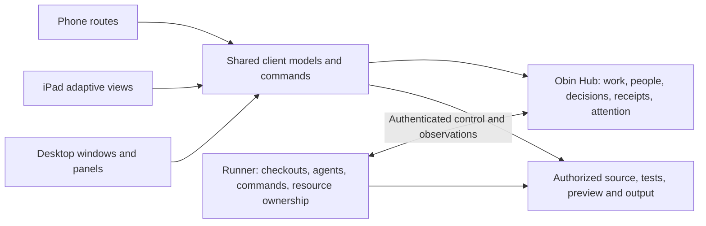

# Development across phone, iPad and desktop

Status: proposed experience and integration contract, 2026-11-09, based on the
user's clarified goal. The phone development journey is required; details below
are implementation proposals to validate. This document does not claim an Obin
Hub API or mobile app already exists. See the [audit](audits/2026-11-09/README.md).

## The outcome

From a phone, start or continue a real development task, direct agents, answer
questions, inspect changes and tests, try the application, request revisions and
approve delivery. Return on an iPad or desktop to the same work without copying
context. The laptop may be closed because execution runs on an available remote
Runner. An offline Runner is shown as offline; execution is not silently migrated.

Phone development includes directing implementation, reviewing and making focused
edits. It must not become only a status dashboard or an Approve button. A full
desktop IDE squeezed into a phone would also miss the goal.

## One product model, different compositions

| Concept | Meaning | Not its identity |
| --- | --- | --- |
| Work | Objective, decisions, tasks, results and integration history, canonical in the Hub. | A chat or PR count. |
| Workspace | The working context: repositories and related conversations/assignments. | A filesystem path or window. |
| Runner workspace instance | Concrete checkouts and services on a specific Runner. | A portable canonical work record. |
| Assignment | Scoped responsibility and authority given to an agent role. | One process or one turn. |
| Agent | Durable identity and versioned role/model/budget policy owned by the Hub, composed with Robin and Runtime. | A PID or a selected model name. |
| Attempt | A particular provider/model/account process executing an assignment. | The durable lifetime of the work. |
| Result | Versioned source vector and verifiable artifacts submitted for review. | An agent's claim that it finished. |
| Attention item | A durable question, approval, failure or review needing a person. | A transient toast or OS notification. |

Use stable work references and `{runnerId, workspaceId}` execution references.
Do not assume a local Collection ID, file path or native provider thread ID is a
globally portable identity. Existing tracker references attach to the same work;
avoid creating a second authoritative task beside a Hub record.

The [implementation plan](IMPLEMENTATION_ROADMAP.md) maps these concepts onto
existing Codefly and Obin owners. The Hub owns agent orchestration; Runner owns
the resulting attempts. A client can disappear without ending either identity.

## Phone: a focused development flow

Primary destinations: **Inbox**, **Work**, and **Settings**. Inbox contains things
that need the person's attention, not a feed of every tool invocation. Running
work is visible in Work and in a compact summary. Badge counts come from durable
unresolved items, not accumulated push messages.

1. **Start work.** Search all accessible repository identities, select one or
   more, describe the objective, and start. A named execution policy supplies
   Runner/account/model defaults; show the resolved agent and location before
   dispatch. Offer explicit coordination for complex work. Repository preparation
   has durable progress/error state; leaving the screen does not cancel it.
2. **Work detail.** One compact header gives name, repository summary and current
   outcome/status. The primary body switches between Conversation, Tasks and
   Changes; Preview and Files are direct actions where available. Do not stack
   the desktop sidebar, workspace bar, conversation heading and agent card.
3. **Answer a question.** Show the question, why it blocks work, affected task,
   choices and free text. Persist the decision and receipt. A native pending
   request is a delivery target, not the sole record of the decision. If the
   process died, save the decision to work and show that delivery is pending;
   never send an old native request ID to a new attempt.
4. **Review a result.** Show changed repositories/files, exact base → result,
   tests and their provenance, unresolved findings and preview availability.
   Default to unified per-file diffs with contextual expansion. Allow comments
   anchored to result/file/line, “Request changes”, and a deliberate integration
   action. Approving one revision never approves a newer revision implicitly.
5. **Edit or investigate.** Navigate Files, open syntax-highlighted source, edit
   a focused range, and save with a version precondition. A stale save presents
   a conflict. Ask the agent to perform larger edits. Offer a scoped terminal
   when implemented, without pretending the current output viewer is one.
6. **Leave and return.** Closing the app detaches the viewer. Opening from Inbox
   or a notification fetches authoritative state and shows what changed. Preserve
   local drafts and useful reading position; never require replaying the entire
   transcript before answering a question or reviewing a result.

The composer stays above the software keyboard and safe area. Use full-screen
routes or purpose-built sheets for substantial tasks. No hover-only controls,
right-click dependencies, draggable desktop dialogs or raw configuration forms
on the main phone path. Destructive actions state concrete affected work and
resources. Normal deletion does not require typing a name.

## iPad: investigation and review beside the work

The same routes compose into list/detail at sufficient width. Work detail can
pair conversation with diff, file or preview. In a narrow multitasking window,
collapse back to phone-style navigation while preserving the selected work and
draft. Do not infer available width solely from “iPad”. Support touch and optional
keyboard/pointer; keyboard shortcuts are discoverable enhancements.

Use screen space for comparing evidence and discussing it, not permanently
displaying every session. A portrait iPad and a wide landscape iPad should not
have identical fixed columns. A review annotation must remain meaningful if the
receiving agent is on another device and the preview has stopped.

## Desktop and multiple displays: parallel views of the same work

Keep workspace windows and independent panes for conversation, tasks, changes,
preview, files and command output. A second screen may follow one work item while
the primary window navigates elsewhere. Keep shortcuts/snippets and window
placement local. Rename, agent continuation or updates to shared work must not
remount unrelated views.

Remove redundant navigation and competing “new” actions. One workspace action
creates work; additional conversations are workspace-scoped. Single-conversation
workspaces open directly, while multi-conversation workspaces expose the agents
without changing the durable workspace identity. Retain explicit “Open on this
device” handoff; do not synchronize every tab selection across devices.

## Proposed architecture boundary

The diagram specifies ownership, not an already selected proxy topology.
Authorized artifact/preview access may use a Hub route or a scoped Runner route;
validate reachability and origin isolation before selecting it. Agents' provider
credentials stay on the execution side. Phones do not receive Runner-owner or
provider credentials.

**Hub owns:** canonical work/decisions/assignments, actor authorization, command
receipts, attention delivery state, device continuity, external integration
intent/outcome and artifact references. Its implementation belongs in Obin.

**Runner owns:** local execution acceptance/journal, attempt process/resource
ownership, checkout admission, command/output capture, source/test artifacts,
provider adapters and observations. It reconciles actual resources after restart.
It must not independently claim a second canonical task state.

**Client core owns:** typed queries and commands, normalized work/attempt/result
models, cached read snapshots, pending command receipts, reconnect/replay handling
and derived view models. This is shared across React DOM and React Native.

**Host/UI owns:** navigation, safe areas/keyboard, local drafts/cache, window and
display placement, notification registration, file picking and accessible
rendering. Retain the existing host seam, but separate window operations from
portable capabilities instead of making a phone pretend it has desktop windows.

The staged local workflow store can supply useful transition/receipt mechanics
and a test implementation. Before shipping shared mode, define its mapping to
Hub records and migrate deliberately. Do not synchronize two independently
authoritative boards by periodically overwriting snapshots.

## Minimum Hub–Runner–client contract to settle with Obin

These are required semantics, not invented endpoint names:

| Contract | Required behavior |
| --- | --- |
| Identity | Human/device, Runner and agent-attempt principals are distinct; scoped grants, revocation and author attribution. |
| Command | Stable command ID, target, expected revision, authenticated actor and payload. Durable accepted/rejected receipt; reconnect recovers the same result. |
| Assignment | Work/task, role policy version, dependency result references, decision version, repository scope, limits and ownership epoch. Stale authority cannot publish. |
| Attention | Durable question/review/failure ID, affected work, current revision, recipient and resolution. Competing answers get one winner and a visible stale outcome. |
| Events | Ordered cursor per defined stream, retention contract, bounded catch-up and snapshot replacement after a gap. Separate control from verbose output. |
| Result | Per-repository base/result revisions, test run receipts, artifact availability, findings and acceptance/integration state. |
| Resource | Attempt-owned process/container/service handles, last observations and reconciled terminal/uncertain state. |
| Handoff | Durable work/result/attention reference and optional reading anchor; no bearer token or local path in the deep link. |
| Preview | Authorized origin-isolated route, assets/navigation/WebSockets, source revision and lifecycle. Saved screenshots remain accessible independently. |

The current broad Runner token is not an acceptable phone enrollment protocol.
An outward Runner control connection is a candidate for NAT-friendly deployment,
not a substitute for identity, encrypted transport and authorization. Decide the
actual route with Obin and test it on the supported topology.

## Offline and background behavior

Cache enough work summary, questions, result metadata and selected artifacts for
useful reading. Display last synchronization time and stale state. Draft edits and
messages can be retained locally. Integration, approval and destructive commands
require current authority and version validation; do not silently queue them for
later execution against changed work. Show sending/accepted/delivery-pending/
rejected separately.

Push is an optional wake-up signal for a durable Inbox item. Revalidate when
opened; duplicates, dropped pushes and a terminated app must not lose work.
Never require a phone background stream to keep the workflow alive. Real iOS
build/device tests must cover lifecycle and notification behavior; desktop
WebKit emulation establishes only layout and browser interaction evidence.

## Role configuration and useful progress

Persist named coordinator/implementer/reviewer policies with provider, model,
supported effort, account pool, tool scope and budgets. Record requested and
observed configuration per attempt; reject unsupported combinations visibly.
Start with explicit choices rather than automatic model routing.

Show “examining files”, “running tests”, “waiting for your answer”, “review ready”,
“Runner offline” or “integration uncertain” with source and timestamp. Tool detail
is expandable. Use measured preparation progress or honest indeterminate stages;
never fabricate an overall percentage for open-ended agent work. Keep token cost,
subscription allowance and billed spend distinct.

## Acceptance journey

1. On a phone, select two accessible repositories and start a bounded change on
   an always-on Runner using a saved policy. No desktop prerequisite for this task.
2. Close the app and laptop. Work continues. An actual native agent question
   creates durable attention; foreground catch-up works even if push is dropped.
3. Open on iPad, read the relevant context and answer. A simultaneous answer from
   the phone is rejected as stale; the accepted decision survives Hub restart.
4. Worker submits a versioned result with tests. On the phone, inspect committed
   diffs and a working preview. Request a revision; old review remains visible.
5. Review the new result and integrate explicitly. Drop the response after one
   repository integrates; reconnect shows the real partial outcome without
   repeating publication or claiming the second repository merged.
6. Open the same work on a laptop and second display. Existing conversation,
   decisions, source/test evidence and cost remain available. Layouts stay local.
7. Kill a worker/Runner at controlled boundaries. Owned resources are reclaimed
   or explicitly unresolved, work remains discoverable, stale owners cannot act,
   and no duplicate attempt starts after reconnect.

For the first release, one human, one remote Runner, sequential writing and
independent review are enough. Two-device correctness is required even with one
human. Add isolated parallel writers after this journey passes and measurements
show benefit.

Layout validation covers phone widths 320/390/430, keyboard-visible composition,
large text, touch targets, iPad narrow/wide multitasking, laptop and multi-display
restoration. These widths are test cases, not hardcoded device categories.

Apple's [adaptive layout guidance](https://developer.apple.com/design/human-interface-guidelines/layout)
supports size-aware composition. Expo's [notification lifecycle documentation](https://docs.expo.dev/push-notifications/what-you-need-to-know/)
informs foreground/background/terminated test cases. Framework selection alone
does not establish those guarantees.
