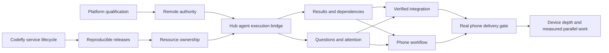

# Development from any device: implementation roadmap

Authoritative package plan, 2026-11-09. Read with [device experience](DEVICE_EXPERIENCE.md)
and the [source-backed audit](audits/2026-11-09/README.md). This expands R0–R4
in [ROADMAP.md](ROADMAP.md); older milestone lists are historical inventory.

## Outcome and release boundary

From an iPhone, create work against two repositories, ask an agent to implement
it, answer a question, inspect exact changes and test evidence, request a
revision, and approve integration. Close every client while the work continues
on an always-on Runner. Reopen on an iPad or laptop without losing decisions,
drafts, progress or the conversation. Uncertain publication must be reconciled,
not repeated. A closed laptop is not an always-on Runner.

The first release supports one person, two devices, one remote Runner, Claude
and Codex, sequential writing and independent review. It establishes explicit
model/effort/budget policy and durable coordination before adding parallelism.
It must deliver real changes, not only demonstrate chat, a board or a task graph.

## Owners and reuse

**The Hub is responsible for agents.** It owns their durable identities, roles,
assignments, model policies, budgets, decisions and recovery intent. A Runner
owns concrete execution attempts, provider processes, working copies, resource
admission and cleanup. Clients own presentation and local interaction state.

The Hub is an **Obin platform V2 solution** composed through supported module and
host contracts. No second Hub database, scheduler, approval authority or agent
registry is to be implemented inside Lazybox.

| Responsibility | Owner / reuse | Lazybox work and qualification boundary |
| --- | --- | --- |
| Services, generated transport, endpoint resolution, health, dev reload | Codefly go-grpc service agent and SDK | Keep application logic in the existing hooks. Generate contracts through Codefly. Resolve ports; do not add another HTTP server or watcher. |
| Long-lived local service supervision | Codefly `service` / native OS supervisor | Materialize the selected Runner release as public configuration. Attach clients independently. Per-attempt cleanup is a separate obligation. |
| Agent/conversation domain | Obin Robin, composed by Hub | Qualify external Claude/Codex execution as a supported backend. Native provider history stays provider-specific; do not run a second model loop inside it. |
| Durable execution, progress, typed input/approval, cancellation, recovery | Obin Runtime `TaskService` | Use published clients and installed operation contracts. Map assignment/attempt results and native questions into these semantics. Do not copy its state machine into Runner SQLite. |
| Identity, permission checks, delegated authority, notifications | Obin host contracts, including SaaS starter composition | Distinct human, Hub, Runner and attempt principals. Call modules through the host gateway. Do not infer that a bearer owner can approve everything. |
| Work objectives, repository references, result revisions, integration policy | Hub solution using platform storage/reference contracts | Domain composition; existing issue/PR references belong to the same work identity. Durable provider effects have receipts. |
| Native execution and workspace resources | Lazybox Runner | Reuse agent adapters, workspace management and account stores. Add scoped admission, fencing, process ownership and immutable evidence. |
| Model traffic and accounting | Existing model gateway, tracing and Runner provider observations | Qualify which requests are actually captured. Dedupe observations and identify estimates/unknown spend. Do not claim subscription charges equal token cost. |
| Web/native UI and mobile | Lazybox shared client models, desktop/web, Expo phone/tablet | Share commands, entities and protocol reducers; compose device-specific screens. No DOM-only dependency in the portable model. |

Inspected evidence (capabilities still require integration tests):

- Codefly CLI checkout `1369ac4b69ba88b7e5c8e3292582780d7b5b4a5f`:
  `cmd/service.go`, `pkg/control/service_installation.go`, `pkg/localservice`.
  The installed executable reports `development`, so it is **not** a pinned
  distribution qualified by that source SHA. Read-only `service status --json`
  succeeded against an unused label. The new adapter fingerprints its executable.
- Lazybox uses Codefly go-grpc service agent `0.1.69`, SDK Go `0.4.0`, and the
  core version pinned in `go.mod`. Generated transport already exists.
- Runtime checkout `dedd4b10bdab44abcf7b578b20ddf63281d28344`:
  published `clients/go`, `modules/runtime/services/tasks/proto`, implementation
  and qualification directories. The API includes `StartTask`/`RecoverTask`,
  `WatchTask`, revision/action-digest-bound `RespondToInteraction`, cancellation,
  command recovery, operation attempts and effect receipts.
- Handbook `modules/runtime.md` and `modules/robin.md` establish ownership.
  Robin's chat proto establishes conversation APIs, **not proof of an external
  native-agent backend**. Older handbook contract statements are not evidence
  that every behavior has shipped. P00 qualifies the exact versions we consume.

## Delivery packages

Statuses mean: **planned**, **implemented / fixture-verified**, **live-qualified**,
or **released**. A fixture passing never advances a real-device or live-platform
gate. Packages are reviewable changes; their IDs are not filed tracker records.

| Package | Owner | Depends on | Deliverable and exit gate | Status |
| --- | --- | --- | --- | --- |
| P00 Platform qualification | Obin/Codefly owners + Lazybox integration | — | Pin distributions, qualify Runtime interactions/recovery and Robin external execution; publish capability/contract matrix and executable integration fixture. Missing capability is fixed in its owning repo. | Planned; local inspection recorded above |
| P01 Independent Runner service | Lazybox tooling → Codefly service | Existing frozen releases | Install/start/stop/status/uninstall selected Working Runner; attach desktop without lifecycle ownership. Exact release/config checks; no credential copying. Verify actual supervisor and disconnect behavior before admission. | macOS native lifecycle and independent HTTP readers qualified in isolation; actual native client lifecycle remains |
| P02 Reproducible release and shared gate catalog | Lazybox tooling + Codefly build/package | P01 | One required-test catalog drives CI/staging. Include continuity, scroll, navigation, sidebar and all new mobile/authority/recovery tests. Package Linux headless Runner; pin toolchain and artifact digests. Promotion cannot omit a gate or silently restart work. | The earlier 25-gate frozen candidate passed; responsive-shell coverage now makes 26 required gates, with all 24 UI gates passing on the polish increment. CI provisioning, Linux packaging and toolchain pinning remain |
| P03 Resource ownership and crash recovery | Runner + Codefly lifecycle owner | P01, P02 | Register every process/container/PTY/port/worktree by attempt; hard admission caps; cancel and reap. SIGKILL parent, escaped child, reboot, container exit and failed cleanup have deterministic outcomes and no cross-attempt kill. | Shared process-group guard and configurable admission implemented; durable inventory, escaped children, containers/PTYs and reboot remain |
| P04 Remote identity and scoped authority | Obin host + Runner | P00 | Enroll/revoke Runner; human UI and agent tool permissions separate on every transport. Public RPC cannot impersonate a human by setting a request field. No local owner token in agent context or phone. Audit F1 becomes a passing regression. | Planned |
| P05 Hub agents and execution bridge | Hub/Robin/Runtime + Runner adapter | P00, P03, P04 | Durable agent role and assignment map to a fenced Runner attempt and native conversation. Idempotent dispatch/recovery; ordered progress; explicit uncertainty. Hub restart loses no assignment; duplicate delivery starts one attempt. | Planned |
| P06 Results and dependency correctness | Hub + Runner Git/evidence | P05 | Immutable per-repository base/result SHAs, artifacts and test receipts. Dependency dispatch verifies accepted source vector, not `done`. Audit's reset-HEAD probe passes. Snapshot review stays stable while working copies change. | Planned |
| P07 Durable questions and attention | Hub Runtime/host + shared client | P04, P05 | Typed questions/approvals with revisions, expiry, action digest and delivery receipt. Two devices race safely; offline draft is distinct from accepted answer. Native request gone: decision survives, delivery state remains explicit. | Planned |
| P08 Phone development vertical slice | Expo phone + shared client + Hub | P05, P06, P07 | Inbox → Work → conversation/tasks/changes → question → revision → integration on a real iPhone, remote Runner, laptop closed. Persist drafts and reading position. Complete an actual two-repository change. | Planned |
| P09 Verified integration and preview | Hub effect owner + Runner + clients | P06, P07; exercised during P08 | Exact revision approval, branch/precondition checks, preview access control, test policy, publication receipts. Lost acknowledgement and partial two-repository integration reconcile without double publication or falsely claiming atomicity. | Planned |
| P10 Tablet/desktop continuity | Expo tablet + desktop/web/shared client | P07; alongside P08 | Adaptive list/detail, chat beside evidence, multi-window restoration, single-conversation workspace compactness. Rename, focus switching and send never remount/reload chat. Actual iPad and desktop handoff gate. | Responsive web/native shell, modal phone navigation and retained chat/draft/reader checks implemented; physical-device and Hub handoff remain |
| P11 Development tools and ergonomics | Runner + client compositions | P06, P08 | File/editor optimistic concurrency, explicit diff baseline, safe local links, scoped shell, snippets and configurable hierarchical/vim/tmux navigation. Mobile routes and desktop panels share commands, not cramped layouts. | Planned |
| P12 Cost, context and bounded parallelism | Hub policy + gateway + Runner | P03, P05, P06, P09 | Per-role provider/model/effort and account policy, budget reservation, cost series and provenance; isolated assignments and conflict-aware integration. Parallel mode must improve measured outcomes over sequential baseline. | Planned |

P03 and P04 are release blockers, not polish to follow a mobile launch. P08 UX
prototypes start against fixtures immediately; release requires the real P05–P09
journey. P10 layout testing runs throughout, not after phone implementation.

P03 must settle the failure behind stranded agents: a surviving process cannot
depend on a vanished ephemeral gateway address. Use Codefly endpoint resolution
and explicit connection generations; resume only a proven compatible session,
otherwise terminate owned resources and record a recoverable interrupted attempt.
Reconciliation requires durable ownership evidence, not PID/name matching. Limits
must have unambiguous semantics: an unspecified or zero limit must not accidentally
mean unlimited agents. Admission, cleanup retries and unresolved resource counts
are observable to the operator even while the general monitoring tab stays hidden.

## P01: implemented foundation and limits

`scripts/runner-command.mjs` is the shared Codefly invocation contract for
terminal and native-service launchers. `scripts/runner-service.mjs` materializes
public service configuration and delegates lifecycle to Codefly. It validates
the frozen release, compiled worker and executable, separates native process
state from authenticated Runner readiness, and blocks changing a running
installation. The terminal launcher rejects a managed Working environment.

There is no new supervisor or Hub. Automatic restart and login start are
disabled until P03 qualifies cleanup. Closing an attached desktop invokes no
service stop. Installation does not start the service. [Commands](ENVIRONMENTS.md#codefly-managed-working-runner)
make each transition explicit. The existing terminal Dev workflow remains.

The current release format contains a macOS desktop app and still needs the
installed build/provider toolchain. Linux packaging, remote enrollment, native
crash recovery, phone connectivity, live inference and service upgrade during
work are **not** delivered by P01. Only an isolated qualification service was
installed, started and removed; the user's Runner was not restarted. Fixture tests cover public argv, private config
preservation, release/worker changes, conflicting launchers, lifecycle delegation,
cleanup command availability and independent client lifetime.

P01 native install/start/stop/uninstall, authenticated readiness, independent HTTP
readers, port release and state preservation passed two isolated cycles. Next:
actual desktop attach/close/reopen, live provider lifecycle and upgrade during
work. Repeat on Linux after P02 packaging. Do not test destructive recovery
against the user's active work.

## P02: release-validation foundation and limits

P02's first increment is documented in [release validation](RELEASE_GATES.md).
It also exposed an actual detached-chat Enter-key bug: keyboard ownership now
belongs to the window host, independently of whether its chat looks embedded.
The existing attachment fixture covers standalone, detached and workspace chat.
The [initial evidence](audits/2026-11-09/RELEASE_GATES.md) records clean-build fixes
and the original macOS watcher failure. The subsequent configured-backend gate
passed with the explicit compatibility stopgap in [release validation](RELEASE_GATES.md).
This does not complete P02 or admit remote execution. P03's current boundary is
documented in [resource ownership](RESOURCE_OWNERSHIP.md).

## Agent and orchestration contract

1. A durable Hub agent identity has a versioned role/policy; a model is a selected
   execution property, not the identity. Record provider, requested and resolved
   model, effort, account reference, permissions and cost limits on each attempt.
2. Work owns the objective, decisions, assignments and result revisions. Runtime
   owns durable execution/interaction mechanics. Robin owns agent/conversation
   mechanics. Runner local history is a recoverable execution projection, not
   the cross-device source of truth for work.
3. Hub dispatches through scoped authority and an idempotency identity. Runner
   durably admits an attempt before spawning it. A recovery query resolves a lost
   acknowledgement; neither side guesses that a timeout means no process exists.
4. An attempt carries an authority generation and dependency/source vector.
   Reassignment fences stale writers and publishers. Lost connectivity does not
   authorize new external effects; pre-authorized local work follows an explicit
   offline policy. Admission limits exist even if orchestration is misconfigured.
5. Native Claude/Codex sessions may be resumed only when the provider supports it
   and workspace/account/model constraints hold. Work survives when a native
   session does not. A new attempt reads durable decisions and approved context;
   it does not impersonate an old process or replay effects blindly.
6. “Coordinate this work” selects an explicit orchestration intent and named
   policy. It creates a plan with owned assignments, dependencies and acceptance
   conditions. Ambiguous “sync” is clarified; it must not silently mean Git pull.
   Start with planner → writer → independent reviewer → integration. The board
   and dependency view project the same durable records; no second task system.
7. Agent tools expose narrow capabilities: list accessible repositories, add a
   repository to this workspace, request coordination, propose/update assigned
   work, submit evidence, ask a question. A prompt is guidance; authorization
   is enforced by the receiving service. Native arbitrary shell permissions do
   not confer human approval authority.

## UX work, grouped by user outcome

- **Start quickly:** one repository catalog, sorted/filterable by organization,
  sources deduplicated by repository identity, paginated access discovery and
  visible connection failures. GitHub App installation is optional. Pick a repo
  and start; add more within the named workspace. Defaults follow selection until
  manually edited. Display name changes never change its stable disk slug.
- **Understand current work:** compact workspace identity/repository summary,
  agent and resolved model visible, truthful working/waiting/disconnected state.
  One conversation can be the workspace's primary view; multiple sessions stay
  available without mandatory nesting or duplicate headings.
- **Trust continuity:** preserve conversation DOM/state, drafts, tool expansion
  and scroll through rename/focus/stream updates. Jump to the real latest message.
  Persist new messages before execution; reconnect using durable cursors and
  explicit gaps. “Starting”, “thinking” and “compacting” require actual signals.
- **Inspect useful activity:** concise tool purpose, duration, status and important
  result; details on demand. Provider capability matrix states missing telemetry.
  Context category drilldown distinguishes measured, estimated, deferred and
  unavailable values. Redacted recordings replay Claude and Codex paths headlessly.
- **Review/change code:** explicit working tree / staged / branch comparison with
  named base and immutable result review. Syntax highlighting, Markdown/Mermaid,
  correct file links, editor conflicts and previews. Phone uses focused routes;
  desktop uses resizable panels. No tiny content-trapping modal.
- **Manage lifecycle:** obvious workspace/session actions, contextual rename,
  normal confirmation and concrete running/dirty resource impact. Distinguish
  delete conversation, cancel attempt, remove checkout and archive work. No
  silent source loss and no typed-name ritual for ordinary actions.
- **Work efficiently:** V1 snippet semantics reused through its adapter; searchable
  manager, scopes and insertion preview. Central action catalog drives menus,
  right-click and configurable shortcuts, including `]]` escape and navigation
  presets. Touch actions remain available without a keyboard.

Design tokens, typography, spacing, contrast, focus, density and component states
are shared. Layout composition differs by available width and input method.
Validate phone safe areas/keyboard, iPad split view and large text as first-class
cases. Every UX change has an explicit task to improve, not a decorative panel.

## Evidence and operating gates

Use four layers: pure contract/state tests; real transport with isolated local
resources; redacted provider recording/replay and browser/device fixtures; live
Obin + remote Runner + native provider + real-device qualification. Faults are
injected at admission, spawn, acknowledgement, question answer, artifact upload,
cancel and integration boundaries. Assertions cover both visible state and
absence of duplicate effects/leaked resources.

Record the release/contract/provider versions, exact revisions, test commands,
artifacts and unverified paths. Existing audit probes remain failing evidence
until fixed at the owning boundary. Do not erase a failing probe to admit a build.
Staged coordination code is reviewed selectively; all 44 files are not an
approved implementation merely because they exist.

Release scorecard: phone-completed and integrated work; stale approvals accepted
(zero); duplicate starts/publications (zero); unexplained resource leaks (zero);
recovery time; manual context copying; actionable versus noisy attention; time
and API-equivalent cost per accepted result; coverage of priced observations;
phone/tablet/desktop task completion and accessibility. Establish the sequential
baseline before claiming benefit from more agents.

Keep the monitoring tab, read-aloud, marketplace, elaborate DAG editor and
autonomous routing deferred. The dependency graph is useful when dependencies
exist; a board does not itself provide orchestration or recovery.
